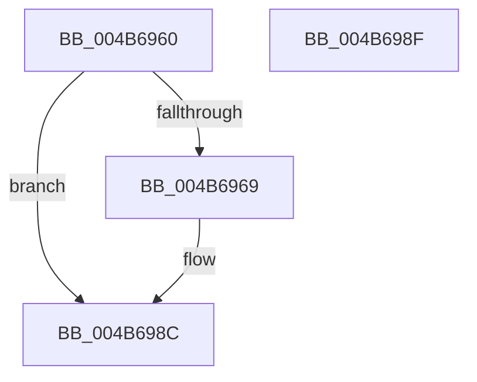

# PpmCheckMaintainArtificialDomain

- RVA: `0x004B6960`–`0x004B6990` (길이 `48` bytes)
- VA: `0x00000001404B6960`
- 실행 섹션: `.text`
- PDB 이름 있음: `예`; PDB Function 태그: `아니요`
- unwind 정보 RVA: `0x000DB714`
- 디코드: `10`개 명령, `48/48` bytes 표시
- 미해석 바이트: `0` (있으면 어셈블리에 `.byte`로 보존)

> 이 문서는 커널 이미지의 기계어와 PDB 기호를 분석해 생성했습니다. 4번과 5번은 함수 원형과 자료형을 바이너리 사용 방식에서 추정한 C 해석이며 원본 소스 복구 결과는 아닙니다.

## 1. Dependencies

- 직접 호출 지점: **0**; 고유 호출 대상: **0**
- 직접 호출자로 확인된 함수: **0**
- RIP 상대 이미지 참조: **5**

### Outgoing calls
- 직접 디코드된 call 명령이 없습니다.

### Direct callers
- 이 함수 시작 RVA로 연결되는 직접 call은 확인되지 않았습니다. 간접 호출은 완전히 역산할 수 없습니다.

### Static image references
- `0x004B6960` → RVA `0x00FC6CD4` (`ALMOSTRO`; read)
- `0x004B6969` → RVA `0x00F0B400` (`.data`; read)
- `0x004B6970` → RVA `0x00F0B3F0` (`.data`; read/write)
- `0x004B6977` → RVA `0x00F0B244` (`.data`; write)
- `0x004B6985` → RVA `0x00F0B3F8` (`.data`; write)

## 2. Other-region calls and transfers

- 다른 실행 섹션으로 향하는 call: **0**
- 별도 외부 분기/꼬리 이동을 확인하지 못했습니다.

## 3. Assembly (complete function range)

```asm
004B6960  83 3D 6D 03 B1 00 00            cmp dword ptr [rip + 0xb1036d], 0
004B6967  74 23                           je 0x1404b698c
004B6969  48 8B 0D 90 4A A5 00            mov rcx, qword ptr [rip + 0xa54a90]
004B6970  83 25 79 4A A5 00 00            and dword ptr [rip + 0xa54a79], 0
004B6977  C7 05 C3 48 A5 00 01 00 00 00   mov dword ptr [rip + 0xa548c3], 1
004B6981  48 8B 51 08                     mov rdx, qword ptr [rcx + 8]
004B6985  48 89 15 6C 4A A5 00            mov qword ptr [rip + 0xa54a6c], rdx
004B698C  B0 01                           mov al, 1
004B698E  C3                              ret
004B698F  CC                              int3
```

## 4. C-style interpretation (structured pseudocode)

```c
__int64 __fastcall PpmCheckMaintainArtificialDomain(void)
{
    if ((*(unsigned int *)(v_rip + 11600749)) != 0) {
        a1 = *(unsigned __int64 *)(v_rip + 10832528);
        *(unsigned int *)(v_rip + 10832067) = 1;
        a2 = *(unsigned __int64 *)(a1 + 8);
        *(unsigned __int64 *)(v_rip + 10832492) = a2;
    }
    return 1;
}
```

## 5. (Beta) C Style

```c
void PpmCheckMaintainArtificialDomain(void)
{
    if ((*(uint32_t *)(v_rip + 0xB1036D)) != 0) {
        a1 = *(uint64_t *)(v_rip + 0xA54A90);
        *(uint32_t *)(v_rip + 0xA548C3) = 1;
        a2 = *(uint64_t *)(a1 + 0x8);
        *(uint64_t *)(v_rip + 0xA54A6C) = a2;
    }
    return 1;
}
```

## 6. Execution-region graph

[열기: 2D/3D 그래프와 함수 탐색 컨트롤 패널](../../../control-panel.html?section=text&rva=0x004B6960&view=graph)

- 2D 그래프는 위에서 아래로 흐르고, 3D 그래프는 빈 공간을 드래그해 회전합니다. Shift+드래그는 이동, 휠은 확대·축소, 함수 노드 선택은 대상 보고서 이동입니다.

### Static fallback


