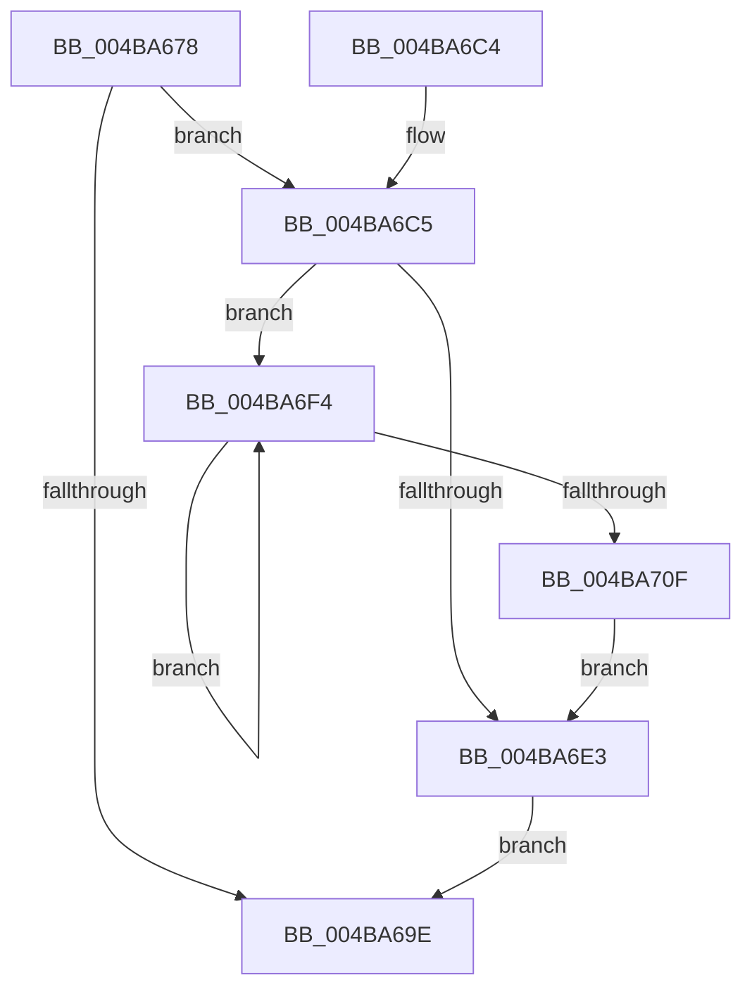

# PpmDisableHighPerfRequestDeferredExpiration

- RVA: `0x004BA678`–`0x004BA711` (길이 `153` bytes)
- VA: `0x00000001404BA678`
- 실행 섹션: `.text`
- PDB 이름 있음: `예`; PDB Function 태그: `아니요`
- unwind 정보 RVA: `0x0006F318`
- 디코드: `36`개 명령, `153/153` bytes 표시
- 미해석 바이트: `0` (있으면 어셈블리에 `.byte`로 보존)

> 이 문서는 커널 이미지의 기계어와 PDB 기호를 분석해 생성했습니다. 4번과 5번은 함수 원형과 자료형을 바이너리 사용 방식에서 추정한 C 해석이며 원본 소스 복구 결과는 아닙니다.

## 1. Dependencies

- 직접 호출 지점: **4**; 고유 호출 대상: **4**
- 직접 호출자로 확인된 함수: **2**
- RIP 상대 이미지 참조: **7**

### Outgoing calls
- `0x004BA691` → [KeAcquireSpinLockRaiseToDpc](../20/KeAcquireSpinLockRaiseToDpc_function_00208470.md) (function, `0x00208470`)
- `0x004BA6AF` → [KeReleaseSpinLock](../39/KeReleaseSpinLock_function_00392BA0.md) (function, `0x00392BA0`)
- `0x004BA6CC` → [KeCancelTimer](../23/KeCancelTimer_function_002327E0.md) (function, `0x002327E0`)
- `0x004BA700` → [PopPowerRequestReferenceRelease](../47/PopPowerRequestReferenceRelease_function_004775B0.md) (function, `0x004775B0`)

### Direct callers
- [PdcPoPerfOverride](../../page/98/PdcPoPerfOverride_function_00989D34.md) at `0x00989D3F`
- [PopPdcIdleResiliencyCallback](../../page/A3/PopPdcIdleResiliencyCallback_function_00A31518.md) at `0x00A315DC`
- [PopPdcIdleResiliencyCallback](../../page/A3/PopPdcIdleResiliencyCallback_function_00A31518.md) at `0x00A3162E`

### Static image references
- `0x004BA68A` → RVA `0x00F0CFA0` (`.data`; read)
- `0x004BA6A1` → RVA `0x00F0C8CC` (`.data`; write)
- `0x004BA6C5` → RVA `0x00F0CF20` (`.data`; read)
- `0x004BA6D1` → RVA `0x00F0C8B8` (`.data`; read/write)
- `0x004BA6DB` → RVA `0x00F0C8C0` (`.data`; read)
- `0x004BA6E3` → RVA `0x00F0C8C0` (`.data`; read/write)
- `0x004BA6F4` → RVA `0x00F0CFB8` (`.data`; read)

## 2. Other-region calls and transfers

- 다른 실행 섹션으로 향하는 call: **0**
- 별도 외부 분기/꼬리 이동을 확인하지 못했습니다.

## 3. Assembly (complete function range)

```asm
004BA678  48 89 5C 24 08                  mov qword ptr [rsp + 8], rbx
004BA67D  48 89 74 24 10                  mov qword ptr [rsp + 0x10], rsi
004BA682  57                              push rdi
004BA683  48 83 EC 20                     sub rsp, 0x20
004BA687  40 8A F9                        mov dil, cl
004BA68A  48 8D 0D 0F 29 A5 00            lea rcx, [rip + 0xa5290f]
004BA691  E8 DA DD D4 FF                  call 0x140208470
004BA696  40 8A F0                        mov sil, al
004BA699  40 84 FF                        test dil, dil
004BA69C  75 27                           jne 0x1404ba6c5
004BA69E  40 8A D6                        mov dl, sil
004BA6A1  40 88 3D 24 22 A5 00            mov byte ptr [rip + 0xa52224], dil
004BA6A8  48 8D 0D F1 28 A5 00            lea rcx, [rip + 0xa528f1]
004BA6AF  E8 EC 84 ED FF                  call 0x140392ba0
004BA6B4  48 8B 5C 24 30                  mov rbx, qword ptr [rsp + 0x30]
004BA6B9  48 8B 74 24 38                  mov rsi, qword ptr [rsp + 0x38]
004BA6BE  48 83 C4 20                     add rsp, 0x20
004BA6C2  5F                              pop rdi
004BA6C3  C3                              ret
004BA6C4  CC                              int3
004BA6C5  48 8D 0D 54 28 A5 00            lea rcx, [rip + 0xa52854]
004BA6CC  E8 0F 81 D7 FF                  call 0x1402327e0
004BA6D1  48 83 25 DF 21 A5 00 00         and qword ptr [rip + 0xa521df], 0
004BA6D9  33 DB                           xor ebx, ebx
004BA6DB  39 1D DF 21 A5 00               cmp dword ptr [rip + 0xa521df], ebx
004BA6E1  77 11                           ja 0x1404ba6f4
004BA6E3  83 25 D6 21 A5 00 00            and dword ptr [rip + 0xa521d6], 0
004BA6EA  48 83 25 C6 21 A5 00 00         and qword ptr [rip + 0xa521c6], 0
004BA6F2  EB AA                           jmp 0x1404ba69e
004BA6F4  48 8B 0D BD 28 A5 00            mov rcx, qword ptr [rip + 0xa528bd]
004BA6FB  BA 04 00 00 00                  mov edx, 4
004BA700  E8 AB CE FB FF                  call 0x1404775b0
004BA705  FF C3                           inc ebx
004BA707  3B 1D B3 21 A5 00               cmp ebx, dword ptr [rip + 0xa521b3]
004BA70D  72 E5                           jb 0x1404ba6f4
004BA70F  EB D2                           jmp 0x1404ba6e3
```

## 4. C-style interpretation (structured pseudocode)

```c
__int64 __fastcall PpmDisableHighPerfRequestDeferredExpiration(unsigned __int8 a1)
{
    __int64 result;
    __int64 v_rbx;
    __int64 v_rsp;
    unsigned __int64 v_stack_p10;
    unsigned __int64 v_stack_p8;

    v_stack_p8 = v_rbx;
    v_stack_p10 = v_rsi;
    v_rsp = (v_rsp) - (32);
    result = KeAcquireSpinLockRaiseToDpc(v_rip + 10823951, a2, a3, a4);
    if (a1 != 0) goto loc_004BA6C5;
loc_004BA69E:
    *(unsigned __int8 *)(v_rip + 10822180) = a1;
    result = KeReleaseSpinLock(v_rip + 10823921, (unsigned __int8)((unsigned __int8)(result)), a3, a4);
    v_rsp = (v_rsp) + (32);
    return result;
loc_004BA6C5:
    result = KeCancelTimer(v_rip + 10823764, (unsigned __int8)((unsigned __int8)(result)), a3, a4);
    v_rbx = 0;
    if ((*(unsigned int *)(v_rip + 10822111)) > 0) goto loc_004BA6F4;
loc_004BA6E3:
    goto loc_004BA69E;
loc_004BA6F4:
    result = PopPowerRequestReferenceRelease(*(unsigned __int64 *)(v_rip + 10823869), 4, a3, a4);
    v_rbx = (unsigned int)((v_rbx) + 1);
    if (((unsigned int)(v_rbx)) < (*(unsigned int *)(v_rip + 10822067))) goto loc_004BA6F4;
    goto loc_004BA6E3;
}
```

## 5. (Beta) C Style

```c
int64_t PpmDisableHighPerfRequestDeferredExpiration(uint8_t Arg1)
{
    int64_t result;
    int64_t local_rbx;
    int64_t local_rsp;
    uint64_t v_stack_p10;
    uint64_t v_stack_p8;

    v_stack_p8 = local_rbx;
    v_stack_p10 = local_rsi;
    local_rsp = (local_rsp) - (32);
    result = KeAcquireSpinLockRaiseToDpc(v_rip + 10823951, a2, a3, a4);
    if (Arg1 != 0) goto loc_004BA6C5;
loc_004BA69E:
    *(uint8_t *)(v_rip + 0xA52224) = Arg1;
    result = KeReleaseSpinLock(v_rip + 10823921, (uint8_t)((uint8_t)(result)), a3, a4);
    local_rsp = (local_rsp) + (32);
    return result;
loc_004BA6C5:
    result = KeCancelTimer(v_rip + 10823764, (uint8_t)((uint8_t)(result)), a3, a4);
    local_rbx = 0;
    if ((*(uint32_t *)(v_rip + 0xA521DF)) > 0) goto loc_004BA6F4;
loc_004BA6E3:
    goto loc_004BA69E;
loc_004BA6F4:
    result = PopPowerRequestReferenceRelease(*(uint64_t *)(v_rip + 0xA528BD), 4, a3, a4);
    local_rbx = (uint32_t)((local_rbx) + 1);
    if (((uint32_t)(local_rbx)) < (*(uint32_t *)(v_rip + 0xA521B3))) goto loc_004BA6F4;
    goto loc_004BA6E3;
}
```

## 6. Execution-region graph

[열기: 2D/3D 그래프와 함수 탐색 컨트롤 패널](../../../control-panel.html?section=text&rva=0x004BA678&view=graph)

- 2D 그래프는 위에서 아래로 흐르고, 3D 그래프는 빈 공간을 드래그해 회전합니다. Shift+드래그는 이동, 휠은 확대·축소, 함수 노드 선택은 대상 보고서 이동입니다.

### Static fallback


