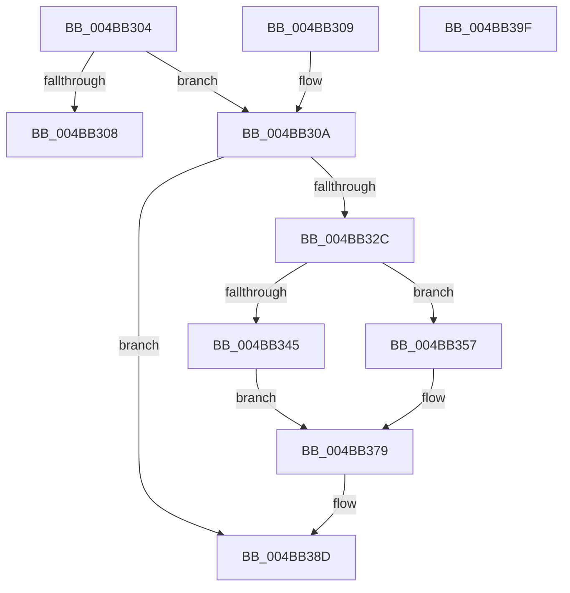

# PpmEventCoordinatedIdleTransition

- RVA: `0x004BB304`–`0x004BB3A0` (길이 `156` bytes)
- VA: `0x00000001404BB304`
- 실행 섹션: `.text`
- PDB 이름 있음: `예`; PDB Function 태그: `아니요`
- unwind 정보 RVA: `0x000BB6F0`
- 디코드: `37`개 명령, `156/156` bytes 표시
- 미해석 바이트: `0` (있으면 어셈블리에 `.byte`로 보존)

> 이 문서는 커널 이미지의 기계어와 PDB 기호를 분석해 생성했습니다. 4번과 5번은 함수 원형과 자료형을 바이너리 사용 방식에서 추정한 C 해석이며 원본 소스 복구 결과는 아닙니다.

## 1. Dependencies

- 직접 호출 지점: **2**; 고유 호출 대상: **2**
- 직접 호출자로 확인된 함수: **2**
- RIP 상대 이미지 참조: **2**

### Outgoing calls
- `0x004BB388` → [EtwTraceKernelEvent](../23/EtwTraceKernelEvent_function_00235350.md) (function, `0x00235350`)
- `0x004BB395` → [_security_check_cookie](../6A/_security_check_cookie_function_006AC640.md) (function, `0x006AC640`)

### Direct callers
- [PpmEnterCoordinatedIdle](../2D/PpmEnterCoordinatedIdle_function_002D19B0.md) at `0x002D1A63`
- [sub_006DD378](../6D/Unknown_function_006DD378.md) at `0x006DD625`

### Static image references
- `0x004BB30E` → RVA `0x00E0A740` (`.data`; read)
- `0x004BB31D` → RVA `0x00FC6B08` (`ALMOSTRO`; read)

## 2. Other-region calls and transfers

- 다른 실행 섹션으로 향하는 call: **0**
- 별도 외부 분기/꼬리 이동을 확인하지 못했습니다.

## 3. Assembly (complete function range)

```asm
004BB304  85 D2                           test edx, edx
004BB306  75 02                           jne 0x1404bb30a
004BB308  C3                              ret
004BB309  CC                              int3
004BB30A  48 83 EC 68                     sub rsp, 0x68
004BB30E  48 8B 05 2B F4 94 00            mov rax, qword ptr [rip + 0x94f42b]
004BB315  48 33 C4                        xor rax, rsp
004BB318  48 89 44 24 50                  mov qword ptr [rsp + 0x50], rax
004BB31D  F7 05 E1 B7 B0 00 00 80 00 00   test dword ptr [rip + 0xb0b7e1], 0x8000
004BB327  4D 8B D1                        mov r10, r9
004BB32A  74 61                           je 0x1404bb38d
004BB32C  83 64 24 3C 00                  and dword ptr [rsp + 0x3c], 0
004BB331  8D 04 95 00 00 00 00            lea eax, [rdx*4]
004BB338  4C 89 44 24 30                  mov qword ptr [rsp + 0x30], r8
004BB33D  89 44 24 38                     mov dword ptr [rsp + 0x38], eax
004BB341  84 C9                           test cl, cl
004BB343  74 12                           je 0x1404bb357
004BB345  B8 02 06 00 00                  mov eax, 0x602
004BB34A  BA 01 00 00 00                  mov edx, 1
004BB34F  41 B9 3F 12 00 00               mov r9d, 0x123f
004BB355  EB 22                           jmp 0x1404bb379
004BB357  83 64 24 4C 00                  and dword ptr [rsp + 0x4c], 0
004BB35C  B8 03 06 00 00                  mov eax, 0x603
004BB361  BA 02 00 00 00                  mov edx, 2
004BB366  4C 89 54 24 40                  mov qword ptr [rsp + 0x40], r10
004BB36B  41 B9 40 12 00 00               mov r9d, 0x1240
004BB371  C7 44 24 48 04 00 00 00         mov dword ptr [rsp + 0x48], 4
004BB379  41 B8 00 80 00 40               mov r8d, 0x40008000
004BB37F  89 44 24 20                     mov dword ptr [rsp + 0x20], eax
004BB383  48 8D 4C 24 30                  lea rcx, [rsp + 0x30]
004BB388  E8 C3 9F D7 FF                  call 0x140235350
004BB38D  48 8B 4C 24 50                  mov rcx, qword ptr [rsp + 0x50]
004BB392  48 33 CC                        xor rcx, rsp
004BB395  E8 A6 12 1F 00                  call 0x1406ac640
004BB39A  48 83 C4 68                     add rsp, 0x68
004BB39E  C3                              ret
004BB39F  CC                              int3
```

## 4. C-style interpretation (structured pseudocode)

```c
__int64 __fastcall PpmEventCoordinatedIdleTransition(unsigned __int8 a1, __int64 a2, __int64 a3, __int64 a4)
{
    __int64 result;
    __int64 v_rsp;
    unsigned __int64 v_stack_m18;
    unsigned int v_stack_m1C;
    unsigned int v_stack_m20;
    unsigned __int64 v_stack_m28;
    unsigned int v_stack_m2C;
    unsigned int v_stack_m30;
    unsigned __int64 v_stack_m38;
    unsigned int v_stack_m48;

    if ((unsigned int)(a2) != 0) goto loc_004BB30A;
    return result;
loc_004BB30A:
    v_rsp = (v_rsp) - (104);
    result = (*(unsigned __int64 *)(v_rip + 9761835)) ^ (v_rsp);
    v_stack_m18 = result;
    if (((*(unsigned int *)(v_rip + 11581409)) & (0x8000ULL)) == 0) goto loc_004BB38D;
    v_stack_m38 = a3;
    v_stack_m30 = (unsigned int)(a2 * 4);
    if (a1 == 0) goto loc_004BB357;
    goto loc_004BB379;
loc_004BB357:
    v_stack_m28 = a4;
    v_stack_m20 = 4;
loc_004BB379:
    v_stack_m48 = (unsigned int)((unsigned int)(0x603ULL));
    result = EtwTraceKernelEvent(v_stack_m38, 2, (unsigned int)(0x40008000ULL), (unsigned int)(0x1240ULL));
loc_004BB38D:
    a1 = (v_stack_m18) ^ (v_rsp);
    result = _security_check_cookie(a1, 2, (unsigned int)(0x40008000ULL), (unsigned int)(0x1240ULL));
    v_rsp = (v_rsp) + (104);
    return result;
}
```

## 5. (Beta) C Style

```c
int64_t PpmEventCoordinatedIdleTransition(uint8_t Arg1, int64_t Arg2, int64_t Arg3, int64_t Arg4)
{
    int64_t result;
    int64_t local_rsp;
    uint64_t v_stack_m18;
    uint32_t v_stack_m1C;
    uint32_t v_stack_m20;
    uint64_t v_stack_m28;
    uint32_t v_stack_m2C;
    uint32_t v_stack_m30;
    uint64_t v_stack_m38;
    uint32_t v_stack_m48;

    if ((uint32_t)(Arg2) != 0) goto loc_004BB30A;
    return result;
loc_004BB30A:
    local_rsp = (local_rsp) - (104);
    result = (*(uint64_t *)(v_rip + 0x94F42B)) ^ (local_rsp);
    v_stack_m18 = result;
    if (((*(uint32_t *)(v_rip + 0xB0B7E1)) & (0x8000ULL)) == 0) goto loc_004BB38D;
    v_stack_m38 = Arg3;
    v_stack_m30 = (uint32_t)(Arg2 * 4);
    if (Arg1 == 0) goto loc_004BB357;
    goto loc_004BB379;
loc_004BB357:
    v_stack_m28 = Arg4;
    v_stack_m20 = 4;
loc_004BB379:
    v_stack_m48 = (uint32_t)((uint32_t)(0x603ULL));
    result = EtwTraceKernelEvent(v_stack_m38, 2, (uint32_t)(0x40008000ULL), (uint32_t)(0x1240ULL));
loc_004BB38D:
    Arg1 = (v_stack_m18) ^ (local_rsp);
    result = _security_check_cookie(Arg1, 2, (uint32_t)(0x40008000ULL), (uint32_t)(0x1240ULL));
    local_rsp = (local_rsp) + (104);
    return result;
}
```

## 6. Execution-region graph

[열기: 2D/3D 그래프와 함수 탐색 컨트롤 패널](../../../control-panel.html?section=text&rva=0x004BB304&view=graph)

- 2D 그래프는 위에서 아래로 흐르고, 3D 그래프는 빈 공간을 드래그해 회전합니다. Shift+드래그는 이동, 휠은 확대·축소, 함수 노드 선택은 대상 보고서 이동입니다.

### Static fallback


