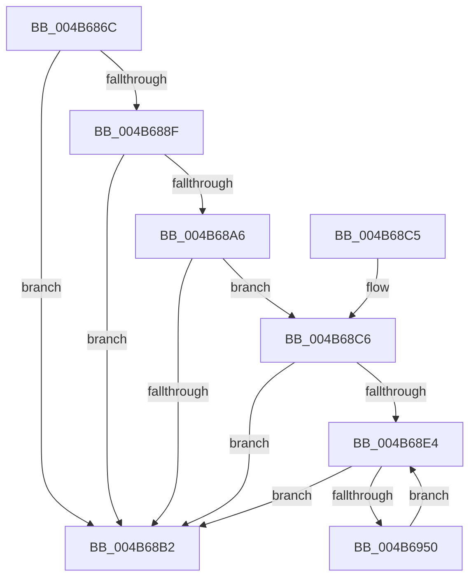

# PpmEventVetoReasonRundown

- RVA: `0x004B686C`–`0x004B6952` (길이 `230` bytes)
- VA: `0x00000001404B686C`
- 실행 섹션: `.text`
- PDB 이름 있음: `예`; PDB Function 태그: `아니요`
- unwind 정보 RVA: `0x000BA5C0`
- 디코드: `53`개 명령, `230/230` bytes 표시
- 미해석 바이트: `0` (있으면 어셈블리에 `.byte`로 보존)

> 이 문서는 커널 이미지의 기계어와 PDB 기호를 분석해 생성했습니다. 4번과 5번은 함수 원형과 자료형을 바이너리 사용 방식에서 추정한 C 해석이며 원본 소스 복구 결과는 아닙니다.

## 1. Dependencies

- 직접 호출 지점: **3**; 고유 호출 대상: **3**
- 직접 호출자로 확인된 함수: **1**
- RIP 상대 이미지 참조: **5**

### Outgoing calls
- `0x004B689D` → [EtwEventEnabled](../39/EtwEventEnabled_function_00392450.md) (function, `0x00392450`)
- `0x004B68BA` → [_security_check_cookie](../6A/_security_check_cookie_function_006AC640.md) (function, `0x006AC640`)
- `0x004B6939` → [EtwWriteEx](../25/EtwWriteEx_function_0025F0D0.md) (function, `0x0025F0D0`)

### Direct callers
- [PpmEventTraceControlCallback](../../page/A5/PpmEventTraceControlCallback_function_00A51F60.md) at `0x00A522CB`

### Static image references
- `0x004B6872` → RVA `0x00E0A740` (`.data`; read)
- `0x004B6886` → RVA `0x00E67A39` (`.data`; read)
- `0x004B688F` → RVA `0x00F083E8` (`.data`; read)
- `0x004B6896` → RVA `0x0001C640` (`.rdata`; read)
- `0x004B68A6` → RVA `0x00E67678` (`.data`; read)

## 2. Other-region calls and transfers

- 다른 실행 섹션으로 향하는 call: **0**
- 별도 외부 분기/꼬리 이동을 확인하지 못했습니다.

## 3. Assembly (complete function range)

```asm
004B686C  40 53                           push rbx
004B686E  48 83 EC 70                     sub rsp, 0x70
004B6872  48 8B 05 C7 3E 95 00            mov rax, qword ptr [rip + 0x953ec7]
004B6879  48 33 C4                        xor rax, rsp
004B687C  48 89 44 24 68                  mov qword ptr [rsp + 0x68], rax
004B6881  83 64 24 40 00                  and dword ptr [rsp + 0x40], 0
004B6886  80 3D AC 11 9B 00 00            cmp byte ptr [rip + 0x9b11ac], 0
004B688D  74 23                           je 0x1404b68b2
004B688F  48 8B 0D 52 1B A5 00            mov rcx, qword ptr [rip + 0xa51b52]
004B6896  48 8D 15 A3 5D B6 FF            lea rdx, [rip - 0x49a25d]
004B689D  E8 AE BB ED FF                  call 0x140392450
004B68A2  84 C0                           test al, al
004B68A4  74 0C                           je 0x1404b68b2
004B68A6  48 8B 15 CB 0D 9B 00            mov rdx, qword ptr [rip + 0x9b0dcb]
004B68AD  48 85 D2                        test rdx, rdx
004B68B0  75 14                           jne 0x1404b68c6
004B68B2  48 8B 4C 24 68                  mov rcx, qword ptr [rsp + 0x68]
004B68B7  48 33 CC                        xor rcx, rsp
004B68BA  E8 81 5D 1F 00                  call 0x1406ac640
004B68BF  48 83 C4 70                     add rsp, 0x70
004B68C3  5B                              pop rbx
004B68C4  C3                              ret
004B68C5  CC                              int3
004B68C6  83 64 24 54 00                  and dword ptr [rsp + 0x54], 0
004B68CB  48 8D 44 24 40                  lea rax, [rsp + 0x40]
004B68D0  48 89 44 24 48                  mov qword ptr [rsp + 0x48], rax
004B68D5  33 C0                           xor eax, eax
004B68D7  C7 44 24 50 04 00 00 00         mov dword ptr [rsp + 0x50], 4
004B68DF  39 42 04                        cmp dword ptr [rdx + 4], eax
004B68E2  76 CE                           jbe 0x1404b68b2
004B68E4  8D 58 01                        lea ebx, [rax + 1]
004B68E7  45 33 C9                        xor r9d, r9d
004B68EA  48 8D 04 40                     lea rax, [rax + rax*2]
004B68EE  89 5C 24 40                     mov dword ptr [rsp + 0x40], ebx
004B68F2  0F B7 4C C2 12                  movzx ecx, word ptr [rdx + rax*8 + 0x12]
004B68F7  45 33 C0                        xor r8d, r8d
004B68FA  48 8B 44 C2 18                  mov rax, qword ptr [rdx + rax*8 + 0x18]
004B68FF  48 8D 15 3A 5D B6 FF            lea rdx, [rip - 0x49a2c6]
004B6906  83 64 24 64 00                  and dword ptr [rsp + 0x64], 0
004B690B  48 89 44 24 58                  mov qword ptr [rsp + 0x58], rax
004B6910  48 8D 44 24 48                  lea rax, [rsp + 0x48]
004B6915  48 89 44 24 38                  mov qword ptr [rsp + 0x38], rax
004B691A  C7 44 24 30 02 00 00 00         mov dword ptr [rsp + 0x30], 2
004B6922  48 83 64 24 28 00               and qword ptr [rsp + 0x28], 0
004B6928  48 83 64 24 20 00               and qword ptr [rsp + 0x20], 0
004B692E  89 4C 24 60                     mov dword ptr [rsp + 0x60], ecx
004B6932  48 8B 0D AF 1A A5 00            mov rcx, qword ptr [rip + 0xa51aaf]
004B6939  E8 92 87 DA FF                  call 0x14025f0d0
004B693E  48 8B 15 33 0D 9B 00            mov rdx, qword ptr [rip + 0x9b0d33]
004B6945  8B C3                           mov eax, ebx
004B6947  3B 5A 04                        cmp ebx, dword ptr [rdx + 4]
004B694A  0F 83 62 FF FF FF               jae 0x1404b68b2
004B6950  EB 92                           jmp 0x1404b68e4
```

## 4. C-style interpretation (structured pseudocode)

```c
__int64 __fastcall PpmEventVetoReasonRundown(__int64 a1, __int64 a2, int a3, int a4)
{
    __int64 result;
    __int64 v_rsp;
    unsigned __int64 v_stack_m10;
    unsigned int v_stack_m38;
    unsigned __int64 v_stack_p20;
    unsigned __int64 v_stack_p28;
    unsigned int v_stack_p30;
    unsigned __int64 v_stack_p38;
    unsigned __int64 v_stack_p40;
    unsigned __int64 v_stack_p48;
    unsigned int v_stack_p50;
    unsigned int v_stack_p54;
    unsigned __int64 v_stack_p58;
    unsigned int v_stack_p60;
    unsigned int v_stack_p64;

    v_rsp = (v_rsp) - (112);
    result = (*(unsigned __int64 *)(v_rip + 9780935)) ^ (v_rsp);
    v_stack_m10 = result;
    if ((*(unsigned __int8 *)(v_rip + 10162604)) == 0) goto loc_004B68B2;
    result = EtwEventEnabled(*(unsigned __int64 *)(v_rip + 10820434), v_rip - 4825693, a3, a4);
    if ((unsigned __int8)(result) == 0) goto loc_004B68B2;
    if (*(unsigned __int64 *)(v_rip + 10161611) != 0) goto loc_004B68C6;
loc_004B68B2:
    a1 = (v_stack_m10) ^ (v_rsp);
    result = _security_check_cookie(a1, *(unsigned __int64 *)(v_rip + 10161611), a3, a4);
    v_rsp = (v_rsp) + (112);
    return result;
loc_004B68C6:
    v_stack_p48 = v_stack_p40;
    result = 0;
    v_stack_p50 = 4;
    if ((*(unsigned int *)(*(unsigned __int64 *)(v_rip + 10161611) + 4)) <= 0) goto loc_004B68B2;
loc_004B68E4:
    a4 = 0;
    v_stack_p40 = (unsigned int)(result + 1);
    a3 = 0;
    v_stack_p58 = *(unsigned __int64 *)(*(unsigned __int64 *)(v_rip + 10161611) + result + result * 2 * 8 + 24);
    v_stack_p38 = v_stack_p48;
    v_stack_p30 = 2;
    v_stack_p60 = (unsigned int)(*(unsigned __int16 *)(*(unsigned __int64 *)(v_rip + 10161611) + result + result * 2 * 8 + 18));
    result = EtwWriteEx(*(unsigned __int64 *)(v_rip + 10820271), v_rip - 4825798, a3, a4);
    if (((unsigned int)(result + 1)) >= (*(unsigned int *)(*(unsigned __int64 *)(v_rip + 10161459) + 4))) goto loc_004B68B2;
    goto loc_004B68E4;
}
```

## 5. (Beta) C Style

```c
int64_t PpmEventVetoReasonRundown(int64_t Arg1, int64_t Arg2, int32_t Arg3, int32_t Arg4)
{
    int64_t result;
    int64_t local_rsp;
    uint64_t v_stack_m10;
    uint32_t v_stack_m38;
    uint64_t v_stack_p20;
    uint64_t v_stack_p28;
    uint32_t v_stack_p30;
    uint64_t v_stack_p38;
    uint64_t v_stack_p40;
    uint64_t v_stack_p48;
    uint32_t v_stack_p50;
    uint32_t v_stack_p54;
    uint64_t v_stack_p58;
    uint32_t v_stack_p60;
    uint32_t v_stack_p64;

    local_rsp = (local_rsp) - (112);
    result = (*(uint64_t *)(v_rip + 0x953EC7)) ^ (local_rsp);
    v_stack_m10 = result;
    if ((*(uint8_t *)(v_rip + 0x9B11AC)) == 0) goto loc_004B68B2;
    result = EtwEventEnabled(*(uint64_t *)(v_rip + 0xA51B52), v_rip - 4825693, Arg3, Arg4);
    if ((uint8_t)(result) == 0) goto loc_004B68B2;
    if (*(uint64_t *)(v_rip + 0x9B0DCB) != 0) goto loc_004B68C6;
loc_004B68B2:
    Arg1 = (v_stack_m10) ^ (local_rsp);
    result = _security_check_cookie(Arg1, *(uint64_t *)(v_rip + 0x9B0DCB), Arg3, Arg4);
    local_rsp = (local_rsp) + (112);
    return result;
loc_004B68C6:
    v_stack_p48 = v_stack_p40;
    result = 0;
    v_stack_p50 = 4;
    if ((*(uint32_t *)(*(uint64_t *)(v_rip + 0x9B0DCB) + 0x4)) <= 0) goto loc_004B68B2;
loc_004B68E4:
    Arg4 = 0;
    v_stack_p40 = (uint32_t)(result + 1);
    Arg3 = 0;
    v_stack_p58 = *(uint64_t *)(*(uint64_t *)(v_rip + 0x9B0DCB) + result + result * 2 * 8 + 0x18);
    v_stack_p38 = v_stack_p48;
    v_stack_p30 = 2;
    v_stack_p60 = (uint32_t)(*(uint16_t *)(*(uint64_t *)(v_rip + 0x9B0DCB) + result + result * 2 * 8 + 0x12));
    result = EtwWriteEx(*(uint64_t *)(v_rip + 0xA51AAF), v_rip - 4825798, Arg3, Arg4);
    if (((uint32_t)(result + 1)) >= (*(uint32_t *)(*(uint64_t *)(v_rip + 0x9B0D33) + 0x4))) goto loc_004B68B2;
    goto loc_004B68E4;
}
```

## 6. Execution-region graph

[열기: 2D/3D 그래프와 함수 탐색 컨트롤 패널](../../../control-panel.html?section=text&rva=0x004B686C&view=graph)

- 2D 그래프는 위에서 아래로 흐르고, 3D 그래프는 빈 공간을 드래그해 회전합니다. Shift+드래그는 이동, 휠은 확대·축소, 함수 노드 선택은 대상 보고서 이동입니다.

### Static fallback


