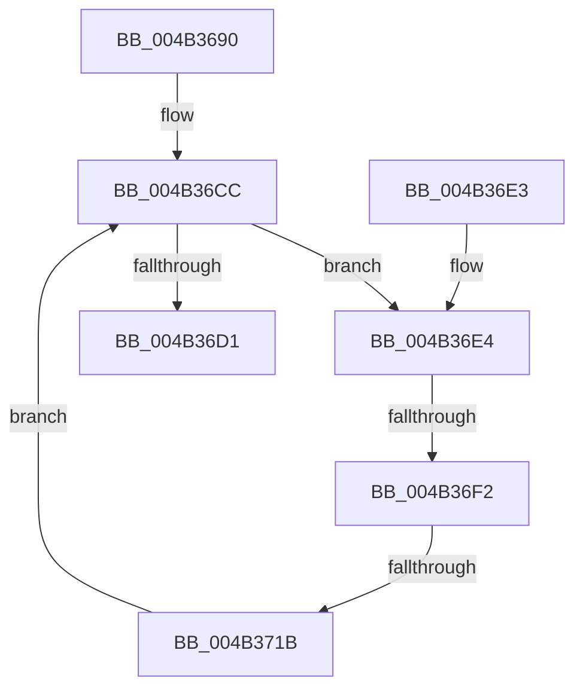

# PpmExitCoordinatedIdleState

- RVA: `0x004B3690`–`0x004B3720` (길이 `144` bytes)
- VA: `0x00000001404B3690`
- 실행 섹션: `.text`
- PDB 이름 있음: `예`; PDB Function 태그: `예`
- unwind 정보 RVA: `0x000B999C`
- 디코드: `40`개 명령, `144/144` bytes 표시
- 미해석 바이트: `0` (있으면 어셈블리에 `.byte`로 보존)

> 이 문서는 커널 이미지의 기계어와 PDB 기호를 분석해 생성했습니다. 4번과 5번은 함수 원형과 자료형을 바이너리 사용 방식에서 추정한 C 해석이며 원본 소스 복구 결과는 아닙니다.

## 1. Dependencies

- 직접 호출 지점: **0**; 고유 호출 대상: **0**
- 직접 호출자로 확인된 함수: **1**
- RIP 상대 이미지 참조: **1**

### Outgoing calls
- 직접 디코드된 call 명령이 없습니다.

### Direct callers
- [sub_006DD378](../6D/Unknown_function_006DD378.md) at `0x006DD44C`

### Static image references
- `0x004B36BB` → RVA `0x00FC7248` (`ALMOSTRO`; read)

## 2. Other-region calls and transfers

- 다른 실행 섹션으로 향하는 call: **0**
- call이 아닌 외부 분기/꼬리 이동: **2**
  - `0x004B36EC` → [sub_006FB45A](../6F/Unknown_function_006FB45A.md) (`tail-transfer`)
  - `0x004B3715` → [sub_006FB45A + 0x3F](../6F/Unknown_function_006FB45A.md) (`tail-transfer`)

## 3. Assembly (complete function range)

```asm
004B3690  48 8B C4                        mov rax, rsp
004B3693  48 89 58 08                     mov qword ptr [rax + 8], rbx
004B3697  48 89 70 10                     mov qword ptr [rax + 0x10], rsi
004B369B  57                              push rdi
004B369C  48 83 EC 40                     sub rsp, 0x40
004B36A0  44 8B 01                        mov r8d, dword ptr [rcx]
004B36A3  0F 57 C0                        xorps xmm0, xmm0
004B36A6  0F 11 40 E8                     movups xmmword ptr [rax - 0x18], xmm0
004B36AA  33 DB                           xor ebx, ebx
004B36AC  C6 40 F4 01                     mov byte ptr [rax - 0xc], 1
004B36B0  48 89 58 E8                     mov qword ptr [rax - 0x18], rbx
004B36B4  48 8B FA                        mov rdi, rdx
004B36B7  0F 11 40 D8                     movups xmmword ptr [rax - 0x28], xmm0
004B36BB  48 8B 05 86 3B B1 00            mov rax, qword ptr [rip + 0xb13b86]
004B36C2  48 8B F1                        mov rsi, rcx
004B36C5  48 89 44 24 28                  mov qword ptr [rsp + 0x28], rax
004B36CA  88 1A                           mov byte ptr [rdx], bl
004B36CC  45 85 C0                        test r8d, r8d
004B36CF  75 13                           jne 0x1404b36e4
004B36D1  48 8B 74 24 58                  mov rsi, qword ptr [rsp + 0x58]
004B36D6  8A C3                           mov al, bl
004B36D8  48 8B 5C 24 50                  mov rbx, qword ptr [rsp + 0x50]
004B36DD  48 83 C4 40                     add rsp, 0x40
004B36E1  5F                              pop rdi
004B36E2  C3                              ret
004B36E3  CC                              int3
004B36E4  41 8B C0                        mov eax, r8d
004B36E7  41 0F BA E0 1A                  bt r8d, 0x1a
004B36EC  0F 83 68 7D 24 00               jae 0x1406fb45a
004B36F2  65 8B 0C 25 A4 01 00 00         mov ecx, dword ptr gs:[0x1a4]
004B36FA  25 FF 0F 00 FA                  and eax, 0xfa000fff
004B36FF  81 E1 FF 0F 00 00               and ecx, 0xfff
004B3705  0F BA E9 0D                     bts ecx, 0xd
004B3709  C1 E1 0C                        shl ecx, 0xc
004B370C  0B C8                           or ecx, eax
004B370E  41 8B C0                        mov eax, r8d
004B3711  F0 0F B1 0E                     lock cmpxchg dword ptr [rsi], ecx
004B3715  0F 84 7E 7D 24 00               je 0x1406fb499
004B371B  44 8B C0                        mov r8d, eax
004B371E  EB AC                           jmp 0x1404b36cc
```

## 4. C-style interpretation (structured pseudocode)

```c
__int64 __fastcall PpmExitCoordinatedIdleState(__int64 a1, __int64 a2)
{
    __int64 result;
    __int64 v_rbx;
    __int64 v_rsp;
    unsigned __int64 v_stack_m20;
    unsigned __int64 v_stack_p10;
    unsigned __int64 v_stack_p8;

    *(unsigned __int64 *)(v_rsp + 8) = v_rbx;
    *(unsigned __int64 *)(v_rsp + 16) = v_rsi;
    v_rsp = (v_rsp) - (64);
    *(unsigned __int64 *)(v_rsp - 24) = v_xmm0;
    v_rbx = 0;
    *(unsigned __int8 *)(v_rsp - 12) = 1;
    *(unsigned __int64 *)(v_rsp - 24) = 0;
    *(unsigned __int64 *)(v_rsp - 40) = v_xmm0;
    v_stack_m20 = *(unsigned __int64 *)(v_rip + 11615110);
    *(unsigned __int8 *)(a2) = 0;
loc_004B36CC:
    if ((unsigned int)((unsigned int)(*(unsigned int *)(a1))) != 0) goto loc_004B36E4;
    v_rsp = (v_rsp) + (64);
    return 0;
loc_004B36E4:
    result = (unsigned int)(((unsigned int)((unsigned int)((unsigned int)(*(unsigned int *)(a1))))) & (0xFA000FFFULL));
    a1 = (unsigned int)(((unsigned int)(*(unsigned int *)(gs_base + (0 + 420)))) & (0xFFFULL));
    a1 = (unsigned int)((a1) << (12));
    a1 = (unsigned int)((a1) | ((unsigned int)(result)));
    goto loc_004B36CC;
}
```

## 5. (Beta) C Style

```c
int64_t PpmExitCoordinatedIdleState(void *Arg1, void *Arg2)
{
    uint8_t *arg1 = (uint8_t *)Arg1;
    uint8_t *arg2 = (uint8_t *)Arg2;

    int64_t result;
    int64_t local_rbx;
    int64_t local_rsp;
    uint64_t v_stack_m20;
    uint64_t v_stack_p10;
    uint64_t v_stack_p8;

    *(uint64_t *)(local_rsp + 0x8) = local_rbx;
    *(uint64_t *)(local_rsp + 0x10) = local_rsi;
    local_rsp = (local_rsp) - (64);
    *(uint64_t *)(local_rsp - 0x18) = v_xmm0;
    local_rbx = 0;
    *(uint8_t *)(local_rsp - 0xC) = 1;
    *(uint64_t *)(local_rsp - 0x18) = 0;
    *(uint64_t *)(local_rsp - 0x28) = v_xmm0;
    v_stack_m20 = *(uint64_t *)(v_rip + 0xB13B86);
    *(uint8_t *)(arg2) = 0;
loc_004B36CC:
    if ((uint32_t)((uint32_t)(*(uint32_t *)(arg1))) != 0) goto loc_004B36E4;
    local_rsp = (local_rsp) + (64);
    return 0;
loc_004B36E4:
    result = (uint32_t)(((uint32_t)((uint32_t)((uint32_t)(*(uint32_t *)(arg1))))) & (0xFA000FFFULL));
    Arg1 = (uint32_t)(((uint32_t)(*(uint32_t *)(gs_base + (0 + 0x1A4)))) & (0xFFFULL));
    Arg1 = (uint32_t)((Arg1) << (12));
    Arg1 = (uint32_t)((Arg1) | ((uint32_t)(result)));
    goto loc_004B36CC;
}
```

### 관측된 메모리 오프셋

구조체 형식이 확인되지 않은 접근은 인자 기준의 오프셋으로만 기록했습니다.

| 기준 인자 | 오프셋 표현 | 폭 (bit) | 접근 |
|---|---:|---:|---|
| `Arg1` | `+ 0x0` | `32` | `R` |
| `Arg2` | `+ 0x0` | `8` | `W` |

## 6. Execution-region graph

[열기: 2D/3D 그래프와 함수 탐색 컨트롤 패널](../../../control-panel.html?section=text&rva=0x004B3690&view=graph)

- 2D 그래프는 위에서 아래로 흐르고, 3D 그래프는 빈 공간을 드래그해 회전합니다. Shift+드래그는 이동, 휠은 확대·축소, 함수 노드 선택은 대상 보고서 이동입니다.

### Static fallback


