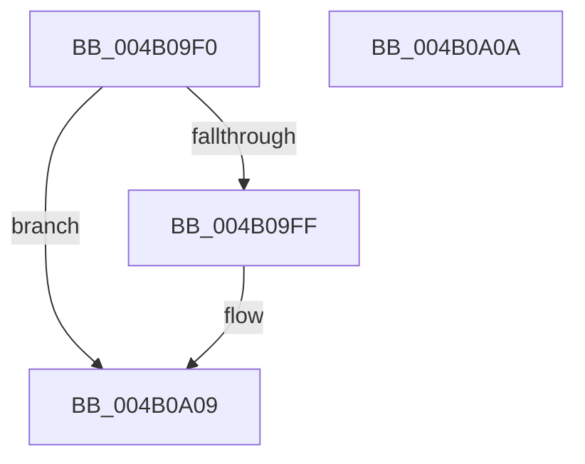

# PpmGetDeepSleepPlatformStateIndex

- RVA: `0x004B09F0`–`0x004B0A0B` (길이 `27` bytes)
- VA: `0x00000001404B09F0`
- 실행 섹션: `.text`
- PDB 이름 있음: `예`; PDB Function 태그: `아니요`
- unwind 정보 RVA: `0x000DB714`
- 디코드: `10`개 명령, `27/27` bytes 표시
- 미해석 바이트: `0` (있으면 어셈블리에 `.byte`로 보존)

> 이 문서는 커널 이미지의 기계어와 PDB 기호를 분석해 생성했습니다. 4번과 5번은 함수 원형과 자료형을 바이너리 사용 방식에서 추정한 C 해석이며 원본 소스 복구 결과는 아닙니다.

## 1. Dependencies

- 직접 호출 지점: **0**; 고유 호출 대상: **0**
- 직접 호출자로 확인된 함수: **5**
- RIP 상대 이미지 참조: **1**

### Outgoing calls
- 직접 디코드된 call 명령이 없습니다.

### Direct callers
- [PopFxClearDeviceConstraints](PopFxClearDeviceConstraints_function_004B05F8.md) at `0x004B0618`
- [PopPepUpdateDripsDeviceVetoMask](PopPepUpdateDripsDeviceVetoMask_function_004B079C.md) at `0x004B0808`
- [PopPepInitializeVetoMasks](../4C/PopPepInitializeVetoMasks_function_004C9350.md) at `0x004C952D`
- [PopFxEnablePlatformStates](../5D/PopFxEnablePlatformStates_function_005D2A98.md) at `0x005D2AA5`
- [PopCheckResiliencyScenarios](../../page/A3/PopCheckResiliencyScenarios_function_00A31718.md) at `0x00A3182E`

### Static image references
- `0x004B09F0` → RVA `0x00FC6AD0` (`ALMOSTRO`; read)

## 2. Other-region calls and transfers

- 다른 실행 섹션으로 향하는 call: **0**
- 별도 외부 분기/꼬리 이동을 확인하지 못했습니다.

## 3. Assembly (complete function range)

```asm
004B09F0  48 8B 15 D9 60 B1 00            mov rdx, qword ptr [rip + 0xb160d9]
004B09F7  83 C8 FF                        or eax, 0xffffffff
004B09FA  48 85 D2                        test rdx, rdx
004B09FD  74 0A                           je 0x1404b0a09
004B09FF  8B 12                           mov edx, dword ptr [rdx]
004B0A01  85 D2                           test edx, edx
004B0A03  8D 4A FF                        lea ecx, [rdx - 1]
004B0A06  0F 45 C1                        cmovne eax, ecx
004B0A09  C3                              ret
004B0A0A  CC                              int3
```

## 4. C-style interpretation (structured pseudocode)

```c
__int64 __fastcall PpmGetDeepSleepPlatformStateIndex(void)
{
    __int64 result;

    result = (unsigned int)((result) | (0xFFFFFFFFULL));
    if (*(unsigned __int64 *)(v_rip + 11624665) != 0) {
        a2 = *(unsigned int *)(*(unsigned __int64 *)(v_rip + 11624665));
        a1 = a2 - 1;
        if ((unsigned int)(a2) != 0) { result = (unsigned int)(a1); }
    }
    return result;
}
```

## 5. (Beta) C Style

```c
void PpmGetDeepSleepPlatformStateIndex(void)
{
    int64_t result;

    result = (uint32_t)((result) | (0xFFFFFFFFULL));
    if (*(uint64_t *)(v_rip + 0xB160D9) != 0) {
        a2 = *(uint32_t *)(*(uint64_t *)(v_rip + 0xB160D9));
        a1 = a2 - 1;
        if ((uint32_t)(a2) != 0) { result = (uint32_t)(a1); }
    }
    return result;
}
```

## 6. Execution-region graph

[열기: 2D/3D 그래프와 함수 탐색 컨트롤 패널](../../../control-panel.html?section=text&rva=0x004B09F0&view=graph)

- 2D 그래프는 위에서 아래로 흐르고, 3D 그래프는 빈 공간을 드래그해 회전합니다. Shift+드래그는 이동, 휠은 확대·축소, 함수 노드 선택은 대상 보고서 이동입니다.

### Static fallback


