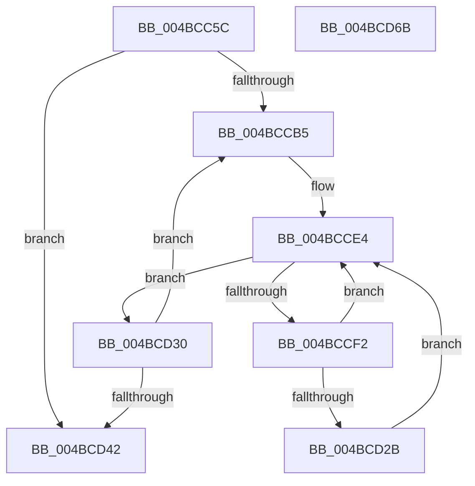

# PpmGetIdleConstrainedMask

- RVA: `0x004BCC5C`–`0x004BCD6C` (길이 `272` bytes)
- VA: `0x00000001404BCC5C`
- 실행 섹션: `.text`
- PDB 이름 있음: `예`; PDB Function 태그: `아니요`
- unwind 정보 RVA: `0x000BBC80`
- 디코드: `69`개 명령, `272/272` bytes 표시
- 미해석 바이트: `0` (있으면 어셈블리에 `.byte`로 보존)

> 이 문서는 커널 이미지의 기계어와 PDB 기호를 분석해 생성했습니다. 4번과 5번은 함수 원형과 자료형을 바이너리 사용 방식에서 추정한 C 해석이며 원본 소스 복구 결과는 아닙니다.

## 1. Dependencies

- 직접 호출 지점: **6**; 고유 호출 대상: **6**
- 직접 호출자로 확인된 함수: **2**
- RIP 상대 이미지 참조: **3**

### Outgoing calls
- `0x004BCC99` → [memset](../6C/memset_function_006C6C40.md) (function, `0x006C6C40`)
- `0x004BCCDF` → [RtlCopyVolatileMemory](../6B/RtlCopyVolatileMemory_function_006BC9D0.md) (function, `0x006BC9D0`)
- `0x004BCCE9` → [KeIsEmptyGroupMask](../25/KeIsEmptyGroupMask_function_002553B0.md) (function, `0x002553B0`)
- `0x004BCCF7` → [KeFindFirstSetRightGroupMask](../25/KeFindFirstSetRightGroupMask_function_00256BE4.md) (function, `0x00256BE4`)
- `0x004BCD20` → [KeAddGroupAffinityEx](../25/KeAddGroupAffinityEx_function_0025B6C0.md) (function, `0x0025B6C0`)
- `0x004BCD4D` → [_security_check_cookie](../6A/_security_check_cookie_function_006AC640.md) (function, `0x006AC640`)

### Direct callers
- [PoExecuteIdleCheck](../39/PoExecuteIdleCheck_function_0039CF20.md) at `0x0039CFE8`
- [PpmEstimateIdleDuration](../4C/PpmEstimateIdleDuration_function_004C79DC.md) at `0x004C7BF1`

### Static image references
- `0x004BCC74` → RVA `0x00E0A740` (`.data`; read)
- `0x004BCC9E` → RVA `0x00FC5000` (`ALMOSTRO`; read)
- `0x004BCCB7` → RVA `0x00FCF6C0` (`CACHEALI`; read)

## 2. Other-region calls and transfers

- 다른 실행 섹션으로 향하는 call: **0**
- 별도 외부 분기/꼬리 이동을 확인하지 못했습니다.

## 3. Assembly (complete function range)

```asm
004BCC5C  48 89 5C 24 10                  mov qword ptr [rsp + 0x10], rbx
004BCC61  48 89 6C 24 18                  mov qword ptr [rsp + 0x18], rbp
004BCC66  48 89 74 24 20                  mov qword ptr [rsp + 0x20], rsi
004BCC6B  57                              push rdi
004BCC6C  41 56                           push r14
004BCC6E  41 57                           push r15
004BCC70  48 83 EC 40                     sub rsp, 0x40
004BCC74  48 8B 05 C5 DA 94 00            mov rax, qword ptr [rip + 0x94dac5]
004BCC7B  48 33 C4                        xor rax, rsp
004BCC7E  48 89 44 24 38                  mov qword ptr [rsp + 0x38], rax
004BCC83  44 0F B7 01                     movzx r8d, word ptr [rcx]
004BCC87  4C 8B F1                        mov r14, rcx
004BCC8A  33 ED                           xor ebp, ebp
004BCC8C  49 C1 E0 03                     shl r8, 3
004BCC90  48 83 C1 08                     add rcx, 8
004BCC94  33 D2                           xor edx, edx
004BCC96  40 8A F5                        mov sil, bpl
004BCC99  E8 A2 9F 20 00                  call 0x1406c6c40
004BCC9E  66 3B 2D 5B 83 B0 00            cmp bp, word ptr [rip + 0xb0835b]
004BCCA5  44 8D 7D 01                     lea r15d, [rbp + 1]
004BCCA9  66 45 89 3E                     mov word ptr [r14], r15w
004BCCAD  8B FD                           mov edi, ebp
004BCCAF  0F 83 8D 00 00 00               jae 0x1404bcd42
004BCCB5  8B C7                           mov eax, edi
004BCCB7  48 8D 15 02 2A B1 00            lea rdx, [rip + 0xb12a02]
004BCCBE  0F 57 C0                        xorps xmm0, xmm0
004BCCC1  48 8D 4C 24 28                  lea rcx, [rsp + 0x28]
004BCCC6  41 B8 10 00 00 00               mov r8d, 0x10
004BCCCC  F3 0F 7F 44 24 28               movdqu xmmword ptr [rsp + 0x28], xmm0
004BCCD2  48 8B 14 C2                     mov rdx, qword ptr [rdx + rax*8]
004BCCD6  48 89 54 24 20                  mov qword ptr [rsp + 0x20], rdx
004BCCDB  48 83 C2 10                     add rdx, 0x10
004BCCDF  E8 EC FC 1F 00                  call 0x1406bc9d0
004BCCE4  48 8D 4C 24 28                  lea rcx, [rsp + 0x28]
004BCCE9  E8 C2 86 D9 FF                  call 0x1402553b0
004BCCEE  85 C0                           test eax, eax
004BCCF0  75 3E                           jne 0x1404bcd30
004BCCF2  48 8D 4C 24 28                  lea rcx, [rsp + 0x28]
004BCCF7  E8 E8 9E D9 FF                  call 0x140256be4
004BCCFC  0F B7 D8                        movzx ebx, ax
004BCCFF  49 8B CE                        mov rcx, r14
004BCD02  48 8D 44 24 28                  lea rax, [rsp + 0x28]
004BCD07  48 0F B3 18                     btr qword ptr [rax], rbx
004BCD0B  48 8B 44 24 20                  mov rax, qword ptr [rsp + 0x20]
004BCD10  48 8B 5C D8 20                  mov rbx, qword ptr [rax + rbx*8 + 0x20]
004BCD15  4C 8B 43 48                     mov r8, qword ptr [rbx + 0x48]
004BCD19  0F B7 93 88 00 00 00            movzx edx, word ptr [rbx + 0x88]
004BCD20  E8 9B E9 D9 FF                  call 0x14025b6c0
004BCD25  48 39 6B 48                     cmp qword ptr [rbx + 0x48], rbp
004BCD29  74 B9                           je 0x1404bcce4
004BCD2B  41 8A F7                        mov sil, r15b
004BCD2E  EB B4                           jmp 0x1404bcce4
004BCD30  0F B7 0D C9 82 B0 00            movzx ecx, word ptr [rip + 0xb082c9]
004BCD37  41 03 FF                        add edi, r15d
004BCD3A  3B F9                           cmp edi, ecx
004BCD3C  0F 82 73 FF FF FF               jb 0x1404bccb5
004BCD42  40 8A C6                        mov al, sil
004BCD45  48 8B 4C 24 38                  mov rcx, qword ptr [rsp + 0x38]
004BCD4A  48 33 CC                        xor rcx, rsp
004BCD4D  E8 EE F8 1E 00                  call 0x1406ac640
004BCD52  48 8B 5C 24 68                  mov rbx, qword ptr [rsp + 0x68]
004BCD57  48 8B 6C 24 70                  mov rbp, qword ptr [rsp + 0x70]
004BCD5C  48 8B 74 24 78                  mov rsi, qword ptr [rsp + 0x78]
004BCD61  48 83 C4 40                     add rsp, 0x40
004BCD65  41 5F                           pop r15
004BCD67  41 5E                           pop r14
004BCD69  5F                              pop rdi
004BCD6A  C3                              ret
004BCD6B  CC                              int3
```

## 4. C-style interpretation (structured pseudocode)

```c
__int64 __fastcall PpmGetIdleConstrainedMask(__int64 a1, int a2)
{
    __int64 result;
    __int64 v_rbp;
    __int64 v_rdi;
    __int64 v_rsp;
    unsigned __int64 v_stack_m20;
    unsigned __int64 v_stack_m30;
    unsigned __int64 v_stack_m38;
    unsigned __int64 v_stack_p10;
    unsigned __int64 v_stack_p18;
    unsigned __int64 v_stack_p20;

    v_stack_p10 = v_rbx;
    v_stack_p18 = v_rbp;
    v_stack_p20 = v_rsi;
    v_rsp = (v_rsp) - (64);
    result = (*(unsigned __int64 *)(v_rip + 9755333)) ^ (v_rsp);
    v_stack_m20 = result;
    v_rbp = 0;
    a3 = (*(unsigned __int16 *)(a1)) << (3);
    a1 = (a1) + (8);
    a2 = 0;
    result = memset(a1, a2, a3, a4);
    *(unsigned __int16 *)(a1) = (unsigned __int16)(v_rbp + 1);
    if (0 >= (*(unsigned __int16 *)(v_rip + 11567963))) goto loc_004BCD42;
loc_004BCCB5:
    v_stack_m30 = v_xmm0;
    v_stack_m38 = *(unsigned __int64 *)(v_rip + 11610626 + 0 * 8);
    a2 = (*(unsigned __int64 *)(v_rip + 11610626 + 0 * 8)) + (16);
    result = RtlCopyVolatileMemory(v_stack_m30, a2, 16, a4);
loc_004BCCE4:
    result = KeIsEmptyGroupMask(v_stack_m30, a2, 16, a4);
    if ((unsigned int)(result) != 0) goto loc_004BCD30;
    result = KeFindFirstSetRightGroupMask(v_stack_m30, a2, 16, a4);
    result = KeAddGroupAffinityEx(a1, *(unsigned __int16 *)(*(unsigned __int64 *)(v_stack_m38 + (unsigned __int16)(result) * 8 + 32) + 136), *(unsigned __int64 *)(*(unsigned __int64 *)(v_stack_m38 + (unsigned __int16)(result) * 8 + 32) + 72), a4);
    if ((*(unsigned __int64 *)(*(unsigned __int64 *)(v_stack_m38 + (unsigned __int16)(result) * 8 + 32) + 72)) == 0) goto loc_004BCCE4;
    goto loc_004BCCE4;
loc_004BCD30:
    v_rdi = (unsigned int)((0) + ((unsigned int)(v_rbp + 1)));
    if (((unsigned int)(v_rdi)) < ((unsigned int)(*(unsigned __int16 *)(v_rip + 11567817)))) goto loc_004BCCB5;
loc_004BCD42:
    a1 = (v_stack_m20) ^ (v_rsp);
    result = _security_check_cookie(a1, *(unsigned __int16 *)(*(unsigned __int64 *)(v_stack_m38 + (unsigned __int16)(result) * 8 + 32) + 136), *(unsigned __int64 *)(*(unsigned __int64 *)(v_stack_m38 + (unsigned __int16)(result) * 8 + 32) + 72), a4);
    v_rsp = (v_rsp) + (64);
    return result;
}
```

## 5. (Beta) C Style

```c
int64_t PpmGetIdleConstrainedMask(void *Arg1, int32_t Arg2)
{
    uint8_t *arg1 = (uint8_t *)Arg1;

    int64_t result;
    int64_t local_rbp;
    int64_t local_rdi;
    int64_t local_rsp;
    uint64_t v_stack_m20;
    uint64_t v_stack_m30;
    uint64_t v_stack_m38;
    uint64_t v_stack_p10;
    uint64_t v_stack_p18;
    uint64_t v_stack_p20;

    v_stack_p10 = local_rbx;
    v_stack_p18 = local_rbp;
    v_stack_p20 = local_rsi;
    local_rsp = (local_rsp) - (64);
    result = (*(uint64_t *)(v_rip + 0x94DAC5)) ^ (local_rsp);
    v_stack_m20 = result;
    local_rbp = 0;
    a3 = (*(uint16_t *)(arg1)) << (3);
    Arg1 = (Arg1) + (8);
    Arg2 = 0;
    result = memset(Arg1, Arg2, a3, a4);
    *(uint16_t *)(arg1) = (uint16_t)(local_rbp + 1);
    if (0 >= (*(uint16_t *)(v_rip + 0xB0835B))) goto loc_004BCD42;
loc_004BCCB5:
    v_stack_m30 = v_xmm0;
    v_stack_m38 = *(uint64_t *)(v_rip + 0xB12A02 + 0x0 * 8);
    Arg2 = (*(uint64_t *)(v_rip + 0xB12A02 + 0x0 * 8)) + (16);
    result = RtlCopyVolatileMemory(v_stack_m30, Arg2, 16, a4);
loc_004BCCE4:
    result = KeIsEmptyGroupMask(v_stack_m30, Arg2, 16, a4);
    if ((uint32_t)(result) != 0) goto loc_004BCD30;
    result = KeFindFirstSetRightGroupMask(v_stack_m30, Arg2, 16, a4);
    result = KeAddGroupAffinityEx(Arg1, *(uint16_t *)(*(uint64_t *)(v_stack_m38 + (uint16_t)(result) * 8 + 0x20) + 0x88), *(uint64_t *)(*(uint64_t *)(v_stack_m38 + (uint16_t)(result) * 8 + 0x20) + 0x48), a4);
    if ((*(uint64_t *)(*(uint64_t *)(v_stack_m38 + (uint16_t)(result) * 8 + 0x20) + 0x48)) == 0) goto loc_004BCCE4;
    goto loc_004BCCE4;
loc_004BCD30:
    local_rdi = (uint32_t)((0) + ((uint32_t)(local_rbp + 1)));
    if (((uint32_t)(local_rdi)) < ((uint32_t)(*(uint16_t *)(v_rip + 0xB082C9)))) goto loc_004BCCB5;
loc_004BCD42:
    Arg1 = (v_stack_m20) ^ (local_rsp);
    result = _security_check_cookie(Arg1, *(uint16_t *)(*(uint64_t *)(v_stack_m38 + (uint16_t)(result) * 8 + 0x20) + 0x88), *(uint64_t *)(*(uint64_t *)(v_stack_m38 + (uint16_t)(result) * 8 + 0x20) + 0x48), a4);
    local_rsp = (local_rsp) + (64);
    return result;
}
```

### 관측된 메모리 오프셋

구조체 형식이 확인되지 않은 접근은 인자 기준의 오프셋으로만 기록했습니다.

| 기준 인자 | 오프셋 표현 | 폭 (bit) | 접근 |
|---|---:|---:|---|
| `Arg1` | `+ 0x0` | `16` | `R` |
| `Arg1` | `+ 0x0` | `16` | `W` |

## 6. Execution-region graph

[열기: 2D/3D 그래프와 함수 탐색 컨트롤 패널](../../../control-panel.html?section=text&rva=0x004BCC5C&view=graph)

- 2D 그래프는 위에서 아래로 흐르고, 3D 그래프는 빈 공간을 드래그해 회전합니다. Shift+드래그는 이동, 휠은 확대·축소, 함수 노드 선택은 대상 보고서 이동입니다.

### Static fallback


