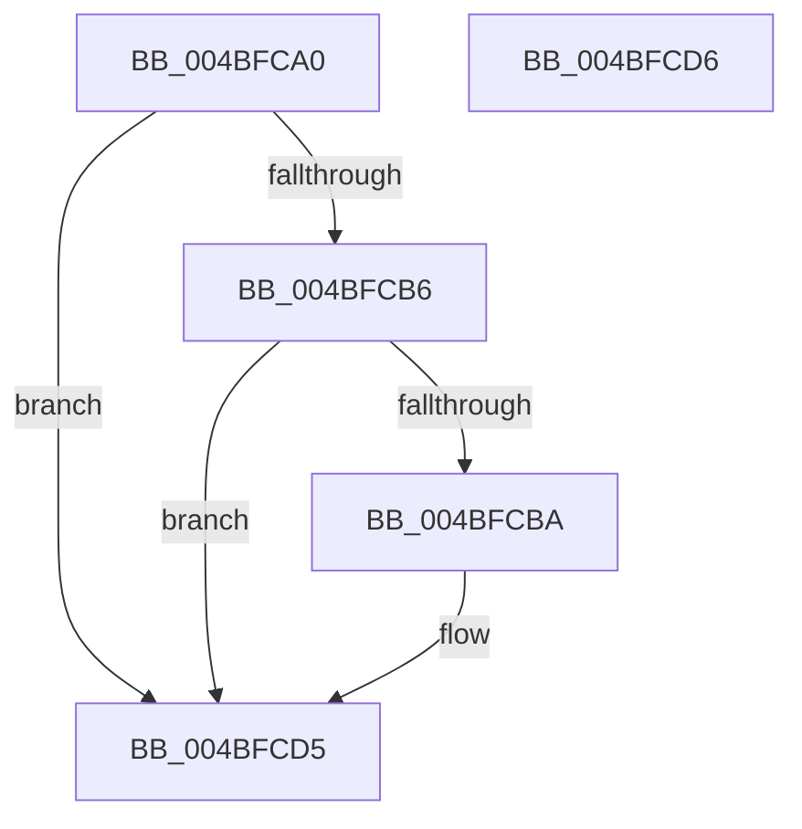

# PpmGetPlatformSelectionVetoCounts

- RVA: `0x004BFCA0`–`0x004BFCD7` (길이 `55` bytes)
- VA: `0x00000001404BFCA0`
- 실행 섹션: `.text`
- PDB 이름 있음: `예`; PDB Function 태그: `아니요`
- unwind 정보 RVA: `0x000DB714`
- 디코드: `17`개 명령, `55/55` bytes 표시
- 미해석 바이트: `0` (있으면 어셈블리에 `.byte`로 보존)

> 이 문서는 커널 이미지의 기계어와 PDB 기호를 분석해 생성했습니다. 4번과 5번은 함수 원형과 자료형을 바이너리 사용 방식에서 추정한 C 해석이며 원본 소스 복구 결과는 아닙니다.

## 1. Dependencies

- 직접 호출 지점: **0**; 고유 호출 대상: **0**
- 직접 호출자로 확인된 함수: **1**
- RIP 상대 이미지 참조: **1**

### Outgoing calls
- 직접 디코드된 call 명령이 없습니다.

### Direct callers
- [PopCaptureSleepStudyStatistics](../43/PopCaptureSleepStudyStatistics_function_004399F4.md) at `0x00439B41`

### Static image references
- `0x004BFCAA` → RVA `0x00FC6AD0` (`ALMOSTRO`; read)

## 2. Other-region calls and transfers

- 다른 실행 섹션으로 향하는 call: **0**
- 별도 외부 분기/꼬리 이동을 확인하지 못했습니다.

## 3. Assembly (complete function range)

```asm
004BFCA0  48 83 22 00                     and qword ptr [rdx], 0
004BFCA4  49 83 20 00                     and qword ptr [r8], 0
004BFCA8  8B C1                           mov eax, ecx
004BFCAA  48 8B 0D 1F 6E B0 00            mov rcx, qword ptr [rip + 0xb06e1f]
004BFCB1  48 85 C9                        test rcx, rcx
004BFCB4  74 1F                           je 0x1404bfcd5
004BFCB6  3B 01                           cmp eax, dword ptr [rcx]
004BFCB8  73 1B                           jae 0x1404bfcd5
004BFCBA  48 8B 49 30                     mov rcx, qword ptr [rcx + 0x30]
004BFCBE  44 8B C8                        mov r9d, eax
004BFCC1  49 C1 E1 0A                     shl r9, 0xa
004BFCC5  49 8B 44 09 68                  mov rax, qword ptr [r9 + rcx + 0x68]
004BFCCA  48 89 02                        mov qword ptr [rdx], rax
004BFCCD  49 8B 44 09 60                  mov rax, qword ptr [r9 + rcx + 0x60]
004BFCD2  49 89 00                        mov qword ptr [r8], rax
004BFCD5  C3                              ret
004BFCD6  CC                              int3
```

## 4. C-style interpretation (structured pseudocode)

```c
__int64 __fastcall PpmGetPlatformSelectionVetoCounts(int a1, __int64 a2, __int64 a3)
{
    __int64 result;

    if (*(unsigned __int64 *)(v_rip + 11562527) == 0) goto loc_004BFCD5;
    result = (unsigned int)(a1);
    if (((unsigned int)((unsigned int)(a1))) < (*(unsigned int *)(*(unsigned __int64 *)(v_rip + 11562527)))) {
        a1 = *(unsigned __int64 *)(*(unsigned __int64 *)(v_rip + 11562527) + 48);
        a4 = (unsigned int)((unsigned int)(a1));
        a4 = (a4) << (10);
        result = *(unsigned __int64 *)(a4 + a1 * 1 + 104);
        *(unsigned __int64 *)(a2) = result;
        result = *(unsigned __int64 *)(a4 + a1 * 1 + 96);
        *(unsigned __int64 *)(a3) = result;
    }
    return result;
}
```

## 5. (Beta) C Style

```c
int64_t PpmGetPlatformSelectionVetoCounts(int32_t Arg1, void *Arg2, void *Arg3)
{
    uint8_t *arg2 = (uint8_t *)Arg2;
    uint8_t *arg3 = (uint8_t *)Arg3;

    int64_t result;

    if (*(uint64_t *)(v_rip + 0xB06E1F) == 0) goto loc_004BFCD5;
    result = (uint32_t)(Arg1);
    if (((uint32_t)((uint32_t)(Arg1))) < (*(uint32_t *)(*(uint64_t *)(v_rip + 0xB06E1F)))) {
        Arg1 = *(uint64_t *)(*(uint64_t *)(v_rip + 0xB06E1F) + 0x30);
        a4 = (uint32_t)((uint32_t)(Arg1));
        a4 = (a4) << (10);
        result = *(uint64_t *)(a4 + Arg1 * 1 + 0x68);
        *(uint64_t *)(arg2) = result;
        result = *(uint64_t *)(a4 + Arg1 * 1 + 0x60);
        *(uint64_t *)(arg3) = result;
    }
    return result;
}
```

### 관측된 메모리 오프셋

구조체 형식이 확인되지 않은 접근은 인자 기준의 오프셋으로만 기록했습니다.

| 기준 인자 | 오프셋 표현 | 폭 (bit) | 접근 |
|---|---:|---:|---|
| `Arg2` | `+ 0x0` | `64` | `R/W` |
| `Arg2` | `+ 0x0` | `64` | `W` |
| `Arg3` | `+ 0x0` | `64` | `R/W` |
| `Arg3` | `+ 0x0` | `64` | `W` |

## 6. Execution-region graph

[열기: 2D/3D 그래프와 함수 탐색 컨트롤 패널](../../../control-panel.html?section=text&rva=0x004BFCA0&view=graph)

- 2D 그래프는 위에서 아래로 흐르고, 3D 그래프는 빈 공간을 드래그해 회전합니다. Shift+드래그는 이동, 휠은 확대·축소, 함수 노드 선택은 대상 보고서 이동입니다.

### Static fallback


