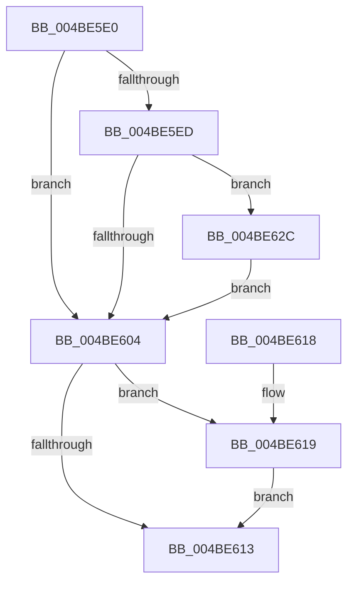

# PpmHeteroDispatchHgsInterrupt

- RVA: `0x004BE5E0`–`0x004BE65E` (길이 `126` bytes)
- VA: `0x00000001404BE5E0`
- 실행 섹션: `.text`
- PDB 이름 있음: `예`; PDB Function 태그: `아니요`
- unwind 정보 RVA: `0x000BB950`
- 디코드: `30`개 명령, `126/126` bytes 표시
- 미해석 바이트: `0` (있으면 어셈블리에 `.byte`로 보존)

> 이 문서는 커널 이미지의 기계어와 PDB 기호를 분석해 생성했습니다. 4번과 5번은 함수 원형과 자료형을 바이너리 사용 방식에서 추정한 C 해석이며 원본 소스 복구 결과는 아닙니다.

## 1. Dependencies

- 직접 호출 지점: **3**; 고유 호출 대상: **3**
- 직접 호출자로 확인된 함수: **0**
- RIP 상대 이미지 참조: **5**

### Outgoing calls
- `0x004BE5FB` → [EtwEventEnabled](../39/EtwEventEnabled_function_00392450.md) (function, `0x00392450`)
- `0x004BE625` → [KeInsertQueueDpc](../20/KeInsertQueueDpc_function_00207C50.md) (function, `0x00207C50`)
- `0x004BE657` → [EtwWriteEx](../25/EtwWriteEx_function_0025F0D0.md) (function, `0x0025F0D0`)

### Direct callers
- 이 함수 시작 RVA로 연결되는 직접 call은 확인되지 않았습니다. 간접 호출은 완전히 역산할 수 없습니다.

### Static image references
- `0x004BE5E4` → RVA `0x00E67A39` (`.data`; read)
- `0x004BE5ED` → RVA `0x00F083E8` (`.data`; read)
- `0x004BE5F4` → RVA `0x0001E080` (`.rdata`; read)
- `0x004BE609` → RVA `0x00FC6F94` (`ALMOSTRO`; read/write)
- `0x004BE61C` → RVA `0x00FC7640` (`ALMOSTRO`; read)

## 2. Other-region calls and transfers

- 다른 실행 섹션으로 향하는 call: **0**
- 별도 외부 분기/꼬리 이동을 확인하지 못했습니다.

## 3. Assembly (complete function range)

```asm
004BE5E0  48 83 EC 48                     sub rsp, 0x48
004BE5E4  80 3D 4E 94 9A 00 00            cmp byte ptr [rip + 0x9a944e], 0
004BE5EB  74 17                           je 0x1404be604
004BE5ED  48 8B 0D F4 9D A4 00            mov rcx, qword ptr [rip + 0xa49df4]
004BE5F4  48 8D 15 85 FA B5 FF            lea rdx, [rip - 0x4a057b]
004BE5FB  E8 50 3E ED FF                  call 0x140392450
004BE600  84 C0                           test al, al
004BE602  75 28                           jne 0x1404be62c
004BE604  B8 01 00 00 00                  mov eax, 1
004BE609  87 05 85 89 B0 00               xchg dword ptr [rip + 0xb08985], eax
004BE60F  85 C0                           test eax, eax
004BE611  74 06                           je 0x1404be619
004BE613  48 83 C4 48                     add rsp, 0x48
004BE617  C3                              ret
004BE618  CC                              int3
004BE619  45 33 C0                        xor r8d, r8d
004BE61C  48 8D 0D 1D 90 B0 00            lea rcx, [rip + 0xb0901d]
004BE623  33 D2                           xor edx, edx
004BE625  E8 26 96 D4 FF                  call 0x140207c50
004BE62A  EB E7                           jmp 0x1404be613
004BE62C  48 83 64 24 38 00               and qword ptr [rsp + 0x38], 0
004BE632  48 8D 15 47 FA B5 FF            lea rdx, [rip - 0x4a05b9]
004BE639  83 64 24 30 00                  and dword ptr [rsp + 0x30], 0
004BE63E  45 33 C9                        xor r9d, r9d
004BE641  48 83 64 24 28 00               and qword ptr [rsp + 0x28], 0
004BE647  45 33 C0                        xor r8d, r8d
004BE64A  48 83 64 24 20 00               and qword ptr [rsp + 0x20], 0
004BE650  48 8B 0D 91 9D A4 00            mov rcx, qword ptr [rip + 0xa49d91]
004BE657  E8 74 0A DA FF                  call 0x14025f0d0
004BE65C  EB A6                           jmp 0x1404be604
```

## 4. C-style interpretation (structured pseudocode)

```c
__int64 __fastcall PpmHeteroDispatchHgsInterrupt(__int64 a1, __int64 a2, int a3, int a4)
{
    __int64 result;
    __int64 v_rsp;
    unsigned __int64 v_stack_p20;
    unsigned __int64 v_stack_p28;
    unsigned int v_stack_p30;
    unsigned __int64 v_stack_p38;

    v_rsp = (v_rsp) - (72);
    if ((*(unsigned __int8 *)(v_rip + 10130510)) == 0) goto loc_004BE604;
    result = EtwEventEnabled(*(unsigned __int64 *)(v_rip + 10788340), v_rip - 4851067, a3, a4);
    if ((unsigned __int8)(result) != 0) goto loc_004BE62C;
loc_004BE604:
    if (1 == 0) goto loc_004BE619;
loc_004BE613:
    v_rsp = (v_rsp) + (72);
    return 1;
loc_004BE619:
    a3 = 0;
    a2 = 0;
    result = KeInsertQueueDpc(v_rip + 11571229, a2, a3, a4);
    goto loc_004BE613;
loc_004BE62C:
    a4 = 0;
    a3 = 0;
    result = EtwWriteEx(*(unsigned __int64 *)(v_rip + 10788241), v_rip - 4851129, a3, a4);
    goto loc_004BE604;
}
```

## 5. (Beta) C Style

```c
int64_t PpmHeteroDispatchHgsInterrupt(int64_t Arg1, int64_t Arg2, int32_t Arg3, int32_t Arg4)
{
    int64_t result;
    int64_t local_rsp;
    uint64_t v_stack_p20;
    uint64_t v_stack_p28;
    uint32_t v_stack_p30;
    uint64_t v_stack_p38;

    local_rsp = (local_rsp) - (72);
    if ((*(uint8_t *)(v_rip + 0x9A944E)) == 0) goto loc_004BE604;
    result = EtwEventEnabled(*(uint64_t *)(v_rip + 0xA49DF4), v_rip - 4851067, Arg3, Arg4);
    if ((uint8_t)(result) != 0) goto loc_004BE62C;
loc_004BE604:
    if (1 == 0) goto loc_004BE619;
loc_004BE613:
    local_rsp = (local_rsp) + (72);
    return 1;
loc_004BE619:
    Arg3 = 0;
    Arg2 = 0;
    result = KeInsertQueueDpc(v_rip + 11571229, Arg2, Arg3, Arg4);
    goto loc_004BE613;
loc_004BE62C:
    Arg4 = 0;
    Arg3 = 0;
    result = EtwWriteEx(*(uint64_t *)(v_rip + 0xA49D91), v_rip - 4851129, Arg3, Arg4);
    goto loc_004BE604;
}
```

## 6. Execution-region graph

[열기: 2D/3D 그래프와 함수 탐색 컨트롤 패널](../../../control-panel.html?section=text&rva=0x004BE5E0&view=graph)

- 2D 그래프는 위에서 아래로 흐르고, 3D 그래프는 빈 공간을 드래그해 회전합니다. Shift+드래그는 이동, 휠은 확대·축소, 함수 노드 선택은 대상 보고서 이동입니다.

### Static fallback


