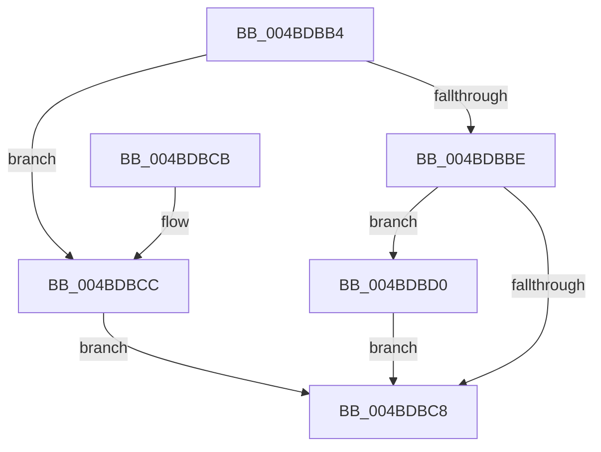

# PpmHvUseNativeAlgorithms

- RVA: `0x004BDBB4`–`0x004BDBE1` (길이 `45` bytes)
- VA: `0x00000001404BDBB4`
- 실행 섹션: `.text`
- PDB 이름 있음: `예`; PDB Function 태그: `아니요`
- unwind 정보 RVA: `0x000DB714`
- 디코드: `17`개 명령, `45/45` bytes 표시
- 미해석 바이트: `0` (있으면 어셈블리에 `.byte`로 보존)

> 이 문서는 커널 이미지의 기계어와 PDB 기호를 분석해 생성했습니다. 4번과 5번은 함수 원형과 자료형을 바이너리 사용 방식에서 추정한 C 해석이며 원본 소스 복구 결과는 아닙니다.

## 1. Dependencies

- 직접 호출 지점: **0**; 고유 호출 대상: **0**
- 직접 호출자로 확인된 함수: **3**
- RIP 상대 이미지 참조: **3**

### Outgoing calls
- 직접 디코드된 call 명령이 없습니다.

### Direct callers
- [PpmIdleRegisterDefaultStates](../../page/75/PpmIdleRegisterDefaultStates_function_00755110.md) at `0x00755127`
- [PpmUpdateIdleStates](../../page/A7/PpmUpdateIdleStates_function_00A7E370.md) at `0x00A7E3D7`
- [PoInitializePrcb](../../pagelk/B7/PoInitializePrcb_function_00B715E4.md) at `0x00B716B5`

### Static image references
- `0x004BDBB6` → RVA `0x00FC6A97` (`ALMOSTRO`; read)
- `0x004BDBBE` → RVA `0x00FC6A90` (`ALMOSTRO`; read)
- `0x004BDBD0` → RVA `0x00FC6AB8` (`ALMOSTRO`; read)

## 2. Other-region calls and transfers

- 다른 실행 섹션으로 향하는 call: **0**
- 별도 외부 분기/꼬리 이동을 확인하지 못했습니다.

## 3. Assembly (complete function range)

```asm
004BDBB4  32 D2                           xor dl, dl
004BDBB6  38 15 DB 8E B0 00               cmp byte ptr [rip + 0xb08edb], dl
004BDBBC  74 0E                           je 0x1404bdbcc
004BDBBE  8B 05 CC 8E B0 00               mov eax, dword ptr [rip + 0xb08ecc]
004BDBC4  A8 02                           test al, 2
004BDBC6  75 08                           jne 0x1404bdbd0
004BDBC8  8A C2                           mov al, dl
004BDBCA  C3                              ret
004BDBCB  CC                              int3
004BDBCC  B2 01                           mov dl, 1
004BDBCE  EB F8                           jmp 0x1404bdbc8
004BDBD0  8B 0D E2 8E B0 00               mov ecx, dword ptr [rip + 0xb08ee2]
004BDBD6  B2 01                           mov dl, 1
004BDBD8  C1 E9 0A                        shr ecx, 0xa
004BDBDB  F6 D1                           not cl
004BDBDD  22 D1                           and dl, cl
004BDBDF  EB E7                           jmp 0x1404bdbc8
```

## 4. C-style interpretation (structured pseudocode)

```c
__int64 __fastcall PpmHvUseNativeAlgorithms(__int64 a1, unsigned __int8 a2)
{
    a2 = 0;
    if ((*(unsigned __int8 *)(v_rip + 11570907)) == 0) goto loc_004BDBCC;
    if ((((unsigned __int8)((unsigned int)(*(unsigned int *)(v_rip + 11570892)))) & (2)) != 0) goto loc_004BDBD0;
loc_004BDBC8:
    return 0;
loc_004BDBCC:
    goto loc_004BDBC8;
loc_004BDBD0:
    a1 = (unsigned int)(((unsigned int)(*(unsigned int *)(v_rip + 11570914))) >> (10));
    a1 = (unsigned __int8)(~(a1));
    a2 = (unsigned __int8)((1) & ((unsigned __int8)(a1)));
    goto loc_004BDBC8;
}
```

## 5. (Beta) C Style

```c
int64_t PpmHvUseNativeAlgorithms(int64_t Arg1, uint8_t Arg2)
{
    Arg2 = 0;
    if ((*(uint8_t *)(v_rip + 0xB08EDB)) == 0) goto loc_004BDBCC;
    if ((((uint8_t)((uint32_t)(*(uint32_t *)(v_rip + 0xB08ECC)))) & (2)) != 0) goto loc_004BDBD0;
loc_004BDBC8:
    return 0;
loc_004BDBCC:
    goto loc_004BDBC8;
loc_004BDBD0:
    Arg1 = (uint32_t)(((uint32_t)(*(uint32_t *)(v_rip + 0xB08EE2))) >> (10));
    Arg1 = (uint8_t)(~(Arg1));
    Arg2 = (uint8_t)((1) & ((uint8_t)(Arg1)));
    goto loc_004BDBC8;
}
```

## 6. Execution-region graph

[열기: 2D/3D 그래프와 함수 탐색 컨트롤 패널](../../../control-panel.html?section=text&rva=0x004BDBB4&view=graph)

- 2D 그래프는 위에서 아래로 흐르고, 3D 그래프는 빈 공간을 드래그해 회전합니다. Shift+드래그는 이동, 휠은 확대·축소, 함수 노드 선택은 대상 보고서 이동입니다.

### Static fallback


