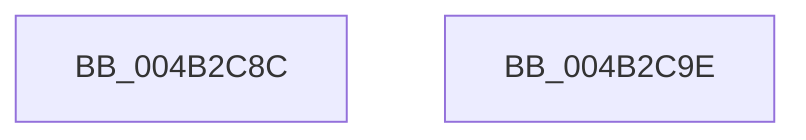

# PpmIdleEnableIdleDurationExpirationTimeout

- RVA: `0x004B2C8C`–`0x004B2C9F` (길이 `19` bytes)
- VA: `0x00000001404B2C8C`
- 실행 섹션: `.text`
- PDB 이름 있음: `예`; PDB Function 태그: `아니요`
- unwind 정보 RVA: `0x000DB714`
- 디코드: `4`개 명령, `19/19` bytes 표시
- 미해석 바이트: `0` (있으면 어셈블리에 `.byte`로 보존)

> 이 문서는 커널 이미지의 기계어와 PDB 기호를 분석해 생성했습니다. 4번과 5번은 함수 원형과 자료형을 바이너리 사용 방식에서 추정한 C 해석이며 원본 소스 복구 결과는 아닙니다.

## 1. Dependencies

- 직접 호출 지점: **0**; 고유 호출 대상: **0**
- 직접 호출자로 확인된 함수: **1**
- RIP 상대 이미지 참조: **2**

### Outgoing calls
- 직접 디코드된 call 명령이 없습니다.

### Direct callers
- [PopInitializeHeteroProcessors](../../page/A5/PopInitializeHeteroProcessors_function_00A53570.md) at `0x00A53857`

### Static image references
- `0x004B2C8C` → RVA `0x00FC5268` (`ALMOSTRO`; read)
- `0x004B2C96` → RVA `0x00FC6F60` (`ALMOSTRO`; write)

## 2. Other-region calls and transfers

- 다른 실행 섹션으로 향하는 call: **0**
- 별도 외부 분기/꼬리 이동을 확인하지 못했습니다.

## 3. Assembly (complete function range)

```asm
004B2C8C  69 0D D2 25 B1 00 10 27 00 00   imul ecx, dword ptr [rip + 0xb125d2], 0x2710
004B2C96  48 89 0D C3 42 B1 00            mov qword ptr [rip + 0xb142c3], rcx
004B2C9D  C3                              ret
004B2C9E  CC                              int3
```

## 4. C-style interpretation (structured pseudocode)

```c
void __fastcall PpmIdleEnableIdleDurationExpirationTimeout(void)
{
    a1 = (unsigned int)((a1) * (*(unsigned int *)(v_rip + 11609554)));
    *(unsigned __int64 *)(v_rip + 11616963) = a1;
    return;
}
```

## 5. (Beta) C Style

```c
void PpmIdleEnableIdleDurationExpirationTimeout(void)
{
    a1 = (uint32_t)((a1) * (*(uint32_t *)(v_rip + 0xB125D2)));
    *(uint64_t *)(v_rip + 0xB142C3) = a1;
    return;
}
```

## 6. Execution-region graph

[열기: 2D/3D 그래프와 함수 탐색 컨트롤 패널](../../../control-panel.html?section=text&rva=0x004B2C8C&view=graph)

- 2D 그래프는 위에서 아래로 흐르고, 3D 그래프는 빈 공간을 드래그해 회전합니다. Shift+드래그는 이동, 휠은 확대·축소, 함수 노드 선택은 대상 보고서 이동입니다.

### Static fallback


