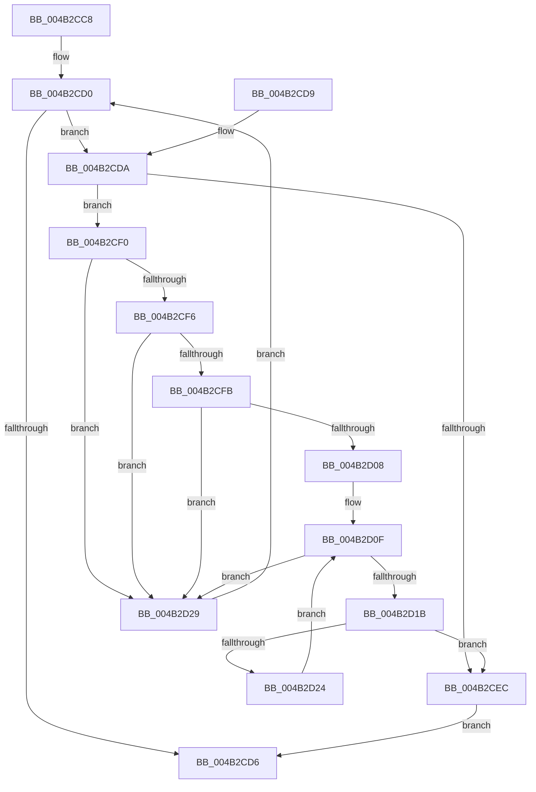

# PpmPerfCheckRequired

- RVA: `0x004B2CC8`–`0x004B2D2E` (길이 `102` bytes)
- VA: `0x00000001404B2CC8`
- 실행 섹션: `.text`
- PDB 이름 있음: `예`; PDB Function 태그: `아니요`
- unwind 정보 RVA: `0x000DB714`
- 디코드: `33`개 명령, `102/102` bytes 표시
- 미해석 바이트: `0` (있으면 어셈블리에 `.byte`로 보존)

> 이 문서는 커널 이미지의 기계어와 PDB 기호를 분석해 생성했습니다. 4번과 5번은 함수 원형과 자료형을 바이너리 사용 방식에서 추정한 C 해석이며 원본 소스 복구 결과는 아닙니다.

## 1. Dependencies

- 직접 호출 지점: **0**; 고유 호출 대상: **0**
- 직접 호출자로 확인된 함수: **1**
- RIP 상대 이미지 참조: **1**

### Outgoing calls
- 직접 디코드된 call 명령이 없습니다.

### Direct callers
- [PpmCheckReInit](../../page/A8/PpmCheckReInit_function_00A84DD8.md) at `0x00A84E2C`

### Static image references
- `0x004B2D08` → RVA `0x00FC6BA8` (`ALMOSTRO`; read)

## 2. Other-region calls and transfers

- 다른 실행 섹션으로 향하는 call: **0**
- 별도 외부 분기/꼬리 이동을 확인하지 못했습니다.

## 3. Assembly (complete function range)

```asm
004B2CC8  33 D2                           xor edx, edx
004B2CCA  4C 8B D1                        mov r10, rcx
004B2CCD  44 8B C2                        mov r8d, edx
004B2CD0  41 83 F8 02                     cmp r8d, 2
004B2CD4  72 04                           jb 0x1404b2cda
004B2CD6  8A C2                           mov al, dl
004B2CD8  C3                              ret
004B2CD9  CC                              int3
004B2CDA  41 8B C0                        mov eax, r8d
004B2CDD  42 8A 4C 10 2A                  mov cl, byte ptr [rax + r10 + 0x2a]
004B2CE2  46 8A 4C 10 2C                  mov r9b, byte ptr [rax + r10 + 0x2c]
004B2CE7  41 3A C9                        cmp cl, r9b
004B2CEA  74 04                           je 0x1404b2cf0
004B2CEC  B2 01                           mov dl, 1
004B2CEE  EB E6                           jmp 0x1404b2cd6
004B2CF0  41 80 F9 64                     cmp r9b, 0x64
004B2CF4  75 33                           jne 0x1404b2d29
004B2CF6  41 3A C9                        cmp cl, r9b
004B2CF9  75 2E                           jne 0x1404b2d29
004B2CFB  41 8B 42 48                     mov eax, dword ptr [r10 + 0x48]
004B2CFF  FF C8                           dec eax
004B2D01  A9 FD FF FF FF                  test eax, 0xfffffffd
004B2D06  75 21                           jne 0x1404b2d29
004B2D08  48 8B 05 99 3E B1 00            mov rax, qword ptr [rip + 0xb13e99]
004B2D0F  48 8D 0D 92 3E B1 00            lea rcx, [rip + 0xb13e92]
004B2D16  48 3B C1                        cmp rax, rcx
004B2D19  74 0E                           je 0x1404b2d29
004B2D1B  83 B8 C4 01 00 00 64            cmp dword ptr [rax + 0x1c4], 0x64
004B2D22  77 C8                           ja 0x1404b2cec
004B2D24  48 8B 00                        mov rax, qword ptr [rax]
004B2D27  EB E6                           jmp 0x1404b2d0f
004B2D29  41 FF C0                        inc r8d
004B2D2C  EB A2                           jmp 0x1404b2cd0
```

## 4. C-style interpretation (structured pseudocode)

```c
__int64 __fastcall PpmPerfCheckRequired(__int64 a1, int a2)
{
    __int64 result;

    a2 = 0;
loc_004B2CD0:
    if (0 < 2) goto loc_004B2CDA;
loc_004B2CD6:
    return 0;
loc_004B2CDA:
    if (((unsigned __int8)(*(unsigned __int8 *)(0 + a1 * 1 + 42))) == ((unsigned __int8)(*(unsigned __int8 *)(0 + a1 * 1 + 44)))) goto loc_004B2CF0;
loc_004B2CEC:
    goto loc_004B2CD6;
loc_004B2CF0:
    if (((unsigned __int8)(*(unsigned __int8 *)(0 + a1 * 1 + 44))) != 100) goto loc_004B2D29;
    if (((unsigned __int8)(*(unsigned __int8 *)(0 + a1 * 1 + 42))) != ((unsigned __int8)(*(unsigned __int8 *)(0 + a1 * 1 + 44)))) goto loc_004B2D29;
    result = (unsigned int)(((unsigned int)(*(unsigned int *)(a1 + 72))) - 1);
    if ((((unsigned int)(result)) & (0xFFFFFFFDULL)) != 0) goto loc_004B2D29;
loc_004B2D0F:
    if ((*(unsigned __int64 *)(v_rip + 11615897)) == (v_rip + 11615890)) goto loc_004B2D29;
    if ((*(unsigned int *)(*(unsigned __int64 *)(v_rip + 11615897) + 452)) > 100) goto loc_004B2CEC;
    goto loc_004B2D0F;
loc_004B2D29:
    a3 = (unsigned int)((0) + 1);
    goto loc_004B2CD0;
}
```

## 5. (Beta) C Style

```c
int64_t PpmPerfCheckRequired(void *Arg1, int32_t Arg2)
{
    uint8_t *arg1 = (uint8_t *)Arg1;

    int64_t result;

    Arg2 = 0;
loc_004B2CD0:
    if (0 < 2) goto loc_004B2CDA;
loc_004B2CD6:
    return 0;
loc_004B2CDA:
    if (((uint8_t)(*(uint8_t *)(0 + arg1 * 1 + 0x2A))) == ((uint8_t)(*(uint8_t *)(0 + arg1 * 1 + 0x2C)))) goto loc_004B2CF0;
loc_004B2CEC:
    goto loc_004B2CD6;
loc_004B2CF0:
    if (((uint8_t)(*(uint8_t *)(0 + arg1 * 1 + 0x2C))) != 100) goto loc_004B2D29;
    if (((uint8_t)(*(uint8_t *)(0 + arg1 * 1 + 0x2A))) != ((uint8_t)(*(uint8_t *)(0 + arg1 * 1 + 0x2C)))) goto loc_004B2D29;
    result = (uint32_t)(((uint32_t)(*(uint32_t *)(arg1 + 0x48))) - 1);
    if ((((uint32_t)(result)) & (0xFFFFFFFDULL)) != 0) goto loc_004B2D29;
loc_004B2D0F:
    if ((*(uint64_t *)(v_rip + 0xB13E99)) == (v_rip + 11615890)) goto loc_004B2D29;
    if ((*(uint32_t *)(*(uint64_t *)(v_rip + 0xB13E99) + 0x1C4)) > 100) goto loc_004B2CEC;
    goto loc_004B2D0F;
loc_004B2D29:
    a3 = (uint32_t)((0) + 1);
    goto loc_004B2CD0;
}
```

### 관측된 메모리 오프셋

구조체 형식이 확인되지 않은 접근은 인자 기준의 오프셋으로만 기록했습니다.

| 기준 인자 | 오프셋 표현 | 폭 (bit) | 접근 |
|---|---:|---:|---|
| `Arg1` | `+ 0x48` | `32` | `R` |

## 6. Execution-region graph

[열기: 2D/3D 그래프와 함수 탐색 컨트롤 패널](../../../control-panel.html?section=text&rva=0x004B2CC8&view=graph)

- 2D 그래프는 위에서 아래로 흐르고, 3D 그래프는 빈 공간을 드래그해 회전합니다. Shift+드래그는 이동, 휠은 확대·축소, 함수 노드 선택은 대상 보고서 이동입니다.

### Static fallback


