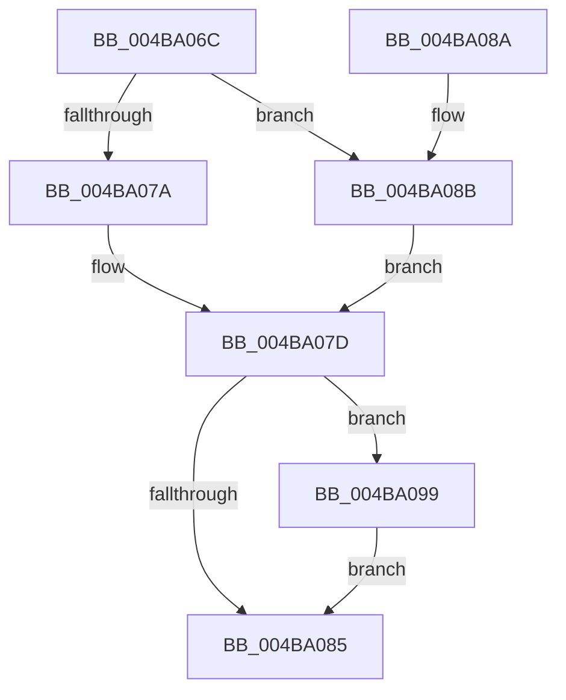

# PpmPerfUpdateMultimediaPowerModel

- RVA: `0x004BA06C`–`0x004BA0C8` (길이 `92` bytes)
- VA: `0x00000001404BA06C`
- 실행 섹션: `.text`
- PDB 이름 있음: `예`; PDB Function 태그: `아니요`
- unwind 정보 RVA: `0x000ACD4C`
- 디코드: `24`개 명령, `92/92` bytes 표시
- 미해석 바이트: `0` (있으면 어셈블리에 `.byte`로 보존)

> 이 문서는 커널 이미지의 기계어와 PDB 기호를 분석해 생성했습니다. 4번과 5번은 함수 원형과 자료형을 바이너리 사용 방식에서 추정한 C 해석이며 원본 소스 복구 결과는 아닙니다.

## 1. Dependencies

- 직접 호출 지점: **1**; 고유 호출 대상: **1**
- 직접 호출자로 확인된 함수: **3**
- RIP 상대 이미지 참조: **5**

### Outgoing calls
- `0x004BA0C1` → [ZwUpdateWnfStateData](../6B/ZwUpdateWnfStateData_function_006B0D10.md) (function, `0x006B0D10`)

### Direct callers
- [PpmDisableProfile](../../page/77/PpmDisableProfile_function_00770858.md) at `0x007708DC`
- [PpmEnableProfile](../../page/77/PpmEnableProfile_function_00770938.md) at `0x007709A0`
- [PpmPerfUpdateDomainPolicy](../../page/A9/PpmPerfUpdateDomainPolicy_function_00A97030.md) at `0x00A9717E`

### Static image references
- `0x004BA072` → RVA `0x00F0E178` (`.data`; read)
- `0x004BA07D` → RVA `0x00F0E174` (`.data`; read)
- `0x004BA08B` → RVA `0x00F07778` (`.data`; read)
- `0x004BA0B0` → RVA `0x00020B10` (`.rdata`; read)
- `0x004BA0B7` → RVA `0x00F0E174` (`.data`; write)

## 2. Other-region calls and transfers

- 다른 실행 섹션으로 향하는 call: **0**
- 별도 외부 분기/꼬리 이동을 확인하지 못했습니다.

## 3. Assembly (complete function range)

```asm
004BA06C  48 83 EC 48                     sub rsp, 0x48
004BA070  33 C9                           xor ecx, ecx
004BA072  38 0D 00 41 A5 00               cmp byte ptr [rip + 0xa54100], cl
004BA078  74 11                           je 0x1404ba08b
004BA07A  8D 41 02                        lea eax, [rcx + 2]
004BA07D  3B 05 F1 40 A5 00               cmp eax, dword ptr [rip + 0xa540f1]
004BA083  75 14                           jne 0x1404ba099
004BA085  48 83 C4 48                     add rsp, 0x48
004BA089  C3                              ret
004BA08A  CC                              int3
004BA08B  48 39 0D E6 D6 A4 00            cmp qword ptr [rip + 0xa4d6e6], rcx
004BA092  8B C1                           mov eax, ecx
004BA094  0F 95 C0                        setne al
004BA097  EB E4                           jmp 0x1404ba07d
004BA099  89 4C 24 30                     mov dword ptr [rsp + 0x30], ecx
004BA09D  48 8D 15 D0 40 A5 00            lea rdx, [rip + 0xa540d0]
004BA0A4  89 4C 24 28                     mov dword ptr [rsp + 0x28], ecx
004BA0A8  45 33 C9                        xor r9d, r9d
004BA0AB  48 89 4C 24 20                  mov qword ptr [rsp + 0x20], rcx
004BA0B0  48 8D 0D 59 6A B6 FF            lea rcx, [rip - 0x4995a7]
004BA0B7  89 05 B7 40 A5 00               mov dword ptr [rip + 0xa540b7], eax
004BA0BD  45 8D 41 04                     lea r8d, [r9 + 4]
004BA0C1  E8 4A 6C 1F 00                  call 0x1406b0d10
004BA0C6  EB BD                           jmp 0x1404ba085
```

## 4. C-style interpretation (structured pseudocode)

```c
__int64 __fastcall PpmPerfUpdateMultimediaPowerModel(int a1, __int64 a2, __int64 a3, int a4)
{
    __int64 result;
    __int64 v_rsp;
    unsigned __int64 v_stack_p20;
    unsigned int v_stack_p28;
    unsigned int v_stack_p30;

    v_rsp = (v_rsp) - (72);
    a1 = 0;
    if ((*(unsigned __int8 *)(v_rip + 10830080)) == 0) goto loc_004BA08B;
loc_004BA07D:
    if (((unsigned int)(a1 + 2)) != (*(unsigned int *)(v_rip + 10830065))) goto loc_004BA099;
loc_004BA085:
    v_rsp = (v_rsp) + (72);
    return a1 + 2;
loc_004BA08B:
    result = ((*(unsigned __int64 *)(v_rip + 10802918)) != 0) ? 1 : 0;
    goto loc_004BA07D;
loc_004BA099:
    v_stack_p30 = 0;
    v_stack_p28 = 0;
    a4 = 0;
    v_stack_p20 = 0;
    *(unsigned int *)(v_rip + 10830007) = (unsigned int)(result);
    result = ZwUpdateWnfStateData(v_rip - 4822439, v_rip + 10830032, a4 + 4, a4);
    goto loc_004BA085;
}
```

## 5. (Beta) C Style

```c
int64_t PpmPerfUpdateMultimediaPowerModel(int32_t Arg1, int64_t Arg2, int64_t Arg3, int32_t Arg4)
{
    int64_t result;
    int64_t local_rsp;
    uint64_t v_stack_p20;
    uint32_t v_stack_p28;
    uint32_t v_stack_p30;

    local_rsp = (local_rsp) - (72);
    Arg1 = 0;
    if ((*(uint8_t *)(v_rip + 0xA54100)) == 0) goto loc_004BA08B;
loc_004BA07D:
    if (((uint32_t)(Arg1 + 2)) != (*(uint32_t *)(v_rip + 0xA540F1))) goto loc_004BA099;
loc_004BA085:
    local_rsp = (local_rsp) + (72);
    return Arg1 + 2;
loc_004BA08B:
    result = ((*(uint64_t *)(v_rip + 0xA4D6E6)) != 0) ? 1 : 0;
    goto loc_004BA07D;
loc_004BA099:
    v_stack_p30 = 0;
    v_stack_p28 = 0;
    Arg4 = 0;
    v_stack_p20 = 0;
    *(uint32_t *)(v_rip + 0xA540B7) = (uint32_t)(result);
    result = ZwUpdateWnfStateData(v_rip - 4822439, v_rip + 10830032, Arg4 + 4, Arg4);
    goto loc_004BA085;
}
```

## 6. Execution-region graph

[열기: 2D/3D 그래프와 함수 탐색 컨트롤 패널](../../../control-panel.html?section=text&rva=0x004BA06C&view=graph)

- 2D 그래프는 위에서 아래로 흐르고, 3D 그래프는 빈 공간을 드래그해 회전합니다. Shift+드래그는 이동, 휠은 확대·축소, 함수 노드 선택은 대상 보고서 이동입니다.

### Static fallback


