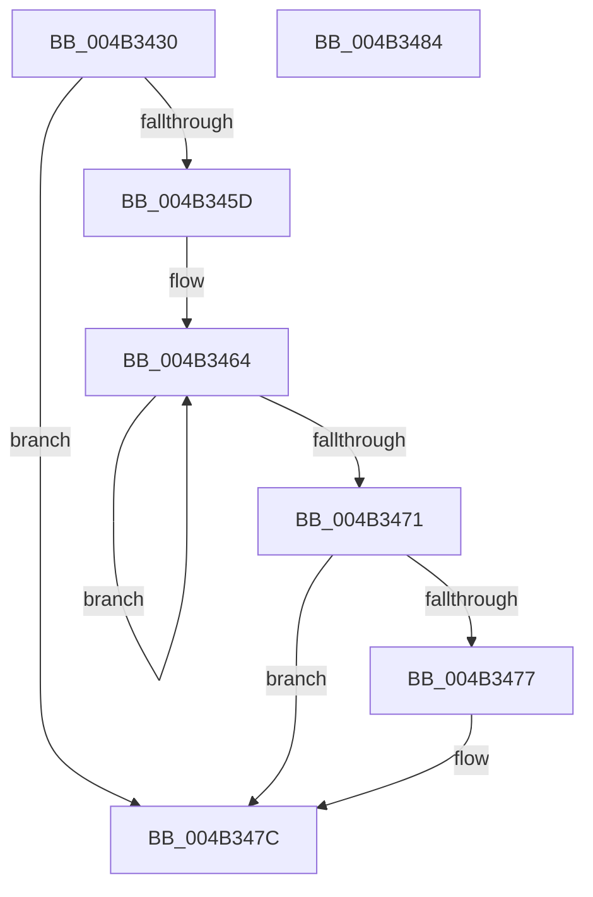

# PpmResetInterruptRate

- RVA: `0x004B3430`–`0x004B3485` (길이 `85` bytes)
- VA: `0x00000001404B3430`
- 실행 섹션: `.text`
- PDB 이름 있음: `예`; PDB Function 태그: `아니요`
- unwind 정보 RVA: `0x0005C788`
- 디코드: `23`개 명령, `85/85` bytes 표시
- 미해석 바이트: `0` (있으면 어셈블리에 `.byte`로 보존)

> 이 문서는 커널 이미지의 기계어와 PDB 기호를 분석해 생성했습니다. 4번과 5번은 함수 원형과 자료형을 바이너리 사용 방식에서 추정한 C 해석이며 원본 소스 복구 결과는 아닙니다.

## 1. Dependencies

- 직접 호출 지점: **1**; 고유 호출 대상: **1**
- 직접 호출자로 확인된 함수: **0**
- RIP 상대 이미지 참조: **0**

### Outgoing calls
- `0x004B3477` → [KiRemoveSystemWorkPriorityKick](../26/KiRemoveSystemWorkPriorityKick_function_002631D0.md) (function, `0x002631D0`)

### Direct callers
- 이 함수 시작 RVA로 연결되는 직접 call은 확인되지 않았습니다. 간접 호출은 완전히 역산할 수 없습니다.

### Static image references
- 디코드된 RIP-relative 메모리 참조가 없습니다.

## 2. Other-region calls and transfers

- 다른 실행 섹션으로 향하는 call: **0**
- 별도 외부 분기/꼬리 이동을 확인하지 못했습니다.

## 3. Assembly (complete function range)

```asm
004B3430  48 83 EC 28                     sub rsp, 0x28
004B3434  FA                              cli
004B3435  83 A1 A4 2D 00 00 00            and dword ptr [rcx + 0x2da4], 0
004B343C  8B 81 40 86 00 00               mov eax, dword ptr [rcx + 0x8640]
004B3442  89 81 A0 2D 00 00               mov dword ptr [rcx + 0x2da0], eax
004B3448  65 48 8B 0C 25 20 00 00 00      mov rcx, qword ptr gs:[0x20]
004B3451  4C 8B 81 B8 8E 00 00            mov r8, qword ptr [rcx + 0x8eb8]
004B3458  4D 85 C0                        test r8, r8
004B345B  74 1F                           je 0x1404b347c
004B345D  41 0F 0D 08                     prefetchw byte ptr [r8]
004B3461  41 8B 00                        mov eax, dword ptr [r8]
004B3464  8B D0                           mov edx, eax
004B3466  0F BA F2 15                     btr edx, 0x15
004B346A  F0 41 0F B1 10                  lock cmpxchg dword ptr [r8], edx
004B346F  75 F3                           jne 0x1404b3464
004B3471  0F BA E0 15                     bt eax, 0x15
004B3475  73 05                           jae 0x1404b347c
004B3477  E8 54 FD DA FF                  call 0x1402631d0
004B347C  FB                              sti
004B347D  33 C0                           xor eax, eax
004B347F  48 83 C4 28                     add rsp, 0x28
004B3483  C3                              ret
004B3484  CC                              int3
```

## 4. C-style interpretation (structured pseudocode)

```c
__int64 __fastcall PpmResetInterruptRate(__int64 a1)
{
    __int64 result;
    __int64 v_rsp;

    v_rsp = (v_rsp) - (40);
    *(unsigned int *)(a1 + 11680) = (unsigned int)((unsigned int)(*(unsigned int *)(a1 + 34368)));
    if (*(unsigned __int64 *)(*(unsigned __int64 *)(gs_base + (0 + 32)) + 36536) == 0) goto loc_004B347C;
loc_004B3464:
    if (*(unsigned __int64 *)(*(unsigned __int64 *)(gs_base + (0 + 32)) + 36536) != 0) goto loc_004B3464;
    result = (unsigned int)(*(unsigned int *)(*(unsigned __int64 *)(*(unsigned __int64 *)(gs_base + (0 + 32)) + 36536)));
    if (!(condition_is_above_or_equal)) {
        result = KiRemoveSystemWorkPriorityKick(*(unsigned __int64 *)(gs_base + (0 + 32)), (unsigned int)((unsigned int)((unsigned int)(*(unsigned int *)(*(unsigned __int64 *)(*(unsigned __int64 *)(gs_base + (0 + 32)) + 36536))))), *(unsigned __int64 *)(*(unsigned __int64 *)(gs_base + (0 + 32)) + 36536), a4);
    }
    result = 0;
    v_rsp = (v_rsp) + (40);
    return result;
}
```

## 5. (Beta) C Style

```c
int64_t PpmResetInterruptRate(void *Arg1)
{
    uint8_t *arg1 = (uint8_t *)Arg1;

    int64_t result;
    int64_t local_rsp;

    local_rsp = (local_rsp) - (40);
    *(uint32_t *)(arg1 + 0x2DA0) = (uint32_t)((uint32_t)(*(uint32_t *)(arg1 + 0x8640)));
    if (*(uint64_t *)(*(uint64_t *)(gs_base + (0 + 0x20)) + 0x8EB8) == 0) goto loc_004B347C;
loc_004B3464:
    if (*(uint64_t *)(*(uint64_t *)(gs_base + (0 + 0x20)) + 0x8EB8) != 0) goto loc_004B3464;
    result = (uint32_t)(*(uint32_t *)(*(uint64_t *)(*(uint64_t *)(gs_base + (0 + 0x20)) + 0x8EB8)));
    if (!(condition_is_above_or_equal)) {
        result = KiRemoveSystemWorkPriorityKick(*(uint64_t *)(gs_base + (0 + 0x20)), (uint32_t)((uint32_t)((uint32_t)(*(uint32_t *)(*(uint64_t *)(*(uint64_t *)(gs_base + (0 + 0x20)) + 0x8EB8))))), *(uint64_t *)(*(uint64_t *)(gs_base + (0 + 0x20)) + 0x8EB8), a4);
    }
    result = 0;
    local_rsp = (local_rsp) + (40);
    return result;
}
```

### 관측된 메모리 오프셋

구조체 형식이 확인되지 않은 접근은 인자 기준의 오프셋으로만 기록했습니다.

| 기준 인자 | 오프셋 표현 | 폭 (bit) | 접근 |
|---|---:|---:|---|
| `Arg1` | `+ 0x2DA0` | `32` | `W` |
| `Arg1` | `+ 0x2DA4` | `32` | `R/W` |
| `Arg1` | `+ 0x8640` | `32` | `R` |

## 6. Execution-region graph

[열기: 2D/3D 그래프와 함수 탐색 컨트롤 패널](../../../control-panel.html?section=text&rva=0x004B3430&view=graph)

- 2D 그래프는 위에서 아래로 흐르고, 3D 그래프는 빈 공간을 드래그해 회전합니다. Shift+드래그는 이동, 휠은 확대·축소, 함수 노드 선택은 대상 보고서 이동입니다.

### Static fallback


