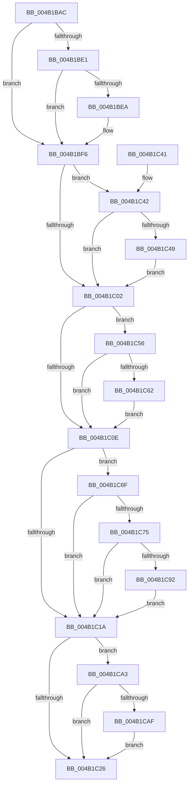

# PpmUpdateTargetProcessorPolicy

- RVA: `0x004B1BAC`–`0x004B1CC2` (길이 `278` bytes)
- VA: `0x00000001404B1BAC`
- 실행 섹션: `.text`
- PDB 이름 있음: `예`; PDB Function 태그: `아니요`
- unwind 정보 RVA: `0x000B8FB8`
- 디코드: `74`개 명령, `278/278` bytes 표시
- 미해석 바이트: `0` (있으면 어셈블리에 `.byte`로 보존)

> 이 문서는 커널 이미지의 기계어와 PDB 기호를 분석해 생성했습니다. 4번과 5번은 함수 원형과 자료형을 바이너리 사용 방식에서 추정한 C 해석이며 원본 소스 복구 결과는 아닙니다.

## 1. Dependencies

- 직접 호출 지점: **6**; 고유 호출 대상: **2**
- 직접 호출자로 확인된 함수: **2**
- RIP 상대 이미지 참조: **2**

### Outgoing calls
- `0x004B1BF1` → [guard_dispatch_icall](../6B/guard_dispatch_icall_function_006BAAD0.md) (function, `0x006BAAD0`)
- `0x004B1C4F` → [guard_dispatch_icall](../6B/guard_dispatch_icall_function_006BAAD0.md) (function, `0x006BAAD0`)
- `0x004B1C68` → [guard_dispatch_icall](../6B/guard_dispatch_icall_function_006BAAD0.md) (function, `0x006BAAD0`)
- `0x004B1C85` → [guard_dispatch_icall](../6B/guard_dispatch_icall_function_006BAAD0.md) (function, `0x006BAAD0`)
- `0x004B1C99` → [PpmEventAutonomousModeChange](../5D/PpmEventAutonomousModeChange_function_005DA684.md) (function, `0x005DA684`)
- `0x004B1CB8` → [guard_dispatch_icall](../6B/guard_dispatch_icall_function_006BAAD0.md) (function, `0x006BAAD0`)

### Direct callers
- [PpmUpdateProcessorPolicyCallback](PpmUpdateProcessorPolicyCallback_function_004B1B80.md) at `0x004B1B98`
- [PpmUpdateProcessorPolicy](../../page/A5/PpmUpdateProcessorPolicy_function_00A53324.md) at `0x00A5355F`

### Static image references
- `0x004B1C56` → RVA `0x00F0E180` (`.data`; read)
- `0x004B1CAF` → RVA `0x00F0E250` (`.data`; read)

## 2. Other-region calls and transfers

- 다른 실행 섹션으로 향하는 call: **0**
- 별도 외부 분기/꼬리 이동을 확인하지 못했습니다.

## 3. Assembly (complete function range)

```asm
004B1BAC  48 8B C4                        mov rax, rsp
004B1BAF  48 89 58 08                     mov qword ptr [rax + 8], rbx
004B1BB3  48 89 68 10                     mov qword ptr [rax + 0x10], rbp
004B1BB7  48 89 70 18                     mov qword ptr [rax + 0x18], rsi
004B1BBB  48 89 78 20                     mov qword ptr [rax + 0x20], rdi
004B1BBF  41 56                           push r14
004B1BC1  48 83 EC 20                     sub rsp, 0x20
004B1BC5  48 8B 81 50 01 00 00            mov rax, qword ptr [rcx + 0x150]
004B1BCC  49 8B E9                        mov rbp, r9
004B1BCF  48 8B 72 08                     mov rsi, qword ptr [rdx + 8]
004B1BD3  49 8B F8                        mov rdi, r8
004B1BD6  4C 8B F2                        mov r14, rdx
004B1BD9  48 8B D9                        mov rbx, rcx
004B1BDC  48 85 C0                        test rax, rax
004B1BDF  74 15                           je 0x1404b1bf6
004B1BE1  45 8B 10                        mov r10d, dword ptr [r8]
004B1BE4  41 F6 C2 20                     test r10b, 0x20
004B1BE8  74 0C                           je 0x1404b1bf6
004B1BEA  41 8B 51 44                     mov edx, dword ptr [r9 + 0x44]
004B1BEE  48 8B CE                        mov rcx, rsi
004B1BF1  E8 DA 8E 20 00                  call 0x1406baad0
004B1BF6  48 8B 83 58 01 00 00            mov rax, qword ptr [rbx + 0x158]
004B1BFD  48 85 C0                        test rax, rax
004B1C00  75 40                           jne 0x1404b1c42
004B1C02  48 8B 83 60 01 00 00            mov rax, qword ptr [rbx + 0x160]
004B1C09  48 85 C0                        test rax, rax
004B1C0C  75 48                           jne 0x1404b1c56
004B1C0E  48 8B 83 68 01 00 00            mov rax, qword ptr [rbx + 0x168]
004B1C15  48 85 C0                        test rax, rax
004B1C18  75 55                           jne 0x1404b1c6f
004B1C1A  48 8B 83 48 01 00 00            mov rax, qword ptr [rbx + 0x148]
004B1C21  48 85 C0                        test rax, rax
004B1C24  75 7D                           jne 0x1404b1ca3
004B1C26  48 8B 5C 24 30                  mov rbx, qword ptr [rsp + 0x30]
004B1C2B  48 8B 6C 24 38                  mov rbp, qword ptr [rsp + 0x38]
004B1C30  48 8B 74 24 40                  mov rsi, qword ptr [rsp + 0x40]
004B1C35  48 8B 7C 24 48                  mov rdi, qword ptr [rsp + 0x48]
004B1C3A  48 83 C4 20                     add rsp, 0x20
004B1C3E  41 5E                           pop r14
004B1C40  C3                              ret
004B1C41  CC                              int3
004B1C42  8B 0F                           mov ecx, dword ptr [rdi]
004B1C44  F6 C1 40                        test cl, 0x40
004B1C47  74 B9                           je 0x1404b1c02
004B1C49  8B 55 48                        mov edx, dword ptr [rbp + 0x48]
004B1C4C  48 8B CE                        mov rcx, rsi
004B1C4F  E8 7C 8E 20 00                  call 0x1406baad0
004B1C54  EB AC                           jmp 0x1404b1c02
004B1C56  F7 05 20 C5 A5 00 00 01 00 00   test dword ptr [rip + 0xa5c520], 0x100
004B1C60  74 AC                           je 0x1404b1c0e
004B1C62  8B 55 58                        mov edx, dword ptr [rbp + 0x58]
004B1C65  48 8B CE                        mov rcx, rsi
004B1C68  E8 63 8E 20 00                  call 0x1406baad0
004B1C6D  EB 9F                           jmp 0x1404b1c0e
004B1C6F  8B 0F                           mov ecx, dword ptr [rdi]
004B1C71  84 C9                           test cl, cl
004B1C73  79 A5                           jns 0x1404b1c1a
004B1C75  8A 4D 5C                        mov cl, byte ptr [rbp + 0x5c]
004B1C78  88 8B 08 02 00 00               mov byte ptr [rbx + 0x208], cl
004B1C7E  48 8B CE                        mov rcx, rsi
004B1C81  0F B6 55 5C                     movzx edx, byte ptr [rbp + 0x5c]
004B1C85  E8 46 8E 20 00                  call 0x1406baad0
004B1C8A  49 8B 0E                        mov rcx, qword ptr [r14]
004B1C8D  48 85 C9                        test rcx, rcx
004B1C90  74 88                           je 0x1404b1c1a
004B1C92  0F B6 93 08 02 00 00            movzx edx, byte ptr [rbx + 0x208]
004B1C99  E8 E6 89 12 00                  call 0x1405da684
004B1C9E  E9 77 FF FF FF                  jmp 0x1404b1c1a
004B1CA3  F7 07 00 02 00 00               test dword ptr [rdi], 0x200
004B1CA9  0F 84 77 FF FF FF               je 0x1404b1c26
004B1CAF  8B 15 9B C5 A5 00               mov edx, dword ptr [rip + 0xa5c59b]
004B1CB5  48 8B CE                        mov rcx, rsi
004B1CB8  E8 13 8E 20 00                  call 0x1406baad0
004B1CBD  E9 64 FF FF FF                  jmp 0x1404b1c26
```

## 4. C-style interpretation (structured pseudocode)

```c
__int64 __fastcall PpmUpdateTargetProcessorPolicy(__int64 a1, __int64 a2, __int64 a3, __int64 a4)
{
    __int64 result;
    __int64 v_rsp;
    unsigned __int64 v_stack_p10;
    unsigned __int64 v_stack_p18;
    unsigned __int64 v_stack_p20;
    unsigned __int64 v_stack_p8;

    *(unsigned __int64 *)(v_rsp + 8) = v_rbx;
    *(unsigned __int64 *)(v_rsp + 16) = v_rbp;
    *(unsigned __int64 *)(v_rsp + 24) = v_rsi;
    *(unsigned __int64 *)(v_rsp + 32) = v_rdi;
    v_rsp = (v_rsp) - (32);
    if (*(unsigned __int64 *)(a1 + 336) == 0) goto loc_004B1BF6;
    result = *(unsigned __int64 *)(a1 + 336);
    if ((((unsigned __int8)((unsigned int)(*(unsigned int *)(a3)))) & (32)) != 0) {
        a2 = *(unsigned int *)(a4 + 68);
        a1 = *(unsigned __int64 *)(a2 + 8);
        result = guard_dispatch_icall(a1, a2, a3, a4);
    }
    if (*(unsigned __int64 *)(a1 + 344) != 0) goto loc_004B1C42;
loc_004B1C02:
    if (*(unsigned __int64 *)(a1 + 352) != 0) goto loc_004B1C56;
loc_004B1C0E:
    if (*(unsigned __int64 *)(a1 + 360) != 0) goto loc_004B1C6F;
loc_004B1C1A:
    if (*(unsigned __int64 *)(a1 + 328) != 0) goto loc_004B1CA3;
loc_004B1C26:
    v_rsp = (v_rsp) + (32);
    return *(unsigned __int64 *)(a1 + 328);
loc_004B1C42:
    if ((((unsigned __int8)((unsigned int)(*(unsigned int *)(v_stack_p20)))) & (64)) == 0) goto loc_004B1C02;
    result = guard_dispatch_icall(v_stack_p18, (unsigned int)(*(unsigned int *)(v_stack_p10 + 72)), a3, a4);
    goto loc_004B1C02;
loc_004B1C56:
    if (((*(unsigned int *)(v_rip + 10863904)) & (256)) == 0) goto loc_004B1C0E;
    result = guard_dispatch_icall(v_stack_p18, (unsigned int)(*(unsigned int *)(v_stack_p10 + 88)), a3, a4);
    goto loc_004B1C0E;
loc_004B1C6F:
    if (!sign_flag) goto loc_004B1C1A;
    *(unsigned __int8 *)(v_stack_p8 + 520) = (unsigned __int8)(*(unsigned __int8 *)(v_stack_p10 + 92));
    result = guard_dispatch_icall(v_stack_p18, *(unsigned __int8 *)(v_stack_p10 + 92), a3, a4);
    if (*(unsigned __int64 *)(a2) == 0) goto loc_004B1C1A;
    result = PpmEventAutonomousModeChange(*(unsigned __int64 *)(a2), *(unsigned __int8 *)(v_stack_p8 + 520), a3, a4);
    goto loc_004B1C1A;
loc_004B1CA3:
    if (((*(unsigned int *)(v_stack_p20)) & (512)) == 0) goto loc_004B1C26;
    result = guard_dispatch_icall(v_stack_p18, (unsigned int)(*(unsigned int *)(v_rip + 10864027)), a3, a4);
    goto loc_004B1C26;
}
```

## 5. (Beta) C Style

```c
int64_t PpmUpdateTargetProcessorPolicy(void *Arg1, void *Arg2, void *Arg3, void *Arg4)
{
    uint8_t *arg1 = (uint8_t *)Arg1;
    uint8_t *arg2 = (uint8_t *)Arg2;
    uint8_t *arg3 = (uint8_t *)Arg3;
    uint8_t *arg4 = (uint8_t *)Arg4;

    int64_t result;
    int64_t local_rsp;
    uint64_t v_stack_p10;
    uint64_t v_stack_p18;
    uint64_t v_stack_p20;
    uint64_t v_stack_p8;

    *(uint64_t *)(local_rsp + 0x8) = local_rbx;
    *(uint64_t *)(local_rsp + 0x10) = local_rbp;
    *(uint64_t *)(local_rsp + 0x18) = local_rsi;
    *(uint64_t *)(local_rsp + 0x20) = local_rdi;
    local_rsp = (local_rsp) - (32);
    if (*(uint64_t *)(arg1 + 0x150) == 0) goto loc_004B1BF6;
    result = *(uint64_t *)(arg1 + 0x150);
    if ((((uint8_t)((uint32_t)(*(uint32_t *)(arg3)))) & (32)) != 0) {
        Arg2 = *(uint32_t *)(arg4 + 0x44);
        Arg1 = *(uint64_t *)(arg2 + 0x8);
        result = guard_dispatch_icall(Arg1, Arg2, Arg3, Arg4);
    }
    if (*(uint64_t *)(arg1 + 0x158) != 0) goto loc_004B1C42;
loc_004B1C02:
    if (*(uint64_t *)(arg1 + 0x160) != 0) goto loc_004B1C56;
loc_004B1C0E:
    if (*(uint64_t *)(arg1 + 0x168) != 0) goto loc_004B1C6F;
loc_004B1C1A:
    if (*(uint64_t *)(arg1 + 0x148) != 0) goto loc_004B1CA3;
loc_004B1C26:
    local_rsp = (local_rsp) + (32);
    return *(uint64_t *)(arg1 + 0x148);
loc_004B1C42:
    if ((((uint8_t)((uint32_t)(*(uint32_t *)(v_stack_p20)))) & (64)) == 0) goto loc_004B1C02;
    result = guard_dispatch_icall(v_stack_p18, (uint32_t)(*(uint32_t *)(v_stack_p10 + 0x48)), Arg3, Arg4);
    goto loc_004B1C02;
loc_004B1C56:
    if (((*(uint32_t *)(v_rip + 0xA5C520)) & (256)) == 0) goto loc_004B1C0E;
    result = guard_dispatch_icall(v_stack_p18, (uint32_t)(*(uint32_t *)(v_stack_p10 + 0x58)), Arg3, Arg4);
    goto loc_004B1C0E;
loc_004B1C6F:
    if (!sign_flag) goto loc_004B1C1A;
    *(uint8_t *)(v_stack_p8 + 0x208) = (uint8_t)(*(uint8_t *)(v_stack_p10 + 0x5C));
    result = guard_dispatch_icall(v_stack_p18, *(uint8_t *)(v_stack_p10 + 0x5C), Arg3, Arg4);
    if (*(uint64_t *)(arg2) == 0) goto loc_004B1C1A;
    result = PpmEventAutonomousModeChange(*(uint64_t *)(arg2), *(uint8_t *)(v_stack_p8 + 0x208), Arg3, Arg4);
    goto loc_004B1C1A;
loc_004B1CA3:
    if (((*(uint32_t *)(v_stack_p20)) & (512)) == 0) goto loc_004B1C26;
    result = guard_dispatch_icall(v_stack_p18, (uint32_t)(*(uint32_t *)(v_rip + 0xA5C59B)), Arg3, Arg4);
    goto loc_004B1C26;
}
```

### 관측된 메모리 오프셋

구조체 형식이 확인되지 않은 접근은 인자 기준의 오프셋으로만 기록했습니다.

| 기준 인자 | 오프셋 표현 | 폭 (bit) | 접근 |
|---|---:|---:|---|
| `Arg1` | `+ 0x148` | `64` | `R` |
| `Arg1` | `+ 0x150` | `64` | `R` |
| `Arg1` | `+ 0x158` | `64` | `R` |
| `Arg1` | `+ 0x160` | `64` | `R` |
| `Arg1` | `+ 0x168` | `64` | `R` |
| `Arg1` | `+ 0x208` | `8` | `R` |
| `Arg1` | `+ 0x208` | `8` | `W` |
| `Arg2` | `+ 0x0` | `64` | `R` |
| `Arg2` | `+ 0x8` | `64` | `R` |
| `Arg3` | `+ 0x0` | `32` | `R` |
| `Arg4` | `+ 0x44` | `32` | `R` |
| `Arg4` | `+ 0x48` | `32` | `R` |
| `Arg4` | `+ 0x58` | `32` | `R` |
| `Arg4` | `+ 0x5C` | `8` | `R` |

## 6. Execution-region graph

[열기: 2D/3D 그래프와 함수 탐색 컨트롤 패널](../../../control-panel.html?section=text&rva=0x004B1BAC&view=graph)

- 2D 그래프는 위에서 아래로 흐르고, 3D 그래프는 빈 공간을 드래그해 회전합니다. Shift+드래그는 이동, 휠은 확대·축소, 함수 노드 선택은 대상 보고서 이동입니다.

### Static fallback


