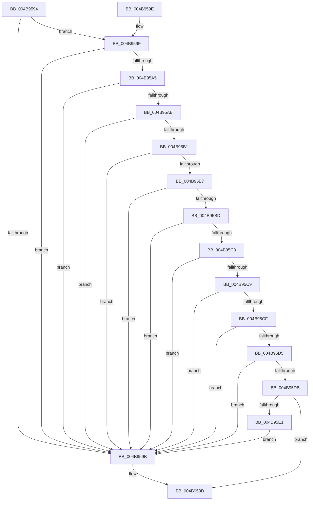

# PspIoRateControlInfoIsAnySet

- RVA: `0x004B9594`–`0x004B95E3` (길이 `79` bytes)
- VA: `0x00000001404B9594`
- 실행 섹션: `.text`
- PDB 이름 있음: `예`; PDB Function 태그: `아니요`
- unwind 정보 RVA: `0x000DB714`
- 디코드: `29`개 명령, `79/79` bytes 표시
- 미해석 바이트: `0` (있으면 어셈블리에 `.byte`로 보존)

> 이 문서는 커널 이미지의 기계어와 PDB 기호를 분석해 생성했습니다. 4번과 5번은 함수 원형과 자료형을 바이너리 사용 방식에서 추정한 C 해석이며 원본 소스 복구 결과는 아닙니다.

## 1. Dependencies

- 직접 호출 지점: **0**; 고유 호출 대상: **0**
- 직접 호출자로 확인된 함수: **2**
- RIP 상대 이미지 참조: **0**

### Outgoing calls
- 직접 디코드된 call 명령이 없습니다.

### Direct callers
- [PspSetJobIoRateControl](../../page/9F/PspSetJobIoRateControl_function_009F78EC.md) at `0x009F7A2F`
- [PspSetJobIoRateControlForVolume](../../page/9F/PspSetJobIoRateControlForVolume_function_009F80A0.md) at `0x009F814C`

### Static image references
- 디코드된 RIP-relative 메모리 참조가 없습니다.

## 2. Other-region calls and transfers

- 다른 실행 섹션으로 향하는 call: **0**
- 별도 외부 분기/꼬리 이동을 확인하지 못했습니다.

## 3. Assembly (complete function range)

```asm
004B9594  33 C0                           xor eax, eax
004B9596  48 39 01                        cmp qword ptr [rcx], rax
004B9599  74 04                           je 0x1404b959f
004B959B  B0 01                           mov al, 1
004B959D  C3                              ret
004B959E  CC                              int3
004B959F  48 39 41 08                     cmp qword ptr [rcx + 8], rax
004B95A3  75 F6                           jne 0x1404b959b
004B95A5  48 39 41 48                     cmp qword ptr [rcx + 0x48], rax
004B95A9  75 F0                           jne 0x1404b959b
004B95AB  48 39 41 60                     cmp qword ptr [rcx + 0x60], rax
004B95AF  75 EA                           jne 0x1404b959b
004B95B1  48 39 41 68                     cmp qword ptr [rcx + 0x68], rax
004B95B5  75 E4                           jne 0x1404b959b
004B95B7  48 39 41 70                     cmp qword ptr [rcx + 0x70], rax
004B95BB  75 DE                           jne 0x1404b959b
004B95BD  48 39 41 10                     cmp qword ptr [rcx + 0x10], rax
004B95C1  75 D8                           jne 0x1404b959b
004B95C3  48 39 41 38                     cmp qword ptr [rcx + 0x38], rax
004B95C7  75 D2                           jne 0x1404b959b
004B95C9  48 39 41 50                     cmp qword ptr [rcx + 0x50], rax
004B95CD  75 CC                           jne 0x1404b959b
004B95CF  48 39 41 30                     cmp qword ptr [rcx + 0x30], rax
004B95D3  75 C6                           jne 0x1404b959b
004B95D5  48 39 41 40                     cmp qword ptr [rcx + 0x40], rax
004B95D9  75 C0                           jne 0x1404b959b
004B95DB  48 39 41 58                     cmp qword ptr [rcx + 0x58], rax
004B95DF  74 BC                           je 0x1404b959d
004B95E1  EB B8                           jmp 0x1404b959b
```

## 4. C-style interpretation (structured pseudocode)

```c
__int64 __fastcall PspIoRateControlInfoIsAnySet(__int64 a1)
{
    __int64 result;

    result = 0;
    if ((*(unsigned __int64 *)(a1)) == 0) goto loc_004B959F;
loc_004B959B:
loc_004B959D:
    return 1;
loc_004B959F:
    if ((*(unsigned __int64 *)(a1 + 8)) != 1) goto loc_004B959B;
    if ((*(unsigned __int64 *)(a1 + 72)) != 1) goto loc_004B959B;
    if ((*(unsigned __int64 *)(a1 + 96)) != 1) goto loc_004B959B;
    if ((*(unsigned __int64 *)(a1 + 104)) != 1) goto loc_004B959B;
    if ((*(unsigned __int64 *)(a1 + 112)) != 1) goto loc_004B959B;
    if ((*(unsigned __int64 *)(a1 + 16)) != 1) goto loc_004B959B;
    if ((*(unsigned __int64 *)(a1 + 56)) != 1) goto loc_004B959B;
    if ((*(unsigned __int64 *)(a1 + 80)) != 1) goto loc_004B959B;
    if ((*(unsigned __int64 *)(a1 + 48)) != 1) goto loc_004B959B;
    if ((*(unsigned __int64 *)(a1 + 64)) != 1) goto loc_004B959B;
    if ((*(unsigned __int64 *)(a1 + 88)) == 1) goto loc_004B959D;
    goto loc_004B959B;
}
```

## 5. (Beta) C Style

```c
int64_t PspIoRateControlInfoIsAnySet(void *Arg1)
{
    uint8_t *arg1 = (uint8_t *)Arg1;

    int64_t result;

    result = 0;
    if ((*(uint64_t *)(arg1)) == 0) goto loc_004B959F;
loc_004B959B:
loc_004B959D:
    return 1;
loc_004B959F:
    if ((*(uint64_t *)(arg1 + 0x8)) != 1) goto loc_004B959B;
    if ((*(uint64_t *)(arg1 + 0x48)) != 1) goto loc_004B959B;
    if ((*(uint64_t *)(arg1 + 0x60)) != 1) goto loc_004B959B;
    if ((*(uint64_t *)(arg1 + 0x68)) != 1) goto loc_004B959B;
    if ((*(uint64_t *)(arg1 + 0x70)) != 1) goto loc_004B959B;
    if ((*(uint64_t *)(arg1 + 0x10)) != 1) goto loc_004B959B;
    if ((*(uint64_t *)(arg1 + 0x38)) != 1) goto loc_004B959B;
    if ((*(uint64_t *)(arg1 + 0x50)) != 1) goto loc_004B959B;
    if ((*(uint64_t *)(arg1 + 0x30)) != 1) goto loc_004B959B;
    if ((*(uint64_t *)(arg1 + 0x40)) != 1) goto loc_004B959B;
    if ((*(uint64_t *)(arg1 + 0x58)) == 1) goto loc_004B959D;
    goto loc_004B959B;
}
```

### 관측된 메모리 오프셋

구조체 형식이 확인되지 않은 접근은 인자 기준의 오프셋으로만 기록했습니다.

| 기준 인자 | 오프셋 표현 | 폭 (bit) | 접근 |
|---|---:|---:|---|
| `Arg1` | `+ 0x0` | `64` | `R` |
| `Arg1` | `+ 0x8` | `64` | `R` |
| `Arg1` | `+ 0x10` | `64` | `R` |
| `Arg1` | `+ 0x30` | `64` | `R` |
| `Arg1` | `+ 0x38` | `64` | `R` |
| `Arg1` | `+ 0x40` | `64` | `R` |
| `Arg1` | `+ 0x48` | `64` | `R` |
| `Arg1` | `+ 0x50` | `64` | `R` |
| `Arg1` | `+ 0x58` | `64` | `R` |
| `Arg1` | `+ 0x60` | `64` | `R` |
| `Arg1` | `+ 0x68` | `64` | `R` |
| `Arg1` | `+ 0x70` | `64` | `R` |

## 6. Execution-region graph

[열기: 2D/3D 그래프와 함수 탐색 컨트롤 패널](../../../control-panel.html?section=text&rva=0x004B9594&view=graph)

- 2D 그래프는 위에서 아래로 흐르고, 3D 그래프는 빈 공간을 드래그해 회전합니다. Shift+드래그는 이동, 휠은 확대·축소, 함수 노드 선택은 대상 보고서 이동입니다.

### Static fallback


