# PspJobDelete

- RVA: `0x004BF8F0`–`0x004BFC97` (길이 `935` bytes)
- VA: `0x00000001404BF8F0`
- 실행 섹션: `.text`
- PDB 이름 있음: `예`; PDB Function 태그: `아니요`
- unwind 정보 RVA: `0x000BC5E4`
- 디코드: `222`개 명령, `935/935` bytes 표시
- 미해석 바이트: `0` (있으면 어셈블리에 `.byte`로 보존)

> 이 문서는 커널 이미지의 기계어와 PDB 기호를 분석해 생성했습니다. 4번과 5번은 함수 원형과 자료형을 바이너리 사용 방식에서 추정한 C 해석이며 원본 소스 복구 결과는 아닙니다.

## 1. Dependencies

- 직접 호출 지점: **39**; 고유 호출 대상: **31**
- 직접 호출자로 확인된 함수: **0**
- RIP 상대 이미지 참조: **4**

### Outgoing calls
- `0x004BF951` → [PspEmptyPropertySet](../../page/90/PspEmptyPropertySet_function_00905D04.md) (function, `0x00905D04`)
- `0x004BF959` → [PspJobDeleteStorageArrays](../../page/A6/PspJobDeleteStorageArrays_function_00A6DF30.md) (function, `0x00A6DF30`)
- `0x004BF97D` → [PspLockRootJobExclusive](../../page/91/PspLockRootJobExclusive_function_00917D0C.md) (function, `0x00917D0C`)
- `0x004BF989` → [PspLockJobConditionally](../../page/9F/PspLockJobConditionally_function_009F7C20.md) (function, `0x009F7C20`)
- `0x004BF99A` → [PspRemoveCpuRateControl](../../page/99/PspRemoveCpuRateControl_function_0099E134.md) (function, `0x0099E134`)
- `0x004BF9C7` → [PspNetRateControlDispatch](../../page/78/PspNetRateControlDispatch_function_007850C4.md) (function, `0x007850C4`)
- `0x004BF9CF` → [PspRemoveRateControl](../../page/78/PspRemoveRateControl_function_00785318.md) (function, `0x00785318`)
- `0x004BF9DB` → [PspUnlockJobConditionally](../../page/A4/PspUnlockJobConditionally_function_00A454A4.md) (function, `0x00A454A4`)
- `0x004BF9E7` → [PspUnlockJob](../../page/91/PspUnlockJob_function_00919E00.md) (function, `0x00919E00`)
- `0x004BF9EF` → [PspJobIoRateControlDisable](../../page/A7/PspJobIoRateControlDisable_function_00A76854.md) (function, `0x00A76854`)
- `0x004BFA07` → [PspLockRootJobExclusive](../../page/91/PspLockRootJobExclusive_function_00917D0C.md) (function, `0x00917D0C`)
- `0x004BFA13` → [PspLockJobConditionally](../../page/9F/PspLockJobConditionally_function_009F7C20.md) (function, `0x009F7C20`)
- `0x004BFA24` → [PspRemoveIoAttribution](../../page/9F/PspRemoveIoAttribution_function_009F8014.md) (function, `0x009F8014`)
- `0x004BFA30` → [PspUnlockJobConditionally](../../page/A4/PspUnlockJobConditionally_function_00A454A4.md) (function, `0x00A454A4`)
- `0x004BFA3C` → [PspUnlockJob](../../page/91/PspUnlockJob_function_00919E00.md) (function, `0x00919E00`)
- `0x004BFA4A` → `ext-ms-win-ntos-win32k-l1-1-0.dll!IsWin32kJobNotifyCallOutPresent` (import, 간접 대상; import `ext-ms-win-ntos-win32k-l1-1-0.dll!IsWin32kJobNotifyCallOutPresent`)
- `0x004BFA67` → `ext-ms-win-ntos-win32k-l1-1-0.dll!Win32kJobTerminateNotify` (import, 간접 대상; import `ext-ms-win-ntos-win32k-l1-1-0.dll!Win32kJobTerminateNotify`)
- `0x004BFA8D` → [ObfDereferenceObjectWithTag](../2F/ObfDereferenceObjectWithTag_function_002F78E0.md) (function, `0x002F78E0`)
- `0x004BFAA9` → [SeReleaseSubjectContext](../../page/86/SeReleaseSubjectContext_function_0086B710.md) (function, `0x0086B710`)
- `0x004BFABA` → [ExFreePoolWithTag](../../poolcode/B8/ExFreePoolWithTag_function_00B82870.md) (function, `0x00B82870`)
- `0x004BFACD` → [PsReturnSharedPoolQuota](../../page/8B/PsReturnSharedPoolQuota_function_008BCC30.md) (function, `0x008BCC30`)
- `0x004BFAD5` → [PspLockJobListExclusive](../../page/91/PspLockJobListExclusive_function_00917780.md) (function, `0x00917780`)
- `0x004BFB02` → [PspUnlockJobListExclusive](../../page/A6/PspUnlockJobListExclusive_function_00A6E354.md) (function, `0x00A6E354`)
- `0x004BFB15` → [ExFreePoolWithTag](../../poolcode/B8/ExFreePoolWithTag_function_00B82870.md) (function, `0x00B82870`)
- `0x004BFB30` → [PsReturnSharedPoolQuota](../../page/8B/PsReturnSharedPoolQuota_function_008BCC30.md) (function, `0x008BCC30`)
- `0x004BFB41` → [IoFreeMiniCompletionPacket](../../page/9A/IoFreeMiniCompletionPacket_function_009A82B0.md) (function, `0x009A82B0`)
- `0x004BFB59` → [ZwDeleteWnfStateName](../6A/ZwDeleteWnfStateName_function_006AECF0.md) (function, `0x006AECF0`)
- `0x004BFB65` → [PspGetJobLockHierarchyForDeletion](../../page/87/PspGetJobLockHierarchyForDeletion_function_0087D510.md) (function, `0x0087D510`)
- `0x004BFB76` → [PspLockJobsAndProcessExclusive](../../page/87/PspLockJobsAndProcessExclusive_function_0087D45C.md) (function, `0x0087D45C`)
- `0x004BFBBB` → [ObDereferenceObjectDeferDeleteWithTag](../26/ObDereferenceObjectDeferDeleteWithTag_function_00263EA0.md) (function, `0x00263EA0`)
- `0x004BFBD0` → [PspUnlockJobsAndProcessExclusive](../../page/87/PspUnlockJobsAndProcessExclusive_function_0087D750.md) (function, `0x0087D750`)
- `0x004BFBD9` → [ExDeleteResourceLite](../38/ExDeleteResourceLite_function_0038BA60.md) (function, `0x0038BA60`)
- `0x004BFBF5` → [ExFreePoolWithTag](../../poolcode/B8/ExFreePoolWithTag_function_00B82870.md) (function, `0x00B82870`)
- `0x004BFC10` → [PspDeleteSilo](../../page/77/PspDeleteSilo_function_0077FE94.md) (function, `0x0077FE94`)
- `0x004BFC39` → [ExMapHandleToPointer](../../page/86/ExMapHandleToPointer_function_00868B60.md) (function, `0x00868B60`)
- `0x004BFC4E` → [ExDestroyHandle](../../page/88/ExDestroyHandle_function_00889430.md) (function, `0x00889430`)
- `0x004BFC53` → [KeLeaveCriticalRegion](../25/KeLeaveCriticalRegion_function_0025D8B0.md) (function, `0x0025D8B0`)
- `0x004BFC66` → [ObfDereferenceObjectWithTag](../2F/ObfDereferenceObjectWithTag_function_002F78E0.md) (function, `0x002F78E0`)
- `0x004BFC72` → [_security_check_cookie](../6A/_security_check_cookie_function_006AC640.md) (function, `0x006AC640`)

### Direct callers
- 이 함수 시작 RVA로 연결되는 직접 call은 확인되지 않았습니다. 간접 호출은 완전히 역산할 수 없습니다.

### Static image references
- `0x004BF90A` → RVA `0x00E0A740` (`.data`; read)
- `0x004BFA4A` → RVA `0x00151690` (`ext-ms-win-ntos-win32k-l1-1-0.dll!IsWin32kJobNotifyCallOutPresent (IAT)`; read)
- `0x004BFA67` → RVA `0x00151680` (`ext-ms-win-ntos-win32k-l1-1-0.dll!Win32kJobTerminateNotify (IAT)`; read)
- `0x004BFC30` → RVA `0x00FD9D00` (`PAGEDATA`; read)

## 2. Other-region calls and transfers

- 다른 실행 섹션으로 향하는 call: **30**
  - `0x004BF951` → [PspEmptyPropertySet](../../page/90/PspEmptyPropertySet_function_00905D04.md) (`.text` → `PAGE`)
  - `0x004BF959` → [PspJobDeleteStorageArrays](../../page/A6/PspJobDeleteStorageArrays_function_00A6DF30.md) (`.text` → `PAGE`)
  - `0x004BF97D` → [PspLockRootJobExclusive](../../page/91/PspLockRootJobExclusive_function_00917D0C.md) (`.text` → `PAGE`)
  - `0x004BF989` → [PspLockJobConditionally](../../page/9F/PspLockJobConditionally_function_009F7C20.md) (`.text` → `PAGE`)
  - `0x004BF99A` → [PspRemoveCpuRateControl](../../page/99/PspRemoveCpuRateControl_function_0099E134.md) (`.text` → `PAGE`)
  - `0x004BF9C7` → [PspNetRateControlDispatch](../../page/78/PspNetRateControlDispatch_function_007850C4.md) (`.text` → `PAGE`)
  - `0x004BF9CF` → [PspRemoveRateControl](../../page/78/PspRemoveRateControl_function_00785318.md) (`.text` → `PAGE`)
  - `0x004BF9DB` → [PspUnlockJobConditionally](../../page/A4/PspUnlockJobConditionally_function_00A454A4.md) (`.text` → `PAGE`)
  - `0x004BF9E7` → [PspUnlockJob](../../page/91/PspUnlockJob_function_00919E00.md) (`.text` → `PAGE`)
  - `0x004BF9EF` → [PspJobIoRateControlDisable](../../page/A7/PspJobIoRateControlDisable_function_00A76854.md) (`.text` → `PAGE`)
  - `0x004BFA07` → [PspLockRootJobExclusive](../../page/91/PspLockRootJobExclusive_function_00917D0C.md) (`.text` → `PAGE`)
  - `0x004BFA13` → [PspLockJobConditionally](../../page/9F/PspLockJobConditionally_function_009F7C20.md) (`.text` → `PAGE`)
  - `0x004BFA24` → [PspRemoveIoAttribution](../../page/9F/PspRemoveIoAttribution_function_009F8014.md) (`.text` → `PAGE`)
  - `0x004BFA30` → [PspUnlockJobConditionally](../../page/A4/PspUnlockJobConditionally_function_00A454A4.md) (`.text` → `PAGE`)
  - `0x004BFA3C` → [PspUnlockJob](../../page/91/PspUnlockJob_function_00919E00.md) (`.text` → `PAGE`)
  - `0x004BFAA9` → [SeReleaseSubjectContext](../../page/86/SeReleaseSubjectContext_function_0086B710.md) (`.text` → `PAGE`)
  - `0x004BFABA` → [ExFreePoolWithTag](../../poolcode/B8/ExFreePoolWithTag_function_00B82870.md) (`.text` → `POOLCODE`)
  - `0x004BFACD` → [PsReturnSharedPoolQuota](../../page/8B/PsReturnSharedPoolQuota_function_008BCC30.md) (`.text` → `PAGE`)
  - `0x004BFAD5` → [PspLockJobListExclusive](../../page/91/PspLockJobListExclusive_function_00917780.md) (`.text` → `PAGE`)
  - `0x004BFB02` → [PspUnlockJobListExclusive](../../page/A6/PspUnlockJobListExclusive_function_00A6E354.md) (`.text` → `PAGE`)
  - `0x004BFB15` → [ExFreePoolWithTag](../../poolcode/B8/ExFreePoolWithTag_function_00B82870.md) (`.text` → `POOLCODE`)
  - `0x004BFB30` → [PsReturnSharedPoolQuota](../../page/8B/PsReturnSharedPoolQuota_function_008BCC30.md) (`.text` → `PAGE`)
  - `0x004BFB41` → [IoFreeMiniCompletionPacket](../../page/9A/IoFreeMiniCompletionPacket_function_009A82B0.md) (`.text` → `PAGE`)
  - `0x004BFB65` → [PspGetJobLockHierarchyForDeletion](../../page/87/PspGetJobLockHierarchyForDeletion_function_0087D510.md) (`.text` → `PAGE`)
  - `0x004BFB76` → [PspLockJobsAndProcessExclusive](../../page/87/PspLockJobsAndProcessExclusive_function_0087D45C.md) (`.text` → `PAGE`)
  - `0x004BFBD0` → [PspUnlockJobsAndProcessExclusive](../../page/87/PspUnlockJobsAndProcessExclusive_function_0087D750.md) (`.text` → `PAGE`)
  - `0x004BFBF5` → [ExFreePoolWithTag](../../poolcode/B8/ExFreePoolWithTag_function_00B82870.md) (`.text` → `POOLCODE`)
  - `0x004BFC10` → [PspDeleteSilo](../../page/77/PspDeleteSilo_function_0077FE94.md) (`.text` → `PAGE`)
  - `0x004BFC39` → [ExMapHandleToPointer](../../page/86/ExMapHandleToPointer_function_00868B60.md) (`.text` → `PAGE`)
  - `0x004BFC4E` → [ExDestroyHandle](../../page/88/ExDestroyHandle_function_00889430.md) (`.text` → `PAGE`)
- 별도 외부 분기/꼬리 이동을 확인하지 못했습니다.

## 3. Assembly (complete function range)

```asm
004BF8F0  48 89 5C 24 10                  mov qword ptr [rsp + 0x10], rbx
004BF8F5  48 89 74 24 18                  mov qword ptr [rsp + 0x18], rsi
004BF8FA  55                              push rbp
004BF8FB  57                              push rdi
004BF8FC  41 56                           push r14
004BF8FE  48 8D 6C 24 B9                  lea rbp, [rsp - 0x47]
004BF903  48 81 EC 90 00 00 00            sub rsp, 0x90
004BF90A  48 8B 05 2F AE 94 00            mov rax, qword ptr [rip + 0x94ae2f]
004BF911  48 33 C4                        xor rax, rsp
004BF914  48 89 45 3F                     mov qword ptr [rbp + 0x3f], rax
004BF918  33 C0                           xor eax, eax
004BF91A  0F 57 C9                        xorps xmm1, xmm1
004BF91D  0F 57 C0                        xorps xmm0, xmm0
004BF920  48 89 45 0F                     mov qword ptr [rbp + 0xf], rax
004BF924  48 8B D9                        mov rbx, rcx
004BF927  89 45 37                        mov dword ptr [rbp + 0x37], eax
004BF92A  0F 11 4D EF                     movups xmmword ptr [rbp - 0x11], xmm1
004BF92E  45 33 F6                        xor r14d, r14d
004BF931  48 81 C1 E8 05 00 00            add rcx, 0x5e8
004BF938  0F 11 4D FF                     movups xmmword ptr [rbp - 1], xmm1
004BF93C  65 48 8B 3C 25 88 01 00 00      mov rdi, qword ptr gs:[0x188]
004BF945  0F 11 45 17                     movups xmmword ptr [rbp + 0x17], xmm0
004BF949  4C 89 75 E7                     mov qword ptr [rbp - 0x19], r14
004BF94D  0F 11 45 27                     movups xmmword ptr [rbp + 0x27], xmm0
004BF951  E8 AE 63 44 00                  call 0x140905d04
004BF956  48 8B CB                        mov rcx, rbx
004BF959  E8 D2 E5 5A 00                  call 0x140a6df30
004BF95E  48 8D B3 08 06 00 00            lea rsi, [rbx + 0x608]
004BF965  4C 39 B3 D8 04 00 00            cmp qword ptr [rbx + 0x4d8], r14
004BF96C  75 05                           jne 0x1404bf973
004BF96E  4C 39 36                        cmp qword ptr [rsi], r14
004BF971  74 79                           je 0x1404bf9ec
004BF973  4C 8D 45 E7                     lea r8, [rbp - 0x19]
004BF977  48 8B D7                        mov rdx, rdi
004BF97A  48 8B CB                        mov rcx, rbx
004BF97D  E8 8A 83 45 00                  call 0x140917d0c
004BF982  48 8D 55 E7                     lea rdx, [rbp - 0x19]
004BF986  48 8B CB                        mov rcx, rbx
004BF989  E8 92 82 53 00                  call 0x1409f7c20
004BF98E  4C 39 B3 D8 04 00 00            cmp qword ptr [rbx + 0x4d8], r14
004BF995  74 08                           je 0x1404bf99f
004BF997  48 8B CB                        mov rcx, rbx
004BF99A  E8 95 E7 4D 00                  call 0x14099e134
004BF99F  48 8B 06                        mov rax, qword ptr [rsi]
004BF9A2  48 85 C0                        test rax, rax
004BF9A5  74 2D                           je 0x1404bf9d4
004BF9A7  0F 57 C0                        xorps xmm0, xmm0
004BF9AA  4C 89 75 07                     mov qword ptr [rbp + 7], r14
004BF9AE  F3 0F 7F 45 F7                  movdqu xmmword ptr [rbp - 9], xmm0
004BF9B3  48 C7 45 0F 04 00 00 00         mov qword ptr [rbp + 0xf], 4
004BF9BB  48 8D 4D EF                     lea rcx, [rbp - 0x11]
004BF9BF  48 8B 40 38                     mov rax, qword ptr [rax + 0x38]
004BF9C3  48 89 45 EF                     mov qword ptr [rbp - 0x11], rax
004BF9C7  E8 F8 56 2C 00                  call 0x1407850c4
004BF9CC  48 8B CB                        mov rcx, rbx
004BF9CF  E8 44 59 2C 00                  call 0x140785318
004BF9D4  48 8D 55 E7                     lea rdx, [rbp - 0x19]
004BF9D8  48 8B CB                        mov rcx, rbx
004BF9DB  E8 C4 5A 58 00                  call 0x140a454a4
004BF9E0  48 8B 4D E7                     mov rcx, qword ptr [rbp - 0x19]
004BF9E4  48 8B D7                        mov rdx, rdi
004BF9E7  E8 14 A4 45 00                  call 0x140919e00
004BF9EC  48 8B CB                        mov rcx, rbx
004BF9EF  E8 60 6E 5B 00                  call 0x140a76854
004BF9F4  4C 39 B3 30 06 00 00            cmp qword ptr [rbx + 0x630], r14
004BF9FB  74 44                           je 0x1404bfa41
004BF9FD  4C 8D 45 E7                     lea r8, [rbp - 0x19]
004BFA01  48 8B D7                        mov rdx, rdi
004BFA04  48 8B CB                        mov rcx, rbx
004BFA07  E8 00 83 45 00                  call 0x140917d0c
004BFA0C  48 8D 55 E7                     lea rdx, [rbp - 0x19]
004BFA10  48 8B CB                        mov rcx, rbx
004BFA13  E8 08 82 53 00                  call 0x1409f7c20
004BFA18  4C 39 B3 30 06 00 00            cmp qword ptr [rbx + 0x630], r14
004BFA1F  74 08                           je 0x1404bfa29
004BFA21  48 8B CB                        mov rcx, rbx
004BFA24  E8 EB 85 53 00                  call 0x1409f8014
004BFA29  48 8D 55 E7                     lea rdx, [rbp - 0x19]
004BFA2D  48 8B CB                        mov rcx, rbx
004BFA30  E8 6F 5A 58 00                  call 0x140a454a4
004BFA35  48 8B 4D E7                     mov rcx, qword ptr [rbp - 0x19]
004BFA39  48 8B D7                        mov rdx, rdi
004BFA3C  E8 BF A3 45 00                  call 0x140919e00
004BFA41  83 BB 40 02 00 00 FD            cmp dword ptr [rbx + 0x240], -3
004BFA48  77 29                           ja 0x1404bfa73
004BFA4A  48 FF 15 3F 1C C9 FF            call qword ptr [rip - 0x36e3c1]
004BFA51  0F 1F 44 00 00                  nop dword ptr [rax + rax]
004BFA56  84 C0                           test al, al
004BFA58  74 19                           je 0x1404bfa73
004BFA5A  8B 83 10 06 00 00               mov eax, dword ptr [rbx + 0x610]
004BFA60  A8 10                           test al, 0x10
004BFA62  74 0F                           je 0x1404bfa73
004BFA64  48 8B CB                        mov rcx, rbx
004BFA67  48 FF 15 12 1C C9 FF            call qword ptr [rip - 0x36e3ee]
004BFA6E  0F 1F 44 00 00                  nop dword ptr [rax + rax]
004BFA73  48 8B 8B 28 02 00 00            mov rcx, qword ptr [rbx + 0x228]
004BFA7A  BE 50 73 4A 62                  mov esi, 0x624a7350
004BFA7F  44 89 B3 00 01 00 00            mov dword ptr [rbx + 0x100], r14d
004BFA86  48 85 C9                        test rcx, rcx
004BFA89  74 0E                           je 0x1404bfa99
004BFA8B  8B D6                           mov edx, esi
004BFA8D  E8 4E 7E E3 FF                  call 0x1402f78e0
004BFA92  4C 89 B3 28 02 00 00            mov qword ptr [rbx + 0x228], r14
004BFA99  48 8B 8B 10 02 00 00            mov rcx, qword ptr [rbx + 0x210]
004BFAA0  48 85 C9                        test rcx, rcx
004BFAA3  74 2D                           je 0x1404bfad2
004BFAA5  48 83 C1 08                     add rcx, 8
004BFAA9  E8 62 BC 3A 00                  call 0x14086b710
004BFAAE  48 8B 8B 10 02 00 00            mov rcx, qword ptr [rbx + 0x210]
004BFAB5  BA 50 73 4A 61                  mov edx, 0x614a7350
004BFABA  E8 B1 2D 6C 00                  call 0x140b82870
004BFABF  48 8B 8B 18 02 00 00            mov rcx, qword ptr [rbx + 0x218]
004BFAC6  45 33 C0                        xor r8d, r8d
004BFAC9  41 8D 50 28                     lea edx, [r8 + 0x28]
004BFACD  E8 5E D1 3F 00                  call 0x1408bcc30
004BFAD2  48 8B CF                        mov rcx, rdi
004BFAD5  E8 A6 7C 45 00                  call 0x140917780
004BFADA  48 8D 43 18                     lea rax, [rbx + 0x18]
004BFADE  48 8B 10                        mov rdx, qword ptr [rax]
004BFAE1  48 39 42 08                     cmp qword ptr [rdx + 8], rax
004BFAE5  0F 85 A5 01 00 00               jne 0x1404bfc90
004BFAEB  48 8B 48 08                     mov rcx, qword ptr [rax + 8]
004BFAEF  48 39 01                        cmp qword ptr [rcx], rax
004BFAF2  0F 85 98 01 00 00               jne 0x1404bfc90
004BFAF8  48 89 11                        mov qword ptr [rcx], rdx
004BFAFB  48 89 4A 08                     mov qword ptr [rdx + 8], rcx
004BFAFF  48 8B CF                        mov rcx, rdi
004BFB02  E8 4D E8 5A 00                  call 0x140a6e354
004BFB07  48 8B 8B C0 04 00 00            mov rcx, qword ptr [rbx + 0x4c0]
004BFB0E  48 85 C9                        test rcx, rcx
004BFB11  74 22                           je 0x1404bfb35
004BFB13  8B D6                           mov edx, esi
004BFB15  E8 56 2D 6C 00                  call 0x140b82870
004BFB1A  48 8B 8B C8 04 00 00            mov rcx, qword ptr [rbx + 0x4c8]
004BFB21  45 33 C0                        xor r8d, r8d
004BFB24  BA 88 00 00 00                  mov edx, 0x88
004BFB29  4C 89 B3 C0 04 00 00            mov qword ptr [rbx + 0x4c0], r14
004BFB30  E8 FB D0 3F 00                  call 0x1408bcc30
004BFB35  48 8B 8B D0 04 00 00            mov rcx, qword ptr [rbx + 0x4d0]
004BFB3C  48 85 C9                        test rcx, rcx
004BFB3F  74 05                           je 0x1404bfb46
004BFB41  E8 6A 87 4E 00                  call 0x1409a82b0
004BFB46  F7 83 10 06 00 00 00 08 00 00   test dword ptr [rbx + 0x610], 0x800
004BFB50  74 0C                           je 0x1404bfb5e
004BFB52  48 8D 8B 58 04 00 00            lea rcx, [rbx + 0x458]
004BFB59  E8 92 F1 1E 00                  call 0x1406aecf0
004BFB5E  48 8D 55 17                     lea rdx, [rbp + 0x17]
004BFB62  48 8B CB                        mov rcx, rbx
004BFB65  E8 A6 D9 3B 00                  call 0x14087d510
004BFB6A  45 33 C9                        xor r9d, r9d
004BFB6D  48 8D 4D 17                     lea rcx, [rbp + 0x17]
004BFB71  4C 8B C7                        mov r8, rdi
004BFB74  33 D2                           xor edx, edx
004BFB76  E8 E1 D8 3B 00                  call 0x14087d45c
004BFB7B  48 8D 83 F8 04 00 00            lea rax, [rbx + 0x4f8]
004BFB82  48 8B 08                        mov rcx, qword ptr [rax]
004BFB85  48 3B C8                        cmp rcx, rax
004BFB88  74 3D                           je 0x1404bfbc7
004BFB8A  48 39 41 08                     cmp qword ptr [rcx + 8], rax
004BFB8E  0F 85 FC 00 00 00               jne 0x1404bfc90
004BFB94  48 8B 50 08                     mov rdx, qword ptr [rax + 8]
004BFB98  48 39 02                        cmp qword ptr [rdx], rax
004BFB9B  0F 85 EF 00 00 00               jne 0x1404bfc90
004BFBA1  48 89 0A                        mov qword ptr [rdx], rcx
004BFBA4  48 89 51 08                     mov qword ptr [rcx + 8], rdx
004BFBA8  BA 50 73 50 73                  mov edx, 0x73507350
004BFBAD  48 89 40 08                     mov qword ptr [rax + 8], rax
004BFBB1  48 89 00                        mov qword ptr [rax], rax
004BFBB4  48 8B 8B 18 05 00 00            mov rcx, qword ptr [rbx + 0x518]
004BFBBB  E8 E0 42 DA FF                  call 0x140263ea0
004BFBC0  4C 89 B3 18 05 00 00            mov qword ptr [rbx + 0x518], r14
004BFBC7  4C 8B C7                        mov r8, rdi
004BFBCA  48 8D 4D 17                     lea rcx, [rbp + 0x17]
004BFBCE  33 D2                           xor edx, edx
004BFBD0  E8 7B DB 3B 00                  call 0x14087d750
004BFBD5  48 8D 4B 38                     lea rcx, [rbx + 0x38]
004BFBD9  E8 82 BE EC FF                  call 0x14038ba60
004BFBDE  4C 39 B3 38 05 00 00            cmp qword ptr [rbx + 0x538], r14
004BFBE5  76 1A                           jbe 0x1404bfc01
004BFBE7  48 8B 8B 40 05 00 00            mov rcx, qword ptr [rbx + 0x540]
004BFBEE  48 85 C9                        test rcx, rcx
004BFBF1  74 0E                           je 0x1404bfc01
004BFBF3  8B D6                           mov edx, esi
004BFBF5  E8 76 2C 6C 00                  call 0x140b82870
004BFBFA  4C 89 B3 40 05 00 00            mov qword ptr [rbx + 0x540], r14
004BFC01  F7 83 10 06 00 00 00 00 00 40   test dword ptr [rbx + 0x610], 0x40000000
004BFC0B  74 08                           je 0x1404bfc15
004BFC0D  48 8B CB                        mov rcx, rbx
004BFC10  E8 7F 02 2C 00                  call 0x14077fe94
004BFC15  65 48 8B 04 25 88 01 00 00      mov rax, qword ptr gs:[0x188]
004BFC1E  66 FF 88 E4 01 00 00            dec word ptr [rax + 0x1e4]
004BFC25  90                              nop
004BFC26  8B 83 BC 05 00 00               mov eax, dword ptr [rbx + 0x5bc]
004BFC2C  85 C0                           test eax, eax
004BFC2E  74 23                           je 0x1404bfc53
004BFC30  48 8B 0D C9 A0 B1 00            mov rcx, qword ptr [rip + 0xb1a0c9]
004BFC37  8B D0                           mov edx, eax
004BFC39  E8 22 8F 3A 00                  call 0x140868b60
004BFC3E  8B 93 BC 05 00 00               mov edx, dword ptr [rbx + 0x5bc]
004BFC44  4C 8B C0                        mov r8, rax
004BFC47  48 8B 0D B2 A0 B1 00            mov rcx, qword ptr [rip + 0xb1a0b2]
004BFC4E  E8 DD 97 3C 00                  call 0x140889430
004BFC53  E8 58 DC D9 FF                  call 0x14025d8b0
004BFC58  48 8B 8B 00 07 00 00            mov rcx, qword ptr [rbx + 0x700]
004BFC5F  48 85 C9                        test rcx, rcx
004BFC62  74 07                           je 0x1404bfc6b
004BFC64  8B D6                           mov edx, esi
004BFC66  E8 75 7C E3 FF                  call 0x1402f78e0
004BFC6B  48 8B 4D 3F                     mov rcx, qword ptr [rbp + 0x3f]
004BFC6F  48 33 CC                        xor rcx, rsp
004BFC72  E8 C9 C9 1E 00                  call 0x1406ac640
004BFC77  4C 8D 9C 24 90 00 00 00         lea r11, [rsp + 0x90]
004BFC7F  49 8B 5B 28                     mov rbx, qword ptr [r11 + 0x28]
004BFC83  49 8B 73 30                     mov rsi, qword ptr [r11 + 0x30]
004BFC87  49 8B E3                        mov rsp, r11
004BFC8A  41 5E                           pop r14
004BFC8C  5F                              pop rdi
004BFC8D  5D                              pop rbp
004BFC8E  C3                              ret
004BFC8F  CC                              int3
004BFC90  B9 03 00 00 00                  mov ecx, 3
004BFC95  CD 29                           int 0x29
```

## 4. C-style interpretation (structured pseudocode)

```c
__int64 __fastcall PspJobDelete(__int64 a1, __int64 a2, __int64 a3, int a4)
{
    __int64 result;
    __int64 v_r14;
    __int64 v_rsp;
    unsigned __int64 v_stack_m18;
    unsigned __int64 v_stack_m20;
    unsigned int v_stack_m28;
    unsigned __int64 v_stack_m38;
    unsigned __int64 v_stack_m48;
    unsigned __int64 v_stack_m50;
    unsigned __int64 v_stack_m58;
    unsigned __int64 v_stack_m5F;
    unsigned __int64 v_stack_m60;
    unsigned __int64 v_stack_m68;
    unsigned __int64 v_stack_m70;
    unsigned __int64 v_stack_m78;
    unsigned __int64 v_stack_p10;
    unsigned __int64 v_stack_p18;

    v_stack_p10 = v_rbx;
    v_stack_p18 = v_rsi;
    v_rsp = (v_rsp) - (144);
    result = (*(unsigned __int64 *)(v_rip + 9743919)) ^ (v_rsp);
    v_stack_m20 = result;
    result = 0;
    v_stack_m50 = 0;
    v_stack_m28 = 0;
    v_stack_m70 = v_xmm1;
    v_r14 = 0;
    a1 = (a1) + (0x5E8ULL);
    v_stack_m60 = v_xmm1;
    v_stack_m48 = v_xmm0;
    v_stack_m78 = 0;
    v_stack_m38 = v_xmm0;
    result = PspEmptyPropertySet(a1, a2, a3, a4);
    result = PspJobDeleteStorageArrays(a1, a2, a3, a4);
    if ((*(unsigned __int64 *)(a1 + 1240)) != 0) goto loc_004BF973;
    if ((*(unsigned __int64 *)(a1 + 1544)) == 0) goto loc_004BF9EC;
loc_004BF973:
    result = PspLockRootJobExclusive(a1, *(unsigned __int64 *)(gs_base + (0 + 392)), v_stack_m78, a4);
    result = PspLockJobConditionally(a1, v_stack_m78, v_stack_m78, a4);
    if ((*(unsigned __int64 *)(a1 + 1240)) != 0) {
        a1 = a1;
        result = PspRemoveCpuRateControl(a1, v_stack_m78, v_stack_m78, a4);
    }
    result = *(unsigned __int64 *)(a1 + 1544);
    if (*(unsigned __int64 *)(a1 + 1544) != 0) {
        v_stack_m58 = 0;
        v_stack_m68 = v_xmm0;
        v_stack_m50 = 4;
        a1 = v_stack_m70;
        result = *(unsigned __int64 *)(*(unsigned __int64 *)(a1 + 1544) + 56);
        v_stack_m70 = result;
        result = PspNetRateControlDispatch(a1, v_stack_m78, v_stack_m78, a4);
        a1 = a1;
        result = PspRemoveRateControl(a1, v_stack_m78, v_stack_m78, a4);
    }
    result = PspUnlockJobConditionally(a1, v_stack_m78, v_stack_m78, a4);
    result = PspUnlockJob(v_stack_m78, *(unsigned __int64 *)(gs_base + (0 + 392)), v_stack_m78, a4);
loc_004BF9EC:
    result = PspJobIoRateControlDisable(a1, *(unsigned __int64 *)(gs_base + (0 + 392)), v_stack_m78, a4);
    if ((*(unsigned __int64 *)(a1 + 1584)) == 0) goto loc_004BFA41;
    result = PspLockRootJobExclusive(a1, *(unsigned __int64 *)(gs_base + (0 + 392)), v_stack_m78, a4);
    result = PspLockJobConditionally(a1, v_stack_m78, v_stack_m78, a4);
    if ((*(unsigned __int64 *)(a1 + 1584)) != 0) {
        a1 = a1;
        result = PspRemoveIoAttribution(a1, v_stack_m78, v_stack_m78, a4);
    }
    result = PspUnlockJobConditionally(a1, v_stack_m78, v_stack_m78, a4);
    result = PspUnlockJob(v_stack_m78, *(unsigned __int64 *)(gs_base + (0 + 392)), v_stack_m78, a4);
loc_004BFA41:
    if ((*(unsigned int *)(a1 + 576)) > -3) goto loc_004BFA73;
    result = ext_ms_win_ntos_win32k_l1_1_0_dll_IsWin32kJobNotifyCallOutPresent(v_stack_m78, *(unsigned __int64 *)(gs_base + (0 + 392)), v_stack_m78, a4);
    if ((unsigned __int8)(result) == 0) goto loc_004BFA73;
    result = (unsigned int)(*(unsigned int *)(a1 + 1552));
    if ((((unsigned __int8)((unsigned int)(*(unsigned int *)(a1 + 1552)))) & (16)) != 0) {
        a1 = a1;
        result = ext_ms_win_ntos_win32k_l1_1_0_dll_Win32kJobTerminateNotify(a1, *(unsigned __int64 *)(gs_base + (0 + 392)), v_stack_m78, a4);
    }
    *(unsigned int *)(a1 + 256) = 0;
    if (*(unsigned __int64 *)(a1 + 552) != 0) {
        a2 = (unsigned int)((unsigned int)(0x624A7350ULL));
        result = ObfDereferenceObjectWithTag(*(unsigned __int64 *)(a1 + 552), a2, v_stack_m78, a4);
        *(unsigned __int64 *)(a1 + 552) = 0;
    }
    if (*(unsigned __int64 *)(a1 + 528) != 0) {
        a1 = (*(unsigned __int64 *)(a1 + 528)) + (8);
        result = SeReleaseSubjectContext(a1, a2, v_stack_m78, a4);
        a1 = *(unsigned __int64 *)(a1 + 528);
        a2 = 0x614A7350ULL;
        result = ExFreePoolWithTag(a1, a2, v_stack_m78, a4);
        a1 = *(unsigned __int64 *)(a1 + 536);
        a3 = 0;
        a2 = a3 + 40;
        result = PsReturnSharedPoolQuota(a1, a2, a3, a4);
    }
    result = PspLockJobListExclusive(*(unsigned __int64 *)(gs_base + (0 + 392)), a2, a3, a4);
    if ((*(unsigned __int64 *)(*(unsigned __int64 *)(a1 + 24) + 8)) != (a1 + 24)) goto loc_004BFC90;
    if ((*(unsigned __int64 *)(*(unsigned __int64 *)(a1 + 24 + 8))) != (a1 + 24)) goto loc_004BFC90;
    *(unsigned __int64 *)(*(unsigned __int64 *)(a1 + 24 + 8)) = *(unsigned __int64 *)(a1 + 24);
    *(unsigned __int64 *)(*(unsigned __int64 *)(a1 + 24) + 8) = *(unsigned __int64 *)(a1 + 24 + 8);
    result = PspUnlockJobListExclusive(*(unsigned __int64 *)(gs_base + (0 + 392)), *(unsigned __int64 *)(a1 + 24), a3, a4);
    if (*(unsigned __int64 *)(a1 + 1216) != 0) {
        a2 = (unsigned int)((unsigned int)(0x624A7350ULL));
        result = ExFreePoolWithTag(*(unsigned __int64 *)(a1 + 1216), a2, a3, a4);
        a1 = *(unsigned __int64 *)(a1 + 1224);
        a3 = 0;
        a2 = 136;
        *(unsigned __int64 *)(a1 + 1216) = 0;
        result = PsReturnSharedPoolQuota(a1, a2, a3, a4);
    }
    if (*(unsigned __int64 *)(a1 + 1232) != 0) {
        result = IoFreeMiniCompletionPacket(*(unsigned __int64 *)(a1 + 1232), a2, a3, a4);
    }
    if (((*(unsigned int *)(a1 + 1552)) & (0x800ULL)) != 0) {
        a1 = a1 + 1112;
        result = ZwDeleteWnfStateName(a1, a2, a3, a4);
    }
    result = PspGetJobLockHierarchyForDeletion(a1, v_stack_m48, a3, a4);
    a4 = 0;
    a2 = 0;
    result = PspLockJobsAndProcessExclusive(v_stack_m48, a2, *(unsigned __int64 *)(gs_base + (0 + 392)), a4);
    if ((*(unsigned __int64 *)(a1 + 1272)) == (a1 + 1272)) goto loc_004BFBC7;
    if ((*(unsigned __int64 *)(*(unsigned __int64 *)(a1 + 1272) + 8)) != (a1 + 1272)) goto loc_004BFC90;
    if ((*(unsigned __int64 *)(*(unsigned __int64 *)(a1 + 1272 + 8))) != (a1 + 1272)) goto loc_004BFC90;
    *(unsigned __int64 *)(*(unsigned __int64 *)(a1 + 1272 + 8)) = *(unsigned __int64 *)(a1 + 1272);
    *(unsigned __int64 *)(*(unsigned __int64 *)(a1 + 1272) + 8) = *(unsigned __int64 *)(a1 + 1272 + 8);
    *(unsigned __int64 *)(a1 + 1272 + 8) = a1 + 1272;
    *(unsigned __int64 *)(a1 + 1272) = a1 + 1272;
    result = ObDereferenceObjectDeferDeleteWithTag(*(unsigned __int64 *)(a1 + 1304), (unsigned int)(0x73507350ULL), *(unsigned __int64 *)(gs_base + (0 + 392)), a4);
    *(unsigned __int64 *)(a1 + 1304) = 0;
loc_004BFBC7:
    a2 = 0;
    result = PspUnlockJobsAndProcessExclusive(v_stack_m48, a2, *(unsigned __int64 *)(gs_base + (0 + 392)), a4);
    result = ExDeleteResourceLite(a1 + 56, a2, *(unsigned __int64 *)(gs_base + (0 + 392)), a4);
    if ((*(unsigned __int64 *)(a1 + 1336)) <= 0) goto loc_004BFC01;
    if (*(unsigned __int64 *)(a1 + 1344) != 0) {
        a2 = (unsigned int)((unsigned int)(0x624A7350ULL));
        result = ExFreePoolWithTag(*(unsigned __int64 *)(a1 + 1344), a2, *(unsigned __int64 *)(gs_base + (0 + 392)), a4);
        *(unsigned __int64 *)(a1 + 1344) = 0;
    }
    if (((*(unsigned int *)(a1 + 1552)) & (0x40000000ULL)) != 0) {
        a1 = a1;
        result = PspDeleteSilo(a1, a2, *(unsigned __int64 *)(gs_base + (0 + 392)), a4);
    }
    result = (unsigned int)(*(unsigned int *)(a1 + 1468));
    if ((unsigned int)((unsigned int)(*(unsigned int *)(a1 + 1468))) != 0) {
        a1 = *(unsigned __int64 *)(v_rip + 11641033);
        a2 = (unsigned int)((unsigned int)(*(unsigned int *)(a1 + 1468)));
        result = ExMapHandleToPointer(a1, a2, *(unsigned __int64 *)(gs_base + (0 + 392)), a4);
        a2 = *(unsigned int *)(a1 + 1468);
        a3 = result;
        a1 = *(unsigned __int64 *)(v_rip + 11641010);
        result = ExDestroyHandle(a1, a2, a3, a4);
    }
    result = KeLeaveCriticalRegion(a1, a2, a3, a4);
    if (*(unsigned __int64 *)(a1 + 1792) != 0) {
        a2 = (unsigned int)((unsigned int)(0x624A7350ULL));
        result = ObfDereferenceObjectWithTag(*(unsigned __int64 *)(a1 + 1792), a2, a3, a4);
    }
    a1 = (v_stack_m20) ^ (v_rsp);
    result = _security_check_cookie(a1, a2, a3, a4);
    return result;
loc_004BFC90:
    return result;
}
```

## 5. (Beta) C Style

```c
int64_t PspJobDelete(void *Arg1, int64_t Arg2, int64_t Arg3, int32_t Arg4)
{
    uint8_t *arg1 = (uint8_t *)Arg1;

    int64_t result;
    int64_t local_r14;
    int64_t local_rsp;
    uint64_t v_stack_m18;
    uint64_t v_stack_m20;
    uint32_t v_stack_m28;
    uint64_t v_stack_m38;
    uint64_t v_stack_m48;
    uint64_t v_stack_m50;
    uint64_t v_stack_m58;
    uint64_t v_stack_m5F;
    uint64_t v_stack_m60;
    uint64_t v_stack_m68;
    uint64_t v_stack_m70;
    uint64_t v_stack_m78;
    uint64_t v_stack_p10;
    uint64_t v_stack_p18;

    v_stack_p10 = local_rbx;
    v_stack_p18 = local_rsi;
    local_rsp = (local_rsp) - (144);
    result = (*(uint64_t *)(v_rip + 0x94AE2F)) ^ (local_rsp);
    v_stack_m20 = result;
    result = 0;
    v_stack_m50 = 0;
    v_stack_m28 = 0;
    v_stack_m70 = v_xmm1;
    local_r14 = 0;
    Arg1 = (Arg1) + (0x5E8ULL);
    v_stack_m60 = v_xmm1;
    v_stack_m48 = v_xmm0;
    v_stack_m78 = 0;
    v_stack_m38 = v_xmm0;
    result = PspEmptyPropertySet(Arg1, Arg2, Arg3, Arg4);
    result = PspJobDeleteStorageArrays(Arg1, Arg2, Arg3, Arg4);
    if ((*(uint64_t *)(arg1 + 0x4D8)) != 0) goto loc_004BF973;
    if ((*(uint64_t *)(arg1 + 0x608)) == 0) goto loc_004BF9EC;
loc_004BF973:
    result = PspLockRootJobExclusive(Arg1, *(uint64_t *)(gs_base + (0 + 0x188)), v_stack_m78, Arg4);
    result = PspLockJobConditionally(Arg1, v_stack_m78, v_stack_m78, Arg4);
    if ((*(uint64_t *)(arg1 + 0x4D8)) != 0) {
        Arg1 = Arg1;
        result = PspRemoveCpuRateControl(Arg1, v_stack_m78, v_stack_m78, Arg4);
    }
    result = *(uint64_t *)(arg1 + 0x608);
    if (*(uint64_t *)(arg1 + 0x608) != 0) {
        v_stack_m58 = 0;
        v_stack_m68 = v_xmm0;
        v_stack_m50 = 4;
        Arg1 = v_stack_m70;
        result = *(uint64_t *)(*(uint64_t *)(arg1 + 0x608) + 0x38);
        v_stack_m70 = result;
        result = PspNetRateControlDispatch(Arg1, v_stack_m78, v_stack_m78, Arg4);
        Arg1 = Arg1;
        result = PspRemoveRateControl(Arg1, v_stack_m78, v_stack_m78, Arg4);
    }
    result = PspUnlockJobConditionally(Arg1, v_stack_m78, v_stack_m78, Arg4);
    result = PspUnlockJob(v_stack_m78, *(uint64_t *)(gs_base + (0 + 0x188)), v_stack_m78, Arg4);
loc_004BF9EC:
    result = PspJobIoRateControlDisable(Arg1, *(uint64_t *)(gs_base + (0 + 0x188)), v_stack_m78, Arg4);
    if ((*(uint64_t *)(arg1 + 0x630)) == 0) goto loc_004BFA41;
    result = PspLockRootJobExclusive(Arg1, *(uint64_t *)(gs_base + (0 + 0x188)), v_stack_m78, Arg4);
    result = PspLockJobConditionally(Arg1, v_stack_m78, v_stack_m78, Arg4);
    if ((*(uint64_t *)(arg1 + 0x630)) != 0) {
        Arg1 = Arg1;
        result = PspRemoveIoAttribution(Arg1, v_stack_m78, v_stack_m78, Arg4);
    }
    result = PspUnlockJobConditionally(Arg1, v_stack_m78, v_stack_m78, Arg4);
    result = PspUnlockJob(v_stack_m78, *(uint64_t *)(gs_base + (0 + 0x188)), v_stack_m78, Arg4);
loc_004BFA41:
    if ((*(uint32_t *)(arg1 + 0x240)) > -3) goto loc_004BFA73;
    result = kernel_indirect_call(v_stack_m78, *(uint64_t *)(gs_base + (0 + 0x188)), v_stack_m78, Arg4);
    if ((uint8_t)(result) == 0) goto loc_004BFA73;
    result = (uint32_t)(*(uint32_t *)(arg1 + 0x610));
    if ((((uint8_t)((uint32_t)(*(uint32_t *)(arg1 + 0x610)))) & (16)) != 0) {
        Arg1 = Arg1;
        result = kernel_indirect_call(Arg1, *(uint64_t *)(gs_base + (0 + 0x188)), v_stack_m78, Arg4);
    }
    *(uint32_t *)(arg1 + 0x100) = 0;
    if (*(uint64_t *)(arg1 + 0x228) != 0) {
        Arg2 = (uint32_t)((uint32_t)(0x624A7350ULL));
        result = ObfDereferenceObjectWithTag(*(uint64_t *)(arg1 + 0x228), Arg2, v_stack_m78, Arg4);
        *(uint64_t *)(arg1 + 0x228) = 0;
    }
    if (*(uint64_t *)(arg1 + 0x210) != 0) {
        Arg1 = (*(uint64_t *)(arg1 + 0x210)) + (8);
        result = SeReleaseSubjectContext(Arg1, Arg2, v_stack_m78, Arg4);
        Arg1 = *(uint64_t *)(arg1 + 0x210);
        Arg2 = 0x614A7350ULL;
        result = ExFreePoolWithTag(Arg1, Arg2, v_stack_m78, Arg4);
        Arg1 = *(uint64_t *)(arg1 + 0x218);
        Arg3 = 0;
        Arg2 = Arg3 + 40;
        result = PsReturnSharedPoolQuota(Arg1, Arg2, Arg3, Arg4);
    }
    result = PspLockJobListExclusive(*(uint64_t *)(gs_base + (0 + 0x188)), Arg2, Arg3, Arg4);
    if ((*(uint64_t *)(*(uint64_t *)(arg1 + 0x18) + 0x8)) != (Arg1 + 24)) goto loc_004BFC90;
    if ((*(uint64_t *)(*(uint64_t *)(arg1 + 0x18 + 0x8))) != (Arg1 + 24)) goto loc_004BFC90;
    *(uint64_t *)(*(uint64_t *)(arg1 + 0x18 + 0x8)) = *(uint64_t *)(arg1 + 0x18);
    *(uint64_t *)(*(uint64_t *)(arg1 + 0x18) + 0x8) = *(uint64_t *)(arg1 + 0x18 + 0x8);
    result = PspUnlockJobListExclusive(*(uint64_t *)(gs_base + (0 + 0x188)), *(uint64_t *)(arg1 + 0x18), Arg3, Arg4);
    if (*(uint64_t *)(arg1 + 0x4C0) != 0) {
        Arg2 = (uint32_t)((uint32_t)(0x624A7350ULL));
        result = ExFreePoolWithTag(*(uint64_t *)(arg1 + 0x4C0), Arg2, Arg3, Arg4);
        Arg1 = *(uint64_t *)(arg1 + 0x4C8);
        Arg3 = 0;
        Arg2 = 136;
        *(uint64_t *)(arg1 + 0x4C0) = 0;
        result = PsReturnSharedPoolQuota(Arg1, Arg2, Arg3, Arg4);
    }
    if (*(uint64_t *)(arg1 + 0x4D0) != 0) {
        result = IoFreeMiniCompletionPacket(*(uint64_t *)(arg1 + 0x4D0), Arg2, Arg3, Arg4);
    }
    if (((*(uint32_t *)(arg1 + 0x610)) & (0x800ULL)) != 0) {
        Arg1 = Arg1 + 1112;
        result = ZwDeleteWnfStateName(Arg1, Arg2, Arg3, Arg4);
    }
    result = PspGetJobLockHierarchyForDeletion(Arg1, v_stack_m48, Arg3, Arg4);
    Arg4 = 0;
    Arg2 = 0;
    result = PspLockJobsAndProcessExclusive(v_stack_m48, Arg2, *(uint64_t *)(gs_base + (0 + 0x188)), Arg4);
    if ((*(uint64_t *)(arg1 + 0x4F8)) == (Arg1 + 1272)) goto loc_004BFBC7;
    if ((*(uint64_t *)(*(uint64_t *)(arg1 + 0x4F8) + 0x8)) != (Arg1 + 1272)) goto loc_004BFC90;
    if ((*(uint64_t *)(*(uint64_t *)(arg1 + 0x4F8 + 0x8))) != (Arg1 + 1272)) goto loc_004BFC90;
    *(uint64_t *)(*(uint64_t *)(arg1 + 0x4F8 + 0x8)) = *(uint64_t *)(arg1 + 0x4F8);
    *(uint64_t *)(*(uint64_t *)(arg1 + 0x4F8) + 0x8) = *(uint64_t *)(arg1 + 0x4F8 + 0x8);
    *(void **)(arg1 + 0x4F8 + 0x8) = Arg1 + 1272;
    *(void **)(arg1 + 0x4F8) = Arg1 + 1272;
    result = ObDereferenceObjectDeferDeleteWithTag(*(uint64_t *)(arg1 + 0x518), (uint32_t)(0x73507350ULL), *(uint64_t *)(gs_base + (0 + 0x188)), Arg4);
    *(uint64_t *)(arg1 + 0x518) = 0;
loc_004BFBC7:
    Arg2 = 0;
    result = PspUnlockJobsAndProcessExclusive(v_stack_m48, Arg2, *(uint64_t *)(gs_base + (0 + 0x188)), Arg4);
    result = ExDeleteResourceLite(Arg1 + 56, Arg2, *(uint64_t *)(gs_base + (0 + 0x188)), Arg4);
    if ((*(uint64_t *)(arg1 + 0x538)) <= 0) goto loc_004BFC01;
    if (*(uint64_t *)(arg1 + 0x540) != 0) {
        Arg2 = (uint32_t)((uint32_t)(0x624A7350ULL));
        result = ExFreePoolWithTag(*(uint64_t *)(arg1 + 0x540), Arg2, *(uint64_t *)(gs_base + (0 + 0x188)), Arg4);
        *(uint64_t *)(arg1 + 0x540) = 0;
    }
    if (((*(uint32_t *)(arg1 + 0x610)) & (0x40000000ULL)) != 0) {
        Arg1 = Arg1;
        result = PspDeleteSilo(Arg1, Arg2, *(uint64_t *)(gs_base + (0 + 0x188)), Arg4);
    }
    result = (uint32_t)(*(uint32_t *)(arg1 + 0x5BC));
    if ((uint32_t)((uint32_t)(*(uint32_t *)(arg1 + 0x5BC))) != 0) {
        Arg1 = *(uint64_t *)(v_rip + 0xB1A0C9);
        Arg2 = (uint32_t)((uint32_t)(*(uint32_t *)(arg1 + 0x5BC)));
        result = ExMapHandleToPointer(Arg1, Arg2, *(uint64_t *)(gs_base + (0 + 0x188)), Arg4);
        Arg2 = *(uint32_t *)(arg1 + 0x5BC);
        Arg3 = result;
        Arg1 = *(uint64_t *)(v_rip + 0xB1A0B2);
        result = ExDestroyHandle(Arg1, Arg2, Arg3, Arg4);
    }
    result = KeLeaveCriticalRegion(Arg1, Arg2, Arg3, Arg4);
    if (*(uint64_t *)(arg1 + 0x700) != 0) {
        Arg2 = (uint32_t)((uint32_t)(0x624A7350ULL));
        result = ObfDereferenceObjectWithTag(*(uint64_t *)(arg1 + 0x700), Arg2, Arg3, Arg4);
    }
    Arg1 = (v_stack_m20) ^ (local_rsp);
    result = _security_check_cookie(Arg1, Arg2, Arg3, Arg4);
    return result;
loc_004BFC90:
    return result;
}
```

### 관측된 메모리 오프셋

구조체 형식이 확인되지 않은 접근은 인자 기준의 오프셋으로만 기록했습니다.

| 기준 인자 | 오프셋 표현 | 폭 (bit) | 접근 |
|---|---:|---:|---|
| `Arg1` | `+ 0x0` | `64` | `R` |
| `Arg1` | `+ 0x0` | `64` | `W` |
| `Arg1` | `+ 0x8` | `64` | `R` |
| `Arg1` | `+ 0x8` | `64` | `W` |
| `Arg1` | `+ 0x18` | `64` | `R` |
| `Arg1` | `+ 0x38` | `64` | `R` |
| `Arg1` | `+ 0x100` | `32` | `W` |
| `Arg1` | `+ 0x210` | `64` | `R` |
| `Arg1` | `+ 0x218` | `64` | `R` |
| `Arg1` | `+ 0x228` | `64` | `R` |
| `Arg1` | `+ 0x228` | `64` | `W` |
| `Arg1` | `+ 0x240` | `32` | `R` |
| `Arg1` | `+ 0x458` | `64` | `R` |
| `Arg1` | `+ 0x4C0` | `64` | `R` |
| `Arg1` | `+ 0x4C0` | `64` | `W` |
| `Arg1` | `+ 0x4C8` | `64` | `R` |
| `Arg1` | `+ 0x4D0` | `64` | `R` |
| `Arg1` | `+ 0x4D8` | `64` | `R` |
| `Arg1` | `+ 0x4F8` | `64` | `R` |
| `Arg1` | `+ 0x518` | `64` | `R` |
| `Arg1` | `+ 0x518` | `64` | `W` |
| `Arg1` | `+ 0x538` | `64` | `R` |
| `Arg1` | `+ 0x540` | `64` | `R` |
| `Arg1` | `+ 0x540` | `64` | `W` |
| `Arg1` | `+ 0x5BC` | `32` | `R` |
| `Arg1` | `+ 0x608` | `64` | `R` |
| `Arg1` | `+ 0x610` | `32` | `R` |
| `Arg1` | `+ 0x630` | `64` | `R` |
| `Arg1` | `+ 0x700` | `64` | `R` |

## 6. Execution-region graph

[열기: 2D/3D 그래프와 함수 탐색 컨트롤 패널](../../../control-panel.html?section=text&rva=0x004BF8F0&view=graph)

- 2D 그래프는 위에서 아래로 흐르고, 3D 그래프는 빈 공간을 드래그해 회전합니다. Shift+드래그는 이동, 휠은 확대·축소, 함수 노드 선택은 대상 보고서 이동입니다.

### Static fallback

```mermaid
flowchart TD
  bb_004BF8F0[BB_004BF8F0]
  bb_004BF96E[BB_004BF96E]
  bb_004BF973[BB_004BF973]
  bb_004BF997[BB_004BF997]
  bb_004BF99F[BB_004BF99F]
  bb_004BF9A7[BB_004BF9A7]
  bb_004BF9D4[BB_004BF9D4]
  bb_004BF9EC[BB_004BF9EC]
  bb_004BF9FD[BB_004BF9FD]
  bb_004BFA21[BB_004BFA21]
  bb_004BFA29[BB_004BFA29]
  bb_004BFA41[BB_004BFA41]
  bb_004BFA4A[BB_004BFA4A]
  bb_004BFA5A[BB_004BFA5A]
  bb_004BFA64[BB_004BFA64]
  bb_004BFA73[BB_004BFA73]
  bb_004BFA8B[BB_004BFA8B]
  bb_004BFA99[BB_004BFA99]
  bb_004BFAA5[BB_004BFAA5]
  bb_004BFAD2[BB_004BFAD2]
  bb_004BFAEB[BB_004BFAEB]
  bb_004BFAF8[BB_004BFAF8]
  bb_004BFB13[BB_004BFB13]
  bb_004BFB35[BB_004BFB35]
  bb_004BFB41[BB_004BFB41]
  bb_004BFB46[BB_004BFB46]
  bb_004BFB52[BB_004BFB52]
  bb_004BFB5E[BB_004BFB5E]
  bb_004BFB8A[BB_004BFB8A]
  bb_004BFB94[BB_004BFB94]
  bb_004BFBA1[BB_004BFBA1]
  bb_004BFBC7[BB_004BFBC7]
  bb_004BFBE7[BB_004BFBE7]
  bb_004BFBF3[BB_004BFBF3]
  bb_004BFC01[BB_004BFC01]
  bb_004BFC0D[BB_004BFC0D]
  bb_004BFC15[BB_004BFC15]
  bb_004BFC30[BB_004BFC30]
  bb_004BFC53[BB_004BFC53]
  bb_004BFC64[BB_004BFC64]
  bb_004BFC6B[BB_004BFC6B]
  bb_004BFC8F[BB_004BFC8F]
  bb_004BFC90[BB_004BFC90]
  bb_004BF8F0 -->|branch| bb_004BF973
  bb_004BF8F0 -->|fallthrough| bb_004BF96E
  bb_004BF96E -->|branch| bb_004BF9EC
  bb_004BF96E -->|fallthrough| bb_004BF973
  bb_004BF973 -->|branch| bb_004BF99F
  bb_004BF973 -->|fallthrough| bb_004BF997
  bb_004BF997 -->|flow| bb_004BF99F
  bb_004BF99F -->|branch| bb_004BF9D4
  bb_004BF99F -->|fallthrough| bb_004BF9A7
  bb_004BF9A7 -->|flow| bb_004BF9D4
  bb_004BF9D4 -->|flow| bb_004BF9EC
  bb_004BF9EC -->|branch| bb_004BFA41
  bb_004BF9EC -->|fallthrough| bb_004BF9FD
  bb_004BF9FD -->|branch| bb_004BFA29
  bb_004BF9FD -->|fallthrough| bb_004BFA21
  bb_004BFA21 -->|flow| bb_004BFA29
  bb_004BFA29 -->|flow| bb_004BFA41
  bb_004BFA41 -->|branch| bb_004BFA73
  bb_004BFA41 -->|fallthrough| bb_004BFA4A
  bb_004BFA4A -->|branch| bb_004BFA73
  bb_004BFA4A -->|fallthrough| bb_004BFA5A
  bb_004BFA5A -->|branch| bb_004BFA73
  bb_004BFA5A -->|fallthrough| bb_004BFA64
  bb_004BFA64 -->|flow| bb_004BFA73
  bb_004BFA73 -->|branch| bb_004BFA99
  bb_004BFA73 -->|fallthrough| bb_004BFA8B
  bb_004BFA8B -->|flow| bb_004BFA99
  bb_004BFA99 -->|branch| bb_004BFAD2
  bb_004BFA99 -->|fallthrough| bb_004BFAA5
  bb_004BFAA5 -->|flow| bb_004BFAD2
  bb_004BFAD2 -->|branch| bb_004BFC90
  bb_004BFAD2 -->|fallthrough| bb_004BFAEB
  bb_004BFAEB -->|branch| bb_004BFC90
  bb_004BFAEB -->|fallthrough| bb_004BFAF8
  bb_004BFAF8 -->|branch| bb_004BFB35
  bb_004BFAF8 -->|fallthrough| bb_004BFB13
  bb_004BFB13 -->|flow| bb_004BFB35
  bb_004BFB35 -->|branch| bb_004BFB46
  bb_004BFB35 -->|fallthrough| bb_004BFB41
  bb_004BFB41 -->|flow| bb_004BFB46
  bb_004BFB46 -->|branch| bb_004BFB5E
  bb_004BFB46 -->|fallthrough| bb_004BFB52
  bb_004BFB52 -->|flow| bb_004BFB5E
  bb_004BFB5E -->|branch| bb_004BFBC7
  bb_004BFB5E -->|fallthrough| bb_004BFB8A
  bb_004BFB8A -->|branch| bb_004BFC90
  bb_004BFB8A -->|fallthrough| bb_004BFB94
  bb_004BFB94 -->|branch| bb_004BFC90
  bb_004BFB94 -->|fallthrough| bb_004BFBA1
  bb_004BFBA1 -->|flow| bb_004BFBC7
  bb_004BFBC7 -->|branch| bb_004BFC01
  bb_004BFBC7 -->|fallthrough| bb_004BFBE7
  bb_004BFBE7 -->|branch| bb_004BFC01
  bb_004BFBE7 -->|fallthrough| bb_004BFBF3
  bb_004BFBF3 -->|flow| bb_004BFC01
  bb_004BFC01 -->|branch| bb_004BFC15
  bb_004BFC01 -->|fallthrough| bb_004BFC0D
  bb_004BFC0D -->|flow| bb_004BFC15
  bb_004BFC15 -->|branch| bb_004BFC53
  bb_004BFC15 -->|fallthrough| bb_004BFC30
  bb_004BFC30 -->|flow| bb_004BFC53
  bb_004BFC53 -->|branch| bb_004BFC6B
  bb_004BFC53 -->|fallthrough| bb_004BFC64
  bb_004BFC64 -->|flow| bb_004BFC6B
  bb_004BFC8F -->|flow| bb_004BFC90
```


