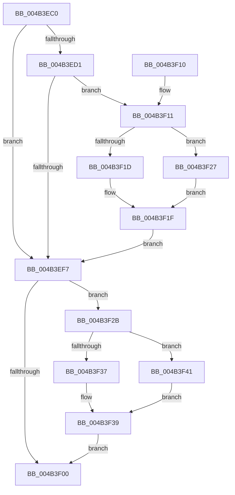

# PspSetJobFreezeCountCallback

- RVA: `0x004B3EC0`–`0x004B3F45` (길이 `133` bytes)
- VA: `0x00000001404B3EC0`
- 실행 섹션: `.text`
- PDB 이름 있음: `예`; PDB Function 태그: `아니요`
- unwind 정보 RVA: `0x000B9D74`
- 디코드: `43`개 명령, `133/133` bytes 표시
- 미해석 바이트: `0` (있으면 어셈블리에 `.byte`로 보존)

> 이 문서는 커널 이미지의 기계어와 PDB 기호를 분석해 생성했습니다. 4번과 5번은 함수 원형과 자료형을 바이너리 사용 방식에서 추정한 C 해석이며 원본 소스 복구 결과는 아닙니다.

## 1. Dependencies

- 직접 호출 지점: **1**; 고유 호출 대상: **1**
- 직접 호출자로 확인된 함수: **0**
- RIP 상대 이미지 참조: **0**

### Outgoing calls
- `0x004B3F00` → [PspComputeExecutionState](../../page/AA/PspComputeExecutionState_function_00AA008C.md) (function, `0x00AA008C`)

### Direct callers
- 이 함수 시작 RVA로 연결되는 직접 call은 확인되지 않았습니다. 간접 호출은 완전히 역산할 수 없습니다.

### Static image references
- 디코드된 RIP-relative 메모리 참조가 없습니다.

## 2. Other-region calls and transfers

- 다른 실행 섹션으로 향하는 call: **1**
  - `0x004B3F00` → [PspComputeExecutionState](../../page/AA/PspComputeExecutionState_function_00AA008C.md) (`.text` → `PAGE`)
- 별도 외부 분기/꼬리 이동을 확인하지 못했습니다.

## 3. Assembly (complete function range)

```asm
004B3EC0  48 83 EC 28                     sub rsp, 0x28
004B3EC4  4C 8B 02                        mov r8, qword ptr [rdx]
004B3EC7  4C 8B D2                        mov r10, rdx
004B3ECA  41 8B 00                        mov eax, dword ptr [r8]
004B3ECD  A8 01                           test al, 1
004B3ECF  74 26                           je 0x1404b3ef7
004B3ED1  8B 81 28 04 00 00               mov eax, dword ptr [rcx + 0x428]
004B3ED7  45 8A 40 04                     mov r8b, byte ptr [r8 + 4]
004B3EDB  44 8D 48 FF                     lea r9d, [rax - 1]
004B3EDF  FF C0                           inc eax
004B3EE1  45 84 C0                        test r8b, r8b
004B3EE4  41 0F 44 C1                     cmove eax, r9d
004B3EE8  89 81 28 04 00 00               mov dword ptr [rcx + 0x428], eax
004B3EEE  48 8B 12                        mov rdx, qword ptr [rdx]
004B3EF1  8B 02                           mov eax, dword ptr [rdx]
004B3EF3  A8 08                           test al, 8
004B3EF5  74 1A                           je 0x1404b3f11
004B3EF7  49 8B 12                        mov rdx, qword ptr [r10]
004B3EFA  8B 02                           mov eax, dword ptr [rdx]
004B3EFC  A8 04                           test al, 4
004B3EFE  75 2B                           jne 0x1404b3f2b
004B3F00  E8 87 C1 5E 00                  call 0x140aa008c
004B3F05  41 88 42 08                     mov byte ptr [r10 + 8], al
004B3F09  33 C0                           xor eax, eax
004B3F0B  48 83 C4 28                     add rsp, 0x28
004B3F0F  C3                              ret
004B3F10  CC                              int3
004B3F11  80 7A 04 00                     cmp byte ptr [rdx + 4], 0
004B3F15  8B 81 2C 04 00 00               mov eax, dword ptr [rcx + 0x42c]
004B3F1B  74 0A                           je 0x1404b3f27
004B3F1D  FF C0                           inc eax
004B3F1F  89 81 2C 04 00 00               mov dword ptr [rcx + 0x42c], eax
004B3F25  EB D0                           jmp 0x1404b3ef7
004B3F27  FF C8                           dec eax
004B3F29  EB F4                           jmp 0x1404b3f1f
004B3F2B  80 7A 05 00                     cmp byte ptr [rdx + 5], 0
004B3F2F  8B 81 34 04 00 00               mov eax, dword ptr [rcx + 0x434]
004B3F35  74 0A                           je 0x1404b3f41
004B3F37  FF C0                           inc eax
004B3F39  89 81 34 04 00 00               mov dword ptr [rcx + 0x434], eax
004B3F3F  EB BF                           jmp 0x1404b3f00
004B3F41  FF C8                           dec eax
004B3F43  EB F4                           jmp 0x1404b3f39
```

## 4. C-style interpretation (structured pseudocode)

```c
__int64 __fastcall PspSetJobFreezeCountCallback(__int64 a1, __int64 a2)
{
    __int64 result;
    __int64 v_rsp;

    v_rsp = (v_rsp) - (40);
    if ((((unsigned __int8)((unsigned int)(*(unsigned int *)(*(unsigned __int64 *)(a2))))) & (1)) == 0) goto loc_004B3EF7;
    result = (unsigned int)(((unsigned int)(*(unsigned int *)(a1 + 1064))) + 1);
    if ((unsigned __int8)(*(unsigned __int8 *)(*(unsigned __int64 *)(a2) + 4)) == 0) { result = (unsigned int)((unsigned int)(*(unsigned int *)(a1 + 1064)) - 1); }
    *(unsigned int *)(a1 + 1064) = (unsigned int)(result);
    if ((((unsigned __int8)((unsigned int)(*(unsigned int *)(*(unsigned __int64 *)(a2))))) & (8)) == 0) goto loc_004B3F11;
loc_004B3EF7:
    if ((((unsigned __int8)((unsigned int)(*(unsigned int *)(*(unsigned __int64 *)(a2))))) & (4)) != 0) goto loc_004B3F2B;
loc_004B3F00:
    result = PspComputeExecutionState(a1, *(unsigned __int64 *)(a2), *(unsigned __int8 *)(*(unsigned __int64 *)(a2) + 4), (unsigned int)(*(unsigned int *)(a1 + 1064)) - 1);
    *(unsigned __int8 *)(a2 + 8) = (unsigned __int8)(result);
    result = 0;
    v_rsp = (v_rsp) + (40);
    return result;
loc_004B3F11:
    if ((*(unsigned __int8 *)(*(unsigned __int64 *)(a2) + 4)) == 0) goto loc_004B3F27;
    result = (unsigned int)(((unsigned int)(*(unsigned int *)(a1 + 1068))) + 1);
loc_004B3F1F:
    *(unsigned int *)(a1 + 1068) = (unsigned int)(result);
    goto loc_004B3EF7;
loc_004B3F27:
    result = (unsigned int)((result) - 1);
    goto loc_004B3F1F;
loc_004B3F2B:
    if ((*(unsigned __int8 *)(*(unsigned __int64 *)(a2) + 5)) == 0) goto loc_004B3F41;
    result = (unsigned int)(((unsigned int)(*(unsigned int *)(a1 + 1076))) + 1);
loc_004B3F39:
    *(unsigned int *)(a1 + 1076) = (unsigned int)(result);
    goto loc_004B3F00;
loc_004B3F41:
    result = (unsigned int)((result) - 1);
    goto loc_004B3F39;
}
```

## 5. (Beta) C Style

```c
int64_t PspSetJobFreezeCountCallback(void *Arg1, void *Arg2)
{
    uint8_t *arg1 = (uint8_t *)Arg1;
    uint8_t *arg2 = (uint8_t *)Arg2;

    int64_t result;
    int64_t local_rsp;

    local_rsp = (local_rsp) - (40);
    if ((((uint8_t)((uint32_t)(*(uint32_t *)(*(uint64_t *)(arg2))))) & (1)) == 0) goto loc_004B3EF7;
    result = (uint32_t)(((uint32_t)(*(uint32_t *)(arg1 + 0x428))) + 1);
    if ((uint8_t)(*(uint8_t *)(*(uint64_t *)(arg2) + 0x4)) == 0) { result = (uint32_t)((uint32_t)(*(uint32_t *)(arg1 + 0x428)) - 1); }
    *(uint32_t *)(arg1 + 0x428) = (uint32_t)(result);
    if ((((uint8_t)((uint32_t)(*(uint32_t *)(*(uint64_t *)(arg2))))) & (8)) == 0) goto loc_004B3F11;
loc_004B3EF7:
    if ((((uint8_t)((uint32_t)(*(uint32_t *)(*(uint64_t *)(arg2))))) & (4)) != 0) goto loc_004B3F2B;
loc_004B3F00:
    result = PspComputeExecutionState(Arg1, *(uint64_t *)(arg2), *(uint8_t *)(*(uint64_t *)(arg2) + 0x4), (uint32_t)(*(uint32_t *)(arg1 + 0x428)) - 1);
    *(uint8_t *)(arg2 + 0x8) = (uint8_t)(result);
    result = 0;
    local_rsp = (local_rsp) + (40);
    return result;
loc_004B3F11:
    if ((*(uint8_t *)(*(uint64_t *)(arg2) + 0x4)) == 0) goto loc_004B3F27;
    result = (uint32_t)(((uint32_t)(*(uint32_t *)(arg1 + 0x42C))) + 1);
loc_004B3F1F:
    *(uint32_t *)(arg1 + 0x42C) = (uint32_t)(result);
    goto loc_004B3EF7;
loc_004B3F27:
    result = (uint32_t)((result) - 1);
    goto loc_004B3F1F;
loc_004B3F2B:
    if ((*(uint8_t *)(*(uint64_t *)(arg2) + 0x5)) == 0) goto loc_004B3F41;
    result = (uint32_t)(((uint32_t)(*(uint32_t *)(arg1 + 0x434))) + 1);
loc_004B3F39:
    *(uint32_t *)(arg1 + 0x434) = (uint32_t)(result);
    goto loc_004B3F00;
loc_004B3F41:
    result = (uint32_t)((result) - 1);
    goto loc_004B3F39;
}
```

### 관측된 메모리 오프셋

구조체 형식이 확인되지 않은 접근은 인자 기준의 오프셋으로만 기록했습니다.

| 기준 인자 | 오프셋 표현 | 폭 (bit) | 접근 |
|---|---:|---:|---|
| `Arg1` | `+ 0x428` | `32` | `R` |
| `Arg1` | `+ 0x428` | `32` | `W` |
| `Arg1` | `+ 0x42C` | `32` | `R` |
| `Arg1` | `+ 0x42C` | `32` | `W` |
| `Arg1` | `+ 0x434` | `32` | `R` |
| `Arg1` | `+ 0x434` | `32` | `W` |
| `Arg2` | `+ 0x0` | `64` | `R` |

## 6. Execution-region graph

[열기: 2D/3D 그래프와 함수 탐색 컨트롤 패널](../../../control-panel.html?section=text&rva=0x004B3EC0&view=graph)

- 2D 그래프는 위에서 아래로 흐르고, 3D 그래프는 빈 공간을 드래그해 회전합니다. Shift+드래그는 이동, 휠은 확대·축소, 함수 노드 선택은 대상 보고서 이동입니다.

### Static fallback


