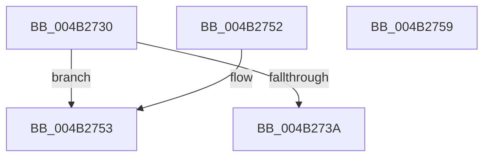

# RtlCompressWorkSpaceSizeLz4

- RVA: `0x004B2730`–`0x004B275A` (길이 `42` bytes)
- VA: `0x00000001404B2730`
- 실행 섹션: `.text`
- PDB 이름 있음: `예`; PDB Function 태그: `아니요`
- unwind 정보 RVA: `0x000DB714`
- 디코드: `15`개 명령, `42/42` bytes 표시
- 미해석 바이트: `0` (있으면 어셈블리에 `.byte`로 보존)

> 이 문서는 커널 이미지의 기계어와 PDB 기호를 분석해 생성했습니다. 4번과 5번은 함수 원형과 자료형을 바이너리 사용 방식에서 추정한 C 해석이며 원본 소스 복구 결과는 아닙니다.

## 1. Dependencies

- 직접 호출 지점: **0**; 고유 호출 대상: **0**
- 직접 호출자로 확인된 함수: **0**
- RIP 상대 이미지 참조: **0**

### Outgoing calls
- 직접 디코드된 call 명령이 없습니다.

### Direct callers
- 이 함수 시작 RVA로 연결되는 직접 call은 확인되지 않았습니다. 간접 호출은 완전히 역산할 수 없습니다.

### Static image references
- 디코드된 RIP-relative 메모리 참조가 없습니다.

## 2. Other-region calls and transfers

- 다른 실행 섹션으로 향하는 call: **0**
- 별도 외부 분기/꼬리 이동을 확인하지 못했습니다.

## 3. Assembly (complete function range)

```asm
004B2730  B8 FF FE 00 00                  mov eax, 0xfeff
004B2735  66 85 C8                        test ax, cx
004B2738  75 19                           jne 0x1404b2753
004B273A  66 F7 D9                        neg cx
004B273D  1B C0                           sbb eax, eax
004B273F  25 18 C0 03 00                  and eax, 0x3c018
004B2744  05 20 40 00 00                  add eax, 0x4020
004B2749  89 02                           mov dword ptr [rdx], eax
004B274B  41 83 20 00                     and dword ptr [r8], 0
004B274F  33 C0                           xor eax, eax
004B2751  C3                              ret
004B2752  CC                              int3
004B2753  B8 BB 00 00 C0                  mov eax, 0xc00000bb
004B2758  C3                              ret
004B2759  CC                              int3
```

## 4. C-style interpretation (structured pseudocode)

```c
__int64 __fastcall RtlCompressWorkSpaceSizeLz4(unsigned __int16 a1, __int64 a2, __int64 a3)
{
    __int64 result;

    if ((((unsigned __int16)((unsigned int)(0xFEFFULL))) & (a1)) != 0) goto loc_004B2753;
    a1 = (unsigned __int16)(-(a1));
    result = (unsigned int)(((unsigned int)(0xFEFFULL)) & (0x3C018ULL));
    result = (unsigned int)((result) + (0x4020ULL));
    *(unsigned int *)(a2) = (unsigned int)(result);
    result = 0;
    return result;
loc_004B2753:
    return (unsigned int)(0xC00000BBULL);
}
```

## 5. (Beta) C Style

```c
int64_t RtlCompressWorkSpaceSizeLz4(uint16_t Arg1, void *Arg2, void *Arg3)
{
    uint8_t *arg2 = (uint8_t *)Arg2;
    uint8_t *arg3 = (uint8_t *)Arg3;

    int64_t result;

    if ((((uint16_t)((uint32_t)(0xFEFFULL))) & (Arg1)) != 0) goto loc_004B2753;
    Arg1 = (uint16_t)(-(Arg1));
    result = (uint32_t)(((uint32_t)(0xFEFFULL)) & (0x3C018ULL));
    result = (uint32_t)((result) + (0x4020ULL));
    *(uint32_t *)(arg2) = (uint32_t)(result);
    result = 0;
    return result;
loc_004B2753:
    return (uint32_t)(0xC00000BBULL);
}
```

### 관측된 메모리 오프셋

구조체 형식이 확인되지 않은 접근은 인자 기준의 오프셋으로만 기록했습니다.

| 기준 인자 | 오프셋 표현 | 폭 (bit) | 접근 |
|---|---:|---:|---|
| `Arg2` | `+ 0x0` | `32` | `W` |
| `Arg3` | `+ 0x0` | `32` | `R/W` |

## 6. Execution-region graph

[열기: 2D/3D 그래프와 함수 탐색 컨트롤 패널](../../../control-panel.html?section=text&rva=0x004B2730&view=graph)

- 2D 그래프는 위에서 아래로 흐르고, 3D 그래프는 빈 공간을 드래그해 회전합니다. Shift+드래그는 이동, 휠은 확대·축소, 함수 노드 선택은 대상 보고서 이동입니다.

### Static fallback


