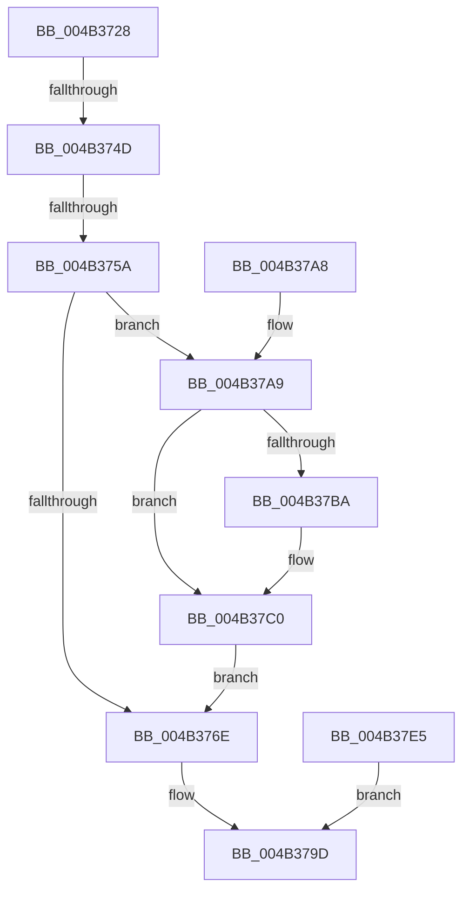

# RtlCreateEnclaveReturnFrame

- RVA: `0x004B3728`–`0x004B37E7` (길이 `191` bytes)
- VA: `0x00000001404B3728`
- 실행 섹션: `.text`
- PDB 이름 있음: `예`; PDB Function 태그: `예`
- unwind 정보 RVA: `0x000B99C0`
- 디코드: `48`개 명령, `191/191` bytes 표시
- 미해석 바이트: `0` (있으면 어셈블리에 `.byte`로 보존)

> 이 문서는 커널 이미지의 기계어와 PDB 기호를 분석해 생성했습니다. 4번과 5번은 함수 원형과 자료형을 바이너리 사용 방식에서 추정한 C 해석이며 원본 소스 복구 결과는 아닙니다.

## 1. Dependencies

- 직접 호출 지점: **1**; 고유 호출 대상: **1**
- 직접 호출자로 확인된 함수: **1**
- RIP 상대 이미지 참조: **0**

### Outgoing calls
- `0x004B37BA` → [ExRaiseDatatypeMisalignment](../../page/89/ExRaiseDatatypeMisalignment_function_00899FD0.md) (function, `0x00899FD0`)

### Direct callers
- [PsCallEnclave](../../page/A0/PsCallEnclave_function_00A0CF50.md) at `0x00A0D291`

### Static image references
- 디코드된 RIP-relative 메모리 참조가 없습니다.

## 2. Other-region calls and transfers

- 다른 실행 섹션으로 향하는 call: **1**
  - `0x004B37BA` → [ExRaiseDatatypeMisalignment](../../page/89/ExRaiseDatatypeMisalignment_function_00899FD0.md) (`.text` → `PAGE`)
- call이 아닌 외부 분기/꼬리 이동: **2**
  - `0x004B3747` → [sub_006FB4B8](../6F/Unknown_function_006FB4B8.md) (`tail-transfer`)
  - `0x004B3754` → [sub_006FB4B8](../6F/Unknown_function_006FB4B8.md) (`tail-transfer`)

## 3. Assembly (complete function range)

```asm
004B3728  48 89 5C 24 10                  mov qword ptr [rsp + 0x10], rbx
004B372D  57                              push rdi
004B372E  48 83 EC 20                     sub rsp, 0x20
004B3732  4D 8B D9                        mov r11, r9
004B3735  48 8B DA                        mov rbx, rdx
004B3738  4C 8B D1                        mov r10, rcx
004B373B  BF 33 00 00 00                  mov edi, 0x33
004B3740  66 39 B9 70 01 00 00            cmp word ptr [rcx + 0x170], di
004B3747  0F 85 6B 7D 24 00               jne 0x1406fb4b8
004B374D  4C 39 81 68 01 00 00            cmp qword ptr [rcx + 0x168], r8
004B3754  0F 85 5E 7D 24 00               jne 0x1406fb4b8
004B375A  49 B8 00 00 FF FF FF 7F 00 00   movabs r8, 0x7fffffff0000
004B3764  48 8B 54 24 60                  mov rdx, qword ptr [rsp + 0x60]
004B3769  48 85 D2                        test rdx, rdx
004B376C  75 3B                           jne 0x1404b37a9
004B376E  4D 89 5A 38                     mov qword ptr [r10 + 0x38], r11
004B3772  48 8B 44 24 50                  mov rax, qword ptr [rsp + 0x50]
004B3777  49 89 42 40                     mov qword ptr [r10 + 0x40], rax
004B377B  8B 44 24 58                     mov eax, dword ptr [rsp + 0x58]
004B377F  49 89 42 48                     mov qword ptr [r10 + 0x48], rax
004B3783  48 8B 44 24 70                  mov rax, qword ptr [rsp + 0x70]
004B3788  49 89 42 50                     mov qword ptr [r10 + 0x50], rax
004B378C  49 89 9A 68 01 00 00            mov qword ptr [r10 + 0x168], rbx
004B3793  66 41 89 BA 70 01 00 00         mov word ptr [r10 + 0x170], di
004B379B  33 C0                           xor eax, eax
004B379D  48 8B 5C 24 38                  mov rbx, qword ptr [rsp + 0x38]
004B37A2  48 83 C4 20                     add rsp, 0x20
004B37A6  5F                              pop rdi
004B37A7  C3                              ret
004B37A8  CC                              int3
004B37A9  49 8B 8A 80 01 00 00            mov rcx, qword ptr [r10 + 0x180]
004B37B0  48 89 4C 24 30                  mov qword ptr [rsp + 0x30], rcx
004B37B5  F6 C1 03                        test cl, 3
004B37B8  74 06                           je 0x1404b37c0
004B37BA  E8 11 68 3E 00                  call 0x140899fd0
004B37BF  CC                              int3
004B37C0  49 3B C8                        cmp rcx, r8
004B37C3  49 0F 43 C8                     cmovae rcx, r8
004B37C7  8A 01                           mov al, byte ptr [rcx]
004B37C9  88 01                           mov byte ptr [rcx], al
004B37CB  8A 41 4F                        mov al, byte ptr [rcx + 0x4f]
004B37CE  88 41 4F                        mov byte ptr [rcx + 0x4f], al
004B37D1  48 8B 44 24 68                  mov rax, qword ptr [rsp + 0x68]
004B37D6  48 8B 4C 24 30                  mov rcx, qword ptr [rsp + 0x30]
004B37DB  48 89 41 40                     mov qword ptr [rcx + 0x40], rax
004B37DF  48 89 51 48                     mov qword ptr [rcx + 0x48], rdx
004B37E3  EB 89                           jmp 0x1404b376e
004B37E5  EB B6                           jmp 0x1404b379d
```

## 4. C-style interpretation (structured pseudocode)

```c
__int64 __fastcall RtlCreateEnclaveReturnFrame(__int64 a1, __int64 a2, __int64 a3, __int64 a4, __int64 a5, unsigned int a6, __int64 a7, __int64 a8, __int64 a9)
{
    __int64 result;
    __int64 v_rsp;
    unsigned __int64 v_stack_p10;
    unsigned __int64 v_stack_p30;

    v_stack_p10 = v_rbx;
    v_rsp = (v_rsp) - (32);
    if (a7 != 0) goto loc_004B37A9;
loc_004B376E:
    *(unsigned __int64 *)(a1 + 56) = a4;
    *(unsigned __int64 *)(a1 + 64) = a5;
    *(unsigned __int64 *)(a1 + 72) = (unsigned int)(a6);
    *(unsigned __int64 *)(a1 + 80) = a9;
    *(unsigned __int64 *)(a1 + 360) = a2;
    *(unsigned __int16 *)(a1 + 368) = 51;
    result = 0;
loc_004B379D:
    v_rsp = (v_rsp) + (32);
    return result;
loc_004B37A9:
    v_stack_p30 = *(unsigned __int64 *)(a1 + 384);
    if ((((unsigned __int8)(*(unsigned __int64 *)(a1 + 384))) & (3)) != 0) {
        result = ExRaiseDatatypeMisalignment(*(unsigned __int64 *)(a1 + 384), a7, a3, a4);
    }
    a1 = *(unsigned __int64 *)(a1 + 384);
    if ((*(unsigned __int64 *)(a1 + 384)) >= a3) { a1 = a3; }
    *(unsigned __int8 *)(a1) = (unsigned __int8)(*(unsigned __int8 *)(a1));
    *(unsigned __int8 *)(a1 + 79) = (unsigned __int8)(*(unsigned __int8 *)(a1 + 79));
    *(unsigned __int64 *)(v_stack_p30 + 64) = a8;
    *(unsigned __int64 *)(v_stack_p30 + 72) = a7;
    goto loc_004B376E;
}
```

## 5. (Beta) C Style

```c
int64_t RtlCreateEnclaveReturnFrame(void *Arg1, int64_t Arg2, int64_t Arg3, int64_t Arg4, int64_t Arg5, uint32_t Arg6, int64_t Arg7, int64_t Arg8, int64_t Arg9)
{
    uint8_t *arg1 = (uint8_t *)Arg1;

    int64_t result;
    int64_t local_rsp;
    uint64_t v_stack_p10;
    uint64_t v_stack_p30;

    v_stack_p10 = local_rbx;
    local_rsp = (local_rsp) - (32);
    if (Arg7 != 0) goto loc_004B37A9;
loc_004B376E:
    *(uint64_t *)(arg1 + 0x38) = Arg4;
    *(uint64_t *)(arg1 + 0x40) = Arg5;
    *(uint64_t *)(arg1 + 0x48) = (uint32_t)(Arg6);
    *(uint64_t *)(arg1 + 0x50) = Arg9;
    *(uint64_t *)(arg1 + 0x168) = Arg2;
    *(uint16_t *)(arg1 + 0x170) = 51;
    result = 0;
loc_004B379D:
    local_rsp = (local_rsp) + (32);
    return result;
loc_004B37A9:
    v_stack_p30 = *(uint64_t *)(arg1 + 0x180);
    if ((((uint8_t)(*(uint64_t *)(arg1 + 0x180))) & (3)) != 0) {
        result = ExRaiseDatatypeMisalignment(*(uint64_t *)(arg1 + 0x180), Arg7, Arg3, Arg4);
    }
    Arg1 = *(uint64_t *)(arg1 + 0x180);
    if ((*(uint64_t *)(arg1 + 0x180)) >= Arg3) { Arg1 = Arg3; }
    *(uint8_t *)(arg1) = (uint8_t)(*(uint8_t *)(arg1));
    *(uint8_t *)(arg1 + 0x4F) = (uint8_t)(*(uint8_t *)(arg1 + 0x4F));
    *(uint64_t *)(v_stack_p30 + 0x40) = Arg8;
    *(uint64_t *)(v_stack_p30 + 0x48) = Arg7;
    goto loc_004B376E;
}
```

### 관측된 메모리 오프셋

구조체 형식이 확인되지 않은 접근은 인자 기준의 오프셋으로만 기록했습니다.

| 기준 인자 | 오프셋 표현 | 폭 (bit) | 접근 |
|---|---:|---:|---|
| `Arg1` | `+ 0x168` | `64` | `R` |
| `Arg1` | `+ 0x170` | `16` | `R` |
| `Arg1` | `+ 0x180` | `64` | `R` |

## 6. Execution-region graph

[열기: 2D/3D 그래프와 함수 탐색 컨트롤 패널](../../../control-panel.html?section=text&rva=0x004B3728&view=graph)

- 2D 그래프는 위에서 아래로 흐르고, 3D 그래프는 빈 공간을 드래그해 회전합니다. Shift+드래그는 이동, 휠은 확대·축소, 함수 노드 선택은 대상 보고서 이동입니다.

### Static fallback


