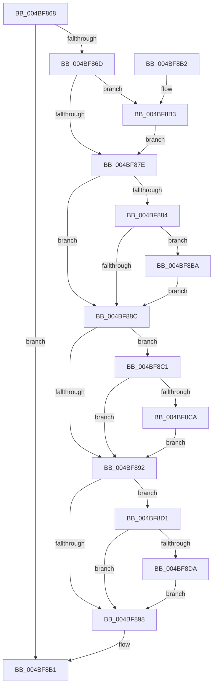

# RtlFileMapFree

- RVA: `0x004BF868`–`0x004BF8E5` (길이 `125` bytes)
- VA: `0x00000001404BF868`
- 실행 섹션: `.text`
- PDB 이름 있음: `예`; PDB Function 태그: `아니요`
- unwind 정보 RVA: `0x000BC5D8`
- 디코드: `42`개 명령, `125/125` bytes 표시
- 미해석 바이트: `0` (있으면 어셈블리에 `.byte`로 보존)

> 이 문서는 커널 이미지의 기계어와 PDB 기호를 분석해 생성했습니다. 4번과 5번은 함수 원형과 자료형을 바이너리 사용 방식에서 추정한 C 해석이며 원본 소스 복구 결과는 아닙니다.

## 1. Dependencies

- 직접 호출 지점: **4**; 고유 호출 대상: **3**
- 직접 호출자로 확인된 함수: **3**
- RIP 상대 이미지 참조: **0**

### Outgoing calls
- `0x004BF8B3` → [MmUnsecureVirtualMemory](../../page/88/MmUnsecureVirtualMemory_function_0088A2A0.md) (function, `0x0088A2A0`)
- `0x004BF8BA` → [ZwClose](../6A/ZwClose_function_006AD2B0.md) (function, `0x006AD2B0`)
- `0x004BF8CA` → [ZwClose](../6A/ZwClose_function_006AD2B0.md) (function, `0x006AD2B0`)
- `0x004BF8DE` → [ZwUnmapViewOfSection](../6A/ZwUnmapViewOfSection_function_006AD610.md) (function, `0x006AD610`)

### Direct callers
- [AslpFileGetChecksumAttributes](../../page/81/AslpFileGetChecksumAttributes_function_0081E130.md) at `0x0081E363`
- [AslpFileGetVersionBlock](../../page/81/AslpFileGetVersionBlock_function_0081FA50.md) at `0x0081FF79`
- [AslFileMappingDelete](../../page/95/AslFileMappingDelete_function_0095B728.md) at `0x0095B73B`

### Static image references
- 디코드된 RIP-relative 메모리 참조가 없습니다.

## 2. Other-region calls and transfers

- 다른 실행 섹션으로 향하는 call: **1**
  - `0x004BF8B3` → [MmUnsecureVirtualMemory](../../page/88/MmUnsecureVirtualMemory_function_0088A2A0.md) (`.text` → `PAGE`)
- 별도 외부 분기/꼬리 이동을 확인하지 못했습니다.

## 3. Assembly (complete function range)

```asm
004BF868  48 85 C9                        test rcx, rcx
004BF86B  74 44                           je 0x1404bf8b1
004BF86D  53                              push rbx
004BF86E  48 83 EC 20                     sub rsp, 0x20
004BF872  48 8B D9                        mov rbx, rcx
004BF875  48 8B 49 28                     mov rcx, qword ptr [rcx + 0x28]
004BF879  48 85 C9                        test rcx, rcx
004BF87C  75 35                           jne 0x1404bf8b3
004BF87E  80 7B 30 00                     cmp byte ptr [rbx + 0x30], 0
004BF882  74 08                           je 0x1404bf88c
004BF884  48 8B 0B                        mov rcx, qword ptr [rbx]
004BF887  48 85 C9                        test rcx, rcx
004BF88A  75 2E                           jne 0x1404bf8ba
004BF88C  80 7B 31 00                     cmp byte ptr [rbx + 0x31], 0
004BF890  75 2F                           jne 0x1404bf8c1
004BF892  80 7B 32 00                     cmp byte ptr [rbx + 0x32], 0
004BF896  75 39                           jne 0x1404bf8d1
004BF898  0F 57 C0                        xorps xmm0, xmm0
004BF89B  33 C0                           xor eax, eax
004BF89D  0F 11 03                        movups xmmword ptr [rbx], xmm0
004BF8A0  0F 11 43 10                     movups xmmword ptr [rbx + 0x10], xmm0
004BF8A4  0F 11 43 20                     movups xmmword ptr [rbx + 0x20], xmm0
004BF8A8  48 89 43 30                     mov qword ptr [rbx + 0x30], rax
004BF8AC  48 83 C4 20                     add rsp, 0x20
004BF8B0  5B                              pop rbx
004BF8B1  C3                              ret
004BF8B2  CC                              int3
004BF8B3  E8 E8 A9 3C 00                  call 0x14088a2a0
004BF8B8  EB C4                           jmp 0x1404bf87e
004BF8BA  E8 F1 D9 1E 00                  call 0x1406ad2b0
004BF8BF  EB CB                           jmp 0x1404bf88c
004BF8C1  48 8B 4B 08                     mov rcx, qword ptr [rbx + 8]
004BF8C5  48 85 C9                        test rcx, rcx
004BF8C8  74 C8                           je 0x1404bf892
004BF8CA  E8 E1 D9 1E 00                  call 0x1406ad2b0
004BF8CF  EB C1                           jmp 0x1404bf892
004BF8D1  48 8B 53 18                     mov rdx, qword ptr [rbx + 0x18]
004BF8D5  48 85 D2                        test rdx, rdx
004BF8D8  74 BE                           je 0x1404bf898
004BF8DA  48 83 C9 FF                     or rcx, 0xffffffffffffffff
004BF8DE  E8 2D DD 1E 00                  call 0x1406ad610
004BF8E3  EB B3                           jmp 0x1404bf898
```

## 4. C-style interpretation (structured pseudocode)

```c
__int64 __fastcall RtlFileMapFree(__int64 a1)
{
    __int64 result;
    __int64 v_rsp;

    if (a1 == 0) goto loc_004BF8B1;
    v_rsp = (v_rsp) - (32);
    if (*(unsigned __int64 *)(a1 + 40) != 0) goto loc_004BF8B3;
loc_004BF87E:
    if ((*(unsigned __int8 *)(a1 + 48)) == 0) goto loc_004BF88C;
    if (*(unsigned __int64 *)(a1) != 0) goto loc_004BF8BA;
loc_004BF88C:
    if ((*(unsigned __int8 *)(a1 + 49)) != 0) goto loc_004BF8C1;
loc_004BF892:
    if ((*(unsigned __int8 *)(a1 + 50)) != 0) goto loc_004BF8D1;
loc_004BF898:
    result = 0;
    *(unsigned __int64 *)(a1) = v_xmm0;
    *(unsigned __int64 *)(a1 + 16) = v_xmm0;
    *(unsigned __int64 *)(a1 + 32) = v_xmm0;
    *(unsigned __int64 *)(a1 + 48) = 0;
    v_rsp = (v_rsp) + (32);
loc_004BF8B1:
    return result;
loc_004BF8B3:
    result = MmUnsecureVirtualMemory(*(unsigned __int64 *)(a1), a2, a3, a4);
    goto loc_004BF87E;
loc_004BF8BA:
    result = ZwClose(*(unsigned __int64 *)(a1), a2, a3, a4);
    goto loc_004BF88C;
loc_004BF8C1:
    if (*(unsigned __int64 *)(a1 + 8) == 0) goto loc_004BF892;
    result = ZwClose(*(unsigned __int64 *)(a1 + 8), a2, a3, a4);
    goto loc_004BF892;
loc_004BF8D1:
    if (*(unsigned __int64 *)(a1 + 24) == 0) goto loc_004BF898;
    a1 = (*(unsigned __int64 *)(a1 + 8)) | (-1);
    result = ZwUnmapViewOfSection(a1, *(unsigned __int64 *)(a1 + 24), a3, a4);
    goto loc_004BF898;
}
```

## 5. (Beta) C Style

```c
int64_t RtlFileMapFree(int64_t Arg1)
{
    int64_t result;
    int64_t local_rsp;

    if (Arg1 == 0) goto loc_004BF8B1;
    local_rsp = (local_rsp) - (32);
    if (*(uint64_t *)(Arg1 + 0x28) != 0) goto loc_004BF8B3;
loc_004BF87E:
    if ((*(uint8_t *)(Arg1 + 0x30)) == 0) goto loc_004BF88C;
    if (*(uint64_t *)(Arg1) != 0) goto loc_004BF8BA;
loc_004BF88C:
    if ((*(uint8_t *)(Arg1 + 0x31)) != 0) goto loc_004BF8C1;
loc_004BF892:
    if ((*(uint8_t *)(Arg1 + 0x32)) != 0) goto loc_004BF8D1;
loc_004BF898:
    result = 0;
    *(uint64_t *)(Arg1) = v_xmm0;
    *(uint64_t *)(Arg1 + 0x10) = v_xmm0;
    *(uint64_t *)(Arg1 + 0x20) = v_xmm0;
    *(uint64_t *)(Arg1 + 0x30) = 0;
    local_rsp = (local_rsp) + (32);
loc_004BF8B1:
    return result;
loc_004BF8B3:
    result = MmUnsecureVirtualMemory(*(uint64_t *)(Arg1), a2, a3, a4);
    goto loc_004BF87E;
loc_004BF8BA:
    result = ZwClose(*(uint64_t *)(Arg1), a2, a3, a4);
    goto loc_004BF88C;
loc_004BF8C1:
    if (*(uint64_t *)(Arg1 + 0x8) == 0) goto loc_004BF892;
    result = ZwClose(*(uint64_t *)(Arg1 + 0x8), a2, a3, a4);
    goto loc_004BF892;
loc_004BF8D1:
    if (*(uint64_t *)(Arg1 + 0x18) == 0) goto loc_004BF898;
    Arg1 = (*(uint64_t *)(Arg1 + 0x8)) | (-1);
    result = ZwUnmapViewOfSection(Arg1, *(uint64_t *)(Arg1 + 0x18), a3, a4);
    goto loc_004BF898;
}
```

## 6. Execution-region graph

[열기: 2D/3D 그래프와 함수 탐색 컨트롤 패널](../../../control-panel.html?section=text&rva=0x004BF868&view=graph)

- 2D 그래프는 위에서 아래로 흐르고, 3D 그래프는 빈 공간을 드래그해 회전합니다. Shift+드래그는 이동, 휠은 확대·축소, 함수 노드 선택은 대상 보고서 이동입니다.

### Static fallback


