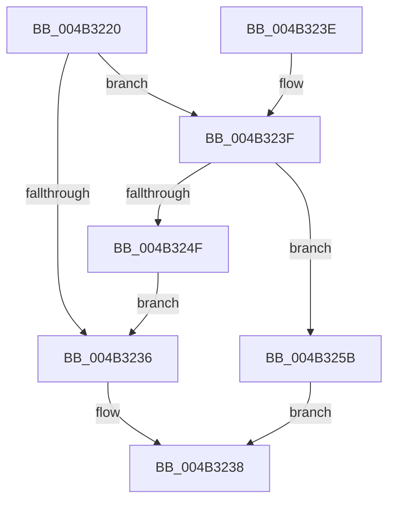

# RtlInitAnsiStringEx

- RVA: `0x004B3220`–`0x004B3262` (길이 `66` bytes)
- VA: `0x00000001404B3220`
- 실행 섹션: `.text`
- PDB 이름 있음: `예`; PDB Function 태그: `아니요`
- unwind 정보 RVA: `0x000795DC`
- 디코드: `22`개 명령, `66/66` bytes 표시
- 미해석 바이트: `0` (있으면 어셈블리에 `.byte`로 보존)

> 이 문서는 커널 이미지의 기계어와 PDB 기호를 분석해 생성했습니다. 4번과 5번은 함수 원형과 자료형을 바이너리 사용 방식에서 추정한 C 해석이며 원본 소스 복구 결과는 아닙니다.

## 1. Dependencies

- 직접 호출 지점: **1**; 고유 호출 대상: **1**
- 직접 호출자로 확인된 함수: **2**
- RIP 상대 이미지 참조: **0**

### Outgoing calls
- `0x004B3242` → [strlen](../6C/strlen_function_006C70D0.md) (function, `0x006C70D0`)

### Direct callers
- [RtlInitStringEx](../5E/RtlInitStringEx_function_005E56B0.md) at `0x005E56B4`
- [RtlCreateUnicodeStringFromAsciiz](../../page/78/RtlCreateUnicodeStringFromAsciiz_function_0078B990.md) at `0x0078B9A6`

### Static image references
- 디코드된 RIP-relative 메모리 참조가 없습니다.

## 2. Other-region calls and transfers

- 다른 실행 섹션으로 향하는 call: **0**
- 별도 외부 분기/꼬리 이동을 확인하지 못했습니다.

## 3. Assembly (complete function range)

```asm
004B3220  40 53                           push rbx
004B3222  48 83 EC 20                     sub rsp, 0x20
004B3226  48 83 21 00                     and qword ptr [rcx], 0
004B322A  48 8B D9                        mov rbx, rcx
004B322D  48 89 51 08                     mov qword ptr [rcx + 8], rdx
004B3231  48 85 D2                        test rdx, rdx
004B3234  75 09                           jne 0x1404b323f
004B3236  33 C0                           xor eax, eax
004B3238  48 83 C4 20                     add rsp, 0x20
004B323C  5B                              pop rbx
004B323D  C3                              ret
004B323E  CC                              int3
004B323F  48 8B CA                        mov rcx, rdx
004B3242  E8 89 3E 21 00                  call 0x1406c70d0
004B3247  48 3D FE FF 00 00               cmp rax, 0xfffe
004B324D  77 0C                           ja 0x1404b325b
004B324F  66 89 03                        mov word ptr [rbx], ax
004B3252  66 FF C0                        inc ax
004B3255  66 89 43 02                     mov word ptr [rbx + 2], ax
004B3259  EB DB                           jmp 0x1404b3236
004B325B  B8 06 01 00 C0                  mov eax, 0xc0000106
004B3260  EB D6                           jmp 0x1404b3238
```

## 4. C-style interpretation (structured pseudocode)

```c
__int64 __fastcall RtlInitAnsiStringEx(__int64 a1, __int64 a2)
{
    __int64 result;
    __int64 v_rsp;

    v_rsp = (v_rsp) - (32);
    *(unsigned __int64 *)(a1 + 8) = a2;
    if (a2 != 0) goto loc_004B323F;
loc_004B3236:
    result = 0;
loc_004B3238:
    v_rsp = (v_rsp) + (32);
    return result;
loc_004B323F:
    result = strlen(a2, a2, a3, a4);
    if (result > 0xFFFEULL) goto loc_004B325B;
    *(unsigned __int16 *)(a1) = (unsigned __int16)(result);
    result = (unsigned __int16)((result) + 1);
    *(unsigned __int16 *)(a1 + 2) = (unsigned __int16)(result);
    goto loc_004B3236;
loc_004B325B:
    goto loc_004B3238;
}
```

## 5. (Beta) C Style

```c
int64_t RtlInitAnsiStringEx(void *Arg1, int64_t Arg2)
{
    uint8_t *arg1 = (uint8_t *)Arg1;

    int64_t result;
    int64_t local_rsp;

    local_rsp = (local_rsp) - (32);
    *(uint64_t *)(arg1 + 0x8) = Arg2;
    if (Arg2 != 0) goto loc_004B323F;
loc_004B3236:
    result = 0;
loc_004B3238:
    local_rsp = (local_rsp) + (32);
    return result;
loc_004B323F:
    result = strlen(Arg2, Arg2, a3, a4);
    if (result > 0xFFFEULL) goto loc_004B325B;
    *(uint16_t *)(arg1) = (uint16_t)(result);
    result = (uint16_t)((result) + 1);
    *(uint16_t *)(arg1 + 0x2) = (uint16_t)(result);
    goto loc_004B3236;
loc_004B325B:
    goto loc_004B3238;
}
```

### 관측된 메모리 오프셋

구조체 형식이 확인되지 않은 접근은 인자 기준의 오프셋으로만 기록했습니다.

| 기준 인자 | 오프셋 표현 | 폭 (bit) | 접근 |
|---|---:|---:|---|
| `Arg1` | `+ 0x0` | `16` | `W` |
| `Arg1` | `+ 0x0` | `64` | `R/W` |
| `Arg1` | `+ 0x2` | `16` | `W` |
| `Arg1` | `+ 0x8` | `64` | `W` |

## 6. Execution-region graph

[열기: 2D/3D 그래프와 함수 탐색 컨트롤 패널](../../../control-panel.html?section=text&rva=0x004B3220&view=graph)

- 2D 그래프는 위에서 아래로 흐르고, 3D 그래프는 빈 공간을 드래그해 회전합니다. Shift+드래그는 이동, 휠은 확대·축소, 함수 노드 선택은 대상 보고서 이동입니다.

### Static fallback


