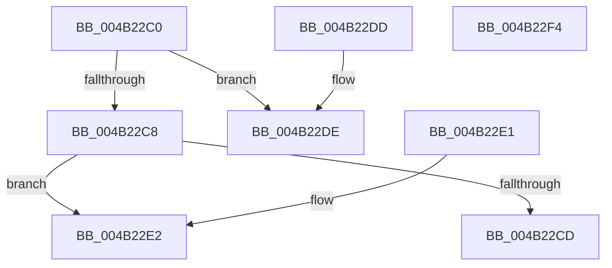

# RtlIsProcessorFeaturePresent

- RVA: `0x004B22C0`–`0x004B22F5` (길이 `53` bytes)
- VA: `0x00000001404B22C0`
- 실행 섹션: `.text`
- PDB 이름 있음: `예`; PDB Function 태그: `아니요`
- unwind 정보 RVA: `0x000DB714`
- 디코드: `18`개 명령, `53/53` bytes 표시
- 미해석 바이트: `0` (있으면 어셈블리에 `.byte`로 보존)

> 이 문서는 커널 이미지의 기계어와 PDB 기호를 분석해 생성했습니다. 4번과 5번은 함수 원형과 자료형을 바이너리 사용 방식에서 추정한 C 해석이며 원본 소스 복구 결과는 아닙니다.

## 1. Dependencies

- 직접 호출 지점: **0**; 고유 호출 대상: **0**
- 직접 호출자로 확인된 함수: **4**
- RIP 상대 이미지 참조: **1**

### Outgoing calls
- 직접 디코드된 call 명령이 없습니다.

### Direct callers
- [ExIsProcessorFeaturePresent](ExIsProcessorFeaturePresent_function_004B22A0.md) at `0x004B22A4`
- [HalpIvtProcessDrhdEntry](../57/HalpIvtProcessDrhdEntry_function_005794B4.md) at `0x0057989B`
- [RtlHpGlobalsInitialize](../5F/RtlHpGlobalsInitialize_function_005F09DC.md) at `0x005F0AE1`
- [RtlHpGlobalsInitialize](../5F/RtlHpGlobalsInitialize_function_005F09DC.md) at `0x005F0AF6`
- [DifExIsProcessorFeaturePresentWrapper](../62/DifExIsProcessorFeaturePresentWrapper_function_00621680.md) at `0x00621743`

### Static image references
- `0x004B22E2` → RVA `0x00FC7560` (`ALMOSTRO`; read)

## 2. Other-region calls and transfers

- 다른 실행 섹션으로 향하는 call: **0**
- 별도 외부 분기/꼬리 이동을 확인하지 못했습니다.

## 3. Assembly (complete function range)

```asm
004B22C0  81 F9 C0 00 00 00               cmp ecx, 0xc0
004B22C6  73 16                           jae 0x1404b22de
004B22C8  83 F9 40                        cmp ecx, 0x40
004B22CB  73 15                           jae 0x1404b22e2
004B22CD  8B C1                           mov eax, ecx
004B22CF  48 B9 74 02 00 00 80 F7 FF FF   movabs rcx, 0xfffff78000000274
004B22D9  8A 04 08                        mov al, byte ptr [rax + rcx]
004B22DC  C3                              ret
004B22DD  CC                              int3
004B22DE  32 C0                           xor al, al
004B22E0  C3                              ret
004B22E1  CC                              int3
004B22E2  48 8B 05 77 52 B1 00            mov rax, qword ptr [rip + 0xb15277]
004B22E9  83 C1 C0                        add ecx, -0x40
004B22EC  48 0F A3 08                     bt qword ptr [rax], rcx
004B22F0  0F 92 C0                        setb al
004B22F3  C3                              ret
004B22F4  CC                              int3
```

## 4. C-style interpretation (structured pseudocode)

```c
__int64 __fastcall RtlIsProcessorFeaturePresent(int a1)
{
    __int64 result;

    if (a1 >= 192) goto loc_004B22DE;
    if (a1 >= 64) goto loc_004B22E2;
    return *(unsigned __int8 *)((unsigned int)(a1) + a1 * 1);
loc_004B22DE:
    result = 0;
    return result;
loc_004B22E2:
    a1 = (unsigned int)((a1) + (-64));
    result = (condition_is_below) ? 1 : 0;
    return result;
}
```

## 5. (Beta) C Style

```c
int64_t RtlIsProcessorFeaturePresent(int32_t Arg1)
{
    int64_t result;

    if (Arg1 >= 192) goto loc_004B22DE;
    if (Arg1 >= 64) goto loc_004B22E2;
    return *(uint8_t *)((uint32_t)(Arg1) + Arg1 * 1);
loc_004B22DE:
    result = 0;
    return result;
loc_004B22E2:
    Arg1 = (uint32_t)((Arg1) + (-64));
    result = (condition_is_below) ? 1 : 0;
    return result;
}
```

## 6. Execution-region graph

[열기: 2D/3D 그래프와 함수 탐색 컨트롤 패널](../../../control-panel.html?section=text&rva=0x004B22C0&view=graph)

- 2D 그래프는 위에서 아래로 흐르고, 3D 그래프는 빈 공간을 드래그해 회전합니다. Shift+드래그는 이동, 휠은 확대·축소, 함수 노드 선택은 대상 보고서 이동입니다.

### Static fallback


