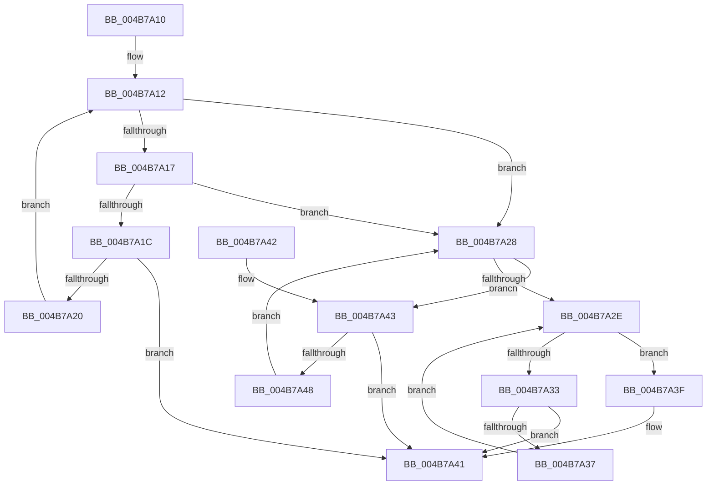

# RtlIsZeroMemory

- RVA: `0x004B7A10`–`0x004B7A52` (길이 `66` bytes)
- VA: `0x00000001404B7A10`
- 실행 섹션: `.text`
- PDB 이름 있음: `예`; PDB Function 태그: `아니요`
- unwind 정보 RVA: `0x000DB714`
- 디코드: `27`개 명령, `66/66` bytes 표시
- 미해석 바이트: `0` (있으면 어셈블리에 `.byte`로 보존)

> 이 문서는 커널 이미지의 기계어와 PDB 기호를 분석해 생성했습니다. 4번과 5번은 함수 원형과 자료형을 바이너리 사용 방식에서 추정한 C 해석이며 원본 소스 복구 결과는 아닙니다.

## 1. Dependencies

- 직접 호출 지점: **0**; 고유 호출 대상: **0**
- 직접 호출자로 확인된 함수: **1**
- RIP 상대 이미지 참조: **0**

### Outgoing calls
- 직접 디코드된 call 명령이 없습니다.

### Direct callers
- [PopTracePowerLimitHistogram](../5D/PopTracePowerLimitHistogram_function_005D7B10.md) at `0x005D7C3F`

### Static image references
- 디코드된 RIP-relative 메모리 참조가 없습니다.

## 2. Other-region calls and transfers

- 다른 실행 섹션으로 향하는 call: **0**
- 별도 외부 분기/꼬리 이동을 확인하지 못했습니다.

## 3. Assembly (complete function range)

```asm
004B7A10  33 C0                           xor eax, eax
004B7A12  F6 C1 07                        test cl, 7
004B7A15  74 11                           je 0x1404b7a28
004B7A17  48 85 D2                        test rdx, rdx
004B7A1A  74 0C                           je 0x1404b7a28
004B7A1C  38 01                           cmp byte ptr [rcx], al
004B7A1E  75 21                           jne 0x1404b7a41
004B7A20  48 FF C1                        inc rcx
004B7A23  48 FF CA                        dec rdx
004B7A26  EB EA                           jmp 0x1404b7a12
004B7A28  48 83 FA 08                     cmp rdx, 8
004B7A2C  73 15                           jae 0x1404b7a43
004B7A2E  48 85 D2                        test rdx, rdx
004B7A31  74 0C                           je 0x1404b7a3f
004B7A33  38 01                           cmp byte ptr [rcx], al
004B7A35  75 0A                           jne 0x1404b7a41
004B7A37  48 FF C1                        inc rcx
004B7A3A  48 FF CA                        dec rdx
004B7A3D  EB EF                           jmp 0x1404b7a2e
004B7A3F  B0 01                           mov al, 1
004B7A41  C3                              ret
004B7A42  CC                              int3
004B7A43  48 39 01                        cmp qword ptr [rcx], rax
004B7A46  75 F9                           jne 0x1404b7a41
004B7A48  48 83 C1 08                     add rcx, 8
004B7A4C  48 83 EA 08                     sub rdx, 8
004B7A50  EB D6                           jmp 0x1404b7a28
```

## 4. C-style interpretation (structured pseudocode)

```c
__int64 __fastcall RtlIsZeroMemory(__int64 a1, __int64 a2)
{
    __int64 result;

    result = 0;
loc_004B7A12:
    if ((((unsigned __int8)(a1)) & (7)) == 0) goto loc_004B7A28;
    if (a2 == 0) goto loc_004B7A28;
    if ((*(unsigned __int8 *)(a1)) != 0) goto loc_004B7A41;
    a1 = (a1) + 1;
    a2 = (a2) - 1;
    goto loc_004B7A12;
loc_004B7A28:
    if (a2 >= 8) goto loc_004B7A43;
loc_004B7A2E:
    if (a2 == 0) goto loc_004B7A3F;
    if ((*(unsigned __int8 *)(a1)) != 0) goto loc_004B7A41;
    a1 = (a1) + 1;
    a2 = (a2) - 1;
    goto loc_004B7A2E;
loc_004B7A3F:
loc_004B7A41:
    return 1;
loc_004B7A43:
    if ((*(unsigned __int64 *)(a1)) != 1) goto loc_004B7A41;
    a1 = (a1) + (8);
    a2 = (a2) - (8);
    goto loc_004B7A28;
}
```

## 5. (Beta) C Style

```c
int64_t RtlIsZeroMemory(int64_t Arg1, int64_t Arg2)
{
    int64_t result;

    result = 0;
loc_004B7A12:
    if ((((uint8_t)(Arg1)) & (7)) == 0) goto loc_004B7A28;
    if (Arg2 == 0) goto loc_004B7A28;
    if ((*(uint8_t *)(Arg1)) != 0) goto loc_004B7A41;
    Arg1 = (Arg1) + 1;
    Arg2 = (Arg2) - 1;
    goto loc_004B7A12;
loc_004B7A28:
    if (Arg2 >= 8) goto loc_004B7A43;
loc_004B7A2E:
    if (Arg2 == 0) goto loc_004B7A3F;
    if ((*(uint8_t *)(Arg1)) != 0) goto loc_004B7A41;
    Arg1 = (Arg1) + 1;
    Arg2 = (Arg2) - 1;
    goto loc_004B7A2E;
loc_004B7A3F:
loc_004B7A41:
    return 1;
loc_004B7A43:
    if ((*(uint64_t *)(Arg1)) != 1) goto loc_004B7A41;
    Arg1 = (Arg1) + (8);
    Arg2 = (Arg2) - (8);
    goto loc_004B7A28;
}
```

## 6. Execution-region graph

[열기: 2D/3D 그래프와 함수 탐색 컨트롤 패널](../../../control-panel.html?section=text&rva=0x004B7A10&view=graph)

- 2D 그래프는 위에서 아래로 흐르고, 3D 그래프는 빈 공간을 드래그해 회전합니다. Shift+드래그는 이동, 휠은 확대·축소, 함수 노드 선택은 대상 보고서 이동입니다.

### Static fallback


