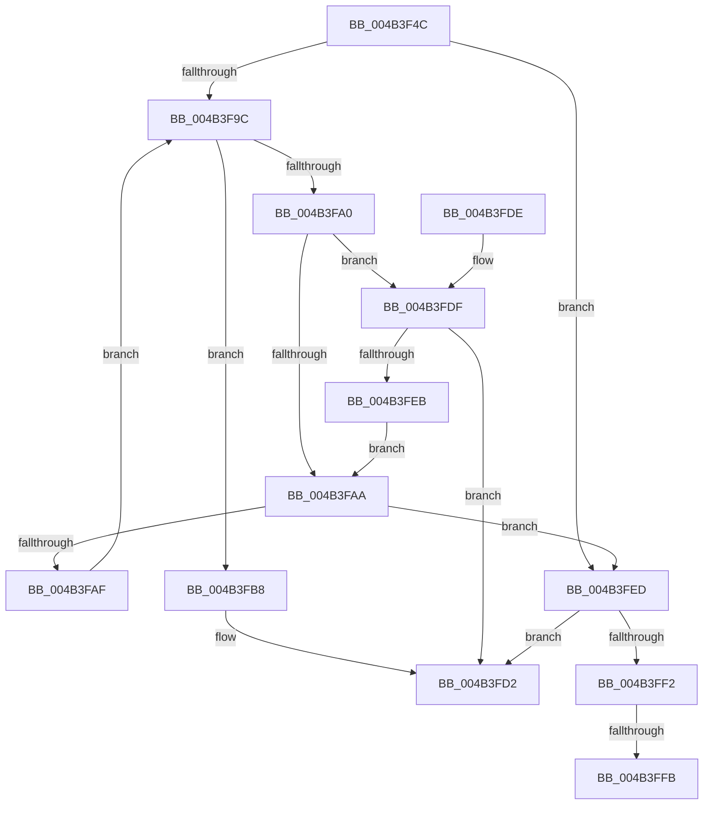

# RtlLengthCurrentClearRunForwardEx

- RVA: `0x004B3F4C`–`0x004B4004` (길이 `184` bytes)
- VA: `0x00000001404B3F4C`
- 실행 섹션: `.text`
- PDB 이름 있음: `예`; PDB Function 태그: `예`
- unwind 정보 RVA: `0x0009CE94`
- 디코드: `55`개 명령, `184/184` bytes 표시
- 미해석 바이트: `0` (있으면 어셈블리에 `.byte`로 보존)

> 이 문서는 커널 이미지의 기계어와 PDB 기호를 분석해 생성했습니다. 4번과 5번은 함수 원형과 자료형을 바이너리 사용 방식에서 추정한 C 해석이며 원본 소스 복구 결과는 아닙니다.

## 1. Dependencies

- 직접 호출 지점: **0**; 고유 호출 대상: **0**
- 직접 호출자로 확인된 함수: **1**
- RIP 상대 이미지 참조: **1**

### Outgoing calls
- 직접 디코드된 call 명령이 없습니다.

### Direct callers
- [RtlCSparseBitmapFindBitSetCapped](../32/RtlCSparseBitmapFindBitSetCapped_function_003274AC.md) at `0x0032759F`

### Static image references
- `0x004B3F87` → RVA `0x00012C50` (`.rdata`; read)

## 2. Other-region calls and transfers

- 다른 실행 섹션으로 향하는 call: **0**
- call이 아닌 외부 분기/꼬리 이동: **2**
  - `0x004B3FF5` → [sub_006FB83A](../6F/Unknown_function_006FB83A.md) (`tail-transfer`)
  - `0x004B3FFF` → [sub_006FB83A](../6F/Unknown_function_006FB83A.md) (`tail-transfer`)

## 3. Assembly (complete function range)

```asm
004B3F4C  48 89 5C 24 08                  mov qword ptr [rsp + 8], rbx
004B3F51  4C 8B 11                        mov r10, qword ptr [rcx]
004B3F54  48 8B C2                        mov rax, rdx
004B3F57  4C 8B 41 08                     mov r8, qword ptr [rcx + 8]
004B3F5B  48 C1 E8 05                     shr rax, 5
004B3F5F  4D 8D 0C 80                     lea r9, [r8 + rax*4]
004B3F63  49 8D 42 FF                     lea rax, [r10 - 1]
004B3F67  41 83 E2 1F                     and r10d, 0x1f
004B3F6B  48 C1 E8 05                     shr rax, 5
004B3F6F  4D 85 D2                        test r10, r10
004B3F72  49 8D 0C 80                     lea rcx, [r8 + rax*4]
004B3F76  48 8D 59 FC                     lea rbx, [rcx - 4]
004B3F7A  48 0F 44 D9                     cmove rbx, rcx
004B3F7E  83 E2 1F                        and edx, 0x1f
004B3F81  44 8B DA                        mov r11d, edx
004B3F84  45 33 C0                        xor r8d, r8d
004B3F87  48 8D 15 C2 EC B5 FF            lea rdx, [rip - 0x4a133e]
004B3F8E  42 8B 0C 9A                     mov ecx, dword ptr [rdx + r11*4]
004B3F92  F7 D1                           not ecx
004B3F94  41 23 09                        and ecx, dword ptr [r9]
004B3F97  4C 3B CB                        cmp r9, rbx
004B3F9A  77 51                           ja 0x1404b3fed
004B3F9C  85 C9                           test ecx, ecx
004B3F9E  75 18                           jne 0x1404b3fb8
004B3FA0  49 83 C0 20                     add r8, 0x20
004B3FA4  49 83 F8 FF                     cmp r8, -1
004B3FA8  73 35                           jae 0x1404b3fdf
004B3FAA  4C 3B CB                        cmp r9, rbx
004B3FAD  74 3E                           je 0x1404b3fed
004B3FAF  49 83 C1 04                     add r9, 4
004B3FB3  41 8B 09                        mov ecx, dword ptr [r9]
004B3FB6  EB E4                           jmp 0x1404b3f9c
004B3FB8  48 0F BC D1                     bsf rdx, rcx
004B3FBC  41 B9 FF FF FF FF               mov r9d, 0xffffffff
004B3FC2  0F B6 CA                        movzx ecx, dl
004B3FC5  44 0F 45 C9                     cmovne r9d, ecx
004B3FC9  49 0F BE C9                     movsx rcx, r9b
004B3FCD  8B C9                           mov ecx, ecx
004B3FCF  4C 03 C1                        add r8, rcx
004B3FD2  48 8B 5C 24 08                  mov rbx, qword ptr [rsp + 8]
004B3FD7  4D 2B C3                        sub r8, r11
004B3FDA  49 8B C0                        mov rax, r8
004B3FDD  C3                              ret
004B3FDE  CC                              int3
004B3FDF  49 8B C0                        mov rax, r8
004B3FE2  49 2B C3                        sub rax, r11
004B3FE5  48 83 F8 FF                     cmp rax, -1
004B3FE9  73 E7                           jae 0x1404b3fd2
004B3FEB  EB BD                           jmp 0x1404b3faa
004B3FED  4D 85 D2                        test r10, r10
004B3FF0  74 E0                           je 0x1404b3fd2
004B3FF2  4D 85 C0                        test r8, r8
004B3FF5  0F 84 3F 78 24 00               je 0x1406fb83a
004B3FFB  41 8B 49 04                     mov ecx, dword ptr [r9 + 4]
004B3FFF  E9 36 78 24 00                  jmp 0x1406fb83a
```

## 4. C-style interpretation (structured pseudocode)

```c
__int64 __fastcall RtlLengthCurrentClearRunForwardEx(__int64 a1, __int64 a2)
{
    __int64 result;
    __int64 v_r10;
    __int64 v_rbx;
    unsigned __int64 v_stack_p8;

    v_stack_p8 = v_rbx;
    result = (a2) >> (5);
    v_r10 = (unsigned int)((*(unsigned __int64 *)(a1)) & (31));
    result = (*(unsigned __int64 *)(a1) - 1) >> (5);
    v_rbx = *(unsigned __int64 *)(a1 + 8) + result * 4 - 4;
    if (v_r10 == 0) { v_rbx = *(unsigned __int64 *)(a1 + 8) + result * 4; }
    a2 = (unsigned int)((a2) & (31));
    a3 = 0;
    a1 = (unsigned int)(~((unsigned int)(*(unsigned int *)(v_rip - 4854590 + (unsigned int)((unsigned int)(a2)) * 4))));
    a1 = (unsigned int)((a1) & (*(unsigned int *)(*(unsigned __int64 *)(a1 + 8) + result * 4)));
    if ((*(unsigned __int64 *)(a1 + 8) + result * 4) > v_rbx) goto loc_004B3FED;
loc_004B3F9C:
    if ((unsigned int)(a1) != 0) goto loc_004B3FB8;
    a3 = (a3) + (32);
    if (a3 >= -1) goto loc_004B3FDF;
loc_004B3FAA:
    if ((*(unsigned __int64 *)(a1 + 8) + result * 4) == v_rbx) goto loc_004B3FED;
    a4 = (*(unsigned __int64 *)(a1 + 8) + result * 4) + (4);
    goto loc_004B3F9C;
loc_004B3FB8:
    a4 = (unsigned int)(0xFFFFFFFFULL);
    if (condition_is_not_equal) { a4 = (unsigned int)((unsigned __int8)(v_rip - 4854590)); }
    a3 = (a3) + ((unsigned int)((unsigned int)((__int8)((unsigned __int8)(a4)))));
loc_004B3FD2:
    a3 = (a3) - ((unsigned int)((unsigned int)(a2)));
    return a3;
loc_004B3FDF:
    result = (a3) - ((unsigned int)((unsigned int)(a2)));
    if (result >= -1) goto loc_004B3FD2;
    goto loc_004B3FAA;
loc_004B3FED:
    if (v_r10 == 0) goto loc_004B3FD2;
}
```

## 5. (Beta) C Style

```c
int64_t RtlLengthCurrentClearRunForwardEx(void *Arg1, int64_t Arg2)
{
    uint8_t *arg1 = (uint8_t *)Arg1;

    int64_t result;
    int64_t local_r10;
    int64_t local_rbx;
    uint64_t v_stack_p8;

    v_stack_p8 = local_rbx;
    result = (Arg2) >> (5);
    local_r10 = (uint32_t)((*(uint64_t *)(arg1)) & (31));
    result = (*(uint64_t *)(arg1) - 1) >> (5);
    local_rbx = *(uint64_t *)(arg1 + 0x8) + result * 4 - 4;
    if (local_r10 == 0) { local_rbx = *(uint64_t *)(arg1 + 0x8) + result * 4; }
    Arg2 = (uint32_t)((Arg2) & (31));
    a3 = 0;
    Arg1 = (uint32_t)(~((uint32_t)(*(uint32_t *)(v_rip - 0x4A133E + (uint32_t)((uint32_t)(Arg2)) * 4))));
    Arg1 = (uint32_t)((Arg1) & (*(uint32_t *)(*(uint64_t *)(arg1 + 0x8) + result * 4)));
    if ((*(uint64_t *)(arg1 + 0x8) + result * 4) > local_rbx) goto loc_004B3FED;
loc_004B3F9C:
    if ((uint32_t)(Arg1) != 0) goto loc_004B3FB8;
    a3 = (a3) + (32);
    if (a3 >= -1) goto loc_004B3FDF;
loc_004B3FAA:
    if ((*(uint64_t *)(arg1 + 0x8) + result * 4) == local_rbx) goto loc_004B3FED;
    a4 = (*(uint64_t *)(arg1 + 0x8) + result * 4) + (4);
    goto loc_004B3F9C;
loc_004B3FB8:
    a4 = (uint32_t)(0xFFFFFFFFULL);
    if (condition_is_not_equal) { a4 = (uint32_t)((uint8_t)(v_rip - 4854590)); }
    a3 = (a3) + ((uint32_t)((uint32_t)((int8_t)((uint8_t)(a4)))));
loc_004B3FD2:
    a3 = (a3) - ((uint32_t)((uint32_t)(Arg2)));
    return a3;
loc_004B3FDF:
    result = (a3) - ((uint32_t)((uint32_t)(Arg2)));
    if (result >= -1) goto loc_004B3FD2;
    goto loc_004B3FAA;
loc_004B3FED:
    if (local_r10 == 0) goto loc_004B3FD2;
}
```

### 관측된 메모리 오프셋

구조체 형식이 확인되지 않은 접근은 인자 기준의 오프셋으로만 기록했습니다.

| 기준 인자 | 오프셋 표현 | 폭 (bit) | 접근 |
|---|---:|---:|---|
| `Arg1` | `+ 0x0` | `64` | `R` |
| `Arg1` | `+ 0x8` | `64` | `R` |

## 6. Execution-region graph

[열기: 2D/3D 그래프와 함수 탐색 컨트롤 패널](../../../control-panel.html?section=text&rva=0x004B3F4C&view=graph)

- 2D 그래프는 위에서 아래로 흐르고, 3D 그래프는 빈 공간을 드래그해 회전합니다. Shift+드래그는 이동, 휠은 확대·축소, 함수 노드 선택은 대상 보고서 이동입니다.

### Static fallback


