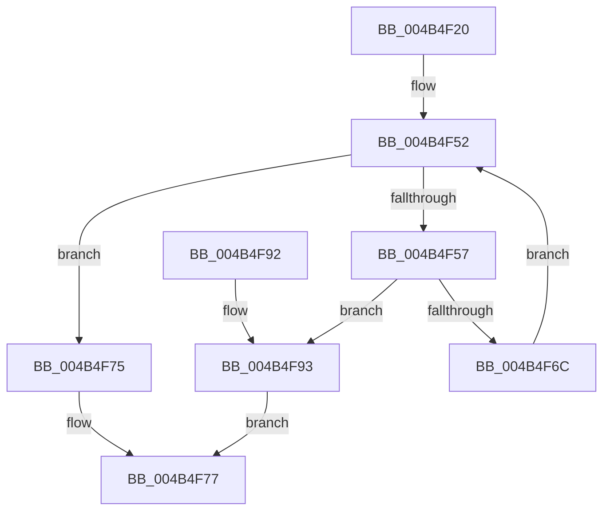

# RtlLookupImageSectionByName

- RVA: `0x004B4F20`–`0x004B4F98` (길이 `120` bytes)
- VA: `0x00000001404B4F20`
- 실행 섹션: `.text`
- PDB 이름 있음: `예`; PDB Function 태그: `아니요`
- unwind 정보 RVA: `0x000AFAEC`
- 디코드: `36`개 명령, `120/120` bytes 표시
- 미해석 바이트: `0` (있으면 어셈블리에 `.byte`로 보존)

> 이 문서는 커널 이미지의 기계어와 PDB 기호를 분석해 생성했습니다. 4번과 5번은 함수 원형과 자료형을 바이너리 사용 방식에서 추정한 C 해석이며 원본 소스 복구 결과는 아닙니다.

## 1. Dependencies

- 직접 호출 지점: **1**; 고유 호출 대상: **1**
- 직접 호출자로 확인된 함수: **3**
- RIP 상대 이미지 참조: **0**

### Outgoing calls
- `0x004B4F63` → [strncmp](../6C/strncmp_function_006C6720.md) (function, `0x006C6720`)

### Direct callers
- [PrExtExtractDataRecordTable](../66/PrExtExtractDataRecordTable_function_00666C4C.md) at `0x00666CA4`
- [MiApplyDynamicFixupsToKernelAndHal](../../init/C6/MiApplyDynamicFixupsToKernelAndHal_function_00C65EBC.md) at `0x00C65FB7`
- [MiApplyDynamicFixupsToKernelAndHal](../../init/C6/MiApplyDynamicFixupsToKernelAndHal_function_00C65EBC.md) at `0x00C65FE2`
- [MiPrepareScpFixupsForNtAndHal](../../init/C6/MiPrepareScpFixupsForNtAndHal_function_00C66734.md) at `0x00C66789`

### Static image references
- 디코드된 RIP-relative 메모리 참조가 없습니다.

## 2. Other-region calls and transfers

- 다른 실행 섹션으로 향하는 call: **0**
- 별도 외부 분기/꼬리 이동을 확인하지 못했습니다.

## 3. Assembly (complete function range)

```asm
004B4F20  48 8B C4                        mov rax, rsp
004B4F23  48 89 58 08                     mov qword ptr [rax + 8], rbx
004B4F27  48 89 68 10                     mov qword ptr [rax + 0x10], rbp
004B4F2B  48 89 70 18                     mov qword ptr [rax + 0x18], rsi
004B4F2F  48 89 78 20                     mov qword ptr [rax + 0x20], rdi
004B4F33  41 56                           push r14
004B4F35  48 83 EC 20                     sub rsp, 0x20
004B4F39  0F B7 59 14                     movzx ebx, word ptr [rcx + 0x14]
004B4F3D  48 8B EA                        mov rbp, rdx
004B4F40  0F B7 71 06                     movzx esi, word ptr [rcx + 6]
004B4F44  48 83 C3 18                     add rbx, 0x18
004B4F48  48 03 D9                        add rbx, rcx
004B4F4B  45 33 F6                        xor r14d, r14d
004B4F4E  41 0F B7 FE                     movzx edi, r14w
004B4F52  66 3B FE                        cmp di, si
004B4F55  73 1E                           jae 0x1404b4f75
004B4F57  41 B8 08 00 00 00               mov r8d, 8
004B4F5D  48 8B D5                        mov rdx, rbp
004B4F60  48 8B CB                        mov rcx, rbx
004B4F63  E8 B8 17 21 00                  call 0x1406c6720
004B4F68  85 C0                           test eax, eax
004B4F6A  74 27                           je 0x1404b4f93
004B4F6C  48 83 C3 28                     add rbx, 0x28
004B4F70  66 FF C7                        inc di
004B4F73  EB DD                           jmp 0x1404b4f52
004B4F75  33 C0                           xor eax, eax
004B4F77  48 8B 5C 24 30                  mov rbx, qword ptr [rsp + 0x30]
004B4F7C  48 8B 6C 24 38                  mov rbp, qword ptr [rsp + 0x38]
004B4F81  48 8B 74 24 40                  mov rsi, qword ptr [rsp + 0x40]
004B4F86  48 8B 7C 24 48                  mov rdi, qword ptr [rsp + 0x48]
004B4F8B  48 83 C4 20                     add rsp, 0x20
004B4F8F  41 5E                           pop r14
004B4F91  C3                              ret
004B4F92  CC                              int3
004B4F93  48 8B C3                        mov rax, rbx
004B4F96  EB DF                           jmp 0x1404b4f77
```

## 4. C-style interpretation (structured pseudocode)

```c
__int64 __fastcall RtlLookupImageSectionByName(__int64 a1, __int64 a2)
{
    __int64 result;
    __int64 v_r14;
    __int64 v_rbx;
    __int64 v_rdi;
    __int64 v_rsp;
    unsigned __int64 v_stack_p10;
    unsigned __int64 v_stack_p18;
    unsigned __int64 v_stack_p20;
    unsigned __int64 v_stack_p8;

    *(unsigned __int64 *)(v_rsp + 8) = v_rbx;
    *(unsigned __int64 *)(v_rsp + 16) = v_rbp;
    *(unsigned __int64 *)(v_rsp + 24) = v_rsi;
    *(unsigned __int64 *)(v_rsp + 32) = v_rdi;
    v_rsp = (v_rsp) - (32);
    v_rbx = (*(unsigned __int16 *)(a1 + 20)) + (24);
    v_rbx = (v_rbx) + (a1);
    v_r14 = 0;
loc_004B4F52:
    if (0 >= ((unsigned __int16)(*(unsigned __int16 *)(a1 + 6)))) goto loc_004B4F75;
    result = strncmp(v_rbx, a2, 8, a4);
    if ((unsigned int)(result) == 0) goto loc_004B4F93;
    v_rbx = (v_rbx) + (40);
    v_rdi = (unsigned __int16)((0) + 1);
    goto loc_004B4F52;
loc_004B4F75:
    result = 0;
loc_004B4F77:
    v_rsp = (v_rsp) + (32);
    return result;
loc_004B4F93:
    goto loc_004B4F77;
}
```

## 5. (Beta) C Style

```c
int64_t RtlLookupImageSectionByName(void *Arg1, int64_t Arg2)
{
    uint8_t *arg1 = (uint8_t *)Arg1;

    int64_t result;
    int64_t local_r14;
    int64_t local_rbx;
    int64_t local_rdi;
    int64_t local_rsp;
    uint64_t v_stack_p10;
    uint64_t v_stack_p18;
    uint64_t v_stack_p20;
    uint64_t v_stack_p8;

    *(uint64_t *)(local_rsp + 0x8) = local_rbx;
    *(uint64_t *)(local_rsp + 0x10) = local_rbp;
    *(uint64_t *)(local_rsp + 0x18) = local_rsi;
    *(uint64_t *)(local_rsp + 0x20) = local_rdi;
    local_rsp = (local_rsp) - (32);
    local_rbx = (*(uint16_t *)(arg1 + 0x14)) + (24);
    local_rbx = (local_rbx) + (Arg1);
    local_r14 = 0;
loc_004B4F52:
    if (0 >= ((uint16_t)(*(uint16_t *)(arg1 + 0x6)))) goto loc_004B4F75;
    result = strncmp(local_rbx, Arg2, 8, a4);
    if ((uint32_t)(result) == 0) goto loc_004B4F93;
    local_rbx = (local_rbx) + (40);
    local_rdi = (uint16_t)((0) + 1);
    goto loc_004B4F52;
loc_004B4F75:
    result = 0;
loc_004B4F77:
    local_rsp = (local_rsp) + (32);
    return result;
loc_004B4F93:
    goto loc_004B4F77;
}
```

### 관측된 메모리 오프셋

구조체 형식이 확인되지 않은 접근은 인자 기준의 오프셋으로만 기록했습니다.

| 기준 인자 | 오프셋 표현 | 폭 (bit) | 접근 |
|---|---:|---:|---|
| `Arg1` | `+ 0x6` | `16` | `R` |
| `Arg1` | `+ 0x14` | `16` | `R` |

## 6. Execution-region graph

[열기: 2D/3D 그래프와 함수 탐색 컨트롤 패널](../../../control-panel.html?section=text&rva=0x004B4F20&view=graph)

- 2D 그래프는 위에서 아래로 흐르고, 3D 그래프는 빈 공간을 드래그해 회전합니다. Shift+드래그는 이동, 휠은 확대·축소, 함수 노드 선택은 대상 보고서 이동입니다.

### Static fallback


