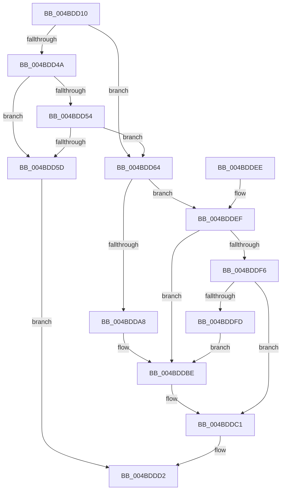

# RtlQueryFeatureConfiguration

- RVA: `0x004BDD10`–`0x004BDDFF` (길이 `239` bytes)
- VA: `0x00000001404BDD10`
- 실행 섹션: `.text`
- PDB 이름 있음: `예`; PDB Function 태그: `아니요`
- unwind 정보 RVA: `0x000BC1A8`
- 디코드: `74`개 명령, `239/239` bytes 표시
- 미해석 바이트: `0` (있으면 어셈블리에 `.byte`로 보존)

> 이 문서는 커널 이미지의 기계어와 PDB 기호를 분석해 생성했습니다. 4번과 5번은 함수 원형과 자료형을 바이너리 사용 방식에서 추정한 C 해석이며 원본 소스 복구 결과는 아닙니다.

## 1. Dependencies

- 직접 호출 지점: **7**; 고유 호출 대상: **7**
- 직접 호출자로 확인된 함수: **3**
- RIP 상대 이미지 참조: **3**

### Outgoing calls
- `0x004BDD41` → [KeGetEffectiveIrql](../2F/KeGetEffectiveIrql_function_002F8030.md) (function, `0x002F8030`)
- `0x004BDD64` → [RtlpFcGetBufferManager](../../page/70/RtlpFcGetBufferManager_function_00705A30.md) (function, `0x00705A30`)
- `0x004BDD6C` → [RtlpFcEnterRegion](../../page/A9/RtlpFcEnterRegion_function_00A903F4.md) (function, `0x00A903F4`)
- `0x004BDD74` → [RtlAcquireSwapReference](../37/RtlAcquireSwapReference_function_00378684.md) (function, `0x00378684`)
- `0x004BDD9D` → [RtlpFcQueryFeatureConfigurationFromBufferSet](../../page/70/RtlpFcQueryFeatureConfigurationFromBufferSet_function_007035C4.md) (function, `0x007035C4`)
- `0x004BDDCB` → [RtlpFcBufferManagerDereferenceBuffers](../37/RtlpFcBufferManagerDereferenceBuffers_function_00378D84.md) (function, `0x00378D84`)
- `0x004BDDDA` → [_security_check_cookie](../6A/_security_check_cookie_function_006AC640.md) (function, `0x006AC640`)

### Direct callers
- [wil_details_UpdateFeatureConfiguredStates](../../page/AB/wil_details_UpdateFeatureConfiguredStates_function_00ABD258.md) at `0x00ABD2B7`
- [wil_RtlStagingConfig_QueryFeatureState](../../page/AC/wil_RtlStagingConfig_QueryFeatureState_function_00AC069C.md) at `0x00AC06E6`
- [CmQuerySingleFeatureConfiguration](../../page/AC/CmQuerySingleFeatureConfiguration_function_00AC70A8.md) at `0x00AC7121`

### Static image references
- `0x004BDD1F` → RVA `0x00E0A740` (`.data`; read)
- `0x004BDD4A` → RVA `0x00F4754C` (`.data`; read)
- `0x004BDD54` → RVA `0x00F0BD20` (`.data`; read)

## 2. Other-region calls and transfers

- 다른 실행 섹션으로 향하는 call: **3**
  - `0x004BDD64` → [RtlpFcGetBufferManager](../../page/70/RtlpFcGetBufferManager_function_00705A30.md) (`.text` → `PAGE`)
  - `0x004BDD6C` → [RtlpFcEnterRegion](../../page/A9/RtlpFcEnterRegion_function_00A903F4.md) (`.text` → `PAGE`)
  - `0x004BDD9D` → [RtlpFcQueryFeatureConfigurationFromBufferSet](../../page/70/RtlpFcQueryFeatureConfigurationFromBufferSet_function_007035C4.md) (`.text` → `PAGE`)
- 별도 외부 분기/꼬리 이동을 확인하지 못했습니다.

## 3. Assembly (complete function range)

```asm
004BDD10  40 53                           push rbx
004BDD12  55                              push rbp
004BDD13  56                              push rsi
004BDD14  57                              push rdi
004BDD15  41 54                           push r12
004BDD17  41 56                           push r14
004BDD19  41 57                           push r15
004BDD1B  48 83 EC 40                     sub rsp, 0x40
004BDD1F  48 8B 05 1A CA 94 00            mov rax, qword ptr [rip + 0x94ca1a]
004BDD26  48 33 C4                        xor rax, rsp
004BDD29  48 89 44 24 30                  mov qword ptr [rsp + 0x30], rax
004BDD2E  0F 57 C0                        xorps xmm0, xmm0
004BDD31  49 8B E9                        mov rbp, r9
004BDD34  0F 11 44 24 20                  movups xmmword ptr [rsp + 0x20], xmm0
004BDD39  4D 8B F0                        mov r14, r8
004BDD3C  44 8B E2                        mov r12d, edx
004BDD3F  8B D9                           mov ebx, ecx
004BDD41  E8 EA A2 E3 FF                  call 0x1402f8030
004BDD46  3C 01                           cmp al, 1
004BDD48  76 1A                           jbe 0x1404bdd64
004BDD4A  8B 05 FC 97 A8 00               mov eax, dword ptr [rip + 0xa897fc]
004BDD50  A8 03                           test al, 3
004BDD52  75 09                           jne 0x1404bdd5d
004BDD54  80 3D C5 DF A4 00 00            cmp byte ptr [rip + 0xa4dfc5], 0
004BDD5B  74 07                           je 0x1404bdd64
004BDD5D  B8 22 00 00 80                  mov eax, 0x80000022
004BDD62  EB 6E                           jmp 0x1404bddd2
004BDD64  E8 C7 7C 24 00                  call 0x140705a30
004BDD69  48 8B F0                        mov rsi, rax
004BDD6C  E8 83 26 5D 00                  call 0x140a903f4
004BDD71  48 8B CE                        mov rcx, rsi
004BDD74  E8 0B A9 EB FF                  call 0x140378684
004BDD79  44 8B D0                        mov r10d, eax
004BDD7C  48 8D 4E 18                     lea rcx, [rsi + 0x18]
004BDD80  4C 8D 4C 24 20                  lea r9, [rsp + 0x20]
004BDD85  45 8B C4                        mov r8d, r12d
004BDD88  8B D3                           mov edx, ebx
004BDD8A  4A 8B BC D6 D8 00 00 00         mov rdi, qword ptr [rsi + r10*8 + 0xd8]
004BDD92  4F 8D 3C 52                     lea r15, [r10 + r10*2]
004BDD96  49 C1 E7 05                     shl r15, 5
004BDD9A  49 03 CF                        add rcx, r15
004BDD9D  E8 22 58 24 00                  call 0x1407035c4
004BDDA2  8B D8                           mov ebx, eax
004BDDA4  85 C0                           test eax, eax
004BDDA6  78 47                           js 0x1404bddef
004BDDA8  0F 10 4C 24 20                  movups xmm1, xmmword ptr [rsp + 0x20]
004BDDAD  33 DB                           xor ebx, ebx
004BDDAF  F2 0F 11 4D 00                  movsd qword ptr [rbp], xmm1
004BDDB4  66 0F 73 D9 08                  psrldq xmm1, 8
004BDDB9  66 0F 7E 4D 08                  movd dword ptr [rbp + 8], xmm1
004BDDBE  49 89 3E                        mov qword ptr [r14], rdi
004BDDC1  48 8D 56 18                     lea rdx, [rsi + 0x18]
004BDDC5  48 8B CE                        mov rcx, rsi
004BDDC8  49 03 D7                        add rdx, r15
004BDDCB  E8 B4 AF EB FF                  call 0x140378d84
004BDDD0  8B C3                           mov eax, ebx
004BDDD2  48 8B 4C 24 30                  mov rcx, qword ptr [rsp + 0x30]
004BDDD7  48 33 CC                        xor rcx, rsp
004BDDDA  E8 61 E8 1E 00                  call 0x1406ac640
004BDDDF  48 83 C4 40                     add rsp, 0x40
004BDDE3  41 5F                           pop r15
004BDDE5  41 5E                           pop r14
004BDDE7  41 5C                           pop r12
004BDDE9  5F                              pop rdi
004BDDEA  5E                              pop rsi
004BDDEB  5D                              pop rbp
004BDDEC  5B                              pop rbx
004BDDED  C3                              ret
004BDDEE  CC                              int3
004BDDEF  3D 25 02 00 C0                  cmp eax, 0xc0000225
004BDDF4  74 C8                           je 0x1404bddbe
004BDDF6  3D 22 00 00 80                  cmp eax, 0x80000022
004BDDFB  75 C4                           jne 0x1404bddc1
004BDDFD  EB BF                           jmp 0x1404bddbe
```

## 4. C-style interpretation (structured pseudocode)

```c
__int64 __fastcall RtlQueryFeatureConfiguration(int a1, int a2, __int64 a3, __int64 a4)
{
    __int64 result;
    __int64 v_r15;
    __int64 v_rbx;
    __int64 v_rsp;
    unsigned __int64 v_stack_m48;
    unsigned __int64 v_stack_m58;

    v_rsp = (v_rsp) - (64);
    result = (*(unsigned __int64 *)(v_rip + 9751066)) ^ (v_rsp);
    v_stack_m48 = result;
    v_stack_m58 = v_xmm0;
    result = KeGetEffectiveIrql(a1, a2, a3, a4);
    if (((unsigned __int8)(result)) <= 1) goto loc_004BDD64;
    if ((((unsigned __int8)((unsigned int)(*(unsigned int *)(v_rip + 11048956)))) & (3)) != 0) goto loc_004BDD5D;
    if ((*(unsigned __int8 *)(v_rip + 10805189)) == 0) goto loc_004BDD64;
loc_004BDD5D:
    goto loc_004BDDD2;
loc_004BDD64:
    result = RtlpFcGetBufferManager(a1, a2, a3, a4);
    result = RtlpFcEnterRegion(a1, a2, a3, a4);
    result = RtlAcquireSwapReference(result, a2, a3, a4);
    v_r15 = ((unsigned int)((unsigned int)(result)) + (unsigned int)((unsigned int)(result)) * 2) << (5);
    a1 = (result + 24) + (v_r15);
    result = RtlpFcQueryFeatureConfigurationFromBufferSet(a1, (unsigned int)((unsigned int)((unsigned int)(a1))), (unsigned int)((unsigned int)((unsigned int)(a2))), v_stack_m58);
    if (sign_flag) goto loc_004BDDEF;
    v_rbx = 0;
    *(unsigned __int64 *)(a4) = v_xmm1;
    *(unsigned int *)(a4 + 8) = v_xmm1;
loc_004BDDBE:
    *(unsigned __int64 *)(a3) = *(unsigned __int64 *)(result + (unsigned int)((unsigned int)(result)) * 8 + 216);
loc_004BDDC1:
    a2 = (result + 24) + (v_r15);
    result = RtlpFcBufferManagerDereferenceBuffers(result, a2, (unsigned int)((unsigned int)((unsigned int)(a2))), v_stack_m58);
loc_004BDDD2:
    a1 = (v_stack_m48) ^ (v_rsp);
    result = _security_check_cookie(a1, a2, (unsigned int)((unsigned int)((unsigned int)(a2))), v_stack_m58);
    v_rsp = (v_rsp) + (64);
    return result;
loc_004BDDEF:
    if (((unsigned int)(result)) == 0xC0000225ULL) goto loc_004BDDBE;
    if (((unsigned int)(result)) != 0x80000022ULL) goto loc_004BDDC1;
    goto loc_004BDDBE;
}
```

## 5. (Beta) C Style

```c
int64_t RtlQueryFeatureConfiguration(int32_t Arg1, int32_t Arg2, void *Arg3, void *Arg4)
{
    uint8_t *arg3 = (uint8_t *)Arg3;
    uint8_t *arg4 = (uint8_t *)Arg4;

    int64_t result;
    int64_t local_r15;
    int64_t local_rbx;
    int64_t local_rsp;
    uint64_t v_stack_m48;
    uint64_t v_stack_m58;

    local_rsp = (local_rsp) - (64);
    result = (*(uint64_t *)(v_rip + 0x94CA1A)) ^ (local_rsp);
    v_stack_m48 = result;
    v_stack_m58 = v_xmm0;
    result = KeGetEffectiveIrql(Arg1, Arg2, Arg3, Arg4);
    if (((uint8_t)(result)) <= 1) goto loc_004BDD64;
    if ((((uint8_t)((uint32_t)(*(uint32_t *)(v_rip + 0xA897FC)))) & (3)) != 0) goto loc_004BDD5D;
    if ((*(uint8_t *)(v_rip + 0xA4DFC5)) == 0) goto loc_004BDD64;
loc_004BDD5D:
    goto loc_004BDDD2;
loc_004BDD64:
    result = RtlpFcGetBufferManager(Arg1, Arg2, Arg3, Arg4);
    result = RtlpFcEnterRegion(Arg1, Arg2, Arg3, Arg4);
    result = RtlAcquireSwapReference(result, Arg2, Arg3, Arg4);
    local_r15 = ((uint32_t)((uint32_t)(result)) + (uint32_t)((uint32_t)(result)) * 2) << (5);
    Arg1 = (result + 24) + (local_r15);
    result = RtlpFcQueryFeatureConfigurationFromBufferSet(Arg1, (uint32_t)((uint32_t)((uint32_t)(Arg1))), (uint32_t)((uint32_t)((uint32_t)(Arg2))), v_stack_m58);
    if (sign_flag) goto loc_004BDDEF;
    local_rbx = 0;
    *(uint64_t *)(arg4) = v_xmm1;
    *(uint32_t *)(arg4 + 0x8) = v_xmm1;
loc_004BDDBE:
    *(uint64_t *)(arg3) = *(uint64_t *)(result + (uint32_t)((uint32_t)(result)) * 8 + 0xD8);
loc_004BDDC1:
    Arg2 = (result + 24) + (local_r15);
    result = RtlpFcBufferManagerDereferenceBuffers(result, Arg2, (uint32_t)((uint32_t)((uint32_t)(Arg2))), v_stack_m58);
loc_004BDDD2:
    Arg1 = (v_stack_m48) ^ (local_rsp);
    result = _security_check_cookie(Arg1, Arg2, (uint32_t)((uint32_t)((uint32_t)(Arg2))), v_stack_m58);
    local_rsp = (local_rsp) + (64);
    return result;
loc_004BDDEF:
    if (((uint32_t)(result)) == 0xC0000225ULL) goto loc_004BDDBE;
    if (((uint32_t)(result)) != 0x80000022ULL) goto loc_004BDDC1;
    goto loc_004BDDBE;
}
```

### 관측된 메모리 오프셋

구조체 형식이 확인되지 않은 접근은 인자 기준의 오프셋으로만 기록했습니다.

| 기준 인자 | 오프셋 표현 | 폭 (bit) | 접근 |
|---|---:|---:|---|
| `Arg3` | `+ 0x0` | `64` | `W` |
| `Arg4` | `+ 0x0` | `64` | `W` |
| `Arg4` | `+ 0x8` | `32` | `W` |

## 6. Execution-region graph

[열기: 2D/3D 그래프와 함수 탐색 컨트롤 패널](../../../control-panel.html?section=text&rva=0x004BDD10&view=graph)

- 2D 그래프는 위에서 아래로 흐르고, 3D 그래프는 빈 공간을 드래그해 회전합니다. Shift+드래그는 이동, 휠은 확대·축소, 함수 노드 선택은 대상 보고서 이동입니다.

### Static fallback


