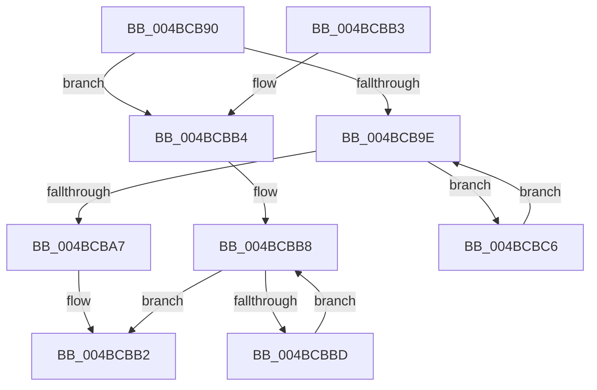

# RtlRealPredecessor

- RVA: `0x004BCB90`–`0x004BCBCB` (길이 `59` bytes)
- VA: `0x00000001404BCB90`
- 실행 섹션: `.text`
- PDB 이름 있음: `예`; PDB Function 태그: `아니요`
- unwind 정보 RVA: `0x000DB714`
- 디코드: `21`개 명령, `59/59` bytes 표시
- 미해석 바이트: `0` (있으면 어셈블리에 `.byte`로 보존)

> 이 문서는 커널 이미지의 기계어와 PDB 기호를 분석해 생성했습니다. 4번과 5번은 함수 원형과 자료형을 바이너리 사용 방식에서 추정한 C 해석이며 원본 소스 복구 결과는 아닙니다.

## 1. Dependencies

- 직접 호출 지점: **0**; 고유 호출 대상: **0**
- 직접 호출자로 확인된 함수: **0**
- RIP 상대 이미지 참조: **0**

### Outgoing calls
- 직접 디코드된 call 명령이 없습니다.

### Direct callers
- 이 함수 시작 RVA로 연결되는 직접 call은 확인되지 않았습니다. 간접 호출은 완전히 역산할 수 없습니다.

### Static image references
- 디코드된 RIP-relative 메모리 참조가 없습니다.

## 2. Other-region calls and transfers

- 다른 실행 섹션으로 향하는 call: **0**
- 별도 외부 분기/꼬리 이동을 확인하지 못했습니다.

## 3. Assembly (complete function range)

```asm
004BCB90  48 8B 41 08                     mov rax, qword ptr [rcx + 8]
004BCB94  33 D2                           xor edx, edx
004BCB96  4C 8B C1                        mov r8, rcx
004BCB99  48 85 C0                        test rax, rax
004BCB9C  75 16                           jne 0x1404bcbb4
004BCB9E  48 8B 09                        mov rcx, qword ptr [rcx]
004BCBA1  4C 39 41 08                     cmp qword ptr [rcx + 8], r8
004BCBA5  74 1F                           je 0x1404bcbc6
004BCBA7  4C 39 41 10                     cmp qword ptr [rcx + 0x10], r8
004BCBAB  48 0F 44 D1                     cmove rdx, rcx
004BCBAF  48 8B C2                        mov rax, rdx
004BCBB2  C3                              ret
004BCBB3  CC                              int3
004BCBB4  48 8B 48 10                     mov rcx, qword ptr [rax + 0x10]
004BCBB8  48 85 C9                        test rcx, rcx
004BCBBB  74 F5                           je 0x1404bcbb2
004BCBBD  48 8B C1                        mov rax, rcx
004BCBC0  48 8B 49 10                     mov rcx, qword ptr [rcx + 0x10]
004BCBC4  EB F2                           jmp 0x1404bcbb8
004BCBC6  4C 8B C1                        mov r8, rcx
004BCBC9  EB D3                           jmp 0x1404bcb9e
```

## 4. C-style interpretation (structured pseudocode)

```c
__int64 __fastcall RtlRealPredecessor(__int64 a1, int a2)
{
    a2 = 0;
    if (*(unsigned __int64 *)(a1 + 8) != 0) goto loc_004BCBB4;
loc_004BCB9E:
    if ((*(unsigned __int64 *)(*(unsigned __int64 *)(a1) + 8)) == a1) goto loc_004BCBC6;
    if ((*(unsigned __int64 *)(*(unsigned __int64 *)(a1) + 16)) == a1) { a2 = *(unsigned __int64 *)(a1); }
loc_004BCBB2:
    return a2;
loc_004BCBB4:
loc_004BCBB8:
    if (*(unsigned __int64 *)(a2 + 16) == 0) goto loc_004BCBB2;
    goto loc_004BCBB8;
loc_004BCBC6:
    goto loc_004BCB9E;
}
```

## 5. (Beta) C Style

```c
int64_t RtlRealPredecessor(void *Arg1, int32_t Arg2)
{
    uint8_t *arg1 = (uint8_t *)Arg1;

    Arg2 = 0;
    if (*(uint64_t *)(arg1 + 0x8) != 0) goto loc_004BCBB4;
loc_004BCB9E:
    if ((*(uint64_t *)(*(uint64_t *)(arg1) + 0x8)) == Arg1) goto loc_004BCBC6;
    if ((*(uint64_t *)(*(uint64_t *)(arg1) + 0x10)) == Arg1) { Arg2 = *(uint64_t *)(arg1); }
loc_004BCBB2:
    return Arg2;
loc_004BCBB4:
loc_004BCBB8:
    if (*(uint64_t *)(Arg2 + 0x10) == 0) goto loc_004BCBB2;
    goto loc_004BCBB8;
loc_004BCBC6:
    goto loc_004BCB9E;
}
```

### 관측된 메모리 오프셋

구조체 형식이 확인되지 않은 접근은 인자 기준의 오프셋으로만 기록했습니다.

| 기준 인자 | 오프셋 표현 | 폭 (bit) | 접근 |
|---|---:|---:|---|
| `Arg1` | `+ 0x8` | `64` | `R` |

## 6. Execution-region graph

[열기: 2D/3D 그래프와 함수 탐색 컨트롤 패널](../../../control-panel.html?section=text&rva=0x004BCB90&view=graph)

- 2D 그래프는 위에서 아래로 흐르고, 3D 그래프는 빈 공간을 드래그해 회전합니다. Shift+드래그는 이동, 휠은 확대·축소, 함수 노드 선택은 대상 보고서 이동입니다.

### Static fallback


