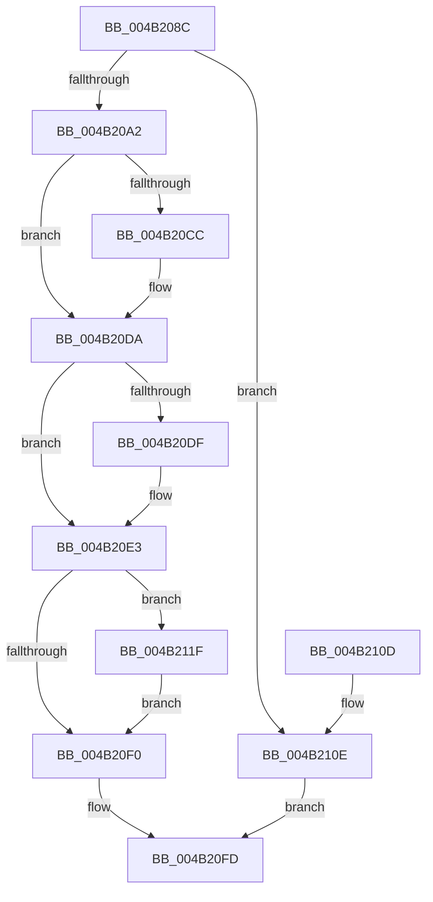

# RtlpHpAcquireReleaseLockExclusive

- RVA: `0x004B208C`–`0x004B2129` (길이 `157` bytes)
- VA: `0x00000001404B208C`
- 실행 섹션: `.text`
- PDB 이름 있음: `예`; PDB Function 태그: `아니요`
- unwind 정보 RVA: `0x00063C10`
- 디코드: `45`개 명령, `157/157` bytes 표시
- 미해석 바이트: `0` (있으면 어셈블리에 `.byte`로 보존)

> 이 문서는 커널 이미지의 기계어와 PDB 기호를 분석해 생성했습니다. 4번과 5번은 함수 원형과 자료형을 바이너리 사용 방식에서 추정한 C 해석이며 원본 소스 복구 결과는 아닙니다.

## 1. Dependencies

- 직접 호출 지점: **7**; 고유 호출 대상: **7**
- 직접 호출자로 확인된 함수: **1**
- RIP 상대 이미지 참조: **0**

### Outgoing calls
- `0x004B20BC` → [KeAbPreAcquire](../21/KeAbPreAcquire_function_00210230.md) (function, `0x00210230`)
- `0x004B20D5` → [ExfAcquirePushLockExclusiveEx](../20/ExfAcquirePushLockExclusiveEx_function_0020FC90.md) (function, `0x0020FC90`)
- `0x004B20F3` → [KeAbPostRelease](../2E/KeAbPostRelease_function_002E1600.md) (function, `0x002E1600`)
- `0x004B20F8` → [KeLeaveGuardedRegion](../2E/KeLeaveGuardedRegion_function_002E2C40.md) (function, `0x002E2C40`)
- `0x004B210E` → [ExAcquireSpinLockExclusive](../24/ExAcquireSpinLockExclusive_function_00248690.md) (function, `0x00248690`)
- `0x004B2118` → [ExReleaseSpinLockExclusive](../2C/ExReleaseSpinLockExclusive_function_002C0EF0.md) (function, `0x002C0EF0`)
- `0x004B2122` → [ExfTryToWakePushLock](../26/ExfTryToWakePushLock_function_00265DD0.md) (function, `0x00265DD0`)

### Direct callers
- [RtlpHpHeapExtendContext](RtlpHpHeapExtendContext_function_004B1EFC.md) at `0x004B1F1F`

### Static image references
- 디코드된 RIP-relative 메모리 참조가 없습니다.

## 2. Other-region calls and transfers

- 다른 실행 섹션으로 향하는 call: **0**
- 별도 외부 분기/꼬리 이동을 확인하지 못했습니다.

## 3. Assembly (complete function range)

```asm
004B208C  48 89 5C 24 08                  mov qword ptr [rsp + 8], rbx
004B2091  48 89 74 24 10                  mov qword ptr [rsp + 0x10], rsi
004B2096  57                              push rdi
004B2097  48 83 EC 20                     sub rsp, 0x20
004B209B  48 8B F9                        mov rdi, rcx
004B209E  85 D2                           test edx, edx
004B20A0  75 6C                           jne 0x1404b210e
004B20A2  65 48 8B 04 25 88 01 00 00      mov rax, qword ptr gs:[0x188]
004B20AB  48 83 CB FF                     or rbx, 0xffffffffffffffff
004B20AF  45 33 C0                        xor r8d, r8d
004B20B2  33 D2                           xor edx, edx
004B20B4  66 01 98 E6 01 00 00            add word ptr [rax + 0x1e6], bx
004B20BB  90                              nop
004B20BC  E8 6F E1 D5 FF                  call 0x140210230
004B20C1  F0 48 0F BA 2F 00               lock bts qword ptr [rdi], 0
004B20C7  48 8B F0                        mov rsi, rax
004B20CA  73 0E                           jae 0x1404b20da
004B20CC  4C 8B C7                        mov r8, rdi
004B20CF  48 8B D0                        mov rdx, rax
004B20D2  48 8B CF                        mov rcx, rdi
004B20D5  E8 B6 DB D5 FF                  call 0x14020fc90
004B20DA  48 85 F6                        test rsi, rsi
004B20DD  74 04                           je 0x1404b20e3
004B20DF  C6 46 0A 01                     mov byte ptr [rsi + 0xa], 1
004B20E3  F0 48 0F C1 1F                  lock xadd qword ptr [rdi], rbx
004B20E8  80 E3 06                        and bl, 6
004B20EB  80 FB 02                        cmp bl, 2
004B20EE  74 2F                           je 0x1404b211f
004B20F0  48 8B CF                        mov rcx, rdi
004B20F3  E8 08 F5 E2 FF                  call 0x1402e1600
004B20F8  E8 43 0B E3 FF                  call 0x1402e2c40
004B20FD  48 8B 5C 24 30                  mov rbx, qword ptr [rsp + 0x30]
004B2102  48 8B 74 24 38                  mov rsi, qword ptr [rsp + 0x38]
004B2107  48 83 C4 20                     add rsp, 0x20
004B210B  5F                              pop rdi
004B210C  C3                              ret
004B210D  CC                              int3
004B210E  E8 7D 65 D9 FF                  call 0x140248690
004B2113  8A D0                           mov dl, al
004B2115  48 8B CF                        mov rcx, rdi
004B2118  E8 D3 ED E0 FF                  call 0x1402c0ef0
004B211D  EB DE                           jmp 0x1404b20fd
004B211F  48 8B CF                        mov rcx, rdi
004B2122  E8 A9 3C DB FF                  call 0x140265dd0
004B2127  EB C7                           jmp 0x1404b20f0
```

## 4. C-style interpretation (structured pseudocode)

```c
__int64 __fastcall RtlpHpAcquireReleaseLockExclusive(__int64 a1, int a2, int a3)
{
    __int64 result;
    __int64 v_rbx;
    __int64 v_rsp;
    unsigned __int64 v_stack_p10;
    unsigned __int64 v_stack_p8;

    v_stack_p8 = v_rbx;
    v_stack_p10 = v_rsi;
    v_rsp = (v_rsp) - (32);
    if (a2 != 0) goto loc_004B210E;
    v_rbx = (v_rbx) | (-1);
    a3 = 0;
    a2 = 0;
    result = KeAbPreAcquire(a1, a2, a3, a4);
    if (!(condition_is_above_or_equal)) {
        a3 = a1;
        a2 = result;
        a1 = a1;
        result = ExfAcquirePushLockExclusiveEx(a1, a2, a3, a4);
    }
    if (result != 0) {
        *(unsigned __int8 *)(result + 10) = 1;
    }
    v_rbx = (unsigned __int8)((v_rbx) & (6));
    if (((unsigned __int8)(v_rbx)) == 2) goto loc_004B211F;
loc_004B20F0:
    result = KeAbPostRelease(a1, a2, a3, a4);
    result = KeLeaveGuardedRegion(a1, a2, a3, a4);
loc_004B20FD:
    v_rsp = (v_rsp) + (32);
    return result;
loc_004B210E:
    result = ExAcquireSpinLockExclusive(a1, a2, a3, a4);
    result = ExReleaseSpinLockExclusive(a1, (unsigned __int8)(result), a3, a4);
    goto loc_004B20FD;
loc_004B211F:
    result = ExfTryToWakePushLock(a1, (unsigned __int8)(result), a3, a4);
    goto loc_004B20F0;
}
```

## 5. (Beta) C Style

```c
int64_t RtlpHpAcquireReleaseLockExclusive(void *Arg1, int32_t Arg2, int32_t Arg3)
{
    uint8_t *arg1 = (uint8_t *)Arg1;

    int64_t result;
    int64_t local_rbx;
    int64_t local_rsp;
    uint64_t v_stack_p10;
    uint64_t v_stack_p8;

    v_stack_p8 = local_rbx;
    v_stack_p10 = local_rsi;
    local_rsp = (local_rsp) - (32);
    if (Arg2 != 0) goto loc_004B210E;
    local_rbx = (local_rbx) | (-1);
    Arg3 = 0;
    Arg2 = 0;
    result = KeAbPreAcquire(Arg1, Arg2, Arg3, a4);
    if (!(condition_is_above_or_equal)) {
        Arg3 = Arg1;
        Arg2 = result;
        Arg1 = Arg1;
        result = ExfAcquirePushLockExclusiveEx(Arg1, Arg2, Arg3, a4);
    }
    if (result != 0) {
        *(uint8_t *)(result + 0xA) = 1;
    }
    local_rbx = (uint8_t)((local_rbx) & (6));
    if (((uint8_t)(local_rbx)) == 2) goto loc_004B211F;
loc_004B20F0:
    result = KeAbPostRelease(Arg1, Arg2, Arg3, a4);
    result = KeLeaveGuardedRegion(Arg1, Arg2, Arg3, a4);
loc_004B20FD:
    local_rsp = (local_rsp) + (32);
    return result;
loc_004B210E:
    result = ExAcquireSpinLockExclusive(Arg1, Arg2, Arg3, a4);
    result = ExReleaseSpinLockExclusive(Arg1, (uint8_t)(result), Arg3, a4);
    goto loc_004B20FD;
loc_004B211F:
    result = ExfTryToWakePushLock(Arg1, (uint8_t)(result), Arg3, a4);
    goto loc_004B20F0;
}
```

### 관측된 메모리 오프셋

구조체 형식이 확인되지 않은 접근은 인자 기준의 오프셋으로만 기록했습니다.

| 기준 인자 | 오프셋 표현 | 폭 (bit) | 접근 |
|---|---:|---:|---|
| `Arg1` | `+ 0x0` | `64` | `R/W` |

## 6. Execution-region graph

[열기: 2D/3D 그래프와 함수 탐색 컨트롤 패널](../../../control-panel.html?section=text&rva=0x004B208C&view=graph)

- 2D 그래프는 위에서 아래로 흐르고, 3D 그래프는 빈 공간을 드래그해 회전합니다. Shift+드래그는 이동, 휠은 확대·축소, 함수 노드 선택은 대상 보고서 이동입니다.

### Static fallback


