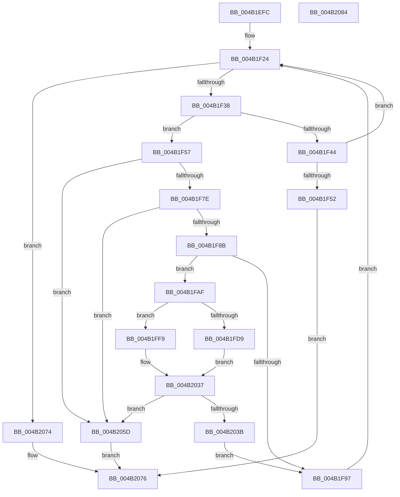

# RtlpHpHeapExtendContext

- RVA: `0x004B1EFC`–`0x004B2085` (길이 `393` bytes)
- VA: `0x00000001404B1EFC`
- 실행 섹션: `.text`
- PDB 이름 있음: `예`; PDB Function 태그: `아니요`
- unwind 정보 RVA: `0x000B9068`
- 디코드: `98`개 명령, `393/393` bytes 표시
- 미해석 바이트: `0` (있으면 어셈블리에 `.byte`로 보존)

> 이 문서는 커널 이미지의 기계어와 PDB 기호를 분석해 생성했습니다. 4번과 5번은 함수 원형과 자료형을 바이너리 사용 방식에서 추정한 C 해석이며 원본 소스 복구 결과는 아닙니다.

## 1. Dependencies

- 직접 호출 지점: **6**; 고유 호출 대상: **5**
- 직접 호출자로 확인된 함수: **1**
- RIP 상대 이미지 참조: **0**

### Outgoing calls
- `0x004B1F1F` → [RtlpHpAcquireReleaseLockExclusive](RtlpHpAcquireReleaseLockExclusive_function_004B208C.md) (function, `0x004B208C`)
- `0x004B1F62` → [RtlpHpAcquireLockExclusive](../32/RtlpHpAcquireLockExclusive_function_003246B0.md) (function, `0x003246B0`)
- `0x004B1FA5` → [RtlpHpReleaseLockExclusive](../32/RtlpHpReleaseLockExclusive_function_00324230.md) (function, `0x00324230`)
- `0x004B1FF2` → [RtlpHpMetadataCommit](../60/RtlpHpMetadataCommit_function_00603540.md) (function, `0x00603540`)
- `0x004B202A` → [RtlpHpAllocVA](../32/RtlpHpAllocVA_function_003276A0.md) (function, `0x003276A0`)
- `0x004B206D` → [RtlpHpReleaseLockExclusive](../32/RtlpHpReleaseLockExclusive_function_00324230.md) (function, `0x00324230`)

### Direct callers
- [RtlpHpSegLfhExtendContext](RtlpHpSegLfhExtendContext_function_004B1EE0.md) at `0x004B1EE8`

### Static image references
- 디코드된 RIP-relative 메모리 참조가 없습니다.

## 2. Other-region calls and transfers

- 다른 실행 섹션으로 향하는 call: **0**
- 별도 외부 분기/꼬리 이동을 확인하지 못했습니다.

## 3. Assembly (complete function range)

```asm
004B1EFC  40 53                           push rbx
004B1EFE  55                              push rbp
004B1EFF  56                              push rsi
004B1F00  57                              push rdi
004B1F01  41 56                           push r14
004B1F03  48 83 EC 50                     sub rsp, 0x50
004B1F07  8B 01                           mov eax, dword ptr [rcx]
004B1F09  48 8D B1 E8 00 00 00            lea rsi, [rcx + 0xe8]
004B1F10  4C 8B F2                        mov r14, rdx
004B1F13  48 8B D9                        mov rbx, rcx
004B1F16  0F B6 D0                        movzx edx, al
004B1F19  48 8B CE                        mov rcx, rsi
004B1F1C  83 E2 01                        and edx, 1
004B1F1F  E8 68 01 00 00                  call 0x1404b208c
004B1F24  48 8B BB F0 00 00 00            mov rdi, qword ptr [rbx + 0xf0]
004B1F2B  4A 8D 0C 37                     lea rcx, [rdi + r14]
004B1F2F  48 3B CF                        cmp rcx, rdi
004B1F32  0F 82 3C 01 00 00               jb 0x1404b2074
004B1F38  48 8B 83 F8 00 00 00            mov rax, qword ptr [rbx + 0xf8]
004B1F3F  48 3B C8                        cmp rcx, rax
004B1F42  77 13                           ja 0x1404b1f57
004B1F44  48 8B C7                        mov rax, rdi
004B1F47  F0 48 0F B1 8B F0 00 00 00      lock cmpxchg qword ptr [rbx + 0xf0], rcx
004B1F50  75 D2                           jne 0x1404b1f24
004B1F52  E9 1F 01 00 00                  jmp 0x1404b2076
004B1F57  8B 03                           mov eax, dword ptr [rbx]
004B1F59  48 8B CE                        mov rcx, rsi
004B1F5C  0F B6 D0                        movzx edx, al
004B1F5F  83 E2 01                        and edx, 1
004B1F62  E8 49 27 E7 FF                  call 0x1403246b0
004B1F67  40 8A E8                        mov bpl, al
004B1F6A  48 8B 83 F0 00 00 00            mov rax, qword ptr [rbx + 0xf0]
004B1F71  4A 8D 3C 30                     lea rdi, [rax + r14]
004B1F75  48 3B F8                        cmp rdi, rax
004B1F78  0F 82 DF 00 00 00               jb 0x1404b205d
004B1F7E  48 3B BB 00 01 00 00            cmp rdi, qword ptr [rbx + 0x100]
004B1F85  0F 87 D2 00 00 00               ja 0x1404b205d
004B1F8B  48 8B 93 F8 00 00 00            mov rdx, qword ptr [rbx + 0xf8]
004B1F92  48 3B FA                        cmp rdi, rdx
004B1F95  77 18                           ja 0x1404b1faf
004B1F97  8B 03                           mov eax, dword ptr [rbx]
004B1F99  44 8A C5                        mov r8b, bpl
004B1F9C  0F B6 D0                        movzx edx, al
004B1F9F  48 8B CE                        mov rcx, rsi
004B1FA2  83 E2 01                        and edx, 1
004B1FA5  E8 86 22 E7 FF                  call 0x140324230
004B1FAA  E9 75 FF FF FF                  jmp 0x1404b1f24
004B1FAF  0F 10 03                        movups xmm0, xmmword ptr [rbx]
004B1FB2  48 2B FA                        sub rdi, rdx
004B1FB5  48 89 94 24 88 00 00 00         mov qword ptr [rsp + 0x88], rdx
004B1FBD  48 81 C7 FF 0F 00 00            add rdi, 0xfff
004B1FC4  48 81 E7 00 F0 FF FF            and rdi, 0xfffffffffffff000
004B1FCB  F6 43 1E 01                     test byte ptr [rbx + 0x1e], 1
004B1FCF  48 89 BC 24 80 00 00 00         mov qword ptr [rsp + 0x80], rdi
004B1FD7  74 20                           je 0x1404b1ff9
004B1FD9  4C 8D 4C 24 30                  lea r9, [rsp + 0x30]
004B1FDE  C7 44 24 20 01 00 00 00         mov dword ptr [rsp + 0x20], 1
004B1FE6  4C 8B C7                        mov r8, rdi
004B1FE9  48 8B CB                        mov rcx, rbx
004B1FEC  F3 0F 7F 44 24 30               movdqu xmmword ptr [rsp + 0x30], xmm0
004B1FF2  E8 49 15 15 00                  call 0x140603540
004B1FF7  EB 3E                           jmp 0x1404b2037
004B1FF9  48 8D 44 24 40                  lea rax, [rsp + 0x40]
004B1FFE  41 B9 00 10 00 00               mov r9d, 0x1000
004B2004  48 89 44 24 28                  mov qword ptr [rsp + 0x28], rax
004B2009  48 8D 94 24 80 00 00 00         lea rdx, [rsp + 0x80]
004B2011  45 33 C0                        xor r8d, r8d
004B2014  C7 44 24 20 04 00 00 00         mov dword ptr [rsp + 0x20], 4
004B201C  48 8D 8C 24 88 00 00 00         lea rcx, [rsp + 0x88]
004B2024  F3 0F 7F 44 24 40               movdqu xmmword ptr [rsp + 0x40], xmm0
004B202A  E8 71 56 E7 FF                  call 0x1403276a0
004B202F  48 8B BC 24 80 00 00 00         mov rdi, qword ptr [rsp + 0x80]
004B2037  85 C0                           test eax, eax
004B2039  78 22                           js 0x1404b205d
004B203B  48 8B 8B F8 00 00 00            mov rcx, qword ptr [rbx + 0xf8]
004B2042  48 03 CF                        add rcx, rdi
004B2045  48 89 8B F8 00 00 00            mov qword ptr [rbx + 0xf8], rcx
004B204C  48 C1 EF 0C                     shr rdi, 0xc
004B2050  F0 48 01 BB 88 00 00 00         lock add qword ptr [rbx + 0x88], rdi
004B2058  E9 3A FF FF FF                  jmp 0x1404b1f97
004B205D  33 FF                           xor edi, edi
004B205F  8B 03                           mov eax, dword ptr [rbx]
004B2061  44 8A C5                        mov r8b, bpl
004B2064  0F B6 D0                        movzx edx, al
004B2067  48 8B CE                        mov rcx, rsi
004B206A  83 E2 01                        and edx, 1
004B206D  E8 BE 21 E7 FF                  call 0x140324230
004B2072  EB 02                           jmp 0x1404b2076
004B2074  33 FF                           xor edi, edi
004B2076  48 8B C7                        mov rax, rdi
004B2079  48 83 C4 50                     add rsp, 0x50
004B207D  41 5E                           pop r14
004B207F  5F                              pop rdi
004B2080  5E                              pop rsi
004B2081  5D                              pop rbp
004B2082  5B                              pop rbx
004B2083  C3                              ret
004B2084  CC                              int3
```

## 4. C-style interpretation (structured pseudocode)

```c
__int64 __fastcall RtlpHpHeapExtendContext(__int64 a1, __int64 a2)
{
    __int64 result;
    __int64 v_rdi;
    __int64 v_rsp;
    unsigned __int64 v_stack_m38;
    unsigned __int64 v_stack_m48;
    unsigned __int64 v_stack_m50;
    unsigned int v_stack_m58;
    unsigned __int64 v_stack_p10;
    unsigned __int64 v_stack_p8;

    v_rsp = (v_rsp) - (80);
    a2 = (unsigned int)(((unsigned __int8)((unsigned int)(*(unsigned int *)(a1)))) & (1));
    result = RtlpHpAcquireReleaseLockExclusive(a1 + 232, a2, a3, a4);
loc_004B1F24:
    if ((*(unsigned __int64 *)(a1 + 240) + a2 * 1) < (*(unsigned __int64 *)(a1 + 240))) goto loc_004B2074;
    if ((*(unsigned __int64 *)(a1 + 240) + a2 * 1) > (*(unsigned __int64 *)(a1 + 248))) goto loc_004B1F57;
    if ((*(unsigned __int64 *)(a1 + 240) + a2 * 1) != (*(unsigned __int64 *)(a1 + 248))) goto loc_004B1F24;
    goto loc_004B2076;
loc_004B1F57:
    a2 = (unsigned int)(((unsigned __int8)((unsigned int)(*(unsigned int *)(a1)))) & (1));
    result = RtlpHpAcquireLockExclusive(a1 + 232, a2, a3, a4);
    if ((*(unsigned __int64 *)(a1 + 240) + a2 * 1) < (*(unsigned __int64 *)(a1 + 240))) goto loc_004B205D;
    if ((*(unsigned __int64 *)(a1 + 240) + a2 * 1) > (*(unsigned __int64 *)(a1 + 256))) goto loc_004B205D;
    if ((*(unsigned __int64 *)(a1 + 240) + a2 * 1) > (*(unsigned __int64 *)(a1 + 248))) goto loc_004B1FAF;
loc_004B1F97:
    a2 = (unsigned int)(((unsigned __int8)((unsigned int)(*(unsigned int *)(a1)))) & (1));
    result = RtlpHpReleaseLockExclusive(a1 + 232, a2, (unsigned __int8)((unsigned __int8)(result)), a4);
    goto loc_004B1F24;
loc_004B1FAF:
    v_rdi = (*(unsigned __int64 *)(a1 + 240) + a2 * 1) - (a2);
    v_stack_p10 = a2;
    v_rdi = (v_rdi) + (0xFFFULL);
    v_rdi = (v_rdi) & (0xFFFFFFFFFFFFF000ULL);
    v_stack_p8 = v_rdi;
    if (((*(unsigned __int8 *)(a1 + 30)) & (1)) == 0) goto loc_004B1FF9;
    v_stack_m58 = 1;
    v_stack_m48 = v_xmm0;
    result = RtlpHpMetadataCommit(a1, a2, v_rdi, v_stack_m48);
    goto loc_004B2037;
loc_004B1FF9:
    v_stack_m50 = v_stack_m38;
    a3 = 0;
    v_stack_m58 = 4;
    v_stack_m38 = v_xmm0;
    result = RtlpHpAllocVA(v_stack_p10, v_stack_p8, a3, (unsigned int)(0x1000ULL));
loc_004B2037:
    if (sign_flag) goto loc_004B205D;
    a1 = (*(unsigned __int64 *)(a1 + 248)) + (v_stack_p8);
    *(unsigned __int64 *)(a1 + 248) = a1;
    v_rdi = (v_stack_p8) >> (12);
    goto loc_004B1F97;
loc_004B205D:
    v_rdi = 0;
    a2 = (unsigned int)(((unsigned __int8)((unsigned int)(*(unsigned int *)(a1)))) & (1));
    result = RtlpHpReleaseLockExclusive(a1 + 232, a2, (unsigned __int8)((unsigned __int8)(result)), (unsigned int)(0x1000ULL));
    goto loc_004B2076;
loc_004B2074:
    v_rdi = 0;
loc_004B2076:
    v_rsp = (v_rsp) + (80);
    return 0;
}
```

## 5. (Beta) C Style

```c
int64_t RtlpHpHeapExtendContext(void *Arg1, int64_t Arg2)
{
    uint8_t *arg1 = (uint8_t *)Arg1;

    int64_t result;
    int64_t local_rdi;
    int64_t local_rsp;
    uint64_t v_stack_m38;
    uint64_t v_stack_m48;
    uint64_t v_stack_m50;
    uint32_t v_stack_m58;
    uint64_t v_stack_p10;
    uint64_t v_stack_p8;

    local_rsp = (local_rsp) - (80);
    Arg2 = (uint32_t)(((uint8_t)((uint32_t)(*(uint32_t *)(arg1)))) & (1));
    result = RtlpHpAcquireReleaseLockExclusive(Arg1 + 232, Arg2, a3, a4);
loc_004B1F24:
    if ((*(uint64_t *)(arg1 + 0xF0) + Arg2 * 1) < (*(uint64_t *)(arg1 + 0xF0))) goto loc_004B2074;
    if ((*(uint64_t *)(arg1 + 0xF0) + Arg2 * 1) > (*(uint64_t *)(arg1 + 0xF8))) goto loc_004B1F57;
    if ((*(uint64_t *)(arg1 + 0xF0) + Arg2 * 1) != (*(uint64_t *)(arg1 + 0xF8))) goto loc_004B1F24;
    goto loc_004B2076;
loc_004B1F57:
    Arg2 = (uint32_t)(((uint8_t)((uint32_t)(*(uint32_t *)(arg1)))) & (1));
    result = RtlpHpAcquireLockExclusive(Arg1 + 232, Arg2, a3, a4);
    if ((*(uint64_t *)(arg1 + 0xF0) + Arg2 * 1) < (*(uint64_t *)(arg1 + 0xF0))) goto loc_004B205D;
    if ((*(uint64_t *)(arg1 + 0xF0) + Arg2 * 1) > (*(uint64_t *)(arg1 + 0x100))) goto loc_004B205D;
    if ((*(uint64_t *)(arg1 + 0xF0) + Arg2 * 1) > (*(uint64_t *)(arg1 + 0xF8))) goto loc_004B1FAF;
loc_004B1F97:
    Arg2 = (uint32_t)(((uint8_t)((uint32_t)(*(uint32_t *)(arg1)))) & (1));
    result = RtlpHpReleaseLockExclusive(Arg1 + 232, Arg2, (uint8_t)((uint8_t)(result)), a4);
    goto loc_004B1F24;
loc_004B1FAF:
    local_rdi = (*(uint64_t *)(arg1 + 0xF0) + Arg2 * 1) - (Arg2);
    v_stack_p10 = Arg2;
    local_rdi = (local_rdi) + (0xFFFULL);
    local_rdi = (local_rdi) & (0xFFFFFFFFFFFFF000ULL);
    v_stack_p8 = local_rdi;
    if (((*(uint8_t *)(arg1 + 0x1E)) & (1)) == 0) goto loc_004B1FF9;
    v_stack_m58 = 1;
    v_stack_m48 = v_xmm0;
    result = RtlpHpMetadataCommit(Arg1, Arg2, local_rdi, v_stack_m48);
    goto loc_004B2037;
loc_004B1FF9:
    v_stack_m50 = v_stack_m38;
    a3 = 0;
    v_stack_m58 = 4;
    v_stack_m38 = v_xmm0;
    result = RtlpHpAllocVA(v_stack_p10, v_stack_p8, a3, (uint32_t)(0x1000ULL));
loc_004B2037:
    if (sign_flag) goto loc_004B205D;
    Arg1 = (*(uint64_t *)(arg1 + 0xF8)) + (v_stack_p8);
    *(void **)(arg1 + 0xF8) = Arg1;
    local_rdi = (v_stack_p8) >> (12);
    goto loc_004B1F97;
loc_004B205D:
    local_rdi = 0;
    Arg2 = (uint32_t)(((uint8_t)((uint32_t)(*(uint32_t *)(arg1)))) & (1));
    result = RtlpHpReleaseLockExclusive(Arg1 + 232, Arg2, (uint8_t)((uint8_t)(result)), (uint32_t)(0x1000ULL));
    goto loc_004B2076;
loc_004B2074:
    local_rdi = 0;
loc_004B2076:
    local_rsp = (local_rsp) + (80);
    return 0;
}
```

### 관측된 메모리 오프셋

구조체 형식이 확인되지 않은 접근은 인자 기준의 오프셋으로만 기록했습니다.

| 기준 인자 | 오프셋 표현 | 폭 (bit) | 접근 |
|---|---:|---:|---|
| `Arg1` | `+ 0x0` | `32` | `R` |
| `Arg1` | `+ 0x0` | `128` | `R` |
| `Arg1` | `+ 0x1E` | `8` | `R` |
| `Arg1` | `+ 0x88` | `64` | `R/W` |
| `Arg1` | `+ 0xE8` | `64` | `R` |
| `Arg1` | `+ 0xF0` | `64` | `R` |
| `Arg1` | `+ 0xF8` | `64` | `R` |
| `Arg1` | `+ 0xF8` | `64` | `W` |
| `Arg1` | `+ 0x100` | `64` | `R` |

## 6. Execution-region graph

[열기: 2D/3D 그래프와 함수 탐색 컨트롤 패널](../../../control-panel.html?section=text&rva=0x004B1EFC&view=graph)

- 2D 그래프는 위에서 아래로 흐르고, 3D 그래프는 빈 공간을 드래그해 회전합니다. Shift+드래그는 이동, 휠은 확대·축소, 함수 노드 선택은 대상 보고서 이동입니다.

### Static fallback


