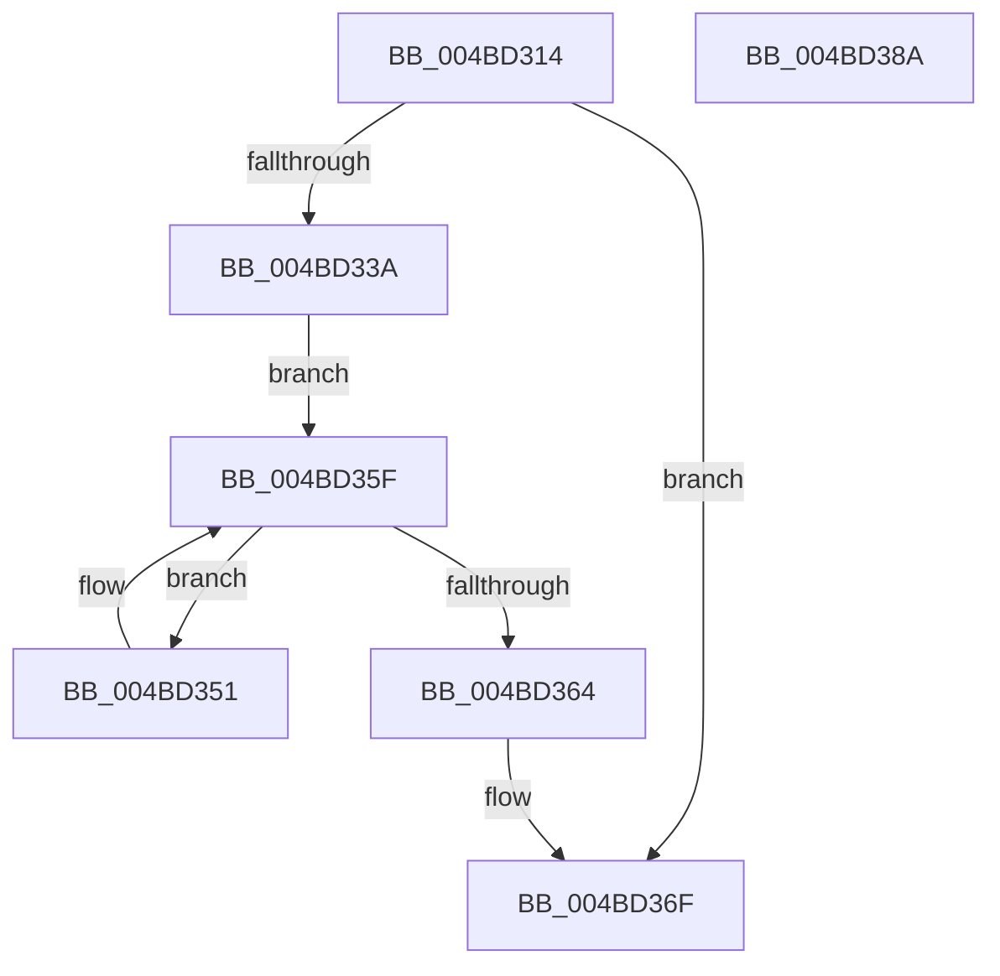

# SMKM_STORE_MGR&lt;SM_TRAITS&gt;::SmCompressCtxUpdatePriority

- RVA: `0x004BD314`–`0x004BD38B` (길이 `119` bytes)
- VA: `0x00000001404BD314`
- 실행 섹션: `.text`
- PDB 이름 있음: `예`; PDB Function 태그: `아니요`
- unwind 정보 RVA: `0x0005E6B4`
- 디코드: `34`개 명령, `119/119` bytes 표시
- 미해석 바이트: `0` (있으면 어셈블리에 `.byte`로 보존)

> 이 문서는 커널 이미지의 기계어와 PDB 기호를 분석해 생성했습니다. 4번과 5번은 함수 원형과 자료형을 바이너리 사용 방식에서 추정한 C 해석이며 원본 소스 복구 결과는 아닙니다.

## 1. Dependencies

- 직접 호출 지점: **3**; 고유 호출 대상: **3**
- 직접 호출자로 확인된 함수: **2**
- RIP 상대 이미지 참조: **0**

### Outgoing calls
- `0x004BD33A` → [ExAcquireSpinLockExclusive](../24/ExAcquireSpinLockExclusive_function_00248690.md) (function, `0x00248690`)
- `0x004BD357` → [KeSetActualBasePriorityThread](../3C/KeSetActualBasePriorityThread_function_003C4370.md) (function, `0x003C4370`)
- `0x004BD36A` → [ExReleaseSpinLockExclusive](../2C/ExReleaseSpinLockExclusive_function_002C0EF0.md) (function, `0x002C0EF0`)

### Direct callers
- [SMKM_STORE_MGR&lt;SM_TRAITS&gt;::SmCompressManagerUpdateMemoryCondition](../4C/SMKM_STORE_MGR_SM_TRAITS_SmCompressManagerUpdateMemoryCondition_function_004C0040.md) at `0x004C010A`
- [SMKM_STORE_MGR&lt;SM_TRAITS&gt;::SmCompressManagerCleanup](../60/SMKM_STORE_MGR_SM_TRAITS_SmCompressManagerCleanup_function_0060C330.md) at `0x0060C37E`

### Static image references
- 디코드된 RIP-relative 메모리 참조가 없습니다.

## 2. Other-region calls and transfers

- 다른 실행 섹션으로 향하는 call: **0**
- 별도 외부 분기/꼬리 이동을 확인하지 못했습니다.

## 3. Assembly (complete function range)

```asm
004BD314  48 8B C4                        mov rax, rsp
004BD317  48 89 58 08                     mov qword ptr [rax + 8], rbx
004BD31B  48 89 68 10                     mov qword ptr [rax + 0x10], rbp
004BD31F  48 89 70 18                     mov qword ptr [rax + 0x18], rsi
004BD323  48 89 78 20                     mov qword ptr [rax + 0x20], rdi
004BD327  41 56                           push r14
004BD329  48 83 EC 20                     sub rsp, 0x20
004BD32D  8B F2                           mov esi, edx
004BD32F  48 8B D9                        mov rbx, rcx
004BD332  39 91 98 00 00 00               cmp dword ptr [rcx + 0x98], edx
004BD338  74 35                           je 0x1404bd36f
004BD33A  E8 51 B3 D8 FF                  call 0x140248690
004BD33F  4C 8D 73 68                     lea r14, [rbx + 0x68]
004BD343  89 B3 98 00 00 00               mov dword ptr [rbx + 0x98], esi
004BD349  49 8B 3E                        mov rdi, qword ptr [r14]
004BD34C  40 8A E8                        mov bpl, al
004BD34F  EB 0E                           jmp 0x1404bd35f
004BD351  48 8B 4F 10                     mov rcx, qword ptr [rdi + 0x10]
004BD355  8B D6                           mov edx, esi
004BD357  E8 14 70 F0 FF                  call 0x1403c4370
004BD35C  48 8B 3F                        mov rdi, qword ptr [rdi]
004BD35F  49 3B FE                        cmp rdi, r14
004BD362  75 ED                           jne 0x1404bd351
004BD364  40 8A D5                        mov dl, bpl
004BD367  48 8B CB                        mov rcx, rbx
004BD36A  E8 81 3B E0 FF                  call 0x1402c0ef0
004BD36F  48 8B 5C 24 30                  mov rbx, qword ptr [rsp + 0x30]
004BD374  48 8B 6C 24 38                  mov rbp, qword ptr [rsp + 0x38]
004BD379  48 8B 74 24 40                  mov rsi, qword ptr [rsp + 0x40]
004BD37E  48 8B 7C 24 48                  mov rdi, qword ptr [rsp + 0x48]
004BD383  48 83 C4 20                     add rsp, 0x20
004BD387  41 5E                           pop r14
004BD389  C3                              ret
004BD38A  CC                              int3
```

## 4. C-style interpretation (structured pseudocode)

```c
__int64 __fastcall SMKM_STORE_MGR_SM_TRAITS___SmCompressCtxUpdatePriority(__int64 a1, int a2)
{
    __int64 result;
    __int64 v_rsp;
    unsigned __int64 v_stack_p10;
    unsigned __int64 v_stack_p18;
    unsigned __int64 v_stack_p20;
    unsigned __int64 v_stack_p8;

    *(unsigned __int64 *)(v_rsp + 8) = v_rbx;
    *(unsigned __int64 *)(v_rsp + 16) = v_rbp;
    *(unsigned __int64 *)(v_rsp + 24) = v_rsi;
    *(unsigned __int64 *)(v_rsp + 32) = v_rdi;
    v_rsp = (v_rsp) - (32);
    if ((*(unsigned int *)(a1 + 152)) == a2) goto loc_004BD36F;
    result = ExAcquireSpinLockExclusive(a1, a2, a3, a4);
    *(unsigned int *)(a1 + 152) = (unsigned int)((unsigned int)(a2));
    goto loc_004BD35F;
loc_004BD351:
    result = KeSetActualBasePriorityThread(*(unsigned __int64 *)(*(unsigned __int64 *)(a1 + 104) + 16), (unsigned int)((unsigned int)((unsigned int)(a2))), a3, a4);
loc_004BD35F:
    if ((*(unsigned __int64 *)(*(unsigned __int64 *)(a1 + 104))) != (a1 + 104)) goto loc_004BD351;
    result = ExReleaseSpinLockExclusive(a1, (unsigned __int8)((unsigned __int8)(result)), a3, a4);
loc_004BD36F:
    v_rsp = (v_rsp) + (32);
    return result;
}
```

## 5. (Beta) C Style

```c
int64_t SMKM_STORE_MGR_SM_TRAITS___SmCompressCtxUpdatePriority(void *Arg1, int32_t Arg2)
{
    uint8_t *arg1 = (uint8_t *)Arg1;

    int64_t result;
    int64_t local_rsp;
    uint64_t v_stack_p10;
    uint64_t v_stack_p18;
    uint64_t v_stack_p20;
    uint64_t v_stack_p8;

    *(uint64_t *)(local_rsp + 0x8) = local_rbx;
    *(uint64_t *)(local_rsp + 0x10) = local_rbp;
    *(uint64_t *)(local_rsp + 0x18) = local_rsi;
    *(uint64_t *)(local_rsp + 0x20) = local_rdi;
    local_rsp = (local_rsp) - (32);
    if ((*(uint32_t *)(arg1 + 0x98)) == Arg2) goto loc_004BD36F;
    result = ExAcquireSpinLockExclusive(Arg1, Arg2, a3, a4);
    *(uint32_t *)(arg1 + 0x98) = (uint32_t)((uint32_t)(Arg2));
    goto loc_004BD35F;
loc_004BD351:
    result = KeSetActualBasePriorityThread(*(uint64_t *)(*(uint64_t *)(arg1 + 0x68) + 0x10), (uint32_t)((uint32_t)((uint32_t)(Arg2))), a3, a4);
loc_004BD35F:
    if ((*(uint64_t *)(*(uint64_t *)(arg1 + 0x68))) != (Arg1 + 104)) goto loc_004BD351;
    result = ExReleaseSpinLockExclusive(Arg1, (uint8_t)((uint8_t)(result)), a3, a4);
loc_004BD36F:
    local_rsp = (local_rsp) + (32);
    return result;
}
```

### 관측된 메모리 오프셋

구조체 형식이 확인되지 않은 접근은 인자 기준의 오프셋으로만 기록했습니다.

| 기준 인자 | 오프셋 표현 | 폭 (bit) | 접근 |
|---|---:|---:|---|
| `Arg1` | `+ 0x0` | `64` | `R` |
| `Arg1` | `+ 0x68` | `64` | `R` |
| `Arg1` | `+ 0x98` | `32` | `R` |
| `Arg1` | `+ 0x98` | `32` | `W` |

## 6. Execution-region graph

[열기: 2D/3D 그래프와 함수 탐색 컨트롤 패널](../../../control-panel.html?section=text&rva=0x004BD314&view=graph)

- 2D 그래프는 위에서 아래로 흐르고, 3D 그래프는 빈 공간을 드래그해 회전합니다. Shift+드래그는 이동, 휠은 확대·축소, 함수 노드 선택은 대상 보고서 이동입니다.

### Static fallback


