# SMKM_STORE&lt;SM_TRAITS&gt;::SmStTrimWsStore

- RVA: `0x004BEB4C`–`0x004BEEFD` (길이 `945` bytes)
- VA: `0x00000001404BEB4C`
- 실행 섹션: `.text`
- PDB 이름 있음: `예`; PDB Function 태그: `아니요`
- unwind 정보 RVA: `0x000876E8`
- 디코드: `253`개 명령, `945/945` bytes 표시
- 미해석 바이트: `0` (있으면 어셈블리에 `.byte`로 보존)

> 이 문서는 커널 이미지의 기계어와 PDB 기호를 분석해 생성했습니다. 4번과 5번은 함수 원형과 자료형을 바이너리 사용 방식에서 추정한 C 해석이며 원본 소스 복구 결과는 아닙니다.

## 1. Dependencies

- 직접 호출 지점: **11**; 고유 호출 대상: **8**
- 직접 호출자로 확인된 함수: **1**
- RIP 상대 이미지 참조: **1**

### Outgoing calls
- `0x004BEB9A` → [memset](../6C/memset_function_006C6C40.md) (function, `0x006C6C40`)
- `0x004BEBAC` → [KiStackAttachProcess](../21/KiStackAttachProcess_function_00216820.md) (function, `0x00216820`)
- `0x004BEC04` → [StLockAcquireShared](../34/StLockAcquireShared_function_0034C728.md) (function, `0x0034C728`)
- `0x004BED5E` → [SMKM_STORE<SM_TRAITS>::SmStMapVirtualRegion](../34/SMKM_STORE_SM_TRAITS_SmStMapVirtualRegion_function_0034D770.md) (function, `0x0034D770`)
- `0x004BED84` → [SMKM_STORE<SM_TRAITS>::SmStTrimWsStoreBatch](../34/SMKM_STORE_SM_TRAITS_SmStTrimWsStoreBatch_function_0034C880.md) (function, `0x0034C880`)
- `0x004BEE21` → [SMKM_STORE<SM_TRAITS>::SmStMapVirtualRegion](../34/SMKM_STORE_SM_TRAITS_SmStMapVirtualRegion_function_0034D770.md) (function, `0x0034D770`)
- `0x004BEE5D` → [SMKM_STORE<SM_TRAITS>::SmStTrimWsStoreBatch](../34/SMKM_STORE_SM_TRAITS_SmStTrimWsStoreBatch_function_0034C880.md) (function, `0x0034C880`)
- `0x004BEEB0` → [SMKM_STORE<SM_TRAITS>::SmStTrimWsStoreBatch](../34/SMKM_STORE_SM_TRAITS_SmStTrimWsStoreBatch_function_0034C880.md) (function, `0x0034C880`)
- `0x004BEEBC` → [StLockReleaseShared](../2E/StLockReleaseShared_function_002E0320.md) (function, `0x002E0320`)
- `0x004BEECE` → [KiUnstackDetachProcess](../21/KiUnstackDetachProcess_function_00217D30.md) (function, `0x00217D30`)
- `0x004BEEDC` → [_security_check_cookie](../6A/_security_check_cookie_function_006AC640.md) (function, `0x006AC640`)

### Direct callers
- [SMKM_STORE_MGR&lt;SM_TRAITS&gt;::SmTrimWsStore](SMKM_STORE_MGR_SM_TRAITS_SmTrimWsStore_function_004BEB1C.md) at `0x004BEB31`

### Static image references
- `0x004BEB68` → RVA `0x00E0A740` (`.data`; read)

## 2. Other-region calls and transfers

- 다른 실행 섹션으로 향하는 call: **0**
- 별도 외부 분기/꼬리 이동을 확인하지 못했습니다.

## 3. Assembly (complete function range)

```asm
004BEB4C  48 89 5C 24 18                  mov qword ptr [rsp + 0x18], rbx
004BEB51  55                              push rbp
004BEB52  56                              push rsi
004BEB53  57                              push rdi
004BEB54  41 54                           push r12
004BEB56  41 55                           push r13
004BEB58  41 56                           push r14
004BEB5A  41 57                           push r15
004BEB5C  48 8D 6C 24 D9                  lea rbp, [rsp - 0x27]
004BEB61  48 81 EC F0 00 00 00            sub rsp, 0xf0
004BEB68  48 8B 05 D1 BB 94 00            mov rax, qword ptr [rip + 0x94bbd1]
004BEB6F  48 33 C4                        xor rax, rsp
004BEB72  48 89 45 17                     mov qword ptr [rbp + 0x17], rax
004BEB76  0F 57 C0                        xorps xmm0, xmm0
004BEB79  48 89 54 24 40                  mov qword ptr [rsp + 0x40], rdx
004BEB7E  48 8B DA                        mov rbx, rdx
004BEB81  4C 8B F1                        mov r14, rcx
004BEB84  33 D2                           xor edx, edx
004BEB86  48 8D 4D D7                     lea rcx, [rbp - 0x29]
004BEB8A  0F 11 45 87                     movups xmmword ptr [rbp - 0x79], xmm0
004BEB8E  0F 11 45 97                     movups xmmword ptr [rbp - 0x69], xmm0
004BEB92  44 8D 42 40                     lea r8d, [rdx + 0x40]
004BEB96  0F 11 45 A7                     movups xmmword ptr [rbp - 0x59], xmm0
004BEB9A  E8 A1 80 20 00                  call 0x1406c6c40
004BEB9F  49 8B 8E 00 1D 00 00            mov rcx, qword ptr [r14 + 0x1d00]
004BEBA6  4C 8D 45 87                     lea r8, [rbp - 0x79]
004BEBAA  33 D2                           xor edx, edx
004BEBAC  E8 6F 7C D5 FF                  call 0x140216820
004BEBB1  41 F6 86 95 1A 00 00 08         test byte ptr [r14 + 0x1a95], 8
004BEBB9  74 07                           je 0x1404bebc2
004BEBBB  33 FF                           xor edi, edi
004BEBBD  E9 06 03 00 00                  jmp 0x1404beec8
004BEBC2  49 83 CF FF                     or r15, 0xffffffffffffffff
004BEBC6  4D 87 BE F0 1C 00 00            xchg qword ptr [r14 + 0x1cf0], r15
004BEBCD  4C 89 7C 24 48                  mov qword ptr [rsp + 0x48], r15
004BEBD2  49 83 FF FF                     cmp r15, -1
004BEBD6  75 0A                           jne 0x1404bebe2
004BEBD8  BF 76 04 00 C0                  mov edi, 0xc0000476
004BEBDD  E9 E6 02 00 00                  jmp 0x1404beec8
004BEBE2  33 FF                           xor edi, edi
004BEBE4  4D 85 FF                        test r15, r15
004BEBE7  74 0E                           je 0x1404bebf7
004BEBE9  49 39 3F                        cmp qword ptr [r15], rdi
004BEBEC  74 09                           je 0x1404bebf7
004BEBEE  4D 8D 6F 08                     lea r13, [r15 + 8]
004BEBF2  48 85 DB                        test rbx, rbx
004BEBF5  74 03                           je 0x1404bebfa
004BEBF7  4C 8B EF                        mov r13, rdi
004BEBFA  49 8D 8E 98 1A 00 00            lea rcx, [r14 + 0x1a98]
004BEC01  44 8B E7                        mov r12d, edi
004BEC04  E8 1F DB E8 FF                  call 0x14034c728
004BEC09  49 B8 00 00 FF FF FF FF FF 7F   movabs r8, 0x7fffffffffff0000
004BEC13  4D 85 ED                        test r13, r13
004BEC16  0F 84 AB 01 00 00               je 0x1404bedc7
004BEC1C  8B F7                           mov esi, edi
004BEC1E  41 8B 45 00                     mov eax, dword ptr [r13]
004BEC22  89 7C 24 30                     mov dword ptr [rsp + 0x30], edi
004BEC26  3B C6                           cmp eax, esi
004BEC28  0F 86 8F 01 00 00               jbe 0x1404bedbd
004BEC2E  4D 8B 5D 08                     mov r11, qword ptr [r13 + 8]
004BEC32  8D 50 FF                        lea edx, [rax - 1]
004BEC35  48 C1 EA 05                     shr rdx, 5
004BEC39  41 B8 01 00 00 00               mov r8d, 1
004BEC3F  8B C6                           mov eax, esi
004BEC41  44 8B CF                        mov r9d, edi
004BEC44  83 E6 1F                        and esi, 0x1f
004BEC47  48 C1 E8 05                     shr rax, 5
004BEC4B  40 8A CE                        mov cl, sil
004BEC4E  41 D3 E0                        shl r8d, cl
004BEC51  4D 8D 14 93                     lea r10, [r11 + rdx*4]
004BEC55  41 FF C8                        dec r8d
004BEC58  49 8D 14 83                     lea rdx, [r11 + rax*4]
004BEC5C  44 0B 02                        or r8d, dword ptr [rdx]
004BEC5F  41 F7 D0                        not r8d
004BEC62  45 85 C0                        test r8d, r8d
004BEC65  75 1C                           jne 0x1404bec83
004BEC67  48 8D 42 04                     lea rax, [rdx + 4]
004BEC6B  49 3B C2                        cmp rax, r10
004BEC6E  77 39                           ja 0x1404beca9
004BEC70  48 83 C2 04                     add rdx, 4
004BEC74  48 83 C0 04                     add rax, 4
004BEC78  44 8B 02                        mov r8d, dword ptr [rdx]
004BEC7B  41 F7 D0                        not r8d
004BEC7E  45 85 C0                        test r8d, r8d
004BEC81  74 E8                           je 0x1404bec6b
004BEC83  41 8B C0                        mov eax, r8d
004BEC86  48 8B F2                        mov rsi, rdx
004BEC89  48 0F BC C8                     bsf rcx, rax
004BEC8D  41 8B 45 00                     mov eax, dword ptr [r13]
004BEC91  49 2B F3                        sub rsi, r11
004BEC94  48 C1 FE 02                     sar rsi, 2
004BEC98  C1 E6 05                        shl esi, 5
004BEC9B  03 F1                           add esi, ecx
004BEC9D  89 4C 24 30                     mov dword ptr [rsp + 0x30], ecx
004BECA1  3B F0                           cmp esi, eax
004BECA3  76 0A                           jbe 0x1404becaf
004BECA5  8B F0                           mov esi, eax
004BECA7  EB 51                           jmp 0x1404becfa
004BECA9  41 8B 75 00                     mov esi, dword ptr [r13]
004BECAD  EB 4B                           jmp 0x1404becfa
004BECAF  B8 01 00 00 00                  mov eax, 1
004BECB4  D3 E0                           shl eax, cl
004BECB6  FF C8                           dec eax
004BECB8  41 0B C0                        or eax, r8d
004BECBB  F7 D0                           not eax
004BECBD  EB 15                           jmp 0x1404becd4
004BECBF  48 8D 42 04                     lea rax, [rdx + 4]
004BECC3  48 8B CA                        mov rcx, rdx
004BECC6  48 8B D0                        mov rdx, rax
004BECC9  49 3B C2                        cmp rax, r10
004BECCC  0F 87 DE 00 00 00               ja 0x1404bedb0
004BECD2  8B 00                           mov eax, dword ptr [rax]
004BECD4  85 C0                           test eax, eax
004BECD6  74 E7                           je 0x1404becbf
004BECD8  48 0F BC C0                     bsf rax, rax
004BECDC  45 8B 4D 00                     mov r9d, dword ptr [r13]
004BECE0  49 2B D3                        sub rdx, r11
004BECE3  48 C1 FA 02                     sar rdx, 2
004BECE7  C1 E2 05                        shl edx, 5
004BECEA  89 44 24 30                     mov dword ptr [rsp + 0x30], eax
004BECEE  03 C2                           add eax, edx
004BECF0  41 3B C1                        cmp eax, r9d
004BECF3  44 0F 46 C8                     cmovbe r9d, eax
004BECF7  44 2B CE                        sub r9d, esi
004BECFA  49 B8 00 00 FF FF FF FF FF 7F   movabs r8, 0x7fffffffffff0000
004BED04  45 85 C9                        test r9d, r9d
004BED07  0F 84 B0 00 00 00               je 0x1404bedbd
004BED0D  42 8D 04 0E                     lea eax, [rsi + r9]
004BED11  89 44 24 30                     mov dword ptr [rsp + 0x30], eax
004BED15  3B F0                           cmp esi, eax
004BED17  0F 83 01 FF FF FF               jae 0x1404bec1e
004BED1D  44 8B 7C 24 30                  mov r15d, dword ptr [rsp + 0x30]
004BED22  8B C6                           mov eax, esi
004BED24  48 8D 0C C5 00 00 00 00         lea rcx, [rax*8]
004BED2C  48 89 4C 24 38                  mov qword ptr [rsp + 0x38], rcx
004BED31  49 8B 96 68 1B 00 00            mov rdx, qword ptr [r14 + 0x1b68]
004BED38  48 8B 04 11                     mov rax, qword ptr [rcx + rdx]
004BED3C  49 85 C0                        test r8, rax
004BED3F  74 5A                           je 0x1404bed9b
004BED41  48 39 3C 11                     cmp qword ptr [rcx + rdx], rdi
004BED45  7C 54                           jl 0x1404bed9b
004BED47  41 8B DC                        mov ebx, r12d
004BED4A  45 33 C0                        xor r8d, r8d
004BED4D  8B D6                           mov edx, esi
004BED4F  C7 44 24 20 04 00 00 00         mov dword ptr [rsp + 0x20], 4
004BED57  49 8B CE                        mov rcx, r14
004BED5A  89 74 9D B7                     mov dword ptr [rbp + rbx*4 - 0x49], esi
004BED5E  E8 0D EA E8 FF                  call 0x14034d770
004BED63  41 FF C4                        inc r12d
004BED66  48 89 44 DD D7                  mov qword ptr [rbp + rbx*8 - 0x29], rax
004BED6B  41 83 FC 08                     cmp r12d, 8
004BED6F  75 1B                           jne 0x1404bed8c
004BED71  45 8B CC                        mov r9d, r12d
004BED74  48 89 7C 24 28                  mov qword ptr [rsp + 0x28], rdi
004BED79  4C 8D 45 D7                     lea r8, [rbp - 0x29]
004BED7D  49 8B CE                        mov rcx, r14
004BED80  48 8D 55 B7                     lea rdx, [rbp - 0x49]
004BED84  E8 F7 DA E8 FF                  call 0x14034c880
004BED89  44 8B E7                        mov r12d, edi
004BED8C  48 8B 4C 24 38                  mov rcx, qword ptr [rsp + 0x38]
004BED91  49 B8 00 00 FF FF FF FF FF 7F   movabs r8, 0x7fffffffffff0000
004BED9B  48 83 C1 08                     add rcx, 8
004BED9F  FF C6                           inc esi
004BEDA1  48 89 4C 24 38                  mov qword ptr [rsp + 0x38], rcx
004BEDA6  41 3B F7                        cmp esi, r15d
004BEDA9  72 86                           jb 0x1404bed31
004BEDAB  E9 6E FE FF FF                  jmp 0x1404bec1e
004BEDB0  B8 20 00 00 00                  mov eax, 0x20
004BEDB5  48 8B D1                        mov rdx, rcx
004BEDB8  E9 1F FF FF FF                  jmp 0x1404becdc
004BEDBD  4C 8B 7C 24 48                  mov r15, qword ptr [rsp + 0x48]
004BEDC2  48 8B 5C 24 40                  mov rbx, qword ptr [rsp + 0x40]
004BEDC7  8B F7                           mov esi, edi
004BEDC9  48 89 5C 24 38                  mov qword ptr [rsp + 0x38], rbx
004BEDCE  41 39 BE 64 1B 00 00            cmp dword ptr [r14 + 0x1b64], edi
004BEDD5  0F 86 AF 00 00 00               jbe 0x1404bee8a
004BEDDB  49 8B 96 68 1B 00 00            mov rdx, qword ptr [r14 + 0x1b68]
004BEDE2  8B CE                           mov ecx, esi
004BEDE4  48 8B 04 CA                     mov rax, qword ptr [rdx + rcx*8]
004BEDE8  49 85 C0                        test r8, rax
004BEDEB  0F 84 8A 00 00 00               je 0x1404bee7b
004BEDF1  48 39 3C CA                     cmp qword ptr [rdx + rcx*8], rdi
004BEDF5  0F 8C 80 00 00 00               jl 0x1404bee7b
004BEDFB  4D 85 ED                        test r13, r13
004BEDFE  74 0A                           je 0x1404bee0a
004BEE00  49 8B 45 08                     mov rax, qword ptr [r13 + 8]
004BEE04  48 0F A3 08                     bt qword ptr [rax], rcx
004BEE08  73 71                           jae 0x1404bee7b
004BEE0A  41 8B DC                        mov ebx, r12d
004BEE0D  45 33 C0                        xor r8d, r8d
004BEE10  8B D6                           mov edx, esi
004BEE12  C7 44 24 20 04 00 00 00         mov dword ptr [rsp + 0x20], 4
004BEE1A  49 8B CE                        mov rcx, r14
004BEE1D  89 74 9D B7                     mov dword ptr [rbp + rbx*4 - 0x49], esi
004BEE21  E8 4A E9 E8 FF                  call 0x14034d770
004BEE26  41 FF C4                        inc r12d
004BEE29  48 89 44 DD D7                  mov qword ptr [rbp + rbx*8 - 0x29], rax
004BEE2E  48 8B 5C 24 40                  mov rbx, qword ptr [rsp + 0x40]
004BEE33  41 83 FC 08                     cmp r12d, 8
004BEE37  75 38                           jne 0x1404bee71
004BEE39  48 8B C3                        mov rax, rbx
004BEE3C  4C 8D 45 D7                     lea r8, [rbp - 0x29]
004BEE40  48 F7 D8                        neg rax
004BEE43  48 8D 55 B7                     lea rdx, [rbp - 0x49]
004BEE47  48 8D 44 24 38                  lea rax, [rsp + 0x38]
004BEE4C  45 8B CC                        mov r9d, r12d
004BEE4F  48 1B C9                        sbb rcx, rcx
004BEE52  48 23 C8                        and rcx, rax
004BEE55  48 89 4C 24 28                  mov qword ptr [rsp + 0x28], rcx
004BEE5A  49 8B CE                        mov rcx, r14
004BEE5D  E8 1E DA E8 FF                  call 0x14034c880
004BEE62  44 8B E7                        mov r12d, edi
004BEE65  48 85 DB                        test rbx, rbx
004BEE68  74 07                           je 0x1404bee71
004BEE6A  48 39 7C 24 38                  cmp qword ptr [rsp + 0x38], rdi
004BEE6F  74 44                           je 0x1404beeb5
004BEE71  49 B8 00 00 FF FF FF FF FF 7F   movabs r8, 0x7fffffffffff0000
004BEE7B  FF C6                           inc esi
004BEE7D  41 3B B6 64 1B 00 00            cmp esi, dword ptr [r14 + 0x1b64]
004BEE84  0F 82 51 FF FF FF               jb 0x1404beddb
004BEE8A  45 85 E4                        test r12d, r12d
004BEE8D  74 26                           je 0x1404beeb5
004BEE8F  48 F7 DB                        neg rbx
004BEE92  48 8D 4C 24 38                  lea rcx, [rsp + 0x38]
004BEE97  45 8B CC                        mov r9d, r12d
004BEE9A  4C 8D 45 D7                     lea r8, [rbp - 0x29]
004BEE9E  48 1B C0                        sbb rax, rax
004BEEA1  48 8D 55 B7                     lea rdx, [rbp - 0x49]
004BEEA5  48 23 C1                        and rax, rcx
004BEEA8  49 8B CE                        mov rcx, r14
004BEEAB  48 89 44 24 28                  mov qword ptr [rsp + 0x28], rax
004BEEB0  E8 CB D9 E8 FF                  call 0x14034c880
004BEEB5  49 8D 8E 98 1A 00 00            lea rcx, [r14 + 0x1a98]
004BEEBC  E8 5F 14 E2 FF                  call 0x1402e0320
004BEEC1  4D 87 BE F0 1C 00 00            xchg qword ptr [r14 + 0x1cf0], r15
004BEEC8  33 D2                           xor edx, edx
004BEECA  48 8D 4D 87                     lea rcx, [rbp - 0x79]
004BEECE  E8 5D 8E D5 FF                  call 0x140217d30
004BEED3  8B C7                           mov eax, edi
004BEED5  48 8B 4D 17                     mov rcx, qword ptr [rbp + 0x17]
004BEED9  48 33 CC                        xor rcx, rsp
004BEEDC  E8 5F D7 1E 00                  call 0x1406ac640
004BEEE1  48 8B 9C 24 40 01 00 00         mov rbx, qword ptr [rsp + 0x140]
004BEEE9  48 81 C4 F0 00 00 00            add rsp, 0xf0
004BEEF0  41 5F                           pop r15
004BEEF2  41 5E                           pop r14
004BEEF4  41 5D                           pop r13
004BEEF6  41 5C                           pop r12
004BEEF8  5F                              pop rdi
004BEEF9  5E                              pop rsi
004BEEFA  5D                              pop rbp
004BEEFB  C3                              ret
004BEEFC  CC                              int3
```

## 4. C-style interpretation (structured pseudocode)

```c
__int64 __fastcall SMKM_STORE_SM_TRAITS___SmStTrimWsStore(__int64 a1, __int64 a2)
{
    __int64 result;
    __int64 v_r12;
    __int64 v_r13;
    __int64 v_r15;
    __int64 v_rbx;
    __int64 v_rdi;
    __int64 v_rsi;
    __int64 v_rsp;
    unsigned __int64 v_stack_m100;
    unsigned int v_stack_m108;
    unsigned __int64 v_stack_m48;
    unsigned __int64 v_stack_m5F;
    unsigned __int64 v_stack_m88;
    unsigned __int64 v_stack_mA8;
    unsigned __int64 v_stack_mB8;
    unsigned __int64 v_stack_mC8;
    unsigned __int64 v_stack_mD8;
    unsigned __int64 v_stack_mE0;
    unsigned __int64 v_stack_mE8;
    unsigned __int64 v_stack_mF0;
    unsigned int v_stack_mF8;
    unsigned __int64 v_stack_p18;

    v_stack_p18 = v_rbx;
    v_rsp = (v_rsp) - (240);
    result = (*(unsigned __int64 *)(v_rip + 9747409)) ^ (v_rsp);
    v_stack_m48 = result;
    v_stack_mE8 = a2;
    a2 = 0;
    v_stack_mD8 = v_xmm0;
    v_stack_mC8 = v_xmm0;
    v_stack_mB8 = v_xmm0;
    result = memset(v_stack_m88, a2, a2 + 64, a4);
    a2 = 0;
    result = KiStackAttachProcess(*(unsigned __int64 *)(a1 + 7424), a2, v_stack_mD8, a4);
    if (((*(unsigned __int8 *)(a1 + 6805)) & (8)) == 0) goto loc_004BEBC2;
    v_rdi = 0;
    goto loc_004BEEC8;
loc_004BEBC2:
    v_r15 = (v_r15) | (-1);
    v_stack_mE0 = v_r15;
    if (v_r15 != -1) goto loc_004BEBE2;
    goto loc_004BEEC8;
loc_004BEBE2:
    v_rdi = 0;
    if (v_r15 == 0) goto loc_004BEBF7;
    if ((*(unsigned __int64 *)(v_r15)) == 0) goto loc_004BEBF7;
    v_r13 = v_r15 + 8;
    if (0 != 0) {
        v_r13 = 0;
    }
    result = StLockAcquireShared(a1 + 6808, a2, v_stack_mD8, a4);
    if (v_r13 == 0) goto loc_004BEDC7;
loc_004BEC1E:
    v_stack_mF8 = 0;
    if (((unsigned int)((unsigned int)(*(unsigned int *)(v_r13)))) <= 0) goto loc_004BEDBD;
    a2 = ((unsigned int)(*(unsigned int *)(v_r13)) - 1) >> (5);
    v_rsi = (unsigned int)((0) & (31));
    result = (0) >> (5);
    a3 = (unsigned int)((1) << ((unsigned __int8)((unsigned __int8)(v_rsi))));
    a3 = (unsigned int)((a3) - 1);
    a3 = (unsigned int)((a3) | (*(unsigned int *)(*(unsigned __int64 *)(v_r13 + 8) + result * 4)));
    a3 = (unsigned int)(~(a3));
    if ((unsigned int)(a3) != 0) goto loc_004BEC83;
loc_004BEC6B:
    if ((*(unsigned __int64 *)(v_r13 + 8) + result * 4 + 4) > (*(unsigned __int64 *)(v_r13 + 8) + a2 * 4)) goto loc_004BECA9;
    a2 = (*(unsigned __int64 *)(v_r13 + 8) + result * 4) + (4);
    result = (*(unsigned __int64 *)(v_r13 + 8) + result * 4 + 4) + (4);
    a3 = (unsigned int)(~((unsigned int)(*(unsigned int *)(a2))));
    if ((unsigned int)(a3) == 0) goto loc_004BEC6B;
loc_004BEC83:
    v_rsi = (a2) - (*(unsigned __int64 *)(v_r13 + 8));
    v_rsi = (v_rsi) >> (2);
    v_rsi = (unsigned int)((v_rsi) << (5));
    v_rsi = (unsigned int)((v_rsi) + ((unsigned int)((unsigned __int8)(v_rsi))));
    v_stack_mF8 = (unsigned int)((unsigned __int8)(v_rsi));
    if (((unsigned int)(v_rsi)) <= ((unsigned int)((unsigned int)(*(unsigned int *)(v_r13))))) goto loc_004BECAF;
    goto loc_004BECFA;
loc_004BECA9:
    goto loc_004BECFA;
loc_004BECAF:
    result = (unsigned int)((1) << ((unsigned __int8)((unsigned __int8)(v_rsi))));
    result = (unsigned int)((result) - 1);
    result = (unsigned int)((result) | ((unsigned int)(a3)));
    result = (unsigned int)(~(result));
    goto loc_004BECD4;
loc_004BECBF:
    if ((a2 + 4) > (*(unsigned __int64 *)(v_r13 + 8) + a2 * 4)) goto loc_004BEDB0;
loc_004BECD4:
    if ((unsigned int)((unsigned int)(*(unsigned int *)(a2 + 4))) == 0) goto loc_004BECBF;
loc_004BECDC:
    a2 = (a2 + 4) - (*(unsigned __int64 *)(v_r13 + 8));
    a2 = (a2) >> (2);
    a2 = (unsigned int)((a2) << (5));
    v_stack_mF8 = (unsigned int)((unsigned int)(*(unsigned int *)(a2 + 4)));
    result = (unsigned int)(((unsigned int)(*(unsigned int *)(a2 + 4))) + ((unsigned int)(a2)));
    a4 = (unsigned int)(*(unsigned int *)(v_r13));
    if (((unsigned int)(result)) <= ((unsigned int)((unsigned int)(*(unsigned int *)(v_r13))))) { a4 = (unsigned int)(result); }
    a4 = (unsigned int)((a4) - ((unsigned int)((unsigned int)(*(unsigned int *)(v_r13)))));
loc_004BECFA:
    if ((unsigned int)(a4) == 0) goto loc_004BEDBD;
    v_stack_mF8 = (unsigned int)((unsigned int)(*(unsigned int *)(v_r13)) + a4 * 1);
    if (((unsigned int)((unsigned int)(*(unsigned int *)(v_r13)))) >= ((unsigned int)((unsigned int)(*(unsigned int *)(v_r13)) + a4 * 1))) goto loc_004BEC1E;
    v_stack_mF0 = (unsigned int)((unsigned int)((unsigned int)(*(unsigned int *)(v_r13)))) * 8;
loc_004BED31:
    if (((a3) & (*(unsigned __int64 *)((unsigned int)((unsigned int)((unsigned int)(*(unsigned int *)(v_r13)))) * 8 + *(unsigned __int64 *)(a1 + 7016) * 1))) == 0) goto loc_004BED9B;
    if ((*(unsigned __int64 *)((unsigned int)((unsigned int)((unsigned int)(*(unsigned int *)(v_r13)))) * 8 + *(unsigned __int64 *)(a1 + 7016) * 1)) < 0) goto loc_004BED9B;
    a3 = 0;
    v_stack_m108 = 4;
    *(unsigned int *)(v_stack_m5F + 0 * 4 - 73) = (unsigned int)((unsigned int)(*(unsigned int *)(v_r13)));
    result = SMKM_STORE_SM_TRAITS___SmStMapVirtualRegion(a1, (unsigned int)((unsigned int)((unsigned int)(*(unsigned int *)(v_r13)))), a3, a4);
    v_r12 = (unsigned int)((0) + 1);
    *(unsigned __int64 *)(v_stack_m5F + 0 * 8 - 41) = result;
    if (((unsigned int)(v_r12)) == 8) {
        a4 = (unsigned int)(v_r12);
        v_stack_m100 = 0;
        a3 = v_stack_m88;
        a1 = a1;
        a2 = v_stack_mA8;
        result = SMKM_STORE_SM_TRAITS___SmStTrimWsStoreBatch(a1, a2, a3, a4);
        v_r12 = 0;
    }
loc_004BED9B:
    a1 = (v_stack_mF0) + (8);
    v_rsi = (unsigned int)(((unsigned int)(*(unsigned int *)(v_r13))) + 1);
    v_stack_mF0 = a1;
    if (((unsigned int)(v_rsi)) < ((unsigned int)((unsigned int)(v_stack_mF8)))) goto loc_004BED31;
    goto loc_004BEC1E;
loc_004BEDB0:
    goto loc_004BECDC;
loc_004BEDBD:
loc_004BEDC7:
    v_stack_mF0 = v_stack_mE8;
    if ((*(unsigned int *)(a1 + 7012)) <= 0) goto loc_004BEE8A;
loc_004BEDDB:
    if (((a3) & (*(unsigned __int64 *)(*(unsigned __int64 *)(a1 + 7016) + 0 * 8))) == 0) goto loc_004BEE7B;
    if ((*(unsigned __int64 *)(*(unsigned __int64 *)(a1 + 7016) + 0 * 8)) < 0) goto loc_004BEE7B;
    if (v_r13 == 0) goto loc_004BEE0A;
    if (condition_is_above_or_equal) goto loc_004BEE7B;
loc_004BEE0A:
    a3 = 0;
    v_stack_m108 = 4;
    *(unsigned int *)(v_stack_m5F + (unsigned int)((unsigned int)(v_r12)) * 4 - 73) = 0;
    result = SMKM_STORE_SM_TRAITS___SmStMapVirtualRegion(a1, 0, a3, a4);
    v_r12 = (unsigned int)((v_r12) + 1);
    *(unsigned __int64 *)(v_stack_m5F + (unsigned int)((unsigned int)(v_r12)) * 8 - 41) = result;
    if (((unsigned int)(v_r12)) != 8) goto loc_004BEE71;
    result = -(v_stack_mE8);
    a1 = (a1) & (v_stack_mF0);
    v_stack_m100 = a1;
    result = SMKM_STORE_SM_TRAITS___SmStTrimWsStoreBatch(a1, v_stack_mA8, v_stack_m88, (unsigned int)((unsigned int)(v_r12)));
    if (v_stack_mE8 == 0) goto loc_004BEE71;
    if (v_stack_mF0 == 0) goto loc_004BEEB5;
loc_004BEE71:
loc_004BEE7B:
    v_rsi = (unsigned int)((0) + 1);
    if (((unsigned int)(v_rsi)) < (*(unsigned int *)(a1 + 7012))) goto loc_004BEDDB;
loc_004BEE8A:
    v_rbx = v_stack_mE8;
    if (0 != 0) {
        v_rbx = -(v_stack_mE8);
        a1 = v_stack_mF0;
        a4 = 0;
        a3 = v_stack_m88;
        a2 = v_stack_mA8;
        result = (result) & (a1);
        a1 = a1;
        v_stack_m100 = result;
        result = SMKM_STORE_SM_TRAITS___SmStTrimWsStoreBatch(a1, a2, a3, a4);
    }
    result = StLockReleaseShared(a1 + 6808, a2, a3, a4);
loc_004BEEC8:
    a2 = 0;
    result = KiUnstackDetachProcess(v_stack_mD8, a2, a3, a4);
    a1 = (v_stack_m48) ^ (v_rsp);
    result = _security_check_cookie(a1, a2, a3, a4);
    v_rsp = (v_rsp) + (240);
    return result;
}
```

## 5. (Beta) C Style

```c
int64_t SMKM_STORE_SM_TRAITS___SmStTrimWsStore(void *Arg1, int64_t Arg2)
{
    uint8_t *arg1 = (uint8_t *)Arg1;

    int64_t result;
    int64_t local_r12;
    int64_t local_r13;
    int64_t local_r15;
    int64_t local_rbx;
    int64_t local_rdi;
    int64_t local_rsi;
    int64_t local_rsp;
    uint64_t v_stack_m100;
    uint32_t v_stack_m108;
    uint64_t v_stack_m48;
    uint64_t v_stack_m5F;
    uint64_t v_stack_m88;
    uint64_t v_stack_mA8;
    uint64_t v_stack_mB8;
    uint64_t v_stack_mC8;
    uint64_t v_stack_mD8;
    uint64_t v_stack_mE0;
    uint64_t v_stack_mE8;
    uint64_t v_stack_mF0;
    uint32_t v_stack_mF8;
    uint64_t v_stack_p18;

    v_stack_p18 = local_rbx;
    local_rsp = (local_rsp) - (240);
    result = (*(uint64_t *)(v_rip + 0x94BBD1)) ^ (local_rsp);
    v_stack_m48 = result;
    v_stack_mE8 = Arg2;
    Arg2 = 0;
    v_stack_mD8 = v_xmm0;
    v_stack_mC8 = v_xmm0;
    v_stack_mB8 = v_xmm0;
    result = memset(v_stack_m88, Arg2, Arg2 + 64, a4);
    Arg2 = 0;
    result = KiStackAttachProcess(*(uint64_t *)(arg1 + 0x1D00), Arg2, v_stack_mD8, a4);
    if (((*(uint8_t *)(arg1 + 0x1A95)) & (8)) == 0) goto loc_004BEBC2;
    local_rdi = 0;
    goto loc_004BEEC8;
loc_004BEBC2:
    local_r15 = (local_r15) | (-1);
    v_stack_mE0 = local_r15;
    if (local_r15 != -1) goto loc_004BEBE2;
    goto loc_004BEEC8;
loc_004BEBE2:
    local_rdi = 0;
    if (local_r15 == 0) goto loc_004BEBF7;
    if ((*(uint64_t *)(local_r15)) == 0) goto loc_004BEBF7;
    local_r13 = local_r15 + 8;
    if (0 != 0) {
        local_r13 = 0;
    }
    result = StLockAcquireShared(Arg1 + 6808, Arg2, v_stack_mD8, a4);
    if (local_r13 == 0) goto loc_004BEDC7;
loc_004BEC1E:
    v_stack_mF8 = 0;
    if (((uint32_t)((uint32_t)(*(uint32_t *)(local_r13)))) <= 0) goto loc_004BEDBD;
    Arg2 = ((uint32_t)(*(uint32_t *)(local_r13)) - 1) >> (5);
    local_rsi = (uint32_t)((0) & (31));
    result = (0) >> (5);
    a3 = (uint32_t)((1) << ((uint8_t)((uint8_t)(local_rsi))));
    a3 = (uint32_t)((a3) - 1);
    a3 = (uint32_t)((a3) | (*(uint32_t *)(*(uint64_t *)(local_r13 + 0x8) + result * 4)));
    a3 = (uint32_t)(~(a3));
    if ((uint32_t)(a3) != 0) goto loc_004BEC83;
loc_004BEC6B:
    if ((*(uint64_t *)(local_r13 + 0x8) + result * 4 + 4) > (*(uint64_t *)(local_r13 + 0x8) + Arg2 * 4)) goto loc_004BECA9;
    Arg2 = (*(uint64_t *)(local_r13 + 0x8) + result * 4) + (4);
    result = (*(uint64_t *)(local_r13 + 0x8) + result * 4 + 4) + (4);
    a3 = (uint32_t)(~((uint32_t)(*(uint32_t *)(Arg2))));
    if ((uint32_t)(a3) == 0) goto loc_004BEC6B;
loc_004BEC83:
    local_rsi = (Arg2) - (*(uint64_t *)(local_r13 + 0x8));
    local_rsi = (local_rsi) >> (2);
    local_rsi = (uint32_t)((local_rsi) << (5));
    local_rsi = (uint32_t)((local_rsi) + ((uint32_t)((uint8_t)(local_rsi))));
    v_stack_mF8 = (uint32_t)((uint8_t)(local_rsi));
    if (((uint32_t)(local_rsi)) <= ((uint32_t)((uint32_t)(*(uint32_t *)(local_r13))))) goto loc_004BECAF;
    goto loc_004BECFA;
loc_004BECA9:
    goto loc_004BECFA;
loc_004BECAF:
    result = (uint32_t)((1) << ((uint8_t)((uint8_t)(local_rsi))));
    result = (uint32_t)((result) - 1);
    result = (uint32_t)((result) | ((uint32_t)(a3)));
    result = (uint32_t)(~(result));
    goto loc_004BECD4;
loc_004BECBF:
    if ((Arg2 + 4) > (*(uint64_t *)(local_r13 + 0x8) + Arg2 * 4)) goto loc_004BEDB0;
loc_004BECD4:
    if ((uint32_t)((uint32_t)(*(uint32_t *)(Arg2 + 0x4))) == 0) goto loc_004BECBF;
loc_004BECDC:
    Arg2 = (Arg2 + 4) - (*(uint64_t *)(local_r13 + 0x8));
    Arg2 = (Arg2) >> (2);
    Arg2 = (uint32_t)((Arg2) << (5));
    v_stack_mF8 = (uint32_t)((uint32_t)(*(uint32_t *)(Arg2 + 0x4)));
    result = (uint32_t)(((uint32_t)(*(uint32_t *)(Arg2 + 0x4))) + ((uint32_t)(Arg2)));
    a4 = (uint32_t)(*(uint32_t *)(local_r13));
    if (((uint32_t)(result)) <= ((uint32_t)((uint32_t)(*(uint32_t *)(local_r13))))) { a4 = (uint32_t)(result); }
    a4 = (uint32_t)((a4) - ((uint32_t)((uint32_t)(*(uint32_t *)(local_r13)))));
loc_004BECFA:
    if ((uint32_t)(a4) == 0) goto loc_004BEDBD;
    v_stack_mF8 = (uint32_t)((uint32_t)(*(uint32_t *)(local_r13)) + a4 * 1);
    if (((uint32_t)((uint32_t)(*(uint32_t *)(local_r13)))) >= ((uint32_t)((uint32_t)(*(uint32_t *)(local_r13)) + a4 * 1))) goto loc_004BEC1E;
    v_stack_mF0 = (uint32_t)((uint32_t)((uint32_t)(*(uint32_t *)(local_r13)))) * 8;
loc_004BED31:
    if (((a3) & (*(uint64_t *)((uint32_t)((uint32_t)((uint32_t)(*(uint32_t *)(local_r13)))) * 8 + *(uint64_t *)(arg1 + 0x1B68) * 1))) == 0) goto loc_004BED9B;
    if ((*(uint64_t *)((uint32_t)((uint32_t)((uint32_t)(*(uint32_t *)(local_r13)))) * 8 + *(uint64_t *)(arg1 + 0x1B68) * 1)) < 0) goto loc_004BED9B;
    a3 = 0;
    v_stack_m108 = 4;
    *(uint32_t *)(v_stack_m5F + 0x0 * 4 - 0x49) = (uint32_t)((uint32_t)(*(uint32_t *)(local_r13)));
    result = SMKM_STORE_SM_TRAITS___SmStMapVirtualRegion(Arg1, (uint32_t)((uint32_t)((uint32_t)(*(uint32_t *)(local_r13)))), a3, a4);
    local_r12 = (uint32_t)((0) + 1);
    *(uint64_t *)(v_stack_m5F + 0x0 * 8 - 0x29) = result;
    if (((uint32_t)(local_r12)) == 8) {
        a4 = (uint32_t)(local_r12);
        v_stack_m100 = 0;
        a3 = v_stack_m88;
        Arg1 = Arg1;
        Arg2 = v_stack_mA8;
        result = SMKM_STORE_SM_TRAITS___SmStTrimWsStoreBatch(Arg1, Arg2, a3, a4);
        local_r12 = 0;
    }
loc_004BED9B:
    Arg1 = (v_stack_mF0) + (8);
    local_rsi = (uint32_t)(((uint32_t)(*(uint32_t *)(local_r13))) + 1);
    v_stack_mF0 = Arg1;
    if (((uint32_t)(local_rsi)) < ((uint32_t)((uint32_t)(v_stack_mF8)))) goto loc_004BED31;
    goto loc_004BEC1E;
loc_004BEDB0:
    goto loc_004BECDC;
loc_004BEDBD:
loc_004BEDC7:
    v_stack_mF0 = v_stack_mE8;
    if ((*(uint32_t *)(arg1 + 0x1B64)) <= 0) goto loc_004BEE8A;
loc_004BEDDB:
    if (((a3) & (*(uint64_t *)(*(uint64_t *)(arg1 + 0x1B68) + 0x0 * 8))) == 0) goto loc_004BEE7B;
    if ((*(uint64_t *)(*(uint64_t *)(arg1 + 0x1B68) + 0x0 * 8)) < 0) goto loc_004BEE7B;
    if (local_r13 == 0) goto loc_004BEE0A;
    if (condition_is_above_or_equal) goto loc_004BEE7B;
loc_004BEE0A:
    a3 = 0;
    v_stack_m108 = 4;
    *(uint32_t *)(v_stack_m5F + (uint32_t)((uint32_t)(local_r12)) * 4 - 0x49) = 0;
    result = SMKM_STORE_SM_TRAITS___SmStMapVirtualRegion(Arg1, 0, a3, a4);
    local_r12 = (uint32_t)((local_r12) + 1);
    *(uint64_t *)(v_stack_m5F + (uint32_t)((uint32_t)(local_r12)) * 8 - 0x29) = result;
    if (((uint32_t)(local_r12)) != 8) goto loc_004BEE71;
    result = -(v_stack_mE8);
    Arg1 = (Arg1) & (v_stack_mF0);
    v_stack_m100 = Arg1;
    result = SMKM_STORE_SM_TRAITS___SmStTrimWsStoreBatch(Arg1, v_stack_mA8, v_stack_m88, (uint32_t)((uint32_t)(local_r12)));
    if (v_stack_mE8 == 0) goto loc_004BEE71;
    if (v_stack_mF0 == 0) goto loc_004BEEB5;
loc_004BEE71:
loc_004BEE7B:
    local_rsi = (uint32_t)((0) + 1);
    if (((uint32_t)(local_rsi)) < (*(uint32_t *)(arg1 + 0x1B64))) goto loc_004BEDDB;
loc_004BEE8A:
    local_rbx = v_stack_mE8;
    if (0 != 0) {
        local_rbx = -(v_stack_mE8);
        Arg1 = v_stack_mF0;
        a4 = 0;
        a3 = v_stack_m88;
        Arg2 = v_stack_mA8;
        result = (result) & (Arg1);
        Arg1 = Arg1;
        v_stack_m100 = result;
        result = SMKM_STORE_SM_TRAITS___SmStTrimWsStoreBatch(Arg1, Arg2, a3, a4);
    }
    result = StLockReleaseShared(Arg1 + 6808, Arg2, a3, a4);
loc_004BEEC8:
    Arg2 = 0;
    result = KiUnstackDetachProcess(v_stack_mD8, Arg2, a3, a4);
    Arg1 = (v_stack_m48) ^ (local_rsp);
    result = _security_check_cookie(Arg1, Arg2, a3, a4);
    local_rsp = (local_rsp) + (240);
    return result;
}
```

### 관측된 메모리 오프셋

구조체 형식이 확인되지 않은 접근은 인자 기준의 오프셋으로만 기록했습니다.

| 기준 인자 | 오프셋 표현 | 폭 (bit) | 접근 |
|---|---:|---:|---|
| `Arg1` | `+ 0x1A95` | `8` | `R` |
| `Arg1` | `+ 0x1A98` | `64` | `R` |
| `Arg1` | `+ 0x1B64` | `32` | `R` |
| `Arg1` | `+ 0x1B68` | `64` | `R` |
| `Arg1` | `+ 0x1CF0` | `64` | `R/W` |
| `Arg1` | `+ 0x1D00` | `64` | `R` |

## 6. Execution-region graph

[열기: 2D/3D 그래프와 함수 탐색 컨트롤 패널](../../../control-panel.html?section=text&rva=0x004BEB4C&view=graph)

- 2D 그래프는 위에서 아래로 흐르고, 3D 그래프는 빈 공간을 드래그해 회전합니다. Shift+드래그는 이동, 휠은 확대·축소, 함수 노드 선택은 대상 보고서 이동입니다.

### Static fallback

```mermaid
flowchart TD
  bb_004BEB4C[BB_004BEB4C]
  bb_004BEBBB[BB_004BEBBB]
  bb_004BEBC2[BB_004BEBC2]
  bb_004BEBD8[BB_004BEBD8]
  bb_004BEBE2[BB_004BEBE2]
  bb_004BEBE9[BB_004BEBE9]
  bb_004BEBEE[BB_004BEBEE]
  bb_004BEBF7[BB_004BEBF7]
  bb_004BEBFA[BB_004BEBFA]
  bb_004BEC1C[BB_004BEC1C]
  bb_004BEC1E[BB_004BEC1E]
  bb_004BEC2E[BB_004BEC2E]
  bb_004BEC67[BB_004BEC67]
  bb_004BEC6B[BB_004BEC6B]
  bb_004BEC70[BB_004BEC70]
  bb_004BEC83[BB_004BEC83]
  bb_004BECA5[BB_004BECA5]
  bb_004BECA9[BB_004BECA9]
  bb_004BECAF[BB_004BECAF]
  bb_004BECBF[BB_004BECBF]
  bb_004BECD2[BB_004BECD2]
  bb_004BECD4[BB_004BECD4]
  bb_004BECD8[BB_004BECD8]
  bb_004BECDC[BB_004BECDC]
  bb_004BECFA[BB_004BECFA]
  bb_004BED0D[BB_004BED0D]
  bb_004BED1D[BB_004BED1D]
  bb_004BED31[BB_004BED31]
  bb_004BED41[BB_004BED41]
  bb_004BED47[BB_004BED47]
  bb_004BED71[BB_004BED71]
  bb_004BED8C[BB_004BED8C]
  bb_004BED9B[BB_004BED9B]
  bb_004BEDAB[BB_004BEDAB]
  bb_004BEDB0[BB_004BEDB0]
  bb_004BEDBD[BB_004BEDBD]
  bb_004BEDC7[BB_004BEDC7]
  bb_004BEDDB[BB_004BEDDB]
  bb_004BEDF1[BB_004BEDF1]
  bb_004BEDFB[BB_004BEDFB]
  bb_004BEE00[BB_004BEE00]
  bb_004BEE0A[BB_004BEE0A]
  bb_004BEE39[BB_004BEE39]
  bb_004BEE6A[BB_004BEE6A]
  bb_004BEE71[BB_004BEE71]
  bb_004BEE7B[BB_004BEE7B]
  bb_004BEE8A[BB_004BEE8A]
  bb_004BEE8F[BB_004BEE8F]
  bb_004BEEB5[BB_004BEEB5]
  bb_004BEEC8[BB_004BEEC8]
  bb_004BEEFC[BB_004BEEFC]
  bb_004BEB4C -->|branch| bb_004BEBC2
  bb_004BEB4C -->|fallthrough| bb_004BEBBB
  bb_004BEBBB -->|branch| bb_004BEEC8
  bb_004BEBC2 -->|branch| bb_004BEBE2
  bb_004BEBC2 -->|fallthrough| bb_004BEBD8
  bb_004BEBD8 -->|branch| bb_004BEEC8
  bb_004BEBE2 -->|branch| bb_004BEBF7
  bb_004BEBE2 -->|fallthrough| bb_004BEBE9
  bb_004BEBE9 -->|branch| bb_004BEBF7
  bb_004BEBE9 -->|fallthrough| bb_004BEBEE
  bb_004BEBEE -->|branch| bb_004BEBFA
  bb_004BEBEE -->|fallthrough| bb_004BEBF7
  bb_004BEBF7 -->|flow| bb_004BEBFA
  bb_004BEBFA -->|branch| bb_004BEDC7
  bb_004BEBFA -->|fallthrough| bb_004BEC1C
  bb_004BEC1C -->|flow| bb_004BEC1E
  bb_004BEC1E -->|branch| bb_004BEDBD
  bb_004BEC1E -->|fallthrough| bb_004BEC2E
  bb_004BEC2E -->|branch| bb_004BEC83
  bb_004BEC2E -->|fallthrough| bb_004BEC67
  bb_004BEC67 -->|flow| bb_004BEC6B
  bb_004BEC6B -->|branch| bb_004BECA9
  bb_004BEC6B -->|fallthrough| bb_004BEC70
  bb_004BEC70 -->|branch| bb_004BEC6B
  bb_004BEC70 -->|fallthrough| bb_004BEC83
  bb_004BEC83 -->|branch| bb_004BECAF
  bb_004BEC83 -->|fallthrough| bb_004BECA5
  bb_004BECA5 -->|branch| bb_004BECFA
  bb_004BECA9 -->|branch| bb_004BECFA
  bb_004BECAF -->|branch| bb_004BECD4
  bb_004BECBF -->|branch| bb_004BEDB0
  bb_004BECBF -->|fallthrough| bb_004BECD2
  bb_004BECD2 -->|flow| bb_004BECD4
  bb_004BECD4 -->|branch| bb_004BECBF
  bb_004BECD4 -->|fallthrough| bb_004BECD8
  bb_004BECD8 -->|flow| bb_004BECDC
  bb_004BECDC -->|flow| bb_004BECFA
  bb_004BECFA -->|branch| bb_004BEDBD
  bb_004BECFA -->|fallthrough| bb_004BED0D
  bb_004BED0D -->|branch| bb_004BEC1E
  bb_004BED0D -->|fallthrough| bb_004BED1D
  bb_004BED1D -->|flow| bb_004BED31
  bb_004BED31 -->|branch| bb_004BED9B
  bb_004BED31 -->|fallthrough| bb_004BED41
  bb_004BED41 -->|branch| bb_004BED9B
  bb_004BED41 -->|fallthrough| bb_004BED47
  bb_004BED47 -->|branch| bb_004BED8C
  bb_004BED47 -->|fallthrough| bb_004BED71
  bb_004BED71 -->|flow| bb_004BED8C
  bb_004BED8C -->|flow| bb_004BED9B
  bb_004BED9B -->|branch| bb_004BED31
  bb_004BED9B -->|fallthrough| bb_004BEDAB
  bb_004BEDAB -->|branch| bb_004BEC1E
  bb_004BEDB0 -->|branch| bb_004BECDC
  bb_004BEDBD -->|flow| bb_004BEDC7
  bb_004BEDC7 -->|branch| bb_004BEE8A
  bb_004BEDC7 -->|fallthrough| bb_004BEDDB
  bb_004BEDDB -->|branch| bb_004BEE7B
  bb_004BEDDB -->|fallthrough| bb_004BEDF1
  bb_004BEDF1 -->|branch| bb_004BEE7B
  bb_004BEDF1 -->|fallthrough| bb_004BEDFB
  bb_004BEDFB -->|branch| bb_004BEE0A
  bb_004BEDFB -->|fallthrough| bb_004BEE00
  bb_004BEE00 -->|branch| bb_004BEE7B
  bb_004BEE00 -->|fallthrough| bb_004BEE0A
  bb_004BEE0A -->|branch| bb_004BEE71
  bb_004BEE0A -->|fallthrough| bb_004BEE39
  bb_004BEE39 -->|branch| bb_004BEE71
  bb_004BEE39 -->|fallthrough| bb_004BEE6A
  bb_004BEE6A -->|branch| bb_004BEEB5
  bb_004BEE6A -->|fallthrough| bb_004BEE71
  bb_004BEE71 -->|flow| bb_004BEE7B
  bb_004BEE7B -->|branch| bb_004BEDDB
  bb_004BEE7B -->|fallthrough| bb_004BEE8A
  bb_004BEE8A -->|branch| bb_004BEEB5
  bb_004BEE8A -->|fallthrough| bb_004BEE8F
  bb_004BEE8F -->|flow| bb_004BEEB5
  bb_004BEEB5 -->|flow| bb_004BEEC8
```


