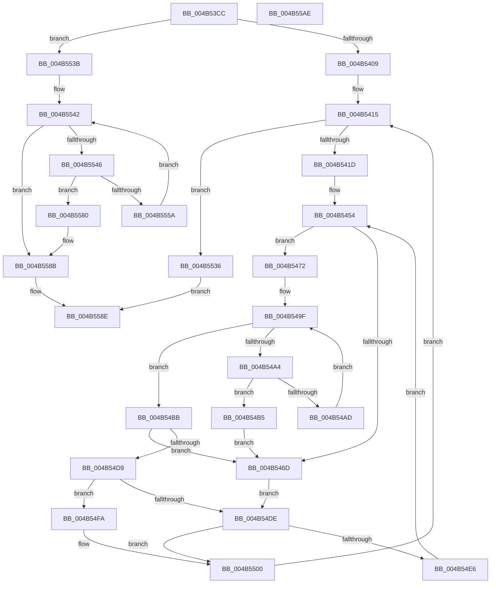

# ST_STORE&lt;SM_TRAITS&gt;::StAddRemoveRegions

- RVA: `0x004B53CC`–`0x004B55AF` (길이 `483` bytes)
- VA: `0x00000001404B53CC`
- 실행 섹션: `.text`
- PDB 이름 있음: `예`; PDB Function 태그: `아니요`
- unwind 정보 RVA: `0x000B0E24`
- 디코드: `148`개 명령, `483/483` bytes 표시
- 미해석 바이트: `0` (있으면 어셈블리에 `.byte`로 보존)

> 이 문서는 커널 이미지의 기계어와 PDB 기호를 분석해 생성했습니다. 4번과 5번은 함수 원형과 자료형을 바이너리 사용 방식에서 추정한 C 해석이며 원본 소스 복구 결과는 아닙니다.

## 1. Dependencies

- 직접 호출 지점: **1**; 고유 호출 대상: **1**
- 직접 호출자로 확인된 함수: **1**
- RIP 상대 이미지 참조: **0**

### Outgoing calls
- `0x004B554E` → [ST_STORE<SM_TRAITS>::StDmRegionRemove](../60/ST_STORE_SM_TRAITS_StDmRegionRemove_function_0060E314.md) (function, `0x0060E314`)

### Direct callers
- [sub_002061A0](../20/Unknown_function_002061A0.md) at `0x0020627D`

### Static image references
- 디코드된 RIP-relative 메모리 참조가 없습니다.

## 2. Other-region calls and transfers

- 다른 실행 섹션으로 향하는 call: **0**
- 별도 외부 분기/꼬리 이동을 확인하지 못했습니다.

## 3. Assembly (complete function range)

```asm
004B53CC  48 8B C4                        mov rax, rsp
004B53CF  48 89 58 08                     mov qword ptr [rax + 8], rbx
004B53D3  48 89 68 18                     mov qword ptr [rax + 0x18], rbp
004B53D7  48 89 70 20                     mov qword ptr [rax + 0x20], rsi
004B53DB  57                              push rdi
004B53DC  41 54                           push r12
004B53DE  41 55                           push r13
004B53E0  41 56                           push r14
004B53E2  41 57                           push r15
004B53E4  48 83 EC 20                     sub rsp, 0x20
004B53E8  8B 72 18                        mov esi, dword ptr [rdx + 0x18]
004B53EB  48 8D 69 50                     lea rbp, [rcx + 0x50]
004B53EF  45 33 F6                        xor r14d, r14d
004B53F2  48 8B DA                        mov rbx, rdx
004B53F5  44 89 70 10                     mov dword ptr [rax + 0x10], r14d
004B53F9  48 8B F9                        mov rdi, rcx
004B53FC  8B 42 08                        mov eax, dword ptr [rdx + 8]
004B53FF  24 07                           and al, 7
004B5401  3C 04                           cmp al, 4
004B5403  0F 85 32 01 00 00               jne 0x1404b553b
004B5409  4C 8B 6A 10                     mov r13, qword ptr [rdx + 0x10]
004B540D  41 83 CC FF                     or r12d, 0xffffffff
004B5411  49 83 CA FF                     or r10, 0xffffffffffffffff
004B5415  85 F6                           test esi, esi
004B5417  0F 84 19 01 00 00               je 0x1404b5536
004B541D  41 8B 6D 00                     mov ebp, dword ptr [r13]
004B5421  49 8B 5D 08                     mov rbx, qword ptr [r13 + 8]
004B5425  44 8B 7C 24 58                  mov r15d, dword ptr [rsp + 0x58]
004B542A  48 8B CB                        mov rcx, rbx
004B542D  83 E1 04                        and ecx, 4
004B5430  8B C1                           mov eax, ecx
004B5432  8D 55 FF                        lea edx, [rbp - 1]
004B5435  48 F7 D8                        neg rax
004B5438  45 1B DB                        sbb r11d, r11d
004B543B  41 83 E3 20                     and r11d, 0x20
004B543F  44 3B FD                        cmp r15d, ebp
004B5442  45 1B C0                        sbb r8d, r8d
004B5445  45 23 C7                        and r8d, r15d
004B5448  48 F7 D9                        neg rcx
004B544B  48 1B C0                        sbb rax, rax
004B544E  83 E0 04                        and eax, 4
004B5451  48 2B D8                        sub rbx, rax
004B5454  44 89 74 24 58                  mov dword ptr [rsp + 0x58], r14d
004B5459  43 8D 0C 03                     lea ecx, [r11 + r8]
004B545D  45 8D 34 13                     lea r14d, [r11 + rdx]
004B5461  41 8B C6                        mov eax, r14d
004B5464  2B C1                           sub eax, ecx
004B5466  FF C0                           inc eax
004B5468  83 F8 01                        cmp eax, 1
004B546B  73 05                           jae 0x1404b5472
004B546D  45 8B CC                        mov r9d, r12d
004B5470  EB 6C                           jmp 0x1404b54de
004B5472  41 8B C6                        mov eax, r14d
004B5475  BA 01 00 00 00                  mov edx, 1
004B547A  48 C1 E8 06                     shr rax, 6
004B547E  4C 8D 24 C3                     lea r12, [rbx + rax*8]
004B5482  48 8B C1                        mov rax, rcx
004B5485  48 C1 E8 06                     shr rax, 6
004B5489  80 E1 3F                        and cl, 0x3f
004B548C  48 D3 E2                        shl rdx, cl
004B548F  48 FF CA                        dec rdx
004B5492  4C 8D 0C C3                     lea r9, [rbx + rax*8]
004B5496  49 8B 01                        mov rax, qword ptr [r9]
004B5499  48 F7 D0                        not rax
004B549C  48 0B D0                        or rdx, rax
004B549F  49 3B D2                        cmp rdx, r10
004B54A2  75 17                           jne 0x1404b54bb
004B54A4  49 83 C1 08                     add r9, 8
004B54A8  4D 3B CC                        cmp r9, r12
004B54AB  77 08                           ja 0x1404b54b5
004B54AD  49 8B 11                        mov rdx, qword ptr [r9]
004B54B0  48 F7 D2                        not rdx
004B54B3  EB EA                           jmp 0x1404b549f
004B54B5  41 83 CC FF                     or r12d, 0xffffffff
004B54B9  EB B2                           jmp 0x1404b546d
004B54BB  4C 2B CB                        sub r9, rbx
004B54BE  48 F7 D2                        not rdx
004B54C1  49 C1 F9 03                     sar r9, 3
004B54C5  41 83 CC FF                     or r12d, 0xffffffff
004B54C9  48 0F BC C2                     bsf rax, rdx
004B54CD  41 C1 E1 06                     shl r9d, 6
004B54D1  44 03 C8                        add r9d, eax
004B54D4  45 3B CE                        cmp r9d, r14d
004B54D7  77 94                           ja 0x1404b546d
004B54D9  45 3B CC                        cmp r9d, r12d
004B54DC  75 1C                           jne 0x1404b54fa
004B54DE  45 33 F6                        xor r14d, r14d
004B54E1  45 85 C0                        test r8d, r8d
004B54E4  74 1A                           je 0x1404b5500
004B54E6  41 8D 57 01                     lea edx, [r15 + 1]
004B54EA  45 8B C6                        mov r8d, r14d
004B54ED  3B D5                           cmp edx, ebp
004B54EF  0F 47 D5                        cmova edx, ebp
004B54F2  41 03 D4                        add edx, r12d
004B54F5  E9 5A FF FF FF                  jmp 0x1404b5454
004B54FA  45 2B CB                        sub r9d, r11d
004B54FD  45 33 F6                        xor r14d, r14d
004B5500  4C 8B 87 A0 03 00 00            mov r8, qword ptr [rdi + 0x3a0]
004B5507  41 8B C1                        mov eax, r9d
004B550A  83 E0 07                        and eax, 7
004B550D  41 8B D1                        mov edx, r9d
004B5510  48 C1 EA 03                     shr rdx, 3
004B5514  42 0F B6 0C 02                  movzx ecx, byte ptr [rdx + r8]
004B5519  0F AB C1                        bts ecx, eax
004B551C  42 88 0C 02                     mov byte ptr [rdx + r8], cl
004B5520  41 8D 41 01                     lea eax, [r9 + 1]
004B5524  FF 87 A8 03 00 00               inc dword ptr [rdi + 0x3a8]
004B552A  41 03 F4                        add esi, r12d
004B552D  89 44 24 58                     mov dword ptr [rsp + 0x58], eax
004B5531  E9 DF FE FF FF                  jmp 0x1404b5415
004B5536  45 8B D6                        mov r10d, r14d
004B5539  EB 53                           jmp 0x1404b558e
004B553B  41 8B FE                        mov edi, r14d
004B553E  49 83 CA FF                     or r10, 0xffffffffffffffff
004B5542  3B FE                           cmp edi, esi
004B5544  73 45                           jae 0x1404b558b
004B5546  48 8D 54 24 58                  lea rdx, [rsp + 0x58]
004B554B  48 8B CD                        mov rcx, rbp
004B554E  E8 C1 8D 15 00                  call 0x14060e314
004B5553  44 8B D0                        mov r10d, eax
004B5556  85 C0                           test eax, eax
004B5558  78 26                           js 0x1404b5580
004B555A  48 8B 4B 10                     mov rcx, qword ptr [rbx + 0x10]
004B555E  8B 54 24 58                     mov edx, dword ptr [rsp + 0x58]
004B5562  44 8B C2                        mov r8d, edx
004B5565  83 E2 07                        and edx, 7
004B5568  49 C1 E8 03                     shr r8, 3
004B556C  4C 8B 49 08                     mov r9, qword ptr [rcx + 8]
004B5570  43 0F B6 0C 08                  movzx ecx, byte ptr [r8 + r9]
004B5575  0F AB D1                        bts ecx, edx
004B5578  43 88 0C 08                     mov byte ptr [r8 + r9], cl
004B557C  FF C7                           inc edi
004B557E  EB C2                           jmp 0x1404b5542
004B5580  41 81 FA 06 00 00 C0            cmp r10d, 0xc0000006
004B5587  45 0F 45 D6                     cmovne r10d, r14d
004B558B  89 7B 18                        mov dword ptr [rbx + 0x18], edi
004B558E  48 8B 5C 24 50                  mov rbx, qword ptr [rsp + 0x50]
004B5593  41 8B C2                        mov eax, r10d
004B5596  48 8B 6C 24 60                  mov rbp, qword ptr [rsp + 0x60]
004B559B  48 8B 74 24 68                  mov rsi, qword ptr [rsp + 0x68]
004B55A0  48 83 C4 20                     add rsp, 0x20
004B55A4  41 5F                           pop r15
004B55A6  41 5E                           pop r14
004B55A8  41 5D                           pop r13
004B55AA  41 5C                           pop r12
004B55AC  5F                              pop rdi
004B55AD  C3                              ret
004B55AE  CC                              int3
```

## 4. C-style interpretation (structured pseudocode)

```c
__int64 __fastcall ST_STORE_SM_TRAITS___StAddRemoveRegions(__int64 a1, __int64 a2, int a3)
{
    __int64 result;
    __int64 v_r10;
    __int64 v_r11;
    __int64 v_r12;
    __int64 v_r14;
    __int64 v_rbx;
    __int64 v_rdi;
    __int64 v_rsi;
    __int64 v_rsp;
    unsigned int v_stack_p10;
    unsigned __int64 v_stack_p18;
    unsigned __int64 v_stack_p20;
    unsigned __int64 v_stack_p8;

    *(unsigned __int64 *)(v_rsp + 8) = v_rbx;
    *(unsigned __int64 *)(v_rsp + 24) = v_rbp;
    *(unsigned __int64 *)(v_rsp + 32) = v_rsi;
    v_rsp = (v_rsp) - (32);
    v_r14 = 0;
    *(unsigned int *)(v_rsp + 16) = 0;
    result = (unsigned __int8)(((unsigned int)(*(unsigned int *)(a2 + 8))) & (7));
    if (((unsigned __int8)(result)) != 4) goto loc_004B553B;
    v_r12 = (unsigned int)((v_r12) | (0xFFFFFFFFULL));
    v_r10 = (v_r10) | (-1);
loc_004B5415:
    if ((unsigned int)((unsigned int)(*(unsigned int *)(a2 + 24))) == 0) goto loc_004B5536;
    a1 = (unsigned int)((*(unsigned __int64 *)(*(unsigned __int64 *)(a2 + 16) + 8)) & (4));
    result = -((unsigned int)((unsigned int)(a1)));
    v_r11 = (unsigned int)((v_r11) & (32));
    a3 = (unsigned int)((a3) & ((unsigned int)((unsigned int)(v_stack_p10))));
    a1 = -(a1);
    result = (unsigned int)((result) & (4));
    v_rbx = (*(unsigned __int64 *)(*(unsigned __int64 *)(a2 + 16) + 8)) - (result);
loc_004B5454:
    v_stack_p10 = 0;
    result = (unsigned int)(((unsigned int)((unsigned int)(v_r11 + (unsigned int)(*(unsigned int *)(*(unsigned __int64 *)(a2 + 16))) - 1 * 1))) - ((unsigned int)(v_r11 + a3 * 1)));
    result = (unsigned int)((result) + 1);
    if (((unsigned int)(result)) >= 1) goto loc_004B5472;
loc_004B546D:
    goto loc_004B54DE;
loc_004B5472:
    result = ((unsigned int)((unsigned int)(v_r11 + (unsigned int)(*(unsigned int *)(*(unsigned __int64 *)(a2 + 16))) - 1 * 1))) >> (6);
    result = (v_r11 + a3 * 1) >> (6);
    a1 = (unsigned __int8)((v_r11 + a3 * 1) & (63));
    a2 = (1) << ((unsigned __int8)(a1));
    a2 = (a2) - 1;
    result = ~(*(unsigned __int64 *)(v_rbx + result * 8));
    a2 = (a2) | (result);
loc_004B549F:
    if (a2 != v_r10) goto loc_004B54BB;
    a4 = (v_rbx + result * 8) + (8);
    if (a4 > (v_rbx + result * 8)) goto loc_004B54B5;
    a2 = ~(*(unsigned __int64 *)(a4));
    goto loc_004B549F;
loc_004B54B5:
    v_r12 = (unsigned int)((v_rbx + result * 8) | (0xFFFFFFFFULL));
    goto loc_004B546D;
loc_004B54BB:
    a4 = (a4) - (v_rbx);
    a2 = ~(a2);
    a4 = (a4) >> (3);
    v_r12 = (unsigned int)((v_r12) | (0xFFFFFFFFULL));
    a4 = (unsigned int)((a4) << (6));
    a4 = (unsigned int)((a4) + ((unsigned int)(result)));
    if (((unsigned int)(a4)) > ((unsigned int)(v_r11 + (unsigned int)(*(unsigned int *)(*(unsigned __int64 *)(a2 + 16))) - 1 * 1))) goto loc_004B546D;
    if (((unsigned int)(a4)) != ((unsigned int)(v_r12))) goto loc_004B54FA;
loc_004B54DE:
    v_r14 = 0;
    if (a3 == 0) goto loc_004B5500;
    a2 = (unsigned int)(v_stack_p10) + 1;
    if (((unsigned int)((unsigned int)(v_stack_p10) + 1)) > ((unsigned int)((unsigned int)(*(unsigned int *)(*(unsigned __int64 *)(a2 + 16)))))) { a2 = (unsigned int)((unsigned int)(*(unsigned int *)(*(unsigned __int64 *)(a2 + 16)))); }
    a2 = (unsigned int)((a2) + ((unsigned int)(v_r12)));
    goto loc_004B5454;
loc_004B54FA:
    a4 = (unsigned int)((a4) - ((unsigned int)(v_r11)));
    v_r14 = 0;
loc_004B5500:
    result = (unsigned int)(((unsigned int)((unsigned int)(a4))) & (7));
    a2 = ((unsigned int)((unsigned int)(a4))) >> (3);
    *(unsigned __int8 *)(a2 + *(unsigned __int64 *)(a1 + 928) * 1) = (unsigned __int8)(*(unsigned __int8 *)(a2 + *(unsigned __int64 *)(a1 + 928) * 1));
    v_rsi = (unsigned int)(((unsigned int)(*(unsigned int *)(a2 + 24))) + ((unsigned int)(v_r12)));
    v_stack_p10 = (unsigned int)(a4 + 1);
    goto loc_004B5415;
loc_004B5536:
    goto loc_004B558E;
loc_004B553B:
    v_r10 = (0) | (-1);
loc_004B5542:
    if (0 >= ((unsigned int)(v_rsi))) goto loc_004B558B;
    result = ST_STORE_SM_TRAITS___StDmRegionRemove((unsigned int)(*(unsigned int *)(*(unsigned __int64 *)(a2 + 16))), v_stack_p10, *(unsigned __int64 *)(a1 + 928), a4);
    if (sign_flag) goto loc_004B5580;
    a2 = (unsigned int)(((unsigned int)(v_stack_p10)) & (7));
    a3 = ((unsigned int)((unsigned int)((unsigned int)(v_stack_p10)))) >> (3);
    *(unsigned __int8 *)(a3 + *(unsigned __int64 *)(*(unsigned __int64 *)(v_rbx + 16) + 8) * 1) = (unsigned __int8)(*(unsigned __int8 *)(a3 + *(unsigned __int64 *)(*(unsigned __int64 *)(v_rbx + 16) + 8) * 1));
    v_rdi = (unsigned int)((0) + 1);
    goto loc_004B5542;
loc_004B5580:
    v_r10 = (unsigned int)((unsigned int)(result));
    if (((unsigned int)((unsigned int)((unsigned int)(result)))) != 0xC0000006ULL) { v_r10 = 0; }
loc_004B558B:
    *(unsigned int *)(v_rbx + 24) = (unsigned int)(v_rdi);
loc_004B558E:
    v_rsp = (v_rsp) + (32);
    return (unsigned int)((unsigned int)(v_r10));
}
```

## 5. (Beta) C Style

```c
int64_t ST_STORE_SM_TRAITS___StAddRemoveRegions(void *Arg1, void *Arg2, int32_t Arg3)
{
    uint8_t *arg1 = (uint8_t *)Arg1;
    uint8_t *arg2 = (uint8_t *)Arg2;

    int64_t result;
    int64_t local_r10;
    int64_t local_r11;
    int64_t local_r12;
    int64_t local_r14;
    int64_t local_rbx;
    int64_t local_rdi;
    int64_t local_rsi;
    int64_t local_rsp;
    uint32_t v_stack_p10;
    uint64_t v_stack_p18;
    uint64_t v_stack_p20;
    uint64_t v_stack_p8;

    *(uint64_t *)(local_rsp + 0x8) = local_rbx;
    *(uint64_t *)(local_rsp + 0x18) = local_rbp;
    *(uint64_t *)(local_rsp + 0x20) = local_rsi;
    local_rsp = (local_rsp) - (32);
    local_r14 = 0;
    *(uint32_t *)(local_rsp + 0x10) = 0;
    result = (uint8_t)(((uint32_t)(*(uint32_t *)(arg2 + 0x8))) & (7));
    if (((uint8_t)(result)) != 4) goto loc_004B553B;
    local_r12 = (uint32_t)((local_r12) | (0xFFFFFFFFULL));
    local_r10 = (local_r10) | (-1);
loc_004B5415:
    if ((uint32_t)((uint32_t)(*(uint32_t *)(arg2 + 0x18))) == 0) goto loc_004B5536;
    Arg1 = (uint32_t)((*(uint64_t *)(*(uint64_t *)(arg2 + 0x10) + 0x8)) & (4));
    result = -((uint32_t)((uint32_t)(Arg1)));
    local_r11 = (uint32_t)((local_r11) & (32));
    Arg3 = (uint32_t)((Arg3) & ((uint32_t)((uint32_t)(v_stack_p10))));
    Arg1 = -(Arg1);
    result = (uint32_t)((result) & (4));
    local_rbx = (*(uint64_t *)(*(uint64_t *)(arg2 + 0x10) + 0x8)) - (result);
loc_004B5454:
    v_stack_p10 = 0;
    result = (uint32_t)(((uint32_t)((uint32_t)(local_r11 + (uint32_t)(*(uint32_t *)(*(uint64_t *)(arg2 + 0x10))) - 1 * 1))) - ((uint32_t)(local_r11 + Arg3 * 1)));
    result = (uint32_t)((result) + 1);
    if (((uint32_t)(result)) >= 1) goto loc_004B5472;
loc_004B546D:
    goto loc_004B54DE;
loc_004B5472:
    result = ((uint32_t)((uint32_t)(local_r11 + (uint32_t)(*(uint32_t *)(*(uint64_t *)(arg2 + 0x10))) - 1 * 1))) >> (6);
    result = (local_r11 + Arg3 * 1) >> (6);
    Arg1 = (uint8_t)((local_r11 + Arg3 * 1) & (63));
    Arg2 = (1) << ((uint8_t)(Arg1));
    Arg2 = (Arg2) - 1;
    result = ~(*(uint64_t *)(local_rbx + result * 8));
    Arg2 = (Arg2) | (result);
loc_004B549F:
    if (Arg2 != local_r10) goto loc_004B54BB;
    a4 = (local_rbx + result * 8) + (8);
    if (a4 > (local_rbx + result * 8)) goto loc_004B54B5;
    Arg2 = ~(*(uint64_t *)(a4));
    goto loc_004B549F;
loc_004B54B5:
    local_r12 = (uint32_t)((local_rbx + result * 8) | (0xFFFFFFFFULL));
    goto loc_004B546D;
loc_004B54BB:
    a4 = (a4) - (local_rbx);
    Arg2 = ~(Arg2);
    a4 = (a4) >> (3);
    local_r12 = (uint32_t)((local_r12) | (0xFFFFFFFFULL));
    a4 = (uint32_t)((a4) << (6));
    a4 = (uint32_t)((a4) + ((uint32_t)(result)));
    if (((uint32_t)(a4)) > ((uint32_t)(local_r11 + (uint32_t)(*(uint32_t *)(*(uint64_t *)(arg2 + 0x10))) - 1 * 1))) goto loc_004B546D;
    if (((uint32_t)(a4)) != ((uint32_t)(local_r12))) goto loc_004B54FA;
loc_004B54DE:
    local_r14 = 0;
    if (Arg3 == 0) goto loc_004B5500;
    Arg2 = (uint32_t)(v_stack_p10) + 1;
    if (((uint32_t)((uint32_t)(v_stack_p10) + 1)) > ((uint32_t)((uint32_t)(*(uint32_t *)(*(uint64_t *)(arg2 + 0x10)))))) { Arg2 = (uint32_t)((uint32_t)(*(uint32_t *)(*(uint64_t *)(arg2 + 0x10)))); }
    Arg2 = (uint32_t)((Arg2) + ((uint32_t)(local_r12)));
    goto loc_004B5454;
loc_004B54FA:
    a4 = (uint32_t)((a4) - ((uint32_t)(local_r11)));
    local_r14 = 0;
loc_004B5500:
    result = (uint32_t)(((uint32_t)((uint32_t)(a4))) & (7));
    Arg2 = ((uint32_t)((uint32_t)(a4))) >> (3);
    *(uint8_t *)(arg2 + *(uint64_t *)(arg1 + 0x3A0) * 1) = (uint8_t)(*(uint8_t *)(arg2 + *(uint64_t *)(arg1 + 0x3A0) * 1));
    local_rsi = (uint32_t)(((uint32_t)(*(uint32_t *)(arg2 + 0x18))) + ((uint32_t)(local_r12)));
    v_stack_p10 = (uint32_t)(a4 + 1);
    goto loc_004B5415;
loc_004B5536:
    goto loc_004B558E;
loc_004B553B:
    local_r10 = (0) | (-1);
loc_004B5542:
    if (0 >= ((uint32_t)(local_rsi))) goto loc_004B558B;
    result = ST_STORE_SM_TRAITS___StDmRegionRemove((uint32_t)(*(uint32_t *)(*(uint64_t *)(arg2 + 0x10))), v_stack_p10, *(uint64_t *)(arg1 + 0x3A0), a4);
    if (sign_flag) goto loc_004B5580;
    Arg2 = (uint32_t)(((uint32_t)(v_stack_p10)) & (7));
    Arg3 = ((uint32_t)((uint32_t)((uint32_t)(v_stack_p10)))) >> (3);
    *(uint8_t *)(Arg3 + *(uint64_t *)(*(uint64_t *)(local_rbx + 0x10) + 0x8) * 1) = (uint8_t)(*(uint8_t *)(Arg3 + *(uint64_t *)(*(uint64_t *)(local_rbx + 0x10) + 0x8) * 1));
    local_rdi = (uint32_t)((0) + 1);
    goto loc_004B5542;
loc_004B5580:
    local_r10 = (uint32_t)((uint32_t)(result));
    if (((uint32_t)((uint32_t)((uint32_t)(result)))) != 0xC0000006ULL) { local_r10 = 0; }
loc_004B558B:
    *(uint32_t *)(local_rbx + 0x18) = (uint32_t)(local_rdi);
loc_004B558E:
    local_rsp = (local_rsp) + (32);
    return (uint32_t)((uint32_t)(local_r10));
}
```

### 관측된 메모리 오프셋

구조체 형식이 확인되지 않은 접근은 인자 기준의 오프셋으로만 기록했습니다.

| 기준 인자 | 오프셋 표현 | 폭 (bit) | 접근 |
|---|---:|---:|---|
| `Arg1` | `+ 0x50` | `64` | `R` |
| `Arg1` | `+ 0x3A0` | `64` | `R` |
| `Arg1` | `+ 0x3A8` | `32` | `R/W` |
| `Arg2` | `+ 0x8` | `32` | `R` |
| `Arg2` | `+ 0x10` | `64` | `R` |
| `Arg2` | `+ 0x18` | `32` | `R` |
| `Arg2` | `+ 0x18` | `32` | `W` |

## 6. Execution-region graph

[열기: 2D/3D 그래프와 함수 탐색 컨트롤 패널](../../../control-panel.html?section=text&rva=0x004B53CC&view=graph)

- 2D 그래프는 위에서 아래로 흐르고, 3D 그래프는 빈 공간을 드래그해 회전합니다. Shift+드래그는 이동, 휠은 확대·축소, 함수 노드 선택은 대상 보고서 이동입니다.

### Static fallback


