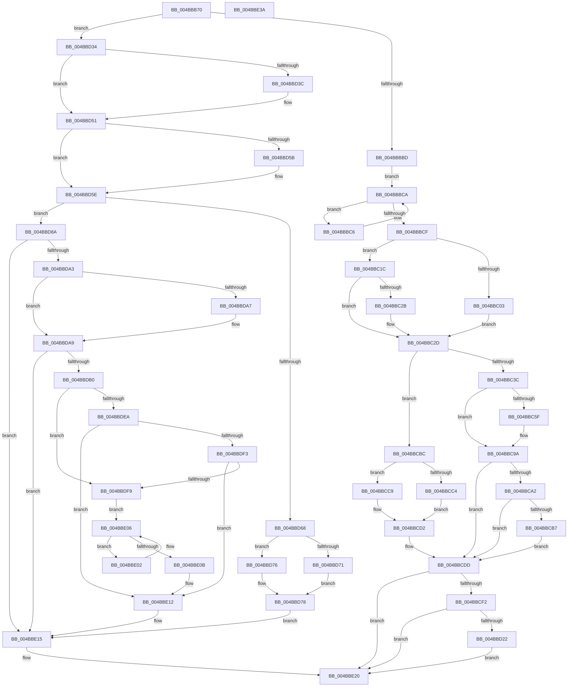

# ST_STORE&lt;SM_TRAITS&gt;::StDmDeviceIoCompletion

- RVA: `0x004BBB70`–`0x004BBE3B` (길이 `715` bytes)
- VA: `0x00000001404BBB70`
- 실행 섹션: `.text`
- PDB 이름 있음: `예`; PDB Function 태그: `아니요`
- unwind 정보 RVA: `0x000717C4`
- 디코드: `197`개 명령, `715/715` bytes 표시
- 미해석 바이트: `0` (있으면 어셈블리에 `.byte`로 보존)

> 이 문서는 커널 이미지의 기계어와 PDB 기호를 분석해 생성했습니다. 4번과 5번은 함수 원형과 자료형을 바이너리 사용 방식에서 추정한 C 해석이며 원본 소스 복구 결과는 아닙니다.

## 1. Dependencies

- 직접 호출 지점: **14**; 고유 호출 대상: **12**
- 직접 호출자로 확인된 함수: **4**
- RIP 상대 이미지 참조: **0**

### Outgoing calls
- `0x004BBBE7` → [StEtaIoComplete](../60/StEtaIoComplete_function_0060EEE0.md) (function, `0x0060EEE0`)
- `0x004BBBF7` → [ST_STORE<SM_TRAITS>::StDeviceIoIsFailed](../4F/ST_STORE_SM_TRAITS_StDeviceIoIsFailed_function_004FCEEC.md) (function, `0x004FCEEC`)
- `0x004BBC12` → [ST_STORE<SM_TRAITS>::StDmDeviceError](../60/ST_STORE_SM_TRAITS_StDmDeviceError_function_0060D2C4.md) (function, `0x0060D2C4`)
- `0x004BBC4F` → [SmEtwEnabled](../3A/SmEtwEnabled_function_003AF2D0.md) (function, `0x003AF2D0`)
- `0x004BBC8C` → [SmEtwLogRegionOp](../60/SmEtwLogRegionOp_function_0060F38C.md) (function, `0x0060F38C`)
- `0x004BBCD8` → [ST_STORE<SM_TRAITS>::StRegionReadDereference](../4F/ST_STORE_SM_TRAITS_StRegionReadDereference_function_004F68A4.md) (function, `0x004F68A4`)
- `0x004BBCF5` → [ST_STORE<SM_TRAITS>::StStagingRegionCleanup](../3A/ST_STORE_SM_TRAITS_StStagingRegionCleanup_function_003AFC3C.md) (function, `0x003AFC3C`)
- `0x004BBD14` → [ST_STORE<SM_TRAITS>::StDmIsCurrentRegion](../4D/ST_STORE_SM_TRAITS_StDmIsCurrentRegion_function_004D3684.md) (function, `0x004D3684`)
- `0x004BBD2A` → [ST_STORE<SM_TRAITS>::StDmCurrentRegionSet](../3B/ST_STORE_SM_TRAITS_StDmCurrentRegionSet_function_003B1130.md) (function, `0x003B1130`)
- `0x004BBD49` → [StEtaIoComplete](../60/StEtaIoComplete_function_0060EEE0.md) (function, `0x0060EEE0`)
- `0x004BBD80` → [ST_STORE<SM_TRAITS>::StDmDeviceError](../60/ST_STORE_SM_TRAITS_StDmDeviceError_function_0060D2C4.md) (function, `0x0060D2C4`)
- `0x004BBD90` → [ST_STORE<SM_TRAITS>::StDmDeviceIoTransfer](ST_STORE_SM_TRAITS_StDmDeviceIoTransfer_function_004BBE44.md) (function, `0x004BBE44`)
- `0x004BBDB2` → [KeQueryPerformanceCounter](../37/KeQueryPerformanceCounter_function_0037E7E0.md) (function, `0x0037E7E0`)
- `0x004BBE1B` → [ST_STORE<SM_TRAITS>::StDeviceWorkItemCleanup](../4F/ST_STORE_SM_TRAITS_StDeviceWorkItemCleanup_function_004F6808.md) (function, `0x004F6808`)

### Direct callers
- [sub_002061A0](../20/Unknown_function_002061A0.md) at `0x002062D0`
- [ST_STORE&lt;SM_TRAITS&gt;::StDmEtaPerformIo](../60/ST_STORE_SM_TRAITS_StDmEtaPerformIo_function_0060D448.md) at `0x0060D523`
- [ST_STORE&lt;SM_TRAITS&gt;::StDmSinglePageRetrieveSync](../60/ST_STORE_SM_TRAITS_StDmSinglePageRetrieveSync_function_0060E414.md) at `0x0060E509`
- [sub_006EDA08](../6E/Unknown_function_006EDA08.md) at `0x006EDAE8`

### Static image references
- 디코드된 RIP-relative 메모리 참조가 없습니다.

## 2. Other-region calls and transfers

- 다른 실행 섹션으로 향하는 call: **0**
- 별도 외부 분기/꼬리 이동을 확인하지 못했습니다.

## 3. Assembly (complete function range)

```asm
004BBB70  48 8B C4                        mov rax, rsp
004BBB73  48 89 58 18                     mov qword ptr [rax + 0x18], rbx
004BBB77  55                              push rbp
004BBB78  56                              push rsi
004BBB79  57                              push rdi
004BBB7A  41 54                           push r12
004BBB7C  41 55                           push r13
004BBB7E  41 56                           push r14
004BBB80  41 57                           push r15
004BBB82  48 83 EC 40                     sub rsp, 0x40
004BBB86  48 8B D9                        mov rbx, rcx
004BBB89  48 8D 7A 08                     lea rdi, [rdx + 8]
004BBB8D  44 8B 7F 10                     mov r15d, dword ptr [rdi + 0x10]
004BBB91  45 33 C0                        xor r8d, r8d
004BBB94  8B 89 2C 03 00 00               mov ecx, dword ptr [rcx + 0x32c]
004BBB9A  4C 8B F2                        mov r14, rdx
004BBB9D  41 D3 EF                        shr r15d, cl
004BBBA0  4C 8B A3 78 05 00 00            mov r12, qword ptr [rbx + 0x578]
004BBBA7  4C 89 A4 24 88 00 00 00         mov qword ptr [rsp + 0x88], r12
004BBBAF  44 89 40 08                     mov dword ptr [rax + 8], r8d
004BBBB3  4C 39 47 08                     cmp qword ptr [rdi + 8], r8
004BBBB7  0F 85 77 01 00 00               jne 0x1404bbd34
004BBBBD  4C 8D B3 C8 05 00 00            lea r14, [rbx + 0x5c8]
004BBBC4  EB 04                           jmp 0x1404bbbca
004BBBC6  49 83 C6 18                     add r14, 0x18
004BBBCA  45 39 3E                        cmp dword ptr [r14], r15d
004BBBCD  75 F7                           jne 0x1404bbbc6
004BBBCF  8B 93 10 03 00 00               mov edx, dword ptr [rbx + 0x310]
004BBBD5  BE 01 00 00 00                  mov esi, 1
004BBBDA  48 8B 8B 58 05 00 00            mov rcx, qword ptr [rbx + 0x558]
004BBBE1  44 8B C6                        mov r8d, esi
004BBBE4  4C 8B CF                        mov r9, rdi
004BBBE7  E8 F4 32 15 00                  call 0x14060eee0
004BBBEC  48 8D 94 24 80 00 00 00         lea rdx, [rsp + 0x80]
004BBBF4  48 8B CF                        mov rcx, rdi
004BBBF7  E8 F0 12 04 00                  call 0x1404fceec
004BBBFC  45 33 C9                        xor r9d, r9d
004BBBFF  85 C0                           test eax, eax
004BBC01  74 19                           je 0x1404bbc1c
004BBC03  8B AC 24 80 00 00 00            mov ebp, dword ptr [rsp + 0x80]
004BBC0A  8B D6                           mov edx, esi
004BBC0C  44 8B C5                        mov r8d, ebp
004BBC0F  48 8B CB                        mov rcx, rbx
004BBC12  E8 AD 16 15 00                  call 0x14060d2c4
004BBC17  45 33 C9                        xor r9d, r9d
004BBC1A  EB 11                           jmp 0x1404bbc2d
004BBC1C  48 8B 83 90 08 00 00            mov rax, qword ptr [rbx + 0x890]
004BBC23  41 8B E9                        mov ebp, r9d
004BBC26  48 85 C0                        test rax, rax
004BBC29  74 02                           je 0x1404bbc2d
004BBC2B  01 30                           add dword ptr [rax], esi
004BBC2D  47 0F B7 04 7C                  movzx r8d, word ptr [r12 + r15*2]
004BBC32  66 45 85 C0                     test r8w, r8w
004BBC36  0F 89 80 00 00 00               jns 0x1404bbcbc
004BBC3C  B8 FF 7F 00 00                  mov eax, 0x7fff
004BBC41  33 C9                           xor ecx, ecx
004BBC43  66 44 23 C0                     and r8w, ax
004BBC47  66 47 89 04 7C                  mov word ptr [r12 + r15*2], r8w
004BBC4C  44 8B E6                        mov r12d, esi
004BBC4F  E8 7C 36 EF FF                  call 0x1403af2d0
004BBC54  41 BA FF 1F 00 00               mov r10d, 0x1fff
004BBC5A  48 85 C0                        test rax, rax
004BBC5D  74 3B                           je 0x1404bbc9a
004BBC5F  48 8B 8B 88 05 00 00            mov rcx, qword ptr [rbx + 0x588]
004BBC66  66 45 23 C2                     and r8w, r10w
004BBC6A  45 8B CF                        mov r9d, r15d
004BBC6D  42 0F B6 14 39                  movzx edx, byte ptr [rcx + r15]
004BBC72  48 8B C8                        mov rcx, rax
004BBC75  66 89 54 24 30                  mov word ptr [rsp + 0x30], dx
004BBC7A  BA 04 00 00 00                  mov edx, 4
004BBC7F  66 44 89 44 24 28               mov word ptr [rsp + 0x28], r8w
004BBC85  4C 8B C3                        mov r8, rbx
004BBC88  89 6C 24 20                     mov dword ptr [rsp + 0x20], ebp
004BBC8C  E8 FB 36 15 00                  call 0x14060f38c
004BBC91  45 33 C9                        xor r9d, r9d
004BBC94  41 BA FF 1F 00 00               mov r10d, 0x1fff
004BBC9A  8B 47 14                        mov eax, dword ptr [rdi + 0x14]
004BBC9D  40 84 C6                        test sil, al
004BBCA0  74 3B                           je 0x1404bbcdd
004BBCA2  48 8B 84 24 88 00 00 00         mov rax, qword ptr [rsp + 0x88]
004BBCAA  01 B3 D8 08 00 00               add dword ptr [rbx + 0x8d8], esi
004BBCB0  66 46 85 14 78                  test word ptr [rax + r15*2], r10w
004BBCB5  76 26                           jbe 0x1404bbcdd
004BBCB7  45 8B E1                        mov r12d, r9d
004BBCBA  EB 21                           jmp 0x1404bbcdd
004BBCBC  8B 47 14                        mov eax, dword ptr [rdi + 0x14]
004BBCBF  40 84 C6                        test sil, al
004BBCC2  75 05                           jne 0x1404bbcc9
004BBCC4  45 8B E1                        mov r12d, r9d
004BBCC7  EB 09                           jmp 0x1404bbcd2
004BBCC9  01 B3 DC 08 00 00               add dword ptr [rbx + 0x8dc], esi
004BBCCF  44 8B E6                        mov r12d, esi
004BBCD2  41 8B D7                        mov edx, r15d
004BBCD5  48 8B CB                        mov rcx, rbx
004BBCD8  E8 C7 AB 03 00                  call 0x1404f68a4
004BBCDD  33 C0                           xor eax, eax
004BBCDF  0F 57 C0                        xorps xmm0, xmm0
004BBCE2  0F 11 07                        movups xmmword ptr [rdi], xmm0
004BBCE5  48 89 47 10                     mov qword ptr [rdi + 0x10], rax
004BBCE9  45 85 E4                        test r12d, r12d
004BBCEC  0F 84 2E 01 00 00               je 0x1404bbe20
004BBCF2  49 8B D6                        mov rdx, r14
004BBCF5  E8 42 3F EF FF                  call 0x1403afc3c
004BBCFA  33 C0                           xor eax, eax
004BBCFC  0F 57 C0                        xorps xmm0, xmm0
004BBCFF  41 0F 11 06                     movups xmmword ptr [r14], xmm0
004BBD03  49 89 46 10                     mov qword ptr [r14 + 0x10], rax
004BBD07  41 83 CA FF                     or r10d, 0xffffffff
004BBD0B  41 8B D7                        mov edx, r15d
004BBD0E  45 89 16                        mov dword ptr [r14], r10d
004BBD11  48 8B CB                        mov rcx, rbx
004BBD14  E8 6B 79 01 00                  call 0x1404d3684
004BBD19  83 F8 08                        cmp eax, 8
004BBD1C  0F 84 FE 00 00 00               je 0x1404bbe20
004BBD22  45 8B C2                        mov r8d, r10d
004BBD25  8B D0                           mov edx, eax
004BBD27  48 8B CB                        mov rcx, rbx
004BBD2A  E8 01 54 EF FF                  call 0x1403b1130
004BBD2F  E9 EC 00 00 00                  jmp 0x1404bbe20
004BBD34  8B 57 14                        mov edx, dword ptr [rdi + 0x14]
004BBD37  F6 C2 08                        test dl, 8
004BBD3A  74 15                           je 0x1404bbd51
004BBD3C  48 8B 8B 58 05 00 00            mov rcx, qword ptr [rbx + 0x558]
004BBD43  4C 8B CF                        mov r9, rdi
004BBD46  C1 EA 05                        shr edx, 5
004BBD49  E8 92 31 15 00                  call 0x14060eee0
004BBD4E  45 33 C0                        xor r8d, r8d
004BBD51  8B 47 14                        mov eax, dword ptr [rdi + 0x14]
004BBD54  49 8B D0                        mov rdx, r8
004BBD57  A8 04                           test al, 4
004BBD59  75 03                           jne 0x1404bbd5e
004BBD5B  48 8B 17                        mov rdx, qword ptr [rdi]
004BBD5E  BE 01 00 00 00                  mov esi, 1
004BBD63  40 84 C6                        test sil, al
004BBD66  74 22                           je 0x1404bbd8a
004BBD68  48 8B 6F 08                     mov rbp, qword ptr [rdi + 8]
004BBD6C  48 85 ED                        test rbp, rbp
004BBD6F  74 05                           je 0x1404bbd76
004BBD71  8B 6D 04                        mov ebp, dword ptr [rbp + 4]
004BBD74  EB 02                           jmp 0x1404bbd78
004BBD76  8B 2F                           mov ebp, dword ptr [rdi]
004BBD78  44 8B C5                        mov r8d, ebp
004BBD7B  8B D6                           mov edx, esi
004BBD7D  48 8B CB                        mov rcx, rbx
004BBD80  E8 3F 15 15 00                  call 0x14060d2c4
004BBD85  E9 8B 00 00 00                  jmp 0x1404bbe15
004BBD8A  4C 8B C7                        mov r8, rdi
004BBD8D  48 8B CB                        mov rcx, rbx
004BBD90  E8 AF 00 00 00                  call 0x1404bbe44
004BBD95  8B E8                           mov ebp, eax
004BBD97  48 8B 83 90 08 00 00            mov rax, qword ptr [rbx + 0x890]
004BBD9E  48 85 C0                        test rax, rax
004BBDA1  74 72                           je 0x1404bbe15
004BBDA3  85 ED                           test ebp, ebp
004BBDA5  78 02                           js 0x1404bbda9
004BBDA7  01 30                           add dword ptr [rax], esi
004BBDA9  8B 47 14                        mov eax, dword ptr [rdi + 0x14]
004BBDAC  A8 04                           test al, 4
004BBDAE  75 65                           jne 0x1404bbe15
004BBDB0  33 C9                           xor ecx, ecx
004BBDB2  E8 29 2A EC FF                  call 0x14037e7e0
004BBDB7  48 8B 57 08                     mov rdx, qword ptr [rdi + 8]
004BBDBB  4C 8B 83 90 08 00 00            mov r8, qword ptr [rbx + 0x890]
004BBDC2  8B 4A 04                        mov ecx, dword ptr [rdx + 4]
004BBDC5  89 8C 24 80 00 00 00            mov dword ptr [rsp + 0x80], ecx
004BBDCC  8B 4A 08                        mov ecx, dword ptr [rdx + 8]
004BBDCF  89 8C 24 84 00 00 00            mov dword ptr [rsp + 0x84], ecx
004BBDD6  49 8B 88 30 05 00 00            mov rcx, qword ptr [r8 + 0x530]
004BBDDD  48 2B 84 24 80 00 00 00         sub rax, qword ptr [rsp + 0x80]
004BBDE5  48 39 01                        cmp qword ptr [rcx], rax
004BBDE8  72 0F                           jb 0x1404bbdf9
004BBDEA  49 3B 88 40 05 00 00            cmp rcx, qword ptr [r8 + 0x540]
004BBDF1  74 1F                           je 0x1404bbe12
004BBDF3  48 39 41 F0                     cmp qword ptr [rcx - 0x10], rax
004BBDF7  72 19                           jb 0x1404bbe12
004BBDF9  49 8B 88 40 05 00 00            mov rcx, qword ptr [r8 + 0x540]
004BBE00  EB 04                           jmp 0x1404bbe06
004BBE02  48 83 C1 10                     add rcx, 0x10
004BBE06  48 39 01                        cmp qword ptr [rcx], rax
004BBE09  72 F7                           jb 0x1404bbe02
004BBE0B  49 89 88 30 05 00 00            mov qword ptr [r8 + 0x530], rcx
004BBE12  01 71 08                        add dword ptr [rcx + 8], esi
004BBE15  49 8B D6                        mov rdx, r14
004BBE18  48 8B CB                        mov rcx, rbx
004BBE1B  E8 E8 A9 03 00                  call 0x1404f6808
004BBE20  48 8B 9C 24 90 00 00 00         mov rbx, qword ptr [rsp + 0x90]
004BBE28  8B C5                           mov eax, ebp
004BBE2A  48 83 C4 40                     add rsp, 0x40
004BBE2E  41 5F                           pop r15
004BBE30  41 5E                           pop r14
004BBE32  41 5D                           pop r13
004BBE34  41 5C                           pop r12
004BBE36  5F                              pop rdi
004BBE37  5E                              pop rsi
004BBE38  5D                              pop rbp
004BBE39  C3                              ret
004BBE3A  CC                              int3
```

## 4. C-style interpretation (structured pseudocode)

```c
__int64 __fastcall ST_STORE_SM_TRAITS___StDmDeviceIoCompletion(__int64 a1, __int64 a2, int a3)
{
    __int64 result;
    __int64 v_r10;
    __int64 v_r14;
    __int64 v_r15;
    __int64 v_rsp;
    unsigned __int16 v_stack_m48;
    unsigned __int16 v_stack_m50;
    unsigned int v_stack_m58;
    unsigned __int64 v_stack_p10;
    unsigned __int64 v_stack_p18;
    unsigned __int64 v_stack_p8;
    unsigned int v_stack_pC;

    *(unsigned __int64 *)(v_rsp + 24) = v_rbx;
    v_rsp = (v_rsp) - (64);
    a3 = 0;
    v_r15 = (unsigned int)(((unsigned int)(*(unsigned int *)(a2 + 8 + 16))) >> ((unsigned __int8)((unsigned int)(*(unsigned int *)(a1 + 812)))));
    v_stack_p10 = *(unsigned __int64 *)(a1 + 1400);
    *(unsigned int *)(v_rsp + 8) = 0;
    if ((*(unsigned __int64 *)(a2 + 8 + 8)) != 0) goto loc_004BBD34;
    goto loc_004BBBCA;
loc_004BBBC6:
    v_r14 = (a1 + 1480) + (24);
loc_004BBBCA:
    if ((*(unsigned int *)(v_r14)) != ((unsigned int)(v_r15))) goto loc_004BBBC6;
    result = StEtaIoComplete(*(unsigned __int64 *)(a1 + 1368), (unsigned int)(*(unsigned int *)(a1 + 784)), 1, a2 + 8);
    result = ST_STORE_SM_TRAITS___StDeviceIoIsFailed(a2 + 8, v_stack_p8, 1, a2 + 8);
    a4 = 0;
    if ((unsigned int)(result) == 0) goto loc_004BBC1C;
    result = ST_STORE_SM_TRAITS___StDmDeviceError(a1, 1, (unsigned int)((unsigned int)((unsigned int)(v_stack_p8))), a4);
    a4 = 0;
    goto loc_004BBC2D;
loc_004BBC1C:
    if (*(unsigned __int64 *)(a1 + 2192) != 0) {
    }
    if (!sign_flag) goto loc_004BBCBC;
    a1 = 0;
    a3 = (unsigned __int16)((*(unsigned __int16 *)(*(unsigned __int64 *)(a1 + 1400) + v_r15 * 2)) & ((unsigned __int16)((unsigned int)(0x7FFFULL))));
    *(unsigned __int16 *)(*(unsigned __int64 *)(a1 + 1400) + v_r15 * 2) = (unsigned __int16)(a3);
    result = SmEtwEnabled(a1, 1, a3, a4);
    v_r10 = (unsigned int)(0x1FFFULL);
    if (result != 0) {
        a1 = *(unsigned __int64 *)(a1 + 1416);
        a3 = (unsigned __int16)((a3) & ((unsigned __int16)((unsigned int)(0x1FFFULL))));
        a4 = (unsigned int)(v_r15);
        a2 = *(unsigned __int8 *)(a1 + v_r15 * 1);
        a1 = result;
        v_stack_m48 = (unsigned __int16)(a2);
        a2 = 4;
        v_stack_m50 = (unsigned __int16)(a3);
        a3 = a1;
        v_stack_m58 = 0;
        result = SmEtwLogRegionOp(a1, a2, a3, a4);
        a4 = 0;
        v_r10 = 0x1FFFULL;
    }
    if (((1) & ((unsigned __int8)((unsigned int)(*(unsigned int *)(a2 + 8 + 20))))) == 0) goto loc_004BBCDD;
    if (condition_is_below_or_equal) goto loc_004BBCDD;
    goto loc_004BBCDD;
loc_004BBCBC:
    if (((1) & ((unsigned __int8)((unsigned int)(*(unsigned int *)(a2 + 8 + 20))))) != 0) goto loc_004BBCC9;
    goto loc_004BBCD2;
loc_004BBCC9:
loc_004BBCD2:
    result = ST_STORE_SM_TRAITS___StRegionReadDereference(a1, (unsigned int)((unsigned int)(v_r15)), a3, a4);
loc_004BBCDD:
    result = 0;
    *(unsigned __int64 *)(a2 + 8) = v_xmm0;
    *(unsigned __int64 *)(a2 + 8 + 16) = 0;
    if (1 == 0) goto loc_004BBE20;
    result = ST_STORE_SM_TRAITS___StStagingRegionCleanup(a1, v_r14, a3, a4);
    result = 0;
    *(unsigned __int64 *)(v_r14) = v_xmm0;
    *(unsigned __int64 *)(v_r14 + 16) = 0;
    v_r10 = (unsigned int)((v_r10) | (0xFFFFFFFFULL));
    *(unsigned int *)(v_r14) = (unsigned int)(v_r10);
    result = ST_STORE_SM_TRAITS___StDmIsCurrentRegion(a1, (unsigned int)((unsigned int)(v_r15)), a3, a4);
    if (((unsigned int)(result)) == 8) goto loc_004BBE20;
    result = ST_STORE_SM_TRAITS___StDmCurrentRegionSet(a1, (unsigned int)((unsigned int)(result)), (unsigned int)((unsigned int)(v_r10)), a4);
    goto loc_004BBE20;
loc_004BBD34:
    if ((((unsigned __int8)((unsigned int)(*(unsigned int *)(a2 + 8 + 20)))) & (8)) != 0) {
        a1 = *(unsigned __int64 *)(a1 + 1368);
        a4 = a2 + 8;
        a2 = (unsigned int)(((unsigned int)(*(unsigned int *)(a2 + 8 + 20))) >> (5));
        result = StEtaIoComplete(a1, a2, (unsigned int)((unsigned int)(v_r10)), a4);
        a3 = 0;
    }
    if ((((unsigned __int8)((unsigned int)(*(unsigned int *)(a2 + 8 + 20)))) & (4)) == 0) {
        a2 = *(unsigned __int64 *)(a2 + 8);
    }
    if (((1) & ((unsigned __int8)((unsigned int)(*(unsigned int *)(a2 + 8 + 20))))) == 0) goto loc_004BBD8A;
    if (*(unsigned __int64 *)(a2 + 8 + 8) == 0) goto loc_004BBD76;
    goto loc_004BBD78;
loc_004BBD76:
loc_004BBD78:
    result = ST_STORE_SM_TRAITS___StDmDeviceError(a1, 1, (unsigned int)((unsigned int)((unsigned int)(*(unsigned int *)(a2 + 8)))), a4);
    goto loc_004BBE15;
loc_004BBD8A:
    result = ST_STORE_SM_TRAITS___StDmDeviceIoTransfer(a1, 1, a2 + 8, a4);
    if (*(unsigned __int64 *)(a1 + 2192) == 0) goto loc_004BBE15;
    if (!(sign_flag)) {
    }
    if ((((unsigned __int8)((unsigned int)(*(unsigned int *)(a2 + 8 + 20)))) & (4)) != 0) goto loc_004BBE15;
    a1 = 0;
    result = KeQueryPerformanceCounter(a1, 1, a2 + 8, a4);
    v_stack_p8 = (unsigned int)((unsigned int)(*(unsigned int *)(*(unsigned __int64 *)(a2 + 8 + 8) + 4)));
    v_stack_pC = (unsigned int)((unsigned int)(*(unsigned int *)(*(unsigned __int64 *)(a2 + 8 + 8) + 8)));
    result = (result) - (v_stack_p8);
    if ((*(unsigned __int64 *)(*(unsigned __int64 *)(*(unsigned __int64 *)(a1 + 2192) + 1328))) < result) goto loc_004BBDF9;
    if ((*(unsigned __int64 *)(*(unsigned __int64 *)(a1 + 2192) + 1328)) == (*(unsigned __int64 *)(*(unsigned __int64 *)(a1 + 2192) + 1344))) goto loc_004BBE12;
    if ((*(unsigned __int64 *)(*(unsigned __int64 *)(*(unsigned __int64 *)(a1 + 2192) + 1328) - 16)) < result) goto loc_004BBE12;
loc_004BBDF9:
    goto loc_004BBE06;
loc_004BBE02:
    a1 = (*(unsigned __int64 *)(*(unsigned __int64 *)(a1 + 2192) + 1344)) + (16);
loc_004BBE06:
    if ((*(unsigned __int64 *)(a1)) < result) goto loc_004BBE02;
    *(unsigned __int64 *)(*(unsigned __int64 *)(a1 + 2192) + 1328) = a1;
loc_004BBE12:
loc_004BBE15:
    result = ST_STORE_SM_TRAITS___StDeviceWorkItemCleanup(a1, v_r14, *(unsigned __int64 *)(a1 + 2192), a4);
loc_004BBE20:
    v_rsp = (v_rsp) + (64);
    return (unsigned int)((unsigned int)((unsigned int)((unsigned int)(result))));
}
```

## 5. (Beta) C Style

```c
int64_t ST_STORE_SM_TRAITS___StDmDeviceIoCompletion(void *Arg1, void *Arg2, int32_t Arg3)
{
    uint8_t *arg1 = (uint8_t *)Arg1;
    uint8_t *arg2 = (uint8_t *)Arg2;

    int64_t result;
    int64_t local_r10;
    int64_t local_r14;
    int64_t local_r15;
    int64_t local_rsp;
    uint16_t v_stack_m48;
    uint16_t v_stack_m50;
    uint32_t v_stack_m58;
    uint64_t v_stack_p10;
    uint64_t v_stack_p18;
    uint64_t v_stack_p8;
    uint32_t v_stack_pC;

    *(uint64_t *)(local_rsp + 0x18) = local_rbx;
    local_rsp = (local_rsp) - (64);
    Arg3 = 0;
    local_r15 = (uint32_t)(((uint32_t)(*(uint32_t *)(arg2 + 0x8 + 0x10))) >> ((uint8_t)((uint32_t)(*(uint32_t *)(arg1 + 0x32C)))));
    v_stack_p10 = *(uint64_t *)(arg1 + 0x578);
    *(uint32_t *)(local_rsp + 0x8) = 0;
    if ((*(uint64_t *)(arg2 + 0x8 + 0x8)) != 0) goto loc_004BBD34;
    goto loc_004BBBCA;
loc_004BBBC6:
    local_r14 = (Arg1 + 1480) + (24);
loc_004BBBCA:
    if ((*(uint32_t *)(local_r14)) != ((uint32_t)(local_r15))) goto loc_004BBBC6;
    result = StEtaIoComplete(*(uint64_t *)(arg1 + 0x558), (uint32_t)(*(uint32_t *)(arg1 + 0x310)), 1, Arg2 + 8);
    result = ST_STORE_SM_TRAITS___StDeviceIoIsFailed(Arg2 + 8, v_stack_p8, 1, Arg2 + 8);
    a4 = 0;
    if ((uint32_t)(result) == 0) goto loc_004BBC1C;
    result = ST_STORE_SM_TRAITS___StDmDeviceError(Arg1, 1, (uint32_t)((uint32_t)((uint32_t)(v_stack_p8))), a4);
    a4 = 0;
    goto loc_004BBC2D;
loc_004BBC1C:
    if (*(uint64_t *)(arg1 + 0x890) != 0) {
    }
    if (!sign_flag) goto loc_004BBCBC;
    Arg1 = 0;
    Arg3 = (uint16_t)((*(uint16_t *)(*(uint64_t *)(arg1 + 0x578) + local_r15 * 2)) & ((uint16_t)((uint32_t)(0x7FFFULL))));
    *(uint16_t *)(*(uint64_t *)(arg1 + 0x578) + local_r15 * 2) = (uint16_t)(Arg3);
    result = SmEtwEnabled(Arg1, 1, Arg3, a4);
    local_r10 = (uint32_t)(0x1FFFULL);
    if (result != 0) {
        Arg1 = *(uint64_t *)(arg1 + 0x588);
        Arg3 = (uint16_t)((Arg3) & ((uint16_t)((uint32_t)(0x1FFFULL))));
        a4 = (uint32_t)(local_r15);
        Arg2 = *(uint8_t *)(arg1 + local_r15 * 1);
        Arg1 = result;
        v_stack_m48 = (uint16_t)(Arg2);
        Arg2 = 4;
        v_stack_m50 = (uint16_t)(Arg3);
        Arg3 = Arg1;
        v_stack_m58 = 0;
        result = SmEtwLogRegionOp(Arg1, Arg2, Arg3, a4);
        a4 = 0;
        local_r10 = 0x1FFFULL;
    }
    if (((1) & ((uint8_t)((uint32_t)(*(uint32_t *)(arg2 + 0x8 + 0x14))))) == 0) goto loc_004BBCDD;
    if (condition_is_below_or_equal) goto loc_004BBCDD;
    goto loc_004BBCDD;
loc_004BBCBC:
    if (((1) & ((uint8_t)((uint32_t)(*(uint32_t *)(arg2 + 0x8 + 0x14))))) != 0) goto loc_004BBCC9;
    goto loc_004BBCD2;
loc_004BBCC9:
loc_004BBCD2:
    result = ST_STORE_SM_TRAITS___StRegionReadDereference(Arg1, (uint32_t)((uint32_t)(local_r15)), Arg3, a4);
loc_004BBCDD:
    result = 0;
    *(uint64_t *)(arg2 + 0x8) = v_xmm0;
    *(uint64_t *)(arg2 + 0x8 + 0x10) = 0;
    if (1 == 0) goto loc_004BBE20;
    result = ST_STORE_SM_TRAITS___StStagingRegionCleanup(Arg1, local_r14, Arg3, a4);
    result = 0;
    *(uint64_t *)(local_r14) = v_xmm0;
    *(uint64_t *)(local_r14 + 0x10) = 0;
    local_r10 = (uint32_t)((local_r10) | (0xFFFFFFFFULL));
    *(uint32_t *)(local_r14) = (uint32_t)(local_r10);
    result = ST_STORE_SM_TRAITS___StDmIsCurrentRegion(Arg1, (uint32_t)((uint32_t)(local_r15)), Arg3, a4);
    if (((uint32_t)(result)) == 8) goto loc_004BBE20;
    result = ST_STORE_SM_TRAITS___StDmCurrentRegionSet(Arg1, (uint32_t)((uint32_t)(result)), (uint32_t)((uint32_t)(local_r10)), a4);
    goto loc_004BBE20;
loc_004BBD34:
    if ((((uint8_t)((uint32_t)(*(uint32_t *)(arg2 + 0x8 + 0x14)))) & (8)) != 0) {
        Arg1 = *(uint64_t *)(arg1 + 0x558);
        a4 = Arg2 + 8;
        Arg2 = (uint32_t)(((uint32_t)(*(uint32_t *)(arg2 + 0x8 + 0x14))) >> (5));
        result = StEtaIoComplete(Arg1, Arg2, (uint32_t)((uint32_t)(local_r10)), a4);
        Arg3 = 0;
    }
    if ((((uint8_t)((uint32_t)(*(uint32_t *)(arg2 + 0x8 + 0x14)))) & (4)) == 0) {
        Arg2 = *(uint64_t *)(arg2 + 0x8);
    }
    if (((1) & ((uint8_t)((uint32_t)(*(uint32_t *)(arg2 + 0x8 + 0x14))))) == 0) goto loc_004BBD8A;
    if (*(uint64_t *)(arg2 + 0x8 + 0x8) == 0) goto loc_004BBD76;
    goto loc_004BBD78;
loc_004BBD76:
loc_004BBD78:
    result = ST_STORE_SM_TRAITS___StDmDeviceError(Arg1, 1, (uint32_t)((uint32_t)((uint32_t)(*(uint32_t *)(arg2 + 0x8)))), a4);
    goto loc_004BBE15;
loc_004BBD8A:
    result = ST_STORE_SM_TRAITS___StDmDeviceIoTransfer(Arg1, 1, Arg2 + 8, a4);
    if (*(uint64_t *)(arg1 + 0x890) == 0) goto loc_004BBE15;
    if (!(sign_flag)) {
    }
    if ((((uint8_t)((uint32_t)(*(uint32_t *)(arg2 + 0x8 + 0x14)))) & (4)) != 0) goto loc_004BBE15;
    Arg1 = 0;
    result = KeQueryPerformanceCounter(Arg1, 1, Arg2 + 8, a4);
    v_stack_p8 = (uint32_t)((uint32_t)(*(uint32_t *)(*(uint64_t *)(arg2 + 0x8 + 0x8) + 0x4)));
    v_stack_pC = (uint32_t)((uint32_t)(*(uint32_t *)(*(uint64_t *)(arg2 + 0x8 + 0x8) + 0x8)));
    result = (result) - (v_stack_p8);
    if ((*(uint64_t *)(*(uint64_t *)(*(uint64_t *)(arg1 + 0x890) + 0x530))) < result) goto loc_004BBDF9;
    if ((*(uint64_t *)(*(uint64_t *)(arg1 + 0x890) + 0x530)) == (*(uint64_t *)(*(uint64_t *)(arg1 + 0x890) + 0x540))) goto loc_004BBE12;
    if ((*(uint64_t *)(*(uint64_t *)(*(uint64_t *)(arg1 + 0x890) + 0x530) - 0x10)) < result) goto loc_004BBE12;
loc_004BBDF9:
    goto loc_004BBE06;
loc_004BBE02:
    Arg1 = (*(uint64_t *)(*(uint64_t *)(arg1 + 0x890) + 0x540)) + (16);
loc_004BBE06:
    if ((*(uint64_t *)(arg1)) < result) goto loc_004BBE02;
    *(void **)(*(uint64_t *)(arg1 + 0x890) + 0x530) = Arg1;
loc_004BBE12:
loc_004BBE15:
    result = ST_STORE_SM_TRAITS___StDeviceWorkItemCleanup(Arg1, local_r14, *(uint64_t *)(arg1 + 0x890), a4);
loc_004BBE20:
    local_rsp = (local_rsp) + (64);
    return (uint32_t)((uint32_t)((uint32_t)((uint32_t)(result))));
}
```

### 관측된 메모리 오프셋

구조체 형식이 확인되지 않은 접근은 인자 기준의 오프셋으로만 기록했습니다.

| 기준 인자 | 오프셋 표현 | 폭 (bit) | 접근 |
|---|---:|---:|---|
| `Arg1` | `+ 0x0` | `32` | `R` |
| `Arg1` | `+ 0x0` | `32` | `W` |
| `Arg1` | `+ 0x0` | `128` | `R` |
| `Arg1` | `+ 0x10` | `64` | `W` |
| `Arg1` | `+ 0x310` | `32` | `R` |
| `Arg1` | `+ 0x32C` | `32` | `R` |
| `Arg1` | `+ 0x558` | `64` | `R` |
| `Arg1` | `+ 0x578` | `64` | `R` |
| `Arg1` | `+ 0x588` | `64` | `R` |
| `Arg1` | `+ 0x5C8` | `64` | `R` |
| `Arg1` | `+ 0x890` | `64` | `R` |
| `Arg1` | `+ 0x8D8` | `32` | `R/W` |
| `Arg1` | `+ 0x8DC` | `32` | `R/W` |
| `Arg2` | `+ 0x0` | `32` | `R` |
| `Arg2` | `+ 0x0` | `64` | `R` |
| `Arg2` | `+ 0x0` | `128` | `R` |
| `Arg2` | `+ 0x8` | `64` | `R` |
| `Arg2` | `+ 0x10` | `32` | `R` |
| `Arg2` | `+ 0x10` | `64` | `W` |
| `Arg2` | `+ 0x14` | `32` | `R` |

## 6. Execution-region graph

[열기: 2D/3D 그래프와 함수 탐색 컨트롤 패널](../../../control-panel.html?section=text&rva=0x004BBB70&view=graph)

- 2D 그래프는 위에서 아래로 흐르고, 3D 그래프는 빈 공간을 드래그해 회전합니다. Shift+드래그는 이동, 휠은 확대·축소, 함수 노드 선택은 대상 보고서 이동입니다.

### Static fallback


