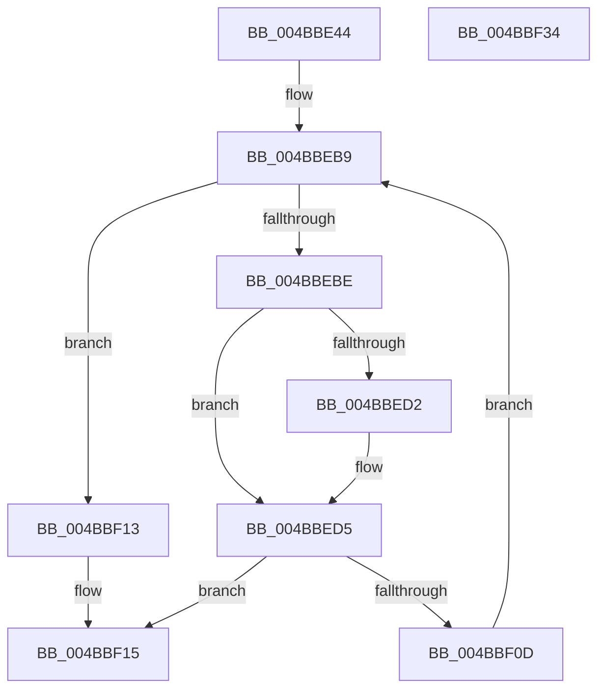

# ST_STORE&lt;SM_TRAITS&gt;::StDmDeviceIoTransfer

- RVA: `0x004BBE44`–`0x004BBF35` (길이 `241` bytes)
- VA: `0x00000001404BBE44`
- 실행 섹션: `.text`
- PDB 이름 있음: `예`; PDB Function 태그: `아니요`
- unwind 정보 RVA: `0x0008A668`
- 디코드: `72`개 명령, `241/241` bytes 표시
- 미해석 바이트: `0` (있으면 어셈블리에 `.byte`로 보존)

> 이 문서는 커널 이미지의 기계어와 PDB 기호를 분석해 생성했습니다. 4번과 5번은 함수 원형과 자료형을 바이너리 사용 방식에서 추정한 C 해석이며 원본 소스 복구 결과는 아닙니다.

## 1. Dependencies

- 직접 호출 지점: **1**; 고유 호출 대상: **1**
- 직접 호출자로 확인된 함수: **1**
- RIP 상대 이미지 참조: **0**

### Outgoing calls
- `0x004BBF04` → [ST_STORE<SM_TRAITS>::StDmSinglePageTransfer](../31/ST_STORE_SM_TRAITS_StDmSinglePageTransfer_function_00317E50.md) (function, `0x00317E50`)

### Direct callers
- [ST_STORE&lt;SM_TRAITS&gt;::StDmDeviceIoCompletion](ST_STORE_SM_TRAITS_StDmDeviceIoCompletion_function_004BBB70.md) at `0x004BBD90`

### Static image references
- 디코드된 RIP-relative 메모리 참조가 없습니다.

## 2. Other-region calls and transfers

- 다른 실행 섹션으로 향하는 call: **0**
- 별도 외부 분기/꼬리 이동을 확인하지 못했습니다.

## 3. Assembly (complete function range)

```asm
004BBE44  48 8B C4                        mov rax, rsp
004BBE47  48 89 58 08                     mov qword ptr [rax + 8], rbx
004BBE4B  48 89 68 10                     mov qword ptr [rax + 0x10], rbp
004BBE4F  48 89 70 18                     mov qword ptr [rax + 0x18], rsi
004BBE53  48 89 78 20                     mov qword ptr [rax + 0x20], rdi
004BBE57  41 54                           push r12
004BBE59  41 56                           push r14
004BBE5B  41 57                           push r15
004BBE5D  48 83 EC 40                     sub rsp, 0x40
004BBE61  44 8B 99 18 03 00 00            mov r11d, dword ptr [rcx + 0x318]
004BBE68  48 8B E9                        mov rbp, rcx
004BBE6B  4D 8B 50 08                     mov r10, qword ptr [r8 + 8]
004BBE6F  49 8B F0                        mov rsi, r8
004BBE72  45 8B 60 14                     mov r12d, dword ptr [r8 + 0x14]
004BBE76  48 8B FA                        mov rdi, rdx
004BBE79  41 8B 02                        mov eax, dword ptr [r10]
004BBE7C  49 8D 5A 10                     lea rbx, [r10 + 0x10]
004BBE80  4D 8D 72 0F                     lea r14, [r10 + 0xf]
004BBE84  4C 8D 0C 40                     lea r9, [rax + rax*2]
004BBE88  4B 8D 04 CB                     lea rax, [r11 + r9*8]
004BBE8C  4C 03 F0                        add r14, rax
004BBE8F  4E 8D 3C CB                     lea r15, [rbx + r9*8]
004BBE93  41 8B C3                        mov eax, r11d
004BBE96  41 F7 DB                        neg r11d
004BBE99  48 F7 D8                        neg rax
004BBE9C  4C 23 F0                        and r14, rax
004BBE9F  8B 81 28 03 00 00               mov eax, dword ptr [rcx + 0x328]
004BBEA5  23 03                           and eax, dword ptr [rbx]
004BBEA7  C1 E0 04                        shl eax, 4
004BBEAA  8B C8                           mov ecx, eax
004BBEAC  41 23 C3                        and eax, r11d
004BBEAF  48 2B C8                        sub rcx, rax
004BBEB2  4C 03 F1                        add r14, rcx
004BBEB5  41 83 E4 10                     and r12d, 0x10
004BBEB9  49 3B DF                        cmp rbx, r15
004BBEBC  73 55                           jae 0x1404bbf13
004BBEBE  8B 13                           mov edx, dword ptr [rbx]
004BBEC0  48 8D 4F 10                     lea rcx, [rdi + 0x10]
004BBEC4  2B 56 10                        sub edx, dword ptr [rsi + 0x10]
004BBEC7  C1 E2 04                        shl edx, 4
004BBECA  49 03 D6                        add rdx, r14
004BBECD  48 85 FF                        test rdi, rdi
004BBED0  75 03                           jne 0x1404bbed5
004BBED2  48 8B CE                        mov rcx, rsi
004BBED5  41 8B C4                        mov eax, r12d
004BBED8  4C 8B CF                        mov r9, rdi
004BBEDB  F7 D8                           neg eax
004BBEDD  48 8B 01                        mov rax, qword ptr [rcx]
004BBEE0  48 8B CD                        mov rcx, rbp
004BBEE3  4D 1B C0                        sbb r8, r8
004BBEE6  48 83 64 24 30 00               and qword ptr [rsp + 0x30], 0
004BBEEC  41 83 E0 02                     and r8d, 2
004BBEF0  48 89 5C 24 28                  mov qword ptr [rsp + 0x28], rbx
004BBEF5  4C 0B C2                        or r8, rdx
004BBEF8  48 89 44 24 20                  mov qword ptr [rsp + 0x20], rax
004BBEFD  48 8B 95 80 03 00 00            mov rdx, qword ptr [rbp + 0x380]
004BBF04  E8 47 BF E5 FF                  call 0x140317e50
004BBF09  85 C0                           test eax, eax
004BBF0B  78 08                           js 0x1404bbf15
004BBF0D  48 83 C3 18                     add rbx, 0x18
004BBF11  EB A6                           jmp 0x1404bbeb9
004BBF13  33 C0                           xor eax, eax
004BBF15  48 8B 5C 24 60                  mov rbx, qword ptr [rsp + 0x60]
004BBF1A  48 8B 6C 24 68                  mov rbp, qword ptr [rsp + 0x68]
004BBF1F  48 8B 74 24 70                  mov rsi, qword ptr [rsp + 0x70]
004BBF24  48 8B 7C 24 78                  mov rdi, qword ptr [rsp + 0x78]
004BBF29  48 83 C4 40                     add rsp, 0x40
004BBF2D  41 5F                           pop r15
004BBF2F  41 5E                           pop r14
004BBF31  41 5C                           pop r12
004BBF33  C3                              ret
004BBF34  CC                              int3
```

## 4. C-style interpretation (structured pseudocode)

```c
__int64 __fastcall ST_STORE_SM_TRAITS___StDmDeviceIoTransfer(__int64 a1, __int64 a2, __int64 a3)
{
    __int64 result;
    __int64 v_r11;
    __int64 v_r12;
    __int64 v_r14;
    __int64 v_rbx;
    __int64 v_rsp;
    unsigned __int64 v_stack_m28;
    unsigned __int64 v_stack_m30;
    unsigned __int64 v_stack_m38;
    unsigned __int64 v_stack_p10;
    unsigned __int64 v_stack_p18;
    unsigned __int64 v_stack_p20;
    unsigned __int64 v_stack_p8;

    *(unsigned __int64 *)(v_rsp + 8) = v_rbx;
    *(unsigned __int64 *)(v_rsp + 16) = v_rbp;
    *(unsigned __int64 *)(v_rsp + 24) = v_rsi;
    *(unsigned __int64 *)(v_rsp + 32) = v_rdi;
    v_rsp = (v_rsp) - (64);
    v_r14 = (*(unsigned __int64 *)(a3 + 8) + 15) + ((unsigned int)(*(unsigned int *)(a1 + 792)) + (unsigned int)(*(unsigned int *)(*(unsigned __int64 *)(a3 + 8))) + (unsigned int)(*(unsigned int *)(*(unsigned __int64 *)(a3 + 8))) * 2 * 8);
    v_r11 = (unsigned int)(-((unsigned int)(*(unsigned int *)(a1 + 792))));
    result = -((unsigned int)((unsigned int)((unsigned int)(*(unsigned int *)(a1 + 792)))));
    v_r14 = (v_r14) & (result);
    result = (unsigned int)(((unsigned int)(*(unsigned int *)(a1 + 808))) & (*(unsigned int *)(*(unsigned __int64 *)(a3 + 8) + 16)));
    result = (unsigned int)((result) << (4));
    result = (unsigned int)((result) & ((unsigned int)(v_r11)));
    a1 = ((unsigned int)((unsigned int)(result))) - (result);
    v_r14 = (v_r14) + (a1);
    v_r12 = (unsigned int)(((unsigned int)(*(unsigned int *)(a3 + 20))) & (16));
loc_004BBEB9:
    if ((*(unsigned __int64 *)(a3 + 8) + 16) >= (*(unsigned __int64 *)(a3 + 8) + 16 + (unsigned int)(*(unsigned int *)(*(unsigned __int64 *)(a3 + 8))) + (unsigned int)(*(unsigned int *)(*(unsigned __int64 *)(a3 + 8))) * 2 * 8)) goto loc_004BBF13;
    a2 = (unsigned int)(((unsigned int)(*(unsigned int *)(*(unsigned __int64 *)(a3 + 8) + 16))) - (*(unsigned int *)(a3 + 16)));
    a2 = (unsigned int)((a2) << (4));
    a2 = (a2) + (v_r14);
    if (a2 == 0) {
        a1 = a3;
    }
    result = (unsigned int)(-((unsigned int)((unsigned int)(v_r12))));
    a3 = (unsigned int)((a3) & (2));
    v_stack_m30 = *(unsigned __int64 *)(a3 + 8) + 16;
    a3 = (a3) | (a2);
    v_stack_m38 = *(unsigned __int64 *)(a1);
    result = ST_STORE_SM_TRAITS___StDmSinglePageTransfer(a1, *(unsigned __int64 *)(a1 + 896), a3, a2);
    if (sign_flag) goto loc_004BBF15;
    v_rbx = (*(unsigned __int64 *)(a3 + 8) + 16) + (24);
    goto loc_004BBEB9;
loc_004BBF13:
    result = 0;
loc_004BBF15:
    v_rsp = (v_rsp) + (64);
    return result;
}
```

## 5. (Beta) C Style

```c
int64_t ST_STORE_SM_TRAITS___StDmDeviceIoTransfer(void *Arg1, int64_t Arg2, void *Arg3)
{
    uint8_t *arg1 = (uint8_t *)Arg1;
    uint8_t *arg3 = (uint8_t *)Arg3;

    int64_t result;
    int64_t local_r11;
    int64_t local_r12;
    int64_t local_r14;
    int64_t local_rbx;
    int64_t local_rsp;
    uint64_t v_stack_m28;
    uint64_t v_stack_m30;
    uint64_t v_stack_m38;
    uint64_t v_stack_p10;
    uint64_t v_stack_p18;
    uint64_t v_stack_p20;
    uint64_t v_stack_p8;

    *(uint64_t *)(local_rsp + 0x8) = local_rbx;
    *(uint64_t *)(local_rsp + 0x10) = local_rbp;
    *(uint64_t *)(local_rsp + 0x18) = local_rsi;
    *(uint64_t *)(local_rsp + 0x20) = local_rdi;
    local_rsp = (local_rsp) - (64);
    local_r14 = (*(uint64_t *)(arg3 + 0x8) + 15) + ((uint32_t)(*(uint32_t *)(arg1 + 0x318)) + (uint32_t)(*(uint32_t *)(*(uint64_t *)(arg3 + 0x8))) + (uint32_t)(*(uint32_t *)(*(uint64_t *)(arg3 + 0x8))) * 2 * 8);
    local_r11 = (uint32_t)(-((uint32_t)(*(uint32_t *)(arg1 + 0x318))));
    result = -((uint32_t)((uint32_t)((uint32_t)(*(uint32_t *)(arg1 + 0x318)))));
    local_r14 = (local_r14) & (result);
    result = (uint32_t)(((uint32_t)(*(uint32_t *)(arg1 + 0x328))) & (*(uint32_t *)(*(uint64_t *)(arg3 + 0x8) + 0x10)));
    result = (uint32_t)((result) << (4));
    result = (uint32_t)((result) & ((uint32_t)(local_r11)));
    Arg1 = ((uint32_t)((uint32_t)(result))) - (result);
    local_r14 = (local_r14) + (Arg1);
    local_r12 = (uint32_t)(((uint32_t)(*(uint32_t *)(arg3 + 0x14))) & (16));
loc_004BBEB9:
    if ((*(uint64_t *)(arg3 + 0x8) + 16) >= (*(uint64_t *)(arg3 + 0x8) + 16 + (uint32_t)(*(uint32_t *)(*(uint64_t *)(arg3 + 0x8))) + (uint32_t)(*(uint32_t *)(*(uint64_t *)(arg3 + 0x8))) * 2 * 8)) goto loc_004BBF13;
    Arg2 = (uint32_t)(((uint32_t)(*(uint32_t *)(*(uint64_t *)(arg3 + 0x8) + 0x10))) - (*(uint32_t *)(arg3 + 0x10)));
    Arg2 = (uint32_t)((Arg2) << (4));
    Arg2 = (Arg2) + (local_r14);
    if (Arg2 == 0) {
        Arg1 = Arg3;
    }
    result = (uint32_t)(-((uint32_t)((uint32_t)(local_r12))));
    Arg3 = (uint32_t)((Arg3) & (2));
    v_stack_m30 = *(uint64_t *)(arg3 + 0x8) + 16;
    Arg3 = (Arg3) | (Arg2);
    v_stack_m38 = *(uint64_t *)(arg1);
    result = ST_STORE_SM_TRAITS___StDmSinglePageTransfer(Arg1, *(uint64_t *)(arg1 + 0x380), Arg3, Arg2);
    if (sign_flag) goto loc_004BBF15;
    local_rbx = (*(uint64_t *)(arg3 + 0x8) + 16) + (24);
    goto loc_004BBEB9;
loc_004BBF13:
    result = 0;
loc_004BBF15:
    local_rsp = (local_rsp) + (64);
    return result;
}
```

### 관측된 메모리 오프셋

구조체 형식이 확인되지 않은 접근은 인자 기준의 오프셋으로만 기록했습니다.

| 기준 인자 | 오프셋 표현 | 폭 (bit) | 접근 |
|---|---:|---:|---|
| `Arg1` | `+ 0x318` | `32` | `R` |
| `Arg1` | `+ 0x328` | `32` | `R` |
| `Arg1` | `+ 0x380` | `64` | `R` |
| `Arg3` | `+ 0x8` | `64` | `R` |
| `Arg3` | `+ 0x10` | `32` | `R` |
| `Arg3` | `+ 0x14` | `32` | `R` |

## 6. Execution-region graph

[열기: 2D/3D 그래프와 함수 탐색 컨트롤 패널](../../../control-panel.html?section=text&rva=0x004BBE44&view=graph)

- 2D 그래프는 위에서 아래로 흐르고, 3D 그래프는 빈 공간을 드래그해 회전합니다. Shift+드래그는 이동, 휠은 확대·축소, 함수 노드 선택은 대상 보고서 이동입니다.

### Static fallback


