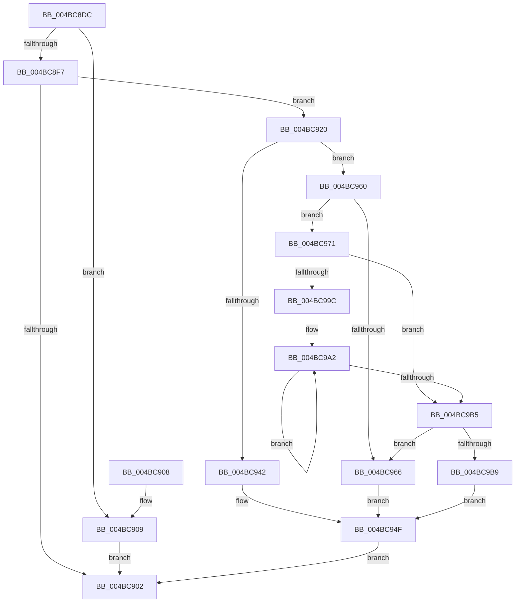

# ST_STORE&lt;SM_TRAITS&gt;::StDmUpdateRegionLazyCleanup

- RVA: `0x004BC8DC`–`0x004BC9BB` (길이 `223` bytes)
- VA: `0x00000001404BC8DC`
- 실행 섹션: `.text`
- PDB 이름 있음: `예`; PDB Function 태그: `아니요`
- unwind 정보 RVA: `0x000BBB24`
- 디코드: `70`개 명령, `223/223` bytes 표시
- 미해석 바이트: `0` (있으면 어셈블리에 `.byte`로 보존)

> 이 문서는 커널 이미지의 기계어와 PDB 기호를 분석해 생성했습니다. 4번과 5번은 함수 원형과 자료형을 바이너리 사용 방식에서 추정한 C 해석이며 원본 소스 복구 결과는 아닙니다.

## 1. Dependencies

- 직접 호출 지점: **1**; 고유 호출 대상: **1**
- 직접 호출자로 확인된 함수: **3**
- RIP 상대 이미지 참조: **0**

### Outgoing calls
- `0x004BC959` → [ST_STORE<SM_TRAITS>::StDmLazyWorkItemQueue](../3C/ST_STORE_SM_TRAITS_StDmLazyWorkItemQueue_function_003C2080.md) (function, `0x003C2080`)

### Direct callers
- [ST_STORE&lt;SM_TRAITS&gt;::StReleaseRegion](../3A/ST_STORE_SM_TRAITS_StReleaseRegion_function_003AF138.md) at `0x003AF27A`
- [ST_STORE&lt;SM_TRAITS&gt;::StMapAndLockRegion](../4E/ST_STORE_SM_TRAITS_StMapAndLockRegion_function_004EC090.md) at `0x004EC230`
- [sub_006F84D2](../6F/Unknown_function_006F84D2.md) at `0x006F84E7`
- [sub_006F84D2](../6F/Unknown_function_006F84D2.md) at `0x006F85A8`

### Static image references
- 디코드된 RIP-relative 메모리 참조가 없습니다.

## 2. Other-region calls and transfers

- 다른 실행 섹션으로 향하는 call: **0**
- 별도 외부 분기/꼬리 이동을 확인하지 못했습니다.

## 3. Assembly (complete function range)

```asm
004BC8DC  40 53                           push rbx
004BC8DE  48 83 EC 20                     sub rsp, 0x20
004BC8E2  44 8B DA                        mov r11d, edx
004BC8E5  48 8B D9                        mov rbx, rcx
004BC8E8  44 8B CA                        mov r9d, edx
004BC8EB  48 8B 91 50 03 00 00            mov rdx, qword ptr [rcx + 0x350]
004BC8F2  45 85 C0                        test r8d, r8d
004BC8F5  74 12                           je 0x1404bc909
004BC8F7  4C 0F A3 0A                     bt qword ptr [rdx], r9
004BC8FB  0F 92 C0                        setb al
004BC8FE  84 C0                           test al, al
004BC900  75 1E                           jne 0x1404bc920
004BC902  48 83 C4 20                     add rsp, 0x20
004BC906  5B                              pop rbx
004BC907  C3                              ret
004BC908  CC                              int3
004BC909  49 C1 E9 03                     shr r9, 3
004BC90D  41 83 E3 07                     and r11d, 7
004BC911  41 0F BE 04 11                  movsx eax, byte ptr [r9 + rdx]
004BC916  44 0F AB D8                     bts eax, r11d
004BC91A  41 88 04 11                     mov byte ptr [r9 + rdx], al
004BC91E  EB E2                           jmp 0x1404bc902
004BC920  49 8B C1                        mov rax, r9
004BC923  41 BA 01 00 00 00               mov r10d, 1
004BC929  48 C1 E8 05                     shr rax, 5
004BC92D  41 83 E1 1F                     and r9d, 0x1f
004BC931  41 8B CA                        mov ecx, r10d
004BC934  4C 8D 04 82                     lea r8, [rdx + rax*4]
004BC938  49 8D 41 01                     lea rax, [r9 + 1]
004BC93C  48 83 F8 20                     cmp rax, 0x20
004BC940  77 1E                           ja 0x1404bc960
004BC942  41 8B C9                        mov ecx, r9d
004BC945  41 D3 E2                        shl r10d, cl
004BC948  41 F7 D2                        not r10d
004BC94B  F0 45 21 10                     lock and dword ptr [r8], r10d
004BC94F  48 8D 93 60 03 00 00            lea rdx, [rbx + 0x360]
004BC956  48 8B CB                        mov rcx, rbx
004BC959  E8 22 57 F0 FF                  call 0x1403c2080
004BC95E  EB A2                           jmp 0x1404bc902
004BC960  41 83 E3 1F                     and r11d, 0x1f
004BC964  75 0B                           jne 0x1404bc971
004BC966  83 C8 FF                        or eax, 0xffffffff
004BC969  D3 E0                           shl eax, cl
004BC96B  F0 41 21 00                     lock and dword ptr [r8], eax
004BC96F  EB DE                           jmp 0x1404bc94f
004BC971  BA 20 00 00 00                  mov edx, 0x20
004BC976  41 8B C2                        mov eax, r10d
004BC979  41 2B D3                        sub edx, r11d
004BC97C  8B CA                           mov ecx, edx
004BC97E  D3 E0                           shl eax, cl
004BC980  49 8B C9                        mov rcx, r9
004BC983  41 2B C2                        sub eax, r10d
004BC986  D3 E0                           shl eax, cl
004BC988  F7 D0                           not eax
004BC98A  F0 41 21 00                     lock and dword ptr [r8], eax
004BC98E  41 8B CA                        mov ecx, r10d
004BC991  49 83 C0 04                     add r8, 4
004BC995  2B CA                           sub ecx, edx
004BC997  83 F9 20                        cmp ecx, 0x20
004BC99A  72 19                           jb 0x1404bc9b5
004BC99C  8B C1                           mov eax, ecx
004BC99E  48 C1 E8 05                     shr rax, 5
004BC9A2  41 C7 00 00 00 00 00            mov dword ptr [r8], 0
004BC9A9  83 C1 E0                        add ecx, -0x20
004BC9AC  49 83 C0 04                     add r8, 4
004BC9B0  49 2B C2                        sub rax, r10
004BC9B3  75 ED                           jne 0x1404bc9a2
004BC9B5  85 C9                           test ecx, ecx
004BC9B7  75 AD                           jne 0x1404bc966
004BC9B9  EB 94                           jmp 0x1404bc94f
```

## 4. C-style interpretation (structured pseudocode)

```c
__int64 __fastcall ST_STORE_SM_TRAITS___StDmUpdateRegionLazyCleanup(__int64 a1, int a2, int a3)
{
    __int64 result;
    __int64 v_r10;
    __int64 v_r11;
    __int64 v_rsp;

    v_rsp = (v_rsp) - (32);
    if (a3 == 0) goto loc_004BC909;
    result = (condition_is_below) ? 1 : 0;
    if ((unsigned __int8)(result) != 0) goto loc_004BC920;
loc_004BC902:
    v_rsp = (v_rsp) + (32);
    return result;
loc_004BC909:
    a4 = ((unsigned int)(a2)) >> (3);
    v_r11 = (unsigned int)(((unsigned int)(a2)) & (7));
    *(unsigned __int8 *)(a4 + *(unsigned __int64 *)(a1 + 848) * 1) = (unsigned __int8)((__int8)(*(unsigned __int8 *)(a4 + *(unsigned __int64 *)(a1 + 848) * 1)));
    goto loc_004BC902;
loc_004BC920:
    result = (a4) >> (5);
    a4 = (unsigned int)((a4) & (31));
    if ((a4 + 1) > 32) goto loc_004BC960;
    v_r10 = (unsigned int)((1) << ((unsigned __int8)((unsigned int)((unsigned int)(a4)))));
    v_r10 = (unsigned int)(~(v_r10));
loc_004BC94F:
    result = ST_STORE_SM_TRAITS___StDmLazyWorkItemQueue(a1, a1 + 864, *(unsigned __int64 *)(a1 + 848) + result * 4, a4);
    goto loc_004BC902;
loc_004BC960:
    v_r11 = (unsigned int)((v_r11) & (31));
    if (condition_is_not_equal) goto loc_004BC971;
loc_004BC966:
    result = (unsigned int)((result) | (0xFFFFFFFFULL));
    result = (unsigned int)((result) << ((unsigned __int8)(a1)));
    goto loc_004BC94F;
loc_004BC971:
    a2 = (unsigned int)((32) - ((unsigned int)(v_r11)));
    result = (unsigned int)(((unsigned int)((unsigned int)(v_r10))) << ((unsigned __int8)((unsigned int)(a2))));
    result = (unsigned int)((result) - ((unsigned int)(v_r10)));
    result = (unsigned int)((result) << ((unsigned __int8)(a4)));
    result = (unsigned int)(~(result));
    a3 = (*(unsigned __int64 *)(a1 + 848) + result * 4) + (4);
    a1 = (unsigned int)(((unsigned int)((unsigned int)(v_r10))) - (a2));
    if (((unsigned int)(a1)) < 32) goto loc_004BC9B5;
    result = ((unsigned int)((unsigned int)(a1))) >> (5);
loc_004BC9A2:
    *(unsigned int *)(a3) = 0;
    a1 = (unsigned int)((a1) + (-32));
    a3 = (a3) + (4);
    result = (result) - (v_r10);
    if (condition_is_not_equal) goto loc_004BC9A2;
loc_004BC9B5:
    if ((unsigned int)(a1) != 0) goto loc_004BC966;
    goto loc_004BC94F;
}
```

## 5. (Beta) C Style

```c
int64_t ST_STORE_SM_TRAITS___StDmUpdateRegionLazyCleanup(void *Arg1, void *Arg2, int32_t Arg3)
{
    uint8_t *arg1 = (uint8_t *)Arg1;
    uint8_t *arg2 = (uint8_t *)Arg2;

    int64_t result;
    int64_t local_r10;
    int64_t local_r11;
    int64_t local_rsp;

    local_rsp = (local_rsp) - (32);
    if (Arg3 == 0) goto loc_004BC909;
    result = (condition_is_below) ? 1 : 0;
    if ((uint8_t)(result) != 0) goto loc_004BC920;
loc_004BC902:
    local_rsp = (local_rsp) + (32);
    return result;
loc_004BC909:
    a4 = ((uint32_t)(Arg2)) >> (3);
    local_r11 = (uint32_t)(((uint32_t)(Arg2)) & (7));
    *(uint8_t *)(a4 + *(uint64_t *)(arg1 + 0x350) * 1) = (uint8_t)((int8_t)(*(uint8_t *)(a4 + *(uint64_t *)(arg1 + 0x350) * 1)));
    goto loc_004BC902;
loc_004BC920:
    result = (a4) >> (5);
    a4 = (uint32_t)((a4) & (31));
    if ((a4 + 1) > 32) goto loc_004BC960;
    local_r10 = (uint32_t)((1) << ((uint8_t)((uint32_t)((uint32_t)(a4)))));
    local_r10 = (uint32_t)(~(local_r10));
loc_004BC94F:
    result = ST_STORE_SM_TRAITS___StDmLazyWorkItemQueue(Arg1, Arg1 + 864, *(uint64_t *)(arg1 + 0x350) + result * 4, a4);
    goto loc_004BC902;
loc_004BC960:
    local_r11 = (uint32_t)((local_r11) & (31));
    if (condition_is_not_equal) goto loc_004BC971;
loc_004BC966:
    result = (uint32_t)((result) | (0xFFFFFFFFULL));
    result = (uint32_t)((result) << ((uint8_t)(Arg1)));
    goto loc_004BC94F;
loc_004BC971:
    Arg2 = (uint32_t)((32) - ((uint32_t)(local_r11)));
    result = (uint32_t)(((uint32_t)((uint32_t)(local_r10))) << ((uint8_t)((uint32_t)(Arg2))));
    result = (uint32_t)((result) - ((uint32_t)(local_r10)));
    result = (uint32_t)((result) << ((uint8_t)(a4)));
    result = (uint32_t)(~(result));
    Arg3 = (*(uint64_t *)(arg1 + 0x350) + result * 4) + (4);
    Arg1 = (uint32_t)(((uint32_t)((uint32_t)(local_r10))) - (Arg2));
    if (((uint32_t)(Arg1)) < 32) goto loc_004BC9B5;
    result = ((uint32_t)((uint32_t)(Arg1))) >> (5);
loc_004BC9A2:
    *(uint32_t *)(Arg3) = 0;
    Arg1 = (uint32_t)((Arg1) + (-32));
    Arg3 = (Arg3) + (4);
    result = (result) - (local_r10);
    if (condition_is_not_equal) goto loc_004BC9A2;
loc_004BC9B5:
    if ((uint32_t)(Arg1) != 0) goto loc_004BC966;
    goto loc_004BC94F;
}
```

### 관측된 메모리 오프셋

구조체 형식이 확인되지 않은 접근은 인자 기준의 오프셋으로만 기록했습니다.

| 기준 인자 | 오프셋 표현 | 폭 (bit) | 접근 |
|---|---:|---:|---|
| `Arg1` | `+ 0x350` | `64` | `R` |
| `Arg1` | `+ 0x360` | `64` | `R` |
| `Arg2` | `+ 0x1` | `64` | `R` |

## 6. Execution-region graph

[열기: 2D/3D 그래프와 함수 탐색 컨트롤 패널](../../../control-panel.html?section=text&rva=0x004BC8DC&view=graph)

- 2D 그래프는 위에서 아래로 흐르고, 3D 그래프는 빈 공간을 드래그해 회전합니다. Shift+드래그는 이동, 휠은 확대·축소, 함수 노드 선택은 대상 보고서 이동입니다.

### Static fallback


