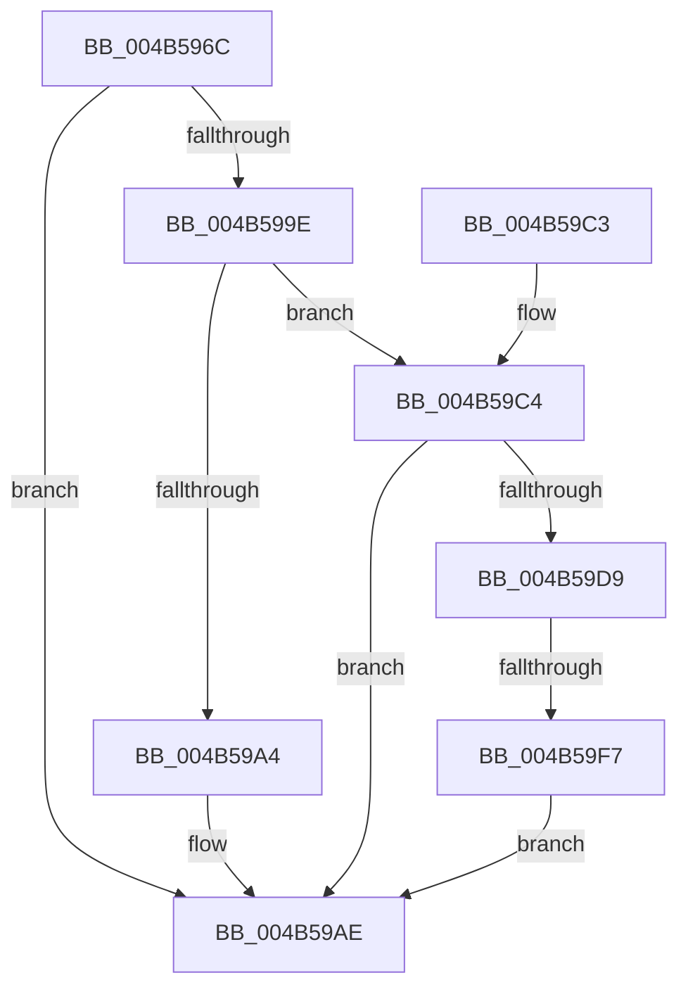

# SepCheckAndCopySelfRelativeSD

- RVA: `0x004B596C`–`0x004B59FE` (길이 `146` bytes)
- VA: `0x00000001404B596C`
- 실행 섹션: `.text`
- PDB 이름 있음: `예`; PDB Function 태그: `예`
- unwind 정보 RVA: `0x000BA32C`
- 디코드: `46`개 명령, `146/146` bytes 표시
- 미해석 바이트: `0` (있으면 어셈블리에 `.byte`로 보존)

> 이 문서는 커널 이미지의 기계어와 PDB 기호를 분석해 생성했습니다. 4번과 5번은 함수 원형과 자료형을 바이너리 사용 방식에서 추정한 C 해석이며 원본 소스 복구 결과는 아닙니다.

## 1. Dependencies

- 직접 호출 지점: **3**; 고유 호출 대상: **3**
- 직접 호출자로 확인된 함수: **3**
- RIP 상대 이미지 참조: **0**

### Outgoing calls
- `0x004B59A4` → [SepSecurityDescriptorStrictLength](../../page/91/SepSecurityDescriptorStrictLength_function_0091E6E0.md) (function, `0x0091E6E0`)
- `0x004B59CB` → [RtlAbsoluteToSelfRelativeSD](../../page/A1/RtlAbsoluteToSelfRelativeSD_function_00A119B0.md) (function, `0x00A119B0`)
- `0x004B59E6` → [ExAllocatePool2](../../poolcode/B8/ExAllocatePool2_function_00B820F0.md) (function, `0x00B820F0`)

### Direct callers
- [SeOperationAuditAlarm](../../page/91/SeOperationAuditAlarm_function_0091EA78.md) at `0x0091EE8F`
- [sub_00B21BFA](../../page/B2/Unknown_function_00B21BFA.md) at `0x00B21C35`
- [sub_00B21BFA](../../page/B2/Unknown_function_00B21BFA.md) at `0x00B21C57`
- [sub_00B21BFA](../../page/B2/Unknown_function_00B21BFA.md) at `0x00B21E3A`
- [sub_00B21E9E](../../page/B2/Unknown_function_00B21E9E.md) at `0x00B22065`
- [sub_00B21E9E](../../page/B2/Unknown_function_00B21E9E.md) at `0x00B22088`

### Static image references
- 디코드된 RIP-relative 메모리 참조가 없습니다.

## 2. Other-region calls and transfers

- 다른 실행 섹션으로 향하는 call: **3**
  - `0x004B59A4` → [SepSecurityDescriptorStrictLength](../../page/91/SepSecurityDescriptorStrictLength_function_0091E6E0.md) (`.text` → `PAGE`)
  - `0x004B59CB` → [RtlAbsoluteToSelfRelativeSD](../../page/A1/RtlAbsoluteToSelfRelativeSD_function_00A119B0.md) (`.text` → `PAGE`)
  - `0x004B59E6` → [ExAllocatePool2](../../poolcode/B8/ExAllocatePool2_function_00B820F0.md) (`.text` → `POOLCODE`)
- call이 아닌 외부 분기/꼬리 이동: **1**
  - `0x004B59F1` → [sub_006FBBCC](../6F/Unknown_function_006FBBCC.md) (`tail-transfer`)

## 3. Assembly (complete function range)

```asm
004B596C  48 89 5C 24 10                  mov qword ptr [rsp + 0x10], rbx
004B5971  48 89 6C 24 18                  mov qword ptr [rsp + 0x18], rbp
004B5976  48 89 4C 24 08                  mov qword ptr [rsp + 8], rcx
004B597B  56                              push rsi
004B597C  57                              push rdi
004B597D  41 56                           push r14
004B597F  48 83 EC 20                     sub rsp, 0x20
004B5983  33 ED                           xor ebp, ebp
004B5985  4D 8B F1                        mov r14, r9
004B5988  48 89 2A                        mov qword ptr [rdx], rbp
004B598B  49 8B F0                        mov rsi, r8
004B598E  41 89 28                        mov dword ptr [r8], ebp
004B5991  48 8B FA                        mov rdi, rdx
004B5994  41 88 29                        mov byte ptr [r9], bpl
004B5997  8B DD                           mov ebx, ebp
004B5999  48 85 C9                        test rcx, rcx
004B599C  74 10                           je 0x1404b59ae
004B599E  66 39 69 02                     cmp word ptr [rcx + 2], bp
004B59A2  7D 20                           jge 0x1404b59c4
004B59A4  E8 37 8D 46 00                  call 0x14091e6e0
004B59A9  89 06                           mov dword ptr [rsi], eax
004B59AB  48 89 0F                        mov qword ptr [rdi], rcx
004B59AE  48 8B 6C 24 50                  mov rbp, qword ptr [rsp + 0x50]
004B59B3  8B C3                           mov eax, ebx
004B59B5  48 8B 5C 24 48                  mov rbx, qword ptr [rsp + 0x48]
004B59BA  48 83 C4 20                     add rsp, 0x20
004B59BE  41 5E                           pop r14
004B59C0  5F                              pop rdi
004B59C1  5E                              pop rsi
004B59C2  C3                              ret
004B59C3  CC                              int3
004B59C4  33 D2                           xor edx, edx
004B59C6  48 8D 4C 24 40                  lea rcx, [rsp + 0x40]
004B59CB  E8 E0 BF 55 00                  call 0x140a119b0
004B59D0  8B D8                           mov ebx, eax
004B59D2  3D 23 00 00 C0                  cmp eax, 0xc0000023
004B59D7  75 D5                           jne 0x1404b59ae
004B59D9  8B 16                           mov edx, dword ptr [rsi]
004B59DB  B9 00 01 00 00                  mov ecx, 0x100
004B59E0  41 B8 53 65 41 70               mov r8d, 0x70416553
004B59E6  E8 05 C7 6C 00                  call 0x140b820f0
004B59EB  48 89 07                        mov qword ptr [rdi], rax
004B59EE  48 85 C0                        test rax, rax
004B59F1  0F 85 D5 61 24 00               jne 0x1406fbbcc
004B59F7  BB 9A 00 00 C0                  mov ebx, 0xc000009a
004B59FC  EB B0                           jmp 0x1404b59ae
```

## 4. C-style interpretation (structured pseudocode)

```c
__int64 __fastcall SepCheckAndCopySelfRelativeSD(__int64 a1, __int64 a2, __int64 a3, __int64 a4)
{
    __int64 result;
    __int64 v_rbp;
    __int64 v_rsp;
    unsigned __int64 v_stack_p10;
    unsigned __int64 v_stack_p18;
    unsigned __int64 v_stack_p40;
    unsigned __int64 v_stack_p8;

    v_stack_p10 = v_rbx;
    v_stack_p18 = v_rbp;
    v_stack_p8 = a1;
    v_rsp = (v_rsp) - (32);
    v_rbp = 0;
    *(unsigned __int64 *)(a2) = 0;
    *(unsigned int *)(a3) = 0;
    *(unsigned __int8 *)(a4) = 0;
    if (a1 == 0) goto loc_004B59AE;
    if ((*(unsigned __int16 *)(a1 + 2)) >= 0) goto loc_004B59C4;
    result = SepSecurityDescriptorStrictLength(a1, a2, a3, a4);
    *(unsigned int *)(a3) = (unsigned int)(result);
    *(unsigned __int64 *)(a2) = a1;
loc_004B59AE:
    v_rsp = (v_rsp) + (32);
    return 0;
loc_004B59C4:
    a2 = 0;
    result = RtlAbsoluteToSelfRelativeSD(v_stack_p40, a2, a3, a4);
    if (((unsigned int)(result)) != 0xC0000023ULL) goto loc_004B59AE;
    result = ExAllocatePool2(256, (unsigned int)(*(unsigned int *)(a3)), (unsigned int)(0x70416553ULL), a4);
    *(unsigned __int64 *)(a2) = result;
    goto loc_004B59AE;
}
```

## 5. (Beta) C Style

```c
int64_t SepCheckAndCopySelfRelativeSD(int64_t Arg1, void *Arg2, void *Arg3, void *Arg4)
{
    uint8_t *arg2 = (uint8_t *)Arg2;
    uint8_t *arg3 = (uint8_t *)Arg3;
    uint8_t *arg4 = (uint8_t *)Arg4;

    int64_t result;
    int64_t local_rbp;
    int64_t local_rsp;
    uint64_t v_stack_p10;
    uint64_t v_stack_p18;
    uint64_t v_stack_p40;
    uint64_t v_stack_p8;

    v_stack_p10 = local_rbx;
    v_stack_p18 = local_rbp;
    v_stack_p8 = Arg1;
    local_rsp = (local_rsp) - (32);
    local_rbp = 0;
    *(uint64_t *)(arg2) = 0;
    *(uint32_t *)(arg3) = 0;
    *(uint8_t *)(arg4) = 0;
    if (Arg1 == 0) goto loc_004B59AE;
    if ((*(uint16_t *)(Arg1 + 0x2)) >= 0) goto loc_004B59C4;
    result = SepSecurityDescriptorStrictLength(Arg1, Arg2, Arg3, Arg4);
    *(uint32_t *)(arg3) = (uint32_t)(result);
    *(uint64_t *)(arg2) = Arg1;
loc_004B59AE:
    local_rsp = (local_rsp) + (32);
    return 0;
loc_004B59C4:
    Arg2 = 0;
    result = RtlAbsoluteToSelfRelativeSD(v_stack_p40, Arg2, Arg3, Arg4);
    if (((uint32_t)(result)) != 0xC0000023ULL) goto loc_004B59AE;
    result = ExAllocatePool2(256, (uint32_t)(*(uint32_t *)(arg3)), (uint32_t)(0x70416553ULL), Arg4);
    *(uint64_t *)(arg2) = result;
    goto loc_004B59AE;
}
```

### 관측된 메모리 오프셋

구조체 형식이 확인되지 않은 접근은 인자 기준의 오프셋으로만 기록했습니다.

| 기준 인자 | 오프셋 표현 | 폭 (bit) | 접근 |
|---|---:|---:|---|
| `Arg2` | `+ 0x0` | `64` | `W` |
| `Arg3` | `+ 0x0` | `32` | `R` |
| `Arg3` | `+ 0x0` | `32` | `W` |
| `Arg4` | `+ 0x0` | `8` | `W` |

## 6. Execution-region graph

[열기: 2D/3D 그래프와 함수 탐색 컨트롤 패널](../../../control-panel.html?section=text&rva=0x004B596C&view=graph)

- 2D 그래프는 위에서 아래로 흐르고, 3D 그래프는 빈 공간을 드래그해 회전합니다. Shift+드래그는 이동, 휠은 확대·축소, 함수 노드 선택은 대상 보고서 이동입니다.

### Static fallback


