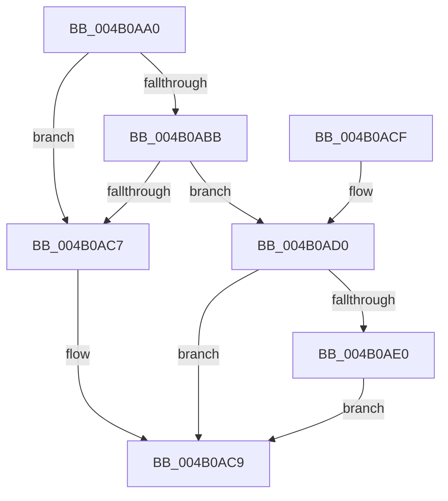

# SepConvertToOwnTokenClaims

- RVA: `0x004B0AA0`–`0x004B0AF8` (길이 `88` bytes)
- VA: `0x00000001404B0AA0`
- 실행 섹션: `.text`
- PDB 이름 있음: `예`; PDB Function 태그: `아니요`
- unwind 정보 RVA: `0x0007FC80`
- 디코드: `24`개 명령, `88/88` bytes 표시
- 미해석 바이트: `0` (있으면 어셈블리에 `.byte`로 보존)

> 이 문서는 커널 이미지의 기계어와 PDB 기호를 분석해 생성했습니다. 4번과 5번은 함수 원형과 자료형을 바이너리 사용 방식에서 추정한 C 해석이며 원본 소스 복구 결과는 아닙니다.

## 1. Dependencies

- 직접 호출 지점: **1**; 고유 호출 대상: **1**
- 직접 호출자로 확인된 함수: **2**
- RIP 상대 이미지 참조: **0**

### Outgoing calls
- `0x004B0AD5` → [SepDuplicateClaimAttributes](../../page/A7/SepDuplicateClaimAttributes_function_00A76334.md) (function, `0x00A76334`)

### Direct callers
- [SepSetUserClaimAttributesToken](../../page/7A/SepSetUserClaimAttributesToken_function_007A36C0.md) at `0x007A36D8`
- [SepStopReferencingLogonSession](../../page/A8/SepStopReferencingLogonSession_function_00A8E35C.md) at `0x00A8E369`

### Static image references
- 디코드된 RIP-relative 메모리 참조가 없습니다.

## 2. Other-region calls and transfers

- 다른 실행 섹션으로 향하는 call: **1**
  - `0x004B0AD5` → [SepDuplicateClaimAttributes](../../page/A7/SepDuplicateClaimAttributes_function_00A76334.md) (`.text` → `PAGE`)
- 별도 외부 분기/꼬리 이동을 확인하지 못했습니다.

## 3. Assembly (complete function range)

```asm
004B0AA0  40 53                           push rbx
004B0AA2  48 83 EC 20                     sub rsp, 0x20
004B0AA6  48 83 64 24 30 00               and qword ptr [rsp + 0x30], 0
004B0AAC  48 8B D9                        mov rbx, rcx
004B0AAF  F7 81 C8 00 00 00 00 80 00 00   test dword ptr [rcx + 0xc8], 0x8000
004B0AB9  75 0C                           jne 0x1404b0ac7
004B0ABB  48 8B 89 48 04 00 00            mov rcx, qword ptr [rcx + 0x448]
004B0AC2  48 85 C9                        test rcx, rcx
004B0AC5  75 09                           jne 0x1404b0ad0
004B0AC7  33 C0                           xor eax, eax
004B0AC9  48 83 C4 20                     add rsp, 0x20
004B0ACD  5B                              pop rbx
004B0ACE  C3                              ret
004B0ACF  CC                              int3
004B0AD0  48 8D 54 24 30                  lea rdx, [rsp + 0x30]
004B0AD5  E8 5A 58 5C 00                  call 0x140a76334
004B0ADA  8B C8                           mov ecx, eax
004B0ADC  85 C0                           test eax, eax
004B0ADE  78 E9                           js 0x1404b0ac9
004B0AE0  48 8B 44 24 30                  mov rax, qword ptr [rsp + 0x30]
004B0AE5  0F BA AB C8 00 00 00 0F         bts dword ptr [rbx + 0xc8], 0xf
004B0AED  48 89 83 48 04 00 00            mov qword ptr [rbx + 0x448], rax
004B0AF4  8B C1                           mov eax, ecx
004B0AF6  EB D1                           jmp 0x1404b0ac9
```

## 4. C-style interpretation (structured pseudocode)

```c
__int64 __fastcall SepConvertToOwnTokenClaims(__int64 a1)
{
    __int64 result;
    __int64 v_rsp;
    unsigned __int64 v_stack_p30;
    unsigned __int64 v_stack_p8;

    v_rsp = (v_rsp) - (32);
    if (((*(unsigned int *)(a1 + 200)) & (0x8000ULL)) != 0) goto loc_004B0AC7;
    if (*(unsigned __int64 *)(a1 + 1096) != 0) goto loc_004B0AD0;
loc_004B0AC7:
    result = 0;
loc_004B0AC9:
    v_rsp = (v_rsp) + (32);
    return result;
loc_004B0AD0:
    result = SepDuplicateClaimAttributes(*(unsigned __int64 *)(a1 + 1096), v_stack_p30, a3, a4);
    if (sign_flag) goto loc_004B0AC9;
    *(unsigned __int64 *)(a1 + 1096) = v_stack_p30;
    goto loc_004B0AC9;
}
```

## 5. (Beta) C Style

```c
int64_t SepConvertToOwnTokenClaims(void *Arg1)
{
    uint8_t *arg1 = (uint8_t *)Arg1;

    int64_t result;
    int64_t local_rsp;
    uint64_t v_stack_p30;
    uint64_t v_stack_p8;

    local_rsp = (local_rsp) - (32);
    if (((*(uint32_t *)(arg1 + 0xC8)) & (0x8000ULL)) != 0) goto loc_004B0AC7;
    if (*(uint64_t *)(arg1 + 0x448) != 0) goto loc_004B0AD0;
loc_004B0AC7:
    result = 0;
loc_004B0AC9:
    local_rsp = (local_rsp) + (32);
    return result;
loc_004B0AD0:
    result = SepDuplicateClaimAttributes(*(uint64_t *)(arg1 + 0x448), v_stack_p30, a3, a4);
    if (sign_flag) goto loc_004B0AC9;
    *(uint64_t *)(arg1 + 0x448) = v_stack_p30;
    goto loc_004B0AC9;
}
```

### 관측된 메모리 오프셋

구조체 형식이 확인되지 않은 접근은 인자 기준의 오프셋으로만 기록했습니다.

| 기준 인자 | 오프셋 표현 | 폭 (bit) | 접근 |
|---|---:|---:|---|
| `Arg1` | `+ 0xC8` | `32` | `R` |
| `Arg1` | `+ 0xC8` | `32` | `R/W` |
| `Arg1` | `+ 0x448` | `64` | `R` |
| `Arg1` | `+ 0x448` | `64` | `W` |

## 6. Execution-region graph

[열기: 2D/3D 그래프와 함수 탐색 컨트롤 패널](../../../control-panel.html?section=text&rva=0x004B0AA0&view=graph)

- 2D 그래프는 위에서 아래로 흐르고, 3D 그래프는 빈 공간을 드래그해 회전합니다. Shift+드래그는 이동, 휠은 확대·축소, 함수 노드 선택은 대상 보고서 이동입니다.

### Static fallback


