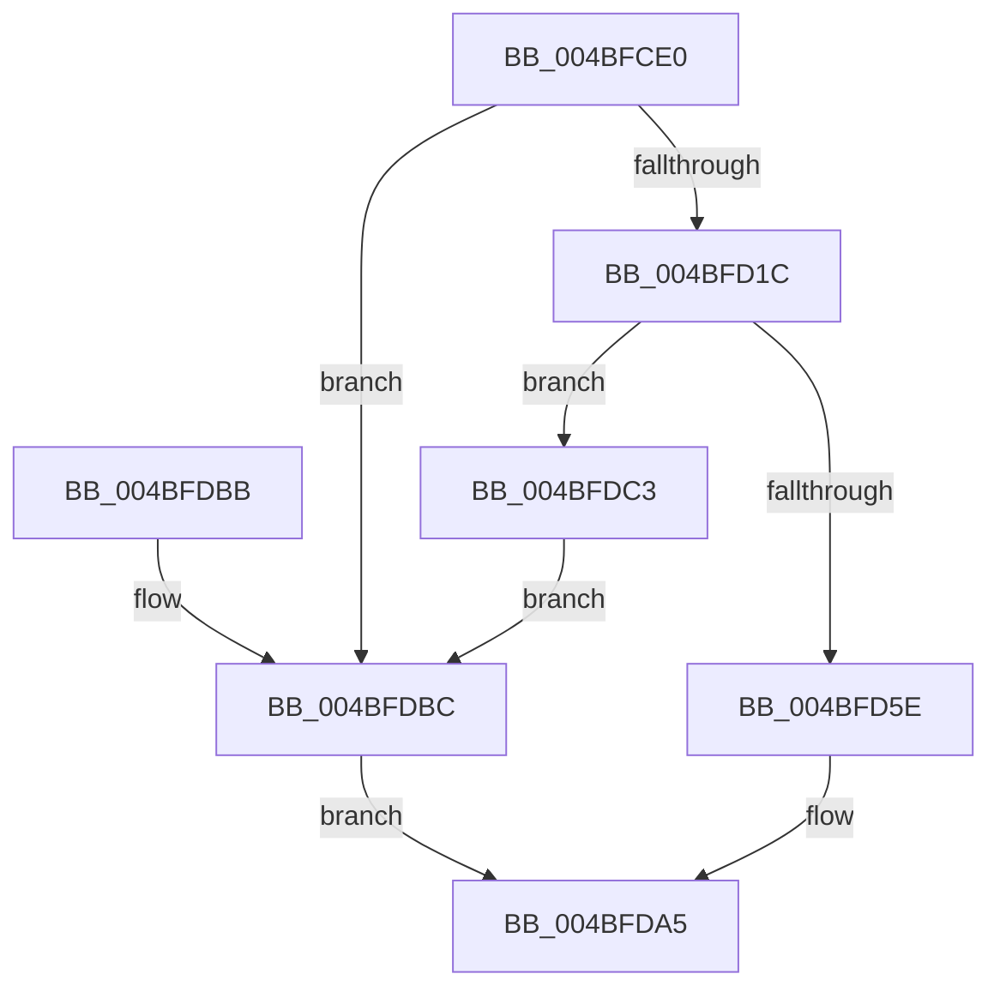

# SepExpandSingletonArrays

- RVA: `0x004BFCE0`–`0x004BFDE1` (길이 `257` bytes)
- VA: `0x00000001404BFCE0`
- 실행 섹션: `.text`
- PDB 이름 있음: `예`; PDB Function 태그: `아니요`
- unwind 정보 RVA: `0x000BC608`
- 디코드: `65`개 명령, `257/257` bytes 표시
- 미해석 바이트: `0` (있으면 어셈블리에 `.byte`로 보존)

> 이 문서는 커널 이미지의 기계어와 PDB 기호를 분석해 생성했습니다. 4번과 5번은 함수 원형과 자료형을 바이너리 사용 방식에서 추정한 C 해석이며 원본 소스 복구 결과는 아닙니다.

## 1. Dependencies

- 직접 호출 지점: **9**; 고유 호출 대상: **6**
- 직접 호출자로 확인된 함수: **1**
- RIP 상대 이미지 참조: **1**

### Outgoing calls
- `0x004BFD0B` → [ExAllocatePool2](../../poolcode/B8/ExAllocatePool2_function_00B820F0.md) (function, `0x00B820F0`)
- `0x004BFD24` → [memset](../6C/memset_function_006C6C40.md) (function, `0x006C6C40`)
- `0x004BFD30` → [ExAcquireSpinLockExclusive](../24/ExAcquireSpinLockExclusive_function_00248690.md) (function, `0x00248690`)
- `0x004BFD51` → [ExAllocatePool2](../../poolcode/B8/ExAllocatePool2_function_00B820F0.md) (function, `0x00B820F0`)
- `0x004BFD74` → [memcpy](../6C/memcpy_function_006C6840.md) (function, `0x006C6840`)
- `0x004BFD91` → [ExReleaseSpinLockExclusive](../2C/ExReleaseSpinLockExclusive_function_002C0EF0.md) (function, `0x002C0EF0`)
- `0x004BFD9E` → [ExFreePoolWithTag](../../poolcode/B8/ExFreePoolWithTag_function_00B82870.md) (function, `0x00B82870`)
- `0x004BFDCD` → [ExReleaseSpinLockExclusive](../2C/ExReleaseSpinLockExclusive_function_002C0EF0.md) (function, `0x002C0EF0`)
- `0x004BFDDA` → [ExFreePoolWithTag](../../poolcode/B8/ExFreePoolWithTag_function_00B82870.md) (function, `0x00B82870`)

### Direct callers
- [SepAddLuidToIndexEntry](../../page/A4/SepAddLuidToIndexEntry_function_00A425C0.md) at `0x00A42767`

### Static image references
- `0x004BFD29` → RVA `0x00E08960` (`.data`; read)

## 2. Other-region calls and transfers

- 다른 실행 섹션으로 향하는 call: **4**
  - `0x004BFD0B` → [ExAllocatePool2](../../poolcode/B8/ExAllocatePool2_function_00B820F0.md) (`.text` → `POOLCODE`)
  - `0x004BFD51` → [ExAllocatePool2](../../poolcode/B8/ExAllocatePool2_function_00B820F0.md) (`.text` → `POOLCODE`)
  - `0x004BFD9E` → [ExFreePoolWithTag](../../poolcode/B8/ExFreePoolWithTag_function_00B82870.md) (`.text` → `POOLCODE`)
  - `0x004BFDDA` → [ExFreePoolWithTag](../../poolcode/B8/ExFreePoolWithTag_function_00B82870.md) (`.text` → `POOLCODE`)
- 별도 외부 분기/꼬리 이동을 확인하지 못했습니다.

## 3. Assembly (complete function range)

```asm
004BFCE0  48 89 5C 24 08                  mov qword ptr [rsp + 8], rbx
004BFCE5  48 89 74 24 10                  mov qword ptr [rsp + 0x10], rsi
004BFCEA  48 89 7C 24 18                  mov qword ptr [rsp + 0x18], rdi
004BFCEF  41 56                           push r14
004BFCF1  48 83 EC 20                     sub rsp, 0x20
004BFCF5  BF 00 06 00 00                  mov edi, 0x600
004BFCFA  41 BE 40 00 00 00               mov r14d, 0x40
004BFD00  8B D7                           mov edx, edi
004BFD02  41 8B CE                        mov ecx, r14d
004BFD05  41 B8 53 65 44 74               mov r8d, 0x74446553
004BFD0B  E8 E0 23 6C 00                  call 0x140b820f0
004BFD10  48 8B D8                        mov rbx, rax
004BFD13  48 85 C0                        test rax, rax
004BFD16  0F 84 A0 00 00 00               je 0x1404bfdbc
004BFD1C  44 8B C7                        mov r8d, edi
004BFD1F  33 D2                           xor edx, edx
004BFD21  48 8B C8                        mov rcx, rax
004BFD24  E8 17 6F 20 00                  call 0x1406c6c40
004BFD29  48 8B 0D 30 8C 94 00            mov rcx, qword ptr [rip + 0x948c30]
004BFD30  E8 5B 89 D8 FF                  call 0x140248690
004BFD35  48 8B 15 24 8C 94 00            mov rdx, qword ptr [rip + 0x948c24]
004BFD3C  41 B8 53 65 44 74               mov r8d, 0x74446553
004BFD42  41 8B CE                        mov ecx, r14d
004BFD45  40 8A F0                        mov sil, al
004BFD48  8B 52 04                        mov edx, dword ptr [rdx + 4]
004BFD4B  FF C2                           inc edx
004BFD4D  48 C1 E2 03                     shl rdx, 3
004BFD51  E8 9A 23 6C 00                  call 0x140b820f0
004BFD56  4C 8B F0                        mov r14, rax
004BFD59  48 85 C0                        test rax, rax
004BFD5C  74 65                           je 0x1404bfdc3
004BFD5E  48 8B 3D FB 8B 94 00            mov rdi, qword ptr [rip + 0x948bfb]
004BFD65  48 8B C8                        mov rcx, rax
004BFD68  44 8B 47 04                     mov r8d, dword ptr [rdi + 4]
004BFD6C  48 8B 57 08                     mov rdx, qword ptr [rdi + 8]
004BFD70  49 C1 E0 03                     shl r8, 3
004BFD74  E8 C7 6A 20 00                  call 0x1406c6840
004BFD79  8B 47 04                        mov eax, dword ptr [rdi + 4]
004BFD7C  40 8A D6                        mov dl, sil
004BFD7F  48 8B CF                        mov rcx, rdi
004BFD82  49 89 1C C6                     mov qword ptr [r14 + rax*8], rbx
004BFD86  48 8B 5F 08                     mov rbx, qword ptr [rdi + 8]
004BFD8A  FF 47 04                        inc dword ptr [rdi + 4]
004BFD8D  4C 89 77 08                     mov qword ptr [rdi + 8], r14
004BFD91  E8 5A 11 E0 FF                  call 0x1402c0ef0
004BFD96  BA 53 65 44 74                  mov edx, 0x74446553
004BFD9B  48 8B CB                        mov rcx, rbx
004BFD9E  E8 CD 2A 6C 00                  call 0x140b82870
004BFDA3  33 C0                           xor eax, eax
004BFDA5  48 8B 5C 24 30                  mov rbx, qword ptr [rsp + 0x30]
004BFDAA  48 8B 74 24 38                  mov rsi, qword ptr [rsp + 0x38]
004BFDAF  48 8B 7C 24 40                  mov rdi, qword ptr [rsp + 0x40]
004BFDB4  48 83 C4 20                     add rsp, 0x20
004BFDB8  41 5E                           pop r14
004BFDBA  C3                              ret
004BFDBB  CC                              int3
004BFDBC  B8 17 00 00 C0                  mov eax, 0xc0000017
004BFDC1  EB E2                           jmp 0x1404bfda5
004BFDC3  48 8B 0D 96 8B 94 00            mov rcx, qword ptr [rip + 0x948b96]
004BFDCA  40 8A D6                        mov dl, sil
004BFDCD  E8 1E 11 E0 FF                  call 0x1402c0ef0
004BFDD2  BA 53 65 44 74                  mov edx, 0x74446553
004BFDD7  48 8B CB                        mov rcx, rbx
004BFDDA  E8 91 2A 6C 00                  call 0x140b82870
004BFDDF  EB DB                           jmp 0x1404bfdbc
```

## 4. C-style interpretation (structured pseudocode)

```c
__int64 __fastcall SepExpandSingletonArrays(void)
{
    __int64 result;
    __int64 v_rsp;
    unsigned __int64 v_stack_p10;
    unsigned __int64 v_stack_p18;
    unsigned __int64 v_stack_p8;

    v_stack_p8 = v_rbx;
    v_stack_p10 = v_rsi;
    v_stack_p18 = v_rdi;
    v_rsp = (v_rsp) - (32);
    result = ExAllocatePool2(64, (unsigned int)((unsigned int)((unsigned int)(0x600ULL))), (unsigned int)(0x74446553ULL), a4);
    if (result == 0) goto loc_004BFDBC;
    a2 = 0;
    result = memset(result, a2, (unsigned int)((unsigned int)((unsigned int)(0x600ULL))), a4);
    result = ExAcquireSpinLockExclusive(*(unsigned __int64 *)(v_rip + 9735216), a2, (unsigned int)((unsigned int)((unsigned int)(0x600ULL))), a4);
    a2 = (unsigned int)(((unsigned int)(*(unsigned int *)(*(unsigned __int64 *)(v_rip + 9735204) + 4))) + 1);
    a2 = (a2) << (3);
    result = ExAllocatePool2(64, a2, (unsigned int)(0x74446553ULL), a4);
    if (result == 0) goto loc_004BFDC3;
    a3 = ((unsigned int)(*(unsigned int *)(*(unsigned __int64 *)(v_rip + 9735163) + 4))) << (3);
    result = memcpy(result, *(unsigned __int64 *)(*(unsigned __int64 *)(v_rip + 9735163) + 8), a3, a4);
    *(unsigned __int64 *)(result + (unsigned int)(*(unsigned int *)(*(unsigned __int64 *)(v_rip + 9735163) + 4)) * 8) = result;
    *(unsigned __int64 *)(*(unsigned __int64 *)(v_rip + 9735163) + 8) = result;
    result = ExReleaseSpinLockExclusive(*(unsigned __int64 *)(v_rip + 9735163), (unsigned __int8)((unsigned __int8)(result)), a3, a4);
    result = ExFreePoolWithTag(*(unsigned __int64 *)(*(unsigned __int64 *)(v_rip + 9735163) + 8), (unsigned int)(0x74446553ULL), a3, a4);
    result = 0;
loc_004BFDA5:
    v_rsp = (v_rsp) + (32);
    return result;
loc_004BFDBC:
    goto loc_004BFDA5;
loc_004BFDC3:
    result = ExReleaseSpinLockExclusive(*(unsigned __int64 *)(v_rip + 9735062), (unsigned __int8)(v_stack_p10), a3, a4);
    result = ExFreePoolWithTag(v_stack_p8, (unsigned int)(0x74446553ULL), a3, a4);
    goto loc_004BFDBC;
}
```

## 5. (Beta) C Style

```c
void SepExpandSingletonArrays(void)
{
    int64_t result;
    int64_t local_rsp;
    uint64_t v_stack_p10;
    uint64_t v_stack_p18;
    uint64_t v_stack_p8;

    v_stack_p8 = local_rbx;
    v_stack_p10 = local_rsi;
    v_stack_p18 = local_rdi;
    local_rsp = (local_rsp) - (32);
    result = ExAllocatePool2(64, (uint32_t)((uint32_t)((uint32_t)(0x600ULL))), (uint32_t)(0x74446553ULL), a4);
    if (result == 0) goto loc_004BFDBC;
    a2 = 0;
    result = memset(result, a2, (uint32_t)((uint32_t)((uint32_t)(0x600ULL))), a4);
    result = ExAcquireSpinLockExclusive(*(uint64_t *)(v_rip + 0x948C30), a2, (uint32_t)((uint32_t)((uint32_t)(0x600ULL))), a4);
    a2 = (uint32_t)(((uint32_t)(*(uint32_t *)(*(uint64_t *)(v_rip + 0x948C24) + 0x4))) + 1);
    a2 = (a2) << (3);
    result = ExAllocatePool2(64, a2, (uint32_t)(0x74446553ULL), a4);
    if (result == 0) goto loc_004BFDC3;
    a3 = ((uint32_t)(*(uint32_t *)(*(uint64_t *)(v_rip + 0x948BFB) + 0x4))) << (3);
    result = memcpy(result, *(uint64_t *)(*(uint64_t *)(v_rip + 0x948BFB) + 0x8), a3, a4);
    *(uint64_t *)(result + (uint32_t)(*(uint32_t *)(*(uint64_t *)(v_rip + 0x948BFB) + 0x4)) * 8) = result;
    *(uint64_t *)(*(uint64_t *)(v_rip + 0x948BFB) + 0x8) = result;
    result = ExReleaseSpinLockExclusive(*(uint64_t *)(v_rip + 0x948BFB), (uint8_t)((uint8_t)(result)), a3, a4);
    result = ExFreePoolWithTag(*(uint64_t *)(*(uint64_t *)(v_rip + 0x948BFB) + 0x8), (uint32_t)(0x74446553ULL), a3, a4);
    result = 0;
loc_004BFDA5:
    local_rsp = (local_rsp) + (32);
    return result;
loc_004BFDBC:
    goto loc_004BFDA5;
loc_004BFDC3:
    result = ExReleaseSpinLockExclusive(*(uint64_t *)(v_rip + 0x948B96), (uint8_t)(v_stack_p10), a3, a4);
    result = ExFreePoolWithTag(v_stack_p8, (uint32_t)(0x74446553ULL), a3, a4);
    goto loc_004BFDBC;
}
```

## 6. Execution-region graph

[열기: 2D/3D 그래프와 함수 탐색 컨트롤 패널](../../../control-panel.html?section=text&rva=0x004BFCE0&view=graph)

- 2D 그래프는 위에서 아래로 흐르고, 3D 그래프는 빈 공간을 드래그해 회전합니다. Shift+드래그는 이동, 휠은 확대·축소, 함수 노드 선택은 대상 보고서 이동입니다.

### Static fallback


