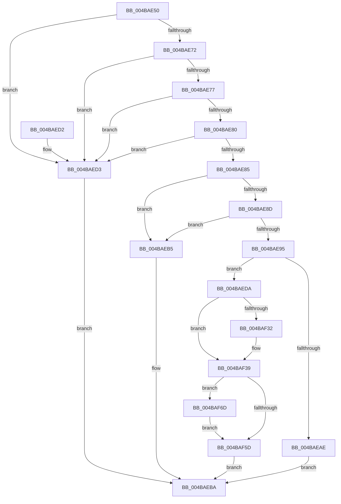

# SleepstudyHelperCreateLibraryEx

- RVA: `0x004BAE50`–`0x004BAF77` (길이 `295` bytes)
- VA: `0x00000001404BAE50`
- 실행 섹션: `.text`
- PDB 이름 있음: `예`; PDB Function 태그: `아니요`
- unwind 정보 RVA: `0x000BB60C`
- 디코드: `78`개 명령, `295/295` bytes 표시
- 미해석 바이트: `0` (있으면 어셈블리에 `.byte`로 보존)

> 이 문서는 커널 이미지의 기계어와 PDB 기호를 분석해 생성했습니다. 4번과 5번은 함수 원형과 자료형을 바이너리 사용 방식에서 추정한 C 해석이며 원본 소스 복구 결과는 아닙니다.

## 1. Dependencies

- 직접 호출 지점: **6**; 고유 호출 대상: **6**
- 직접 호출자로 확인된 함수: **4**
- RIP 상대 이미지 참조: **7**

### Outgoing calls
- `0x004BAEA1` → [ExAllocatePool2](../../poolcode/B8/ExAllocatePool2_function_00B820F0.md) (function, `0x00B820F0`)
- `0x004BAEE4` → [CmSiRWLockInitialize](../../page/AD/CmSiRWLockInitialize_function_00AD69E0.md) (function, `0x00AD69E0`)
- `0x004BAF0B` → [SshpCacheInitializeLibraryCache](../../page/AD/SshpCacheInitializeLibraryCache_function_00AD0D30.md) (function, `0x00AD0D30`)
- `0x004BAF1A` → [CmSiRWLockAcquireExclusive](../../page/A1/CmSiRWLockAcquireExclusive_function_00A1679C.md) (function, `0x00A1679C`)
- `0x004BAF60` → [KeAbPostRelease](../2E/KeAbPostRelease_function_002E1600.md) (function, `0x002E1600`)
- `0x004BAF70` → [ExfTryToWakePushLock](../26/ExfTryToWakePushLock_function_00265DD0.md) (function, `0x00265DD0`)

### Direct callers
- [SleepstudyHelper_Initialize](../../page/AA/SleepstudyHelper_Initialize_function_00AAE0B0.md) at `0x00AAE0E1`
- [SleepstudyHelperCreateLibrary](../../page/AB/SleepstudyHelperCreateLibrary_function_00AB70F0.md) at `0x00AB7109`
- [PopPowerRequestStatsInitialize](../../init/C4/PopPowerRequestStatsInitialize_function_00C43D34.md) at `0x00C43D83`
- [PopSleepstudyInitialize](../../init/C7/PopSleepstudyInitialize_function_00C76C60.md) at `0x00C76D4F`

### Static image references
- `0x004BAE85` → RVA `0x00E0C474` (`.data`; read)
- `0x004BAE8D` → RVA `0x00F07094` (`.data`; read)
- `0x004BAF10` → RVA `0x00F07030` (`.data`; read)
- `0x004BAF1F` → RVA `0x00F07028` (`.data`; read)
- `0x004BAF26` → RVA `0x00F07020` (`.data`; read)
- `0x004BAF47` → RVA `0x00F07028` (`.data`; write)
- `0x004BAF4E` → RVA `0x00F07030` (`.data`; read/write)

## 2. Other-region calls and transfers

- 다른 실행 섹션으로 향하는 call: **4**
  - `0x004BAEA1` → [ExAllocatePool2](../../poolcode/B8/ExAllocatePool2_function_00B820F0.md) (`.text` → `POOLCODE`)
  - `0x004BAEE4` → [CmSiRWLockInitialize](../../page/AD/CmSiRWLockInitialize_function_00AD69E0.md) (`.text` → `PAGE`)
  - `0x004BAF0B` → [SshpCacheInitializeLibraryCache](../../page/AD/SshpCacheInitializeLibraryCache_function_00AD0D30.md) (`.text` → `PAGE`)
  - `0x004BAF1A` → [CmSiRWLockAcquireExclusive](../../page/A1/CmSiRWLockAcquireExclusive_function_00A1679C.md) (`.text` → `PAGE`)
- 별도 외부 분기/꼬리 이동을 확인하지 못했습니다.

## 3. Assembly (complete function range)

```asm
004BAE50  48 89 5C 24 08                  mov qword ptr [rsp + 8], rbx
004BAE55  48 89 74 24 10                  mov qword ptr [rsp + 0x10], rsi
004BAE5A  48 89 7C 24 18                  mov qword ptr [rsp + 0x18], rdi
004BAE5F  41 56                           push r14
004BAE61  48 83 EC 20                     sub rsp, 0x20
004BAE65  33 DB                           xor ebx, ebx
004BAE67  4C 8B F2                        mov r14, rdx
004BAE6A  48 8B F1                        mov rsi, rcx
004BAE6D  48 85 C9                        test rcx, rcx
004BAE70  74 61                           je 0x1404baed3
004BAE72  83 39 01                        cmp dword ptr [rcx], 1
004BAE75  77 5C                           ja 0x1404baed3
004BAE77  F7 41 08 F8 FF FF FF            test dword ptr [rcx + 8], 0xfffffff8
004BAE7E  75 53                           jne 0x1404baed3
004BAE80  48 85 D2                        test rdx, rdx
004BAE83  74 4E                           je 0x1404baed3
004BAE85  39 1D E9 15 95 00               cmp dword ptr [rip + 0x9515e9], ebx
004BAE8B  74 28                           je 0x1404baeb5
004BAE8D  38 1D 01 C2 A4 00               cmp byte ptr [rip + 0xa4c201], bl
004BAE93  74 20                           je 0x1404baeb5
004BAE95  44 8B 41 04                     mov r8d, dword ptr [rcx + 4]
004BAE99  BA B8 00 00 00                  mov edx, 0xb8
004BAE9E  8D 4B 40                        lea ecx, [rbx + 0x40]
004BAEA1  E8 4A 72 6C 00                  call 0x140b820f0
004BAEA6  48 8B F8                        mov rdi, rax
004BAEA9  48 85 C0                        test rax, rax
004BAEAC  75 2C                           jne 0x1404baeda
004BAEAE  BB 9A 00 00 C0                  mov ebx, 0xc000009a
004BAEB3  EB 05                           jmp 0x1404baeba
004BAEB5  BB BB 00 00 C0                  mov ebx, 0xc00000bb
004BAEBA  48 8B 74 24 38                  mov rsi, qword ptr [rsp + 0x38]
004BAEBF  8B C3                           mov eax, ebx
004BAEC1  48 8B 5C 24 30                  mov rbx, qword ptr [rsp + 0x30]
004BAEC6  48 8B 7C 24 40                  mov rdi, qword ptr [rsp + 0x40]
004BAECB  48 83 C4 20                     add rsp, 0x20
004BAECF  41 5E                           pop r14
004BAED1  C3                              ret
004BAED2  CC                              int3
004BAED3  BB 0D 00 00 C0                  mov ebx, 0xc000000d
004BAED8  EB E0                           jmp 0x1404baeba
004BAEDA  8B 46 04                        mov eax, dword ptr [rsi + 4]
004BAEDD  48 8D 4F 10                     lea rcx, [rdi + 0x10]
004BAEE1  89 47 18                        mov dword ptr [rdi + 0x18], eax
004BAEE4  E8 F7 BA 61 00                  call 0x140ad69e0
004BAEE9  48 8D 87 98 00 00 00            lea rax, [rdi + 0x98]
004BAEF0  48 8B CF                        mov rcx, rdi
004BAEF3  48 89 40 08                     mov qword ptr [rax + 8], rax
004BAEF7  48 89 00                        mov qword ptr [rax], rax
004BAEFA  48 8D 87 A8 00 00 00            lea rax, [rdi + 0xa8]
004BAF01  48 89 40 08                     mov qword ptr [rax + 8], rax
004BAF05  48 89 00                        mov qword ptr [rax], rax
004BAF08  8B 56 08                        mov edx, dword ptr [rsi + 8]
004BAF0B  E8 20 5E 61 00                  call 0x140ad0d30
004BAF10  48 8D 35 19 C1 A4 00            lea rsi, [rip + 0xa4c119]
004BAF17  48 8B CE                        mov rcx, rsi
004BAF1A  E8 7D B8 55 00                  call 0x140a1679c
004BAF1F  48 8B 05 02 C1 A4 00            mov rax, qword ptr [rip + 0xa4c102]
004BAF26  48 8D 0D F3 C0 A4 00            lea rcx, [rip + 0xa4c0f3]
004BAF2D  48 39 08                        cmp qword ptr [rax], rcx
004BAF30  74 07                           je 0x1404baf39
004BAF32  B9 03 00 00 00                  mov ecx, 3
004BAF37  CD 29                           int 0x29
004BAF39  48 89 47 08                     mov qword ptr [rdi + 8], rax
004BAF3D  48 89 0F                        mov qword ptr [rdi], rcx
004BAF40  48 89 38                        mov qword ptr [rax], rdi
004BAF43  48 83 C8 FF                     or rax, 0xffffffffffffffff
004BAF47  48 89 3D DA C0 A4 00            mov qword ptr [rip + 0xa4c0da], rdi
004BAF4E  F0 48 0F C1 05 D9 C0 A4 00      lock xadd qword ptr [rip + 0xa4c0d9], rax
004BAF57  24 06                           and al, 6
004BAF59  3C 02                           cmp al, 2
004BAF5B  74 10                           je 0x1404baf6d
004BAF5D  48 8B CE                        mov rcx, rsi
004BAF60  E8 9B 66 E2 FF                  call 0x1402e1600
004BAF65  49 89 3E                        mov qword ptr [r14], rdi
004BAF68  E9 4D FF FF FF                  jmp 0x1404baeba
004BAF6D  48 8B CE                        mov rcx, rsi
004BAF70  E8 5B AE DA FF                  call 0x140265dd0
004BAF75  EB E6                           jmp 0x1404baf5d
```

## 4. C-style interpretation (structured pseudocode)

```c
__int64 __fastcall SleepstudyHelperCreateLibraryEx(__int64 a1, __int64 a2)
{
    __int64 result;
    __int64 v_rbx;
    __int64 v_rsp;
    unsigned __int64 v_stack_p10;
    unsigned __int64 v_stack_p18;
    unsigned __int64 v_stack_p8;

    v_stack_p8 = v_rbx;
    v_stack_p10 = v_rsi;
    v_stack_p18 = v_rdi;
    v_rsp = (v_rsp) - (32);
    v_rbx = 0;
    if (a1 == 0) goto loc_004BAED3;
    if ((*(unsigned int *)(a1)) > 1) goto loc_004BAED3;
    if (((*(unsigned int *)(a1 + 8)) & (0xFFFFFFF8ULL)) != 0) goto loc_004BAED3;
    if (a2 == 0) goto loc_004BAED3;
    if ((*(unsigned int *)(v_rip + 9770473)) == 0) goto loc_004BAEB5;
    if ((*(unsigned __int8 *)(v_rip + 10797569)) == 0) goto loc_004BAEB5;
    result = ExAllocatePool2(v_rbx + 64, 184, (unsigned int)(*(unsigned int *)(a1 + 4)), a4);
    if (result != 0) goto loc_004BAEDA;
    goto loc_004BAEBA;
loc_004BAEB5:
loc_004BAEBA:
    v_rsp = (v_rsp) + (32);
    return (unsigned int)((unsigned int)((unsigned int)(0xC00000BBULL)));
loc_004BAED3:
    goto loc_004BAEBA;
loc_004BAEDA:
    *(unsigned int *)(v_stack_p18 + 24) = (unsigned int)((unsigned int)(*(unsigned int *)(v_stack_p10 + 4)));
    result = CmSiRWLockInitialize(v_stack_p18 + 16, 184, (unsigned int)(*(unsigned int *)(a1 + 4)), a4);
    *(unsigned __int64 *)(v_stack_p18 + 152 + 8) = v_stack_p18 + 152;
    *(unsigned __int64 *)(v_stack_p18 + 152) = v_stack_p18 + 152;
    *(unsigned __int64 *)(v_stack_p18 + 168 + 8) = v_stack_p18 + 168;
    *(unsigned __int64 *)(v_stack_p18 + 168) = v_stack_p18 + 168;
    result = SshpCacheInitializeLibraryCache(v_stack_p18, (unsigned int)(*(unsigned int *)(v_stack_p10 + 8)), (unsigned int)(*(unsigned int *)(a1 + 4)), a4);
    result = CmSiRWLockAcquireExclusive(v_rip + 10797337, (unsigned int)(*(unsigned int *)(v_stack_p10 + 8)), (unsigned int)(*(unsigned int *)(a1 + 4)), a4);
    if ((*(unsigned __int64 *)(*(unsigned __int64 *)(v_rip + 10797314))) != (v_rip + 10797299)) {
        a1 = 3;
    }
    *(unsigned __int64 *)(v_stack_p18 + 8) = *(unsigned __int64 *)(v_rip + 10797314);
    *(unsigned __int64 *)(v_stack_p18) = a1;
    *(unsigned __int64 *)(*(unsigned __int64 *)(v_rip + 10797314)) = v_stack_p18;
    result = (*(unsigned __int64 *)(v_rip + 10797314)) | (-1);
    *(unsigned __int64 *)(v_rip + 10797274) = v_stack_p18;
    result = (unsigned __int8)((result) & (6));
    if (((unsigned __int8)(result)) == 2) goto loc_004BAF6D;
loc_004BAF5D:
    result = KeAbPostRelease(v_rip + 10797337, (unsigned int)(*(unsigned int *)(v_stack_p10 + 8)), (unsigned int)(*(unsigned int *)(a1 + 4)), a4);
    *(unsigned __int64 *)(a2) = v_stack_p18;
    goto loc_004BAEBA;
loc_004BAF6D:
    result = ExfTryToWakePushLock(v_rip + 10797337, (unsigned int)(*(unsigned int *)(v_stack_p10 + 8)), (unsigned int)(*(unsigned int *)(a1 + 4)), a4);
    goto loc_004BAF5D;
}
```

## 5. (Beta) C Style

```c
int64_t SleepstudyHelperCreateLibraryEx(void *Arg1, void *Arg2)
{
    uint8_t *arg1 = (uint8_t *)Arg1;
    uint8_t *arg2 = (uint8_t *)Arg2;

    int64_t result;
    int64_t local_rbx;
    int64_t local_rsp;
    uint64_t v_stack_p10;
    uint64_t v_stack_p18;
    uint64_t v_stack_p8;

    v_stack_p8 = local_rbx;
    v_stack_p10 = local_rsi;
    v_stack_p18 = local_rdi;
    local_rsp = (local_rsp) - (32);
    local_rbx = 0;
    if (Arg1 == NULL) goto loc_004BAED3;
    if ((*(uint32_t *)(arg1)) > 1) goto loc_004BAED3;
    if (((*(uint32_t *)(arg1 + 0x8)) & (0xFFFFFFF8ULL)) != 0) goto loc_004BAED3;
    if (Arg2 == NULL) goto loc_004BAED3;
    if ((*(uint32_t *)(v_rip + 0x9515E9)) == 0) goto loc_004BAEB5;
    if ((*(uint8_t *)(v_rip + 0xA4C201)) == 0) goto loc_004BAEB5;
    result = ExAllocatePool2(local_rbx + 64, 184, (uint32_t)(*(uint32_t *)(arg1 + 0x4)), a4);
    if (result != 0) goto loc_004BAEDA;
    goto loc_004BAEBA;
loc_004BAEB5:
loc_004BAEBA:
    local_rsp = (local_rsp) + (32);
    return (uint32_t)((uint32_t)((uint32_t)(0xC00000BBULL)));
loc_004BAED3:
    goto loc_004BAEBA;
loc_004BAEDA:
    *(uint32_t *)(v_stack_p18 + 0x18) = (uint32_t)((uint32_t)(*(uint32_t *)(v_stack_p10 + 0x4)));
    result = CmSiRWLockInitialize(v_stack_p18 + 16, 184, (uint32_t)(*(uint32_t *)(arg1 + 0x4)), a4);
    *(uint64_t *)(v_stack_p18 + 0x98 + 0x8) = v_stack_p18 + 152;
    *(uint64_t *)(v_stack_p18 + 0x98) = v_stack_p18 + 152;
    *(uint64_t *)(v_stack_p18 + 0xA8 + 0x8) = v_stack_p18 + 168;
    *(uint64_t *)(v_stack_p18 + 0xA8) = v_stack_p18 + 168;
    result = SshpCacheInitializeLibraryCache(v_stack_p18, (uint32_t)(*(uint32_t *)(v_stack_p10 + 0x8)), (uint32_t)(*(uint32_t *)(arg1 + 0x4)), a4);
    result = CmSiRWLockAcquireExclusive(v_rip + 10797337, (uint32_t)(*(uint32_t *)(v_stack_p10 + 0x8)), (uint32_t)(*(uint32_t *)(arg1 + 0x4)), a4);
    if ((*(uint64_t *)(*(uint64_t *)(v_rip + 0xA4C102))) != (v_rip + 10797299)) {
        Arg1 = 3;
    }
    *(uint64_t *)(v_stack_p18 + 0x8) = *(uint64_t *)(v_rip + 0xA4C102);
    *(void **)(v_stack_p18) = Arg1;
    *(uint64_t *)(*(uint64_t *)(v_rip + 0xA4C102)) = v_stack_p18;
    result = (*(uint64_t *)(v_rip + 0xA4C102)) | (-1);
    *(uint64_t *)(v_rip + 0xA4C0DA) = v_stack_p18;
    result = (uint8_t)((result) & (6));
    if (((uint8_t)(result)) == 2) goto loc_004BAF6D;
loc_004BAF5D:
    result = KeAbPostRelease(v_rip + 10797337, (uint32_t)(*(uint32_t *)(v_stack_p10 + 0x8)), (uint32_t)(*(uint32_t *)(arg1 + 0x4)), a4);
    *(uint64_t *)(arg2) = v_stack_p18;
    goto loc_004BAEBA;
loc_004BAF6D:
    result = ExfTryToWakePushLock(v_rip + 10797337, (uint32_t)(*(uint32_t *)(v_stack_p10 + 0x8)), (uint32_t)(*(uint32_t *)(arg1 + 0x4)), a4);
    goto loc_004BAF5D;
}
```

### 관측된 메모리 오프셋

구조체 형식이 확인되지 않은 접근은 인자 기준의 오프셋으로만 기록했습니다.

| 기준 인자 | 오프셋 표현 | 폭 (bit) | 접근 |
|---|---:|---:|---|
| `Arg1` | `+ 0x4` | `32` | `R` |
| `Arg1` | `+ 0x8` | `32` | `R` |
| `Arg2` | `+ 0x0` | `64` | `W` |

## 6. Execution-region graph

[열기: 2D/3D 그래프와 함수 탐색 컨트롤 패널](../../../control-panel.html?section=text&rva=0x004BAE50&view=graph)

- 2D 그래프는 위에서 아래로 흐르고, 3D 그래프는 빈 공간을 드래그해 회전합니다. Shift+드래그는 이동, 휠은 확대·축소, 함수 노드 선택은 대상 보고서 이동입니다.

### Static fallback


