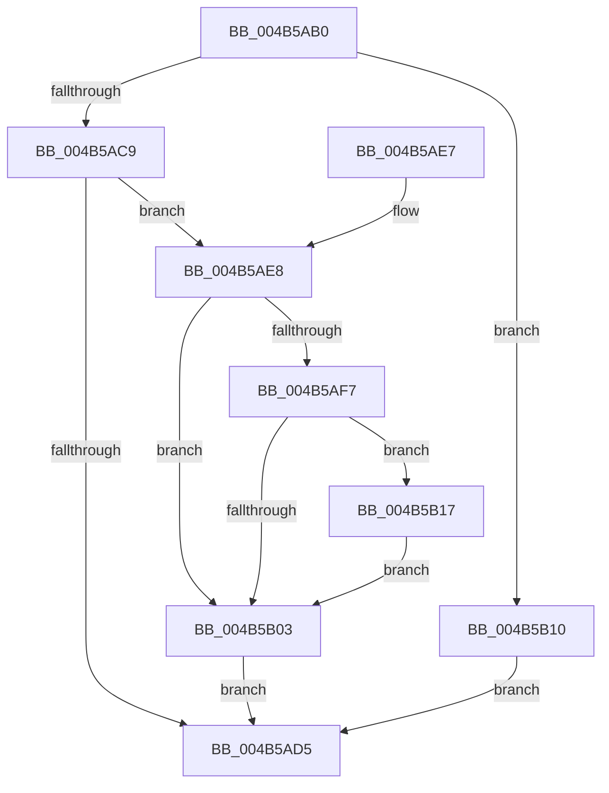

# SleepstudyHelper_ComponentInactive

- RVA: `0x004B5AB0`–`0x004B5B23` (길이 `115` bytes)
- VA: `0x00000001404B5AB0`
- 실행 섹션: `.text`
- PDB 이름 있음: `예`; PDB Function 태그: `아니요`
- unwind 정보 RVA: `0x00071224`
- 디코드: `37`개 명령, `115/115` bytes 표시
- 미해석 바이트: `0` (있으면 어셈블리에 `.byte`로 보존)

> 이 문서는 커널 이미지의 기계어와 PDB 기호를 분석해 생성했습니다. 4번과 5번은 함수 원형과 자료형을 바이너리 사용 방식에서 추정한 C 해석이며 원본 소스 복구 결과는 아닙니다.

## 1. Dependencies

- 직접 호출 지점: **3**; 고유 호출 대상: **3**
- 직접 호출자로 확인된 함수: **0**
- RIP 상대 이미지 참조: **1**

### Outgoing calls
- `0x004B5AE8` → [KeAcquireSpinLockRaiseToDpc](../20/KeAcquireSpinLockRaiseToDpc_function_00208470.md) (function, `0x00208470`)
- `0x004B5B09` → [KeReleaseSpinLock](../39/KeReleaseSpinLock_function_00392BA0.md) (function, `0x00392BA0`)
- `0x004B5B1C` → [SshpSetBlockerActive](../45/SshpSetBlockerActive_function_00453A90.md) (function, `0x00453A90`)

### Direct callers
- 이 함수 시작 RVA로 연결되는 직접 call은 확인되지 않았습니다. 간접 호출은 완전히 역산할 수 없습니다.

### Static image references
- `0x004B5AC9` → RVA `0x00F06B68` (`.data`; read)

## 2. Other-region calls and transfers

- 다른 실행 섹션으로 향하는 call: **0**
- 별도 외부 분기/꼬리 이동을 확인하지 못했습니다.

## 3. Assembly (complete function range)

```asm
004B5AB0  48 89 5C 24 08                  mov qword ptr [rsp + 8], rbx
004B5AB5  48 89 74 24 10                  mov qword ptr [rsp + 0x10], rsi
004B5ABA  57                              push rdi
004B5ABB  48 83 EC 20                     sub rsp, 0x20
004B5ABF  33 FF                           xor edi, edi
004B5AC1  48 8B D9                        mov rbx, rcx
004B5AC4  48 85 C9                        test rcx, rcx
004B5AC7  74 47                           je 0x1404b5b10
004B5AC9  48 8D 05 98 10 A5 00            lea rax, [rip + 0xa51098]
004B5AD0  48 3B C8                        cmp rcx, rax
004B5AD3  75 13                           jne 0x1404b5ae8
004B5AD5  48 8B 5C 24 30                  mov rbx, qword ptr [rsp + 0x30]
004B5ADA  8B C7                           mov eax, edi
004B5ADC  48 8B 74 24 38                  mov rsi, qword ptr [rsp + 0x38]
004B5AE1  48 83 C4 20                     add rsp, 0x20
004B5AE5  5F                              pop rdi
004B5AE6  C3                              ret
004B5AE7  CC                              int3
004B5AE8  E8 83 29 D5 FF                  call 0x140208470
004B5AED  40 8A F0                        mov sil, al
004B5AF0  8B 43 08                        mov eax, dword ptr [rbx + 8]
004B5AF3  A8 10                           test al, 0x10
004B5AF5  74 0C                           je 0x1404b5b03
004B5AF7  83 E0 EF                        and eax, 0xffffffef
004B5AFA  83 6B 14 01                     sub dword ptr [rbx + 0x14], 1
004B5AFE  89 43 08                        mov dword ptr [rbx + 8], eax
004B5B01  74 14                           je 0x1404b5b17
004B5B03  40 8A D6                        mov dl, sil
004B5B06  48 8B CB                        mov rcx, rbx
004B5B09  E8 92 D0 ED FF                  call 0x140392ba0
004B5B0E  EB C5                           jmp 0x1404b5ad5
004B5B10  BF 0D 00 00 C0                  mov edi, 0xc000000d
004B5B15  EB BE                           jmp 0x1404b5ad5
004B5B17  33 D2                           xor edx, edx
004B5B19  48 8B CB                        mov rcx, rbx
004B5B1C  E8 6F DF F9 FF                  call 0x140453a90
004B5B21  EB E0                           jmp 0x1404b5b03
```

## 4. C-style interpretation (structured pseudocode)

```c
__int64 __fastcall SleepstudyHelper_ComponentInactive(__int64 a1)
{
    __int64 result;
    __int64 v_rdi;
    __int64 v_rsp;
    unsigned __int64 v_stack_p10;
    unsigned __int64 v_stack_p8;

    v_stack_p8 = v_rbx;
    v_stack_p10 = v_rsi;
    v_rsp = (v_rsp) - (32);
    v_rdi = 0;
    if (a1 == 0) goto loc_004B5B10;
    if (a1 != (v_rip + 10817688)) goto loc_004B5AE8;
loc_004B5AD5:
    v_rsp = (v_rsp) + (32);
    return 0;
loc_004B5AE8:
    result = KeAcquireSpinLockRaiseToDpc(a1, a2, a3, a4);
    if ((((unsigned __int8)((unsigned int)(*(unsigned int *)(v_stack_p8 + 8)))) & (16)) == 0) goto loc_004B5B03;
    result = (unsigned int)(((unsigned int)(*(unsigned int *)(v_stack_p8 + 8))) & (0xFFFFFFEFULL));
    *(unsigned int *)(v_stack_p8 + 8) = (unsigned int)(result);
    if (condition_is_equal) goto loc_004B5B17;
loc_004B5B03:
    result = KeReleaseSpinLock(v_stack_p8, (unsigned __int8)((unsigned __int8)(result)), a3, a4);
    goto loc_004B5AD5;
loc_004B5B10:
    goto loc_004B5AD5;
loc_004B5B17:
    a2 = 0;
    result = SshpSetBlockerActive(v_stack_p8, a2, a3, a4);
    goto loc_004B5B03;
}
```

## 5. (Beta) C Style

```c
int64_t SleepstudyHelper_ComponentInactive(void *Arg1)
{
    uint8_t *arg1 = (uint8_t *)Arg1;

    int64_t result;
    int64_t local_rdi;
    int64_t local_rsp;
    uint64_t v_stack_p10;
    uint64_t v_stack_p8;

    v_stack_p8 = local_rbx;
    v_stack_p10 = local_rsi;
    local_rsp = (local_rsp) - (32);
    local_rdi = 0;
    if (Arg1 == NULL) goto loc_004B5B10;
    if (Arg1 != (v_rip + 10817688)) goto loc_004B5AE8;
loc_004B5AD5:
    local_rsp = (local_rsp) + (32);
    return 0;
loc_004B5AE8:
    result = KeAcquireSpinLockRaiseToDpc(Arg1, a2, a3, a4);
    if ((((uint8_t)((uint32_t)(*(uint32_t *)(v_stack_p8 + 0x8)))) & (16)) == 0) goto loc_004B5B03;
    result = (uint32_t)(((uint32_t)(*(uint32_t *)(v_stack_p8 + 0x8))) & (0xFFFFFFEFULL));
    *(uint32_t *)(v_stack_p8 + 0x8) = (uint32_t)(result);
    if (condition_is_equal) goto loc_004B5B17;
loc_004B5B03:
    result = KeReleaseSpinLock(v_stack_p8, (uint8_t)((uint8_t)(result)), a3, a4);
    goto loc_004B5AD5;
loc_004B5B10:
    goto loc_004B5AD5;
loc_004B5B17:
    a2 = 0;
    result = SshpSetBlockerActive(v_stack_p8, a2, a3, a4);
    goto loc_004B5B03;
}
```

### 관측된 메모리 오프셋

구조체 형식이 확인되지 않은 접근은 인자 기준의 오프셋으로만 기록했습니다.

| 기준 인자 | 오프셋 표현 | 폭 (bit) | 접근 |
|---|---:|---:|---|
| `Arg1` | `+ 0x8` | `32` | `R` |
| `Arg1` | `+ 0x8` | `32` | `W` |
| `Arg1` | `+ 0x14` | `32` | `R/W` |

## 6. Execution-region graph

[열기: 2D/3D 그래프와 함수 탐색 컨트롤 패널](../../../control-panel.html?section=text&rva=0x004B5AB0&view=graph)

- 2D 그래프는 위에서 아래로 흐르고, 3D 그래프는 빈 공간을 드래그해 회전합니다. Shift+드래그는 이동, 휠은 확대·축소, 함수 노드 선택은 대상 보고서 이동입니다.

### Static fallback


