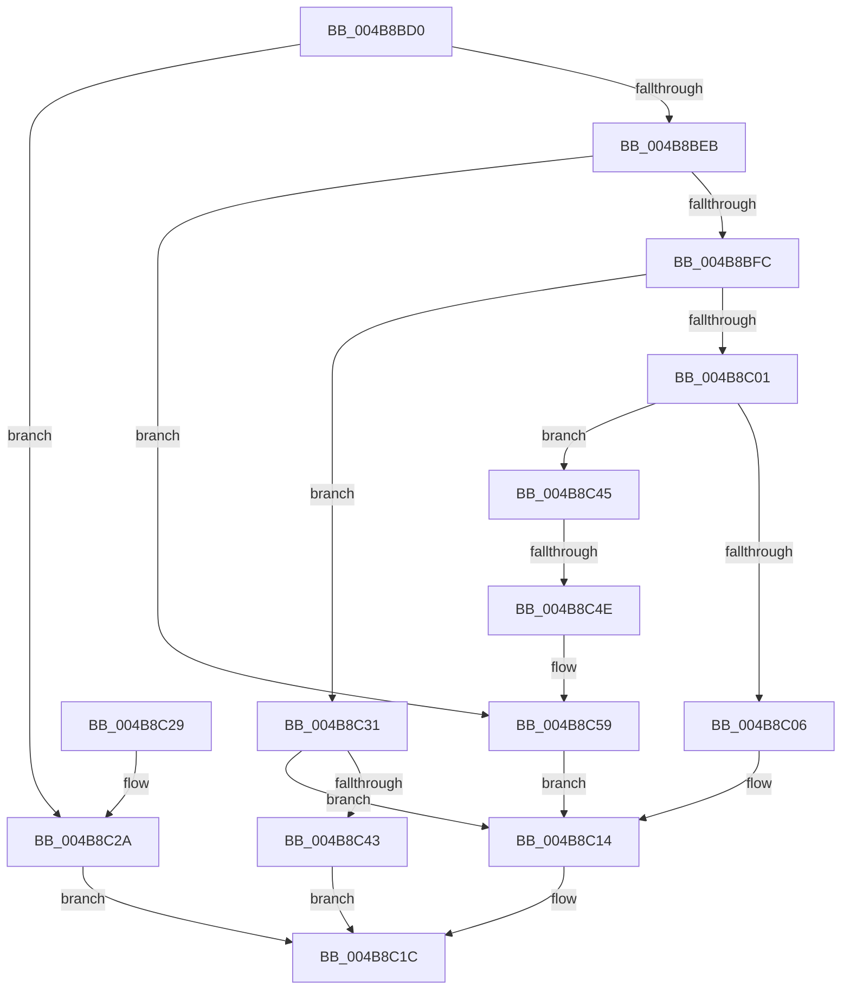

# SleepstudyHelper_GenerateGuid

- RVA: `0x004B8BD0`–`0x004B8C5F` (길이 `143` bytes)
- VA: `0x00000001404B8BD0`
- 실행 섹션: `.text`
- PDB 이름 있음: `예`; PDB Function 태그: `예`
- unwind 정보 RVA: `0x000BB06C`
- 디코드: `47`개 명령, `143/143` bytes 표시
- 미해석 바이트: `0` (있으면 어셈블리에 `.byte`로 보존)

> 이 문서는 커널 이미지의 기계어와 PDB 기호를 분석해 생성했습니다. 4번과 5번은 함수 원형과 자료형을 바이너리 사용 방식에서 추정한 C 해석이며 원본 소스 복구 결과는 아닙니다.

## 1. Dependencies

- 직접 호출 지점: **1**; 고유 호출 대상: **1**
- 직접 호출자로 확인된 함수: **0**
- RIP 상대 이미지 참조: **0**

### Outgoing calls
- `0x004B8C38` → [SleepstudyHelperGetBlockerGuid](../../page/A7/SleepstudyHelperGetBlockerGuid_function_00A775C0.md) (function, `0x00A775C0`)

### Direct callers
- 이 함수 시작 RVA로 연결되는 직접 call은 확인되지 않았습니다. 간접 호출은 완전히 역산할 수 없습니다.

### Static image references
- 디코드된 RIP-relative 메모리 참조가 없습니다.

## 2. Other-region calls and transfers

- 다른 실행 섹션으로 향하는 call: **1**
  - `0x004B8C38` → [SleepstudyHelperGetBlockerGuid](../../page/A7/SleepstudyHelperGetBlockerGuid_function_00A775C0.md) (`.text` → `PAGE`)
- call이 아닌 외부 분기/꼬리 이동: **1**
  - `0x004B8C48` → [sub_006FC1E4](../6F/Unknown_function_006FC1E4.md) (`tail-transfer`)

## 3. Assembly (complete function range)

```asm
004B8BD0  48 89 5C 24 08                  mov qword ptr [rsp + 8], rbx
004B8BD5  55                              push rbp
004B8BD6  48 8B EC                        mov rbp, rsp
004B8BD9  48 83 EC 30                     sub rsp, 0x30
004B8BDD  49 8B D8                        mov rbx, r8
004B8BE0  4C 8B CA                        mov r9, rdx
004B8BE3  44 8B D1                        mov r10d, ecx
004B8BE6  4D 85 C0                        test r8, r8
004B8BE9  74 3F                           je 0x1404b8c2a
004B8BEB  0F 57 C0                        xorps xmm0, xmm0
004B8BEE  33 D2                           xor edx, edx
004B8BF0  41 0F 11 00                     movups xmmword ptr [r8], xmm0
004B8BF4  0F 11 45 F0                     movups xmmword ptr [rbp - 0x10], xmm0
004B8BF8  85 C9                           test ecx, ecx
004B8BFA  74 5D                           je 0x1404b8c59
004B8BFC  83 E9 01                        sub ecx, 1
004B8BFF  74 30                           je 0x1404b8c31
004B8C01  83 E9 04                        sub ecx, 4
004B8C04  75 3F                           jne 0x1404b8c45
004B8C06  8A 45 F7                        mov al, byte ptr [rbp - 9]
004B8C09  24 FD                           and al, 0xfd
004B8C0B  0C 01                           or al, 1
004B8C0D  4C 89 4D F8                     mov qword ptr [rbp - 8], r9
004B8C11  88 45 F7                        mov byte ptr [rbp - 9], al
004B8C14  0F 10 45 F0                     movups xmm0, xmmword ptr [rbp - 0x10]
004B8C18  F3 0F 7F 03                     movdqu xmmword ptr [rbx], xmm0
004B8C1C  48 8B 5C 24 40                  mov rbx, qword ptr [rsp + 0x40]
004B8C21  8B C2                           mov eax, edx
004B8C23  48 83 C4 30                     add rsp, 0x30
004B8C27  5D                              pop rbp
004B8C28  C3                              ret
004B8C29  CC                              int3
004B8C2A  BA 0D 00 00 C0                  mov edx, 0xc000000d
004B8C2F  EB EB                           jmp 0x1404b8c1c
004B8C31  48 8D 55 F0                     lea rdx, [rbp - 0x10]
004B8C35  49 8B C9                        mov rcx, r9
004B8C38  E8 83 E9 5B 00                  call 0x140a775c0
004B8C3D  8B D0                           mov edx, eax
004B8C3F  85 C0                           test eax, eax
004B8C41  79 D1                           jns 0x1404b8c14
004B8C43  EB D7                           jmp 0x1404b8c1c
004B8C45  83 F9 01                        cmp ecx, 1
004B8C48  0F 84 96 35 24 00               je 0x1406fc1e4
004B8C4E  C7 45 F8 CC CC 00 00            mov dword ptr [rbp - 8], 0xcccc
004B8C55  44 89 55 FC                     mov dword ptr [rbp - 4], r10d
004B8C59  4C 89 4D F0                     mov qword ptr [rbp - 0x10], r9
004B8C5D  EB B5                           jmp 0x1404b8c14
```

## 4. C-style interpretation (structured pseudocode)

```c
__int64 __fastcall SleepstudyHelper_GenerateGuid(int a1, __int64 a2, __int64 a3)
{
    __int64 result;
    __int64 v_rsp;
    unsigned __int64 v_stack_m10;
    unsigned __int8 v_stack_m11;
    unsigned __int64 v_stack_m18;
    unsigned int v_stack_mC;
    unsigned __int64 v_stack_p8;

    v_stack_p8 = v_rbx;
    v_rsp = (v_rsp) - (48);
    if (a3 == 0) goto loc_004B8C2A;
    a2 = 0;
    *(unsigned __int64 *)(a3) = v_xmm0;
    v_stack_m18 = v_xmm0;
    if (a1 == 0) goto loc_004B8C59;
    a1 = (unsigned int)((a1) - (1));
    if (condition_is_equal) goto loc_004B8C31;
    a1 = (unsigned int)((a1) - (4));
    if (condition_is_not_equal) goto loc_004B8C45;
    result = (unsigned __int8)((v_stack_m11) & (253));
    result = (unsigned __int8)((result) | (1));
    v_stack_m10 = 0;
    v_stack_m11 = (unsigned __int8)(result);
loc_004B8C14:
    *(unsigned __int64 *)(a3) = v_xmm0;
loc_004B8C1C:
    v_rsp = (v_rsp) + (48);
    return 0;
loc_004B8C2A:
    goto loc_004B8C1C;
loc_004B8C31:
    result = SleepstudyHelperGetBlockerGuid(0, v_stack_m18, a3, a2);
    if (!sign_flag) goto loc_004B8C14;
    goto loc_004B8C1C;
loc_004B8C45:
    v_stack_m10 = 0xCCCCULL;
    v_stack_mC = (unsigned int)((unsigned int)(a1));
loc_004B8C59:
    v_stack_m18 = 0;
    goto loc_004B8C14;
}
```

## 5. (Beta) C Style

```c
int64_t SleepstudyHelper_GenerateGuid(int32_t Arg1, int64_t Arg2, void *Arg3)
{
    uint8_t *arg3 = (uint8_t *)Arg3;

    int64_t result;
    int64_t local_rsp;
    uint64_t v_stack_m10;
    uint8_t v_stack_m11;
    uint64_t v_stack_m18;
    uint32_t v_stack_mC;
    uint64_t v_stack_p8;

    v_stack_p8 = local_rbx;
    local_rsp = (local_rsp) - (48);
    if (Arg3 == NULL) goto loc_004B8C2A;
    Arg2 = 0;
    *(uint64_t *)(arg3) = v_xmm0;
    v_stack_m18 = v_xmm0;
    if (Arg1 == 0) goto loc_004B8C59;
    Arg1 = (uint32_t)((Arg1) - (1));
    if (condition_is_equal) goto loc_004B8C31;
    Arg1 = (uint32_t)((Arg1) - (4));
    if (condition_is_not_equal) goto loc_004B8C45;
    result = (uint8_t)((v_stack_m11) & (253));
    result = (uint8_t)((result) | (1));
    v_stack_m10 = 0;
    v_stack_m11 = (uint8_t)(result);
loc_004B8C14:
    *(uint64_t *)(arg3) = v_xmm0;
loc_004B8C1C:
    local_rsp = (local_rsp) + (48);
    return 0;
loc_004B8C2A:
    goto loc_004B8C1C;
loc_004B8C31:
    result = SleepstudyHelperGetBlockerGuid(0, v_stack_m18, Arg3, Arg2);
    if (!sign_flag) goto loc_004B8C14;
    goto loc_004B8C1C;
loc_004B8C45:
    v_stack_m10 = 0xCCCCULL;
    v_stack_mC = (uint32_t)((uint32_t)(Arg1));
loc_004B8C59:
    v_stack_m18 = 0;
    goto loc_004B8C14;
}
```

### 관측된 메모리 오프셋

구조체 형식이 확인되지 않은 접근은 인자 기준의 오프셋으로만 기록했습니다.

| 기준 인자 | 오프셋 표현 | 폭 (bit) | 접근 |
|---|---:|---:|---|
| `Arg3` | `+ 0x0` | `128` | `W` |

## 6. Execution-region graph

[열기: 2D/3D 그래프와 함수 탐색 컨트롤 패널](../../../control-panel.html?section=text&rva=0x004B8BD0&view=graph)

- 2D 그래프는 위에서 아래로 흐르고, 3D 그래프는 빈 공간을 드래그해 회전합니다. Shift+드래그는 이동, 휠은 확대·축소, 함수 노드 선택은 대상 보고서 이동입니다.

### Static fallback


