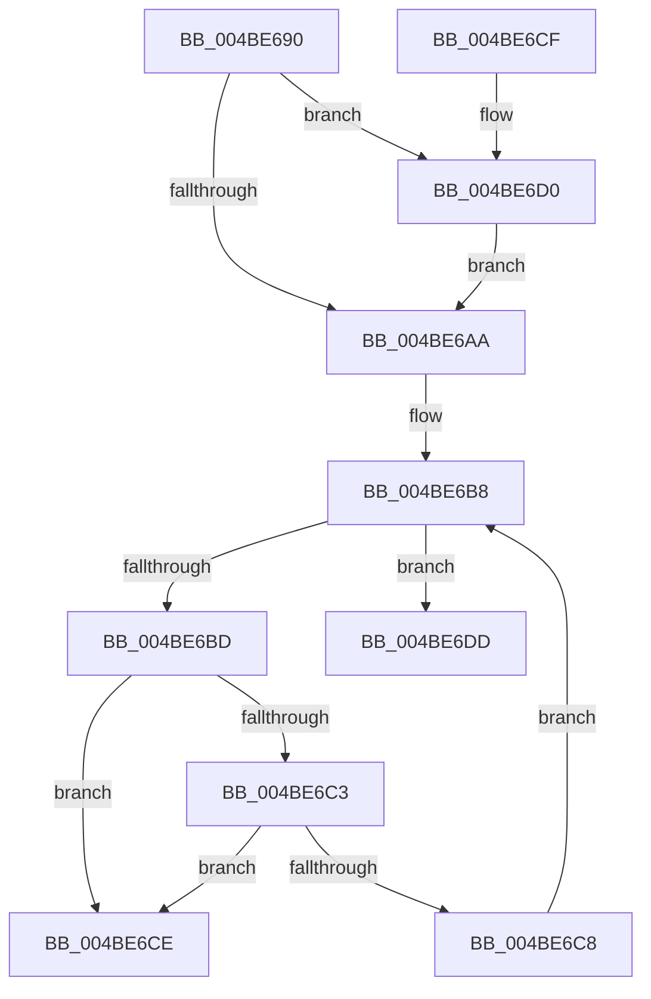

# TelemetryCoverageTableLocateInternal

- RVA: `0x004BE690`–`0x004BE6E6` (길이 `86` bytes)
- VA: `0x00000001404BE690`
- 실행 섹션: `.text`
- PDB 이름 있음: `예`; PDB Function 태그: `예`
- unwind 정보 RVA: `0x000DB714`
- 디코드: `30`개 명령, `86/86` bytes 표시
- 미해석 바이트: `0` (있으면 어셈블리에 `.byte`로 보존)

> 이 문서는 커널 이미지의 기계어와 PDB 기호를 분석해 생성했습니다. 4번과 5번은 함수 원형과 자료형을 바이너리 사용 방식에서 추정한 C 해석이며 원본 소스 복구 결과는 아닙니다.

## 1. Dependencies

- 직접 호출 지점: **0**; 고유 호출 대상: **0**
- 직접 호출자로 확인된 함수: **3**
- RIP 상대 이미지 참조: **0**

### Outgoing calls
- 직접 디코드된 call 명령이 없습니다.

### Direct callers
- [EtwpCoverageCheckCP](../../page/7B/EtwpCoverageCheckCP_function_007B9BC4.md) at `0x007B9C60`
- [EtwpCoverageResetCP](../../page/7B/EtwpCoverageResetCP_function_007BA154.md) at `0x007BA268`
- [EtwpCoverageResetCP](../../page/7B/EtwpCoverageResetCP_function_007BA154.md) at `0x007BA3AD`
- [EtwpCoverageRecord](../../page/98/EtwpCoverageRecord_function_009821BC.md) at `0x00982326`

### Static image references
- 디코드된 RIP-relative 메모리 참조가 없습니다.

## 2. Other-region calls and transfers

- 다른 실행 섹션으로 향하는 call: **0**
- call이 아닌 외부 분기/꼬리 이동: **1**
  - `0x004BE6E1` → `0x006FCB32` (`tail-transfer`)

## 3. Assembly (complete function range)

```asm
004BE690  8B 41 04                        mov eax, dword ptr [rcx + 4]
004BE693  4C 8D 51 34                     lea r10, [rcx + 0x34]
004BE697  44 8B 41 08                     mov r8d, dword ptr [rcx + 8]
004BE69B  44 8B CA                        mov r9d, edx
004BE69E  44 23 C2                        and r8d, edx
004BE6A1  4D 8D 14 82                     lea r10, [r10 + rax*4]
004BE6A5  44 3B C0                        cmp r8d, eax
004BE6A8  73 26                           jae 0x1404be6d0
004BE6AA  41 8B C0                        mov eax, r8d
004BE6AD  48 83 C0 0D                     add rax, 0xd
004BE6B1  4C 8D 04 81                     lea r8, [rcx + rax*4]
004BE6B5  49 8B C0                        mov rax, r8
004BE6B8  49 3B C2                        cmp rax, r10
004BE6BB  73 20                           jae 0x1404be6dd
004BE6BD  8B 10                           mov edx, dword ptr [rax]
004BE6BF  85 D2                           test edx, edx
004BE6C1  74 0B                           je 0x1404be6ce
004BE6C3  41 3B D1                        cmp edx, r9d
004BE6C6  74 06                           je 0x1404be6ce
004BE6C8  48 83 C0 04                     add rax, 4
004BE6CC  EB EA                           jmp 0x1404be6b8
004BE6CE  C3                              ret
004BE6CF  CC                              int3
004BE6D0  44 2B C0                        sub r8d, eax
004BE6D3  44 3B C0                        cmp r8d, eax
004BE6D6  1B C0                           sbb eax, eax
004BE6D8  44 23 C0                        and r8d, eax
004BE6DB  EB CD                           jmp 0x1404be6aa
004BE6DD  48 8D 41 34                     lea rax, [rcx + 0x34]
004BE6E1  E9 4C E4 23 00                  jmp 0x1406fcb32
```

## 4. C-style interpretation (structured pseudocode)

```c
__int64 __fastcall TelemetryCoverageTableLocateInternal(__int64 a1, int a2)
{
    __int64 result;

    a3 = (unsigned int)(((unsigned int)(*(unsigned int *)(a1 + 8))) & (a2));
    if (((unsigned int)(a3)) >= ((unsigned int)((unsigned int)(*(unsigned int *)(a1 + 4))))) goto loc_004BE6D0;
loc_004BE6AA:
    result = ((unsigned int)((unsigned int)(a3))) + (13);
loc_004BE6B8:
    if ((a1 + result * 4) >= (a1 + 52 + (unsigned int)(*(unsigned int *)(a1 + 4)) * 4)) goto loc_004BE6DD;
    if ((unsigned int)((unsigned int)(*(unsigned int *)(a1 + result * 4))) == 0) goto loc_004BE6CE;
    if (((unsigned int)((unsigned int)(*(unsigned int *)(a1 + result * 4)))) == ((unsigned int)((unsigned int)(a2)))) goto loc_004BE6CE;
    result = (a1 + result * 4) + (4);
    goto loc_004BE6B8;
loc_004BE6CE:
    return result;
loc_004BE6D0:
    a3 = (unsigned int)((a1 + result * 4) - ((unsigned int)(result)));
    a3 = (unsigned int)((a3) & ((unsigned int)(result)));
    goto loc_004BE6AA;
loc_004BE6DD:
}
```

## 5. (Beta) C Style

```c
int64_t TelemetryCoverageTableLocateInternal(void *Arg1, int32_t Arg2)
{
    uint8_t *arg1 = (uint8_t *)Arg1;

    int64_t result;

    a3 = (uint32_t)(((uint32_t)(*(uint32_t *)(arg1 + 0x8))) & (Arg2));
    if (((uint32_t)(a3)) >= ((uint32_t)((uint32_t)(*(uint32_t *)(arg1 + 0x4))))) goto loc_004BE6D0;
loc_004BE6AA:
    result = ((uint32_t)((uint32_t)(a3))) + (13);
loc_004BE6B8:
    if ((Arg1 + result * 4) >= (Arg1 + 52 + (uint32_t)(*(uint32_t *)(arg1 + 0x4)) * 4)) goto loc_004BE6DD;
    if ((uint32_t)((uint32_t)(*(uint32_t *)(arg1 + result * 4))) == 0) goto loc_004BE6CE;
    if (((uint32_t)((uint32_t)(*(uint32_t *)(arg1 + result * 4)))) == ((uint32_t)((uint32_t)(Arg2)))) goto loc_004BE6CE;
    result = (Arg1 + result * 4) + (4);
    goto loc_004BE6B8;
loc_004BE6CE:
    return result;
loc_004BE6D0:
    a3 = (uint32_t)((Arg1 + result * 4) - ((uint32_t)(result)));
    a3 = (uint32_t)((a3) & ((uint32_t)(result)));
    goto loc_004BE6AA;
loc_004BE6DD:
}
```

### 관측된 메모리 오프셋

구조체 형식이 확인되지 않은 접근은 인자 기준의 오프셋으로만 기록했습니다.

| 기준 인자 | 오프셋 표현 | 폭 (bit) | 접근 |
|---|---:|---:|---|
| `Arg1` | `+ 0x0 + rax*4` | `64` | `R` |
| `Arg1` | `+ 0x4` | `32` | `R` |
| `Arg1` | `+ 0x8` | `32` | `R` |
| `Arg1` | `+ 0x34` | `64` | `R` |

## 6. Execution-region graph

[열기: 2D/3D 그래프와 함수 탐색 컨트롤 패널](../../../control-panel.html?section=text&rva=0x004BE690&view=graph)

- 2D 그래프는 위에서 아래로 흐르고, 3D 그래프는 빈 공간을 드래그해 회전합니다. Shift+드래그는 이동, 휠은 확대·축소, 함수 노드 선택은 대상 보고서 이동입니다.

### Static fallback


