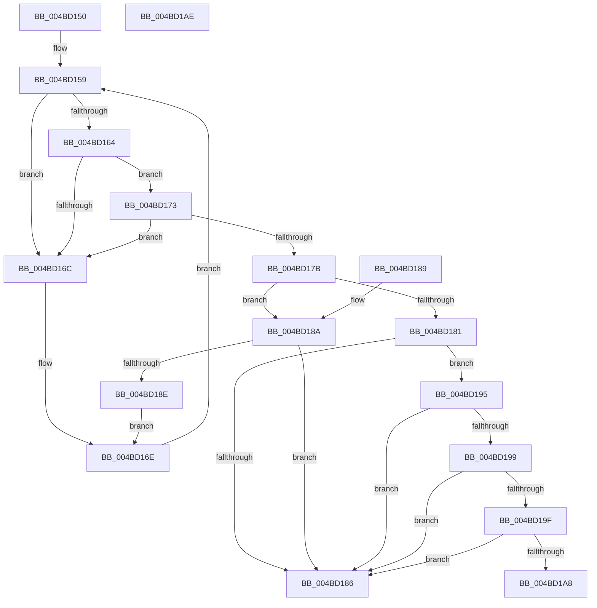

# TelemetryCoverageValidateName

- RVA: `0x004BD150`–`0x004BD1AF` (길이 `95` bytes)
- VA: `0x00000001404BD150`
- 실행 섹션: `.text`
- PDB 이름 있음: `예`; PDB Function 태그: `아니요`
- unwind 정보 RVA: `0x000DB714`
- 디코드: `38`개 명령, `95/95` bytes 표시
- 미해석 바이트: `0` (있으면 어셈블리에 `.byte`로 보존)

> 이 문서는 커널 이미지의 기계어와 PDB 기호를 분석해 생성했습니다. 4번과 5번은 함수 원형과 자료형을 바이너리 사용 방식에서 추정한 C 해석이며 원본 소스 복구 결과는 아닙니다.

## 1. Dependencies

- 직접 호출 지점: **0**; 고유 호출 대상: **0**
- 직접 호출자로 확인된 함수: **1**
- RIP 상대 이미지 참조: **0**

### Outgoing calls
- 직접 디코드된 call 명령이 없습니다.

### Direct callers
- [EtwpCoverageValidateCP](../46/EtwpCoverageValidateCP_function_0046068C.md) at `0x004606D7`

### Static image references
- 디코드된 RIP-relative 메모리 참조가 없습니다.

## 2. Other-region calls and transfers

- 다른 실행 섹션으로 향하는 call: **0**
- 별도 외부 분기/꼬리 이동을 확인하지 못했습니다.

## 3. Assembly (complete function range)

```asm
004BD150  33 D2                           xor edx, edx
004BD152  4C 8B D1                        mov r10, rcx
004BD155  44 8D 4A 01                     lea r9d, [rdx + 1]
004BD159  44 8A 01                        mov r8b, byte ptr [rcx]
004BD15C  41 8D 40 9F                     lea eax, [r8 - 0x61]
004BD160  3C 19                           cmp al, 0x19
004BD162  76 08                           jbe 0x1404bd16c
004BD164  41 8D 40 BF                     lea eax, [r8 - 0x41]
004BD168  3C 19                           cmp al, 0x19
004BD16A  77 07                           ja 0x1404bd173
004BD16C  FF C2                           inc edx
004BD16E  48 FF C1                        inc rcx
004BD171  EB E6                           jmp 0x1404bd159
004BD173  41 8D 40 D0                     lea eax, [r8 - 0x30]
004BD177  3C 09                           cmp al, 9
004BD179  76 F1                           jbe 0x1404bd16c
004BD17B  41 80 F8 5F                     cmp r8b, 0x5f
004BD17F  74 09                           je 0x1404bd18a
004BD181  45 84 C0                        test r8b, r8b
004BD184  74 0F                           je 0x1404bd195
004BD186  33 C0                           xor eax, eax
004BD188  C3                              ret
004BD189  CC                              int3
004BD18A  85 D2                           test edx, edx
004BD18C  74 F8                           je 0x1404bd186
004BD18E  41 FF C1                        inc r9d
004BD191  33 D2                           xor edx, edx
004BD193  EB D9                           jmp 0x1404bd16e
004BD195  85 D2                           test edx, edx
004BD197  74 ED                           je 0x1404bd186
004BD199  41 83 F9 03                     cmp r9d, 3
004BD19D  72 E7                           jb 0x1404bd186
004BD19F  49 2B CA                        sub rcx, r10
004BD1A2  48 83 F9 40                     cmp rcx, 0x40
004BD1A6  7D DE                           jge 0x1404bd186
004BD1A8  B8 01 00 00 00                  mov eax, 1
004BD1AD  C3                              ret
004BD1AE  CC                              int3
```

## 4. C-style interpretation (structured pseudocode)

```c
__int64 __fastcall TelemetryCoverageValidateName(__int64 a1, int a2)
{
    __int64 result;

    a2 = 0;
loc_004BD159:
    if (((unsigned __int8)(*(unsigned __int8 *)(a1) - 97)) <= 25) goto loc_004BD16C;
    if (((unsigned __int8)(*(unsigned __int8 *)(a1) - 65)) > 25) goto loc_004BD173;
loc_004BD16C:
    a2 = (unsigned int)((a2) + 1);
loc_004BD16E:
    a1 = (a1) + 1;
    goto loc_004BD159;
loc_004BD173:
    if (((unsigned __int8)(*(unsigned __int8 *)(a1) - 48)) <= 9) goto loc_004BD16C;
    if (((unsigned __int8)(*(unsigned __int8 *)(a1))) == 95) goto loc_004BD18A;
    if ((unsigned __int8)(*(unsigned __int8 *)(a1)) == 0) goto loc_004BD195;
loc_004BD186:
    result = 0;
    return result;
loc_004BD18A:
    if (a2 == 0) goto loc_004BD186;
    a4 = (unsigned int)((a2 + 1) + 1);
    a2 = 0;
    goto loc_004BD16E;
loc_004BD195:
    if (0 == 0) goto loc_004BD186;
    if (((unsigned int)(a4)) < 3) goto loc_004BD186;
    a1 = (a1) - (a1);
    if (a1 >= 64) goto loc_004BD186;
    return 1;
}
```

## 5. (Beta) C Style

```c
int64_t TelemetryCoverageValidateName(int64_t Arg1, int32_t Arg2)
{
    int64_t result;

    Arg2 = 0;
loc_004BD159:
    if (((uint8_t)(*(uint8_t *)(Arg1) - 97)) <= 25) goto loc_004BD16C;
    if (((uint8_t)(*(uint8_t *)(Arg1) - 65)) > 25) goto loc_004BD173;
loc_004BD16C:
    Arg2 = (uint32_t)((Arg2) + 1);
loc_004BD16E:
    Arg1 = (Arg1) + 1;
    goto loc_004BD159;
loc_004BD173:
    if (((uint8_t)(*(uint8_t *)(Arg1) - 48)) <= 9) goto loc_004BD16C;
    if (((uint8_t)(*(uint8_t *)(Arg1))) == 95) goto loc_004BD18A;
    if ((uint8_t)(*(uint8_t *)(Arg1)) == 0) goto loc_004BD195;
loc_004BD186:
    result = 0;
    return result;
loc_004BD18A:
    if (Arg2 == 0) goto loc_004BD186;
    a4 = (uint32_t)((Arg2 + 1) + 1);
    Arg2 = 0;
    goto loc_004BD16E;
loc_004BD195:
    if (0 == 0) goto loc_004BD186;
    if (((uint32_t)(a4)) < 3) goto loc_004BD186;
    Arg1 = (Arg1) - (Arg1);
    if (Arg1 >= 64) goto loc_004BD186;
    return 1;
}
```

## 6. Execution-region graph

[열기: 2D/3D 그래프와 함수 탐색 컨트롤 패널](../../../control-panel.html?section=text&rva=0x004BD150&view=graph)

- 2D 그래프는 위에서 아래로 흐르고, 3D 그래프는 빈 공간을 드래그해 회전합니다. Shift+드래그는 이동, 휠은 확대·축소, 함수 노드 선택은 대상 보고서 이동입니다.

### Static fallback


