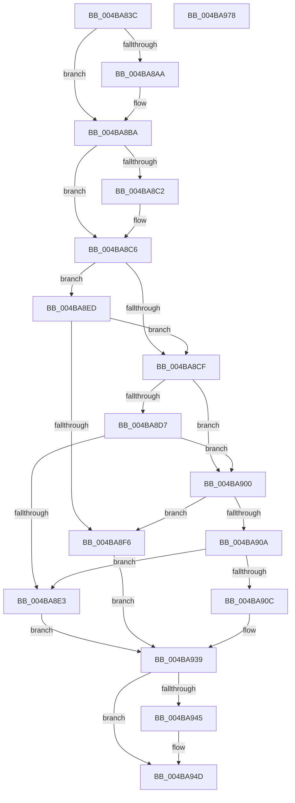

# sub_004BA83C

- RVA: `0x004BA83C`–`0x004BA979` (길이 `317` bytes)
- VA: `0x00000001404BA83C`
- 실행 섹션: `.text`
- PDB 이름 있음: `아니요`; PDB Function 태그: `아니요`
- unwind 정보 RVA: `0x000BB4C4`
- 디코드: `87`개 명령, `317/317` bytes 표시
- 미해석 바이트: `0` (있으면 어셈블리에 `.byte`로 보존)

> 이 문서는 커널 이미지의 기계어와 PDB 기호를 분석해 생성했습니다. 4번과 5번은 함수 원형과 자료형을 바이너리 사용 방식에서 추정한 C 해석이며 원본 소스 복구 결과는 아닙니다.

## 1. Dependencies

- 직접 호출 지점: **6**; 고유 호출 대상: **6**
- 직접 호출자로 확인된 함수: **3**
- RIP 상대 이미지 참조: **0**

### Outgoing calls
- `0x004BA894` → [KeAbPreAcquire](../21/KeAbPreAcquire_function_00210230.md) (function, `0x00210230`)
- `0x004BA8B5` → [ExfAcquirePushLockSharedEx](../21/ExfAcquirePushLockSharedEx_function_0021044C.md) (function, `0x0021044C`)
- `0x004BA930` → [sub_007C8E88](../../page/7C/Unknown_function_007C8E88.md) (function, `0x007C8E88`)
- `0x004BA948` → [ExfReleasePushLockShared](../26/ExfReleasePushLockShared_function_00263440.md) (function, `0x00263440`)
- `0x004BA950` → [KeAbPostRelease](../2E/KeAbPostRelease_function_002E1600.md) (function, `0x002E1600`)
- `0x004BA955` → [KeLeaveCriticalRegion](../25/KeLeaveCriticalRegion_function_0025D8B0.md) (function, `0x0025D8B0`)

### Direct callers
- [ExpConsumeAddonPolicySetCacheProvider](../../page/7C/ExpConsumeAddonPolicySetCacheProvider_function_007C7F40.md) at `0x007C7F68`
- [SLGetSubscriptionPfn](../../page/7C/SLGetSubscriptionPfn_function_007C9108.md) at `0x007C915F`
- [SLGetSubscriptionPfn](../../page/7C/SLGetSubscriptionPfn_function_007C9108.md) at `0x007C91C3`
- [SLQueryLicenseValueInternal](../../page/7C/SLQueryLicenseValueInternal_function_007C93EC.md) at `0x007C980C`
- [SLQueryLicenseValueInternal](../../page/7C/SLQueryLicenseValueInternal_function_007C93EC.md) at `0x007C9A11`

### Static image references
- 디코드된 RIP-relative 메모리 참조가 없습니다.

## 2. Other-region calls and transfers

- 다른 실행 섹션으로 향하는 call: **1**
  - `0x004BA930` → [sub_007C8E88](../../page/7C/Unknown_function_007C8E88.md) (`.text` → `PAGE`)
- 별도 외부 분기/꼬리 이동을 확인하지 못했습니다.

## 3. Assembly (complete function range)

```asm
004BA83C  48 8B C4                        mov rax, rsp
004BA83F  48 89 58 10                     mov qword ptr [rax + 0x10], rbx
004BA843  48 89 70 18                     mov qword ptr [rax + 0x18], rsi
004BA847  48 89 48 08                     mov qword ptr [rax + 8], rcx
004BA84B  57                              push rdi
004BA84C  41 54                           push r12
004BA84E  41 55                           push r13
004BA850  41 56                           push r14
004BA852  41 57                           push r15
004BA854  48 83 EC 50                     sub rsp, 0x50
004BA858  4D 8B F1                        mov r14, r9
004BA85B  4D 8B F8                        mov r15, r8
004BA85E  4C 8B E2                        mov r12, rdx
004BA861  48 8B D9                        mov rbx, rcx
004BA864  65 4C 8B 14 25 88 01 00 00      mov r10, qword ptr gs:[0x188]
004BA86D  4C 89 50 C8                     mov qword ptr [rax - 0x38], r10
004BA871  41 0F B7 82 E4 01 00 00         movzx eax, word ptr [r10 + 0x1e4]
004BA879  66 FF C8                        dec ax
004BA87C  66 41 89 82 E4 01 00 00         mov word ptr [r10 + 0x1e4], ax
004BA884  90                              nop
004BA885  48 8D B9 F8 B6 00 00            lea rdi, [rcx + 0xb6f8]
004BA88C  45 33 C0                        xor r8d, r8d
004BA88F  33 D2                           xor edx, edx
004BA891  48 8B CF                        mov rcx, rdi
004BA894  E8 97 59 D5 FF                  call 0x140210230
004BA899  48 8B F0                        mov rsi, rax
004BA89C  B9 11 00 00 00                  mov ecx, 0x11
004BA8A1  33 C0                           xor eax, eax
004BA8A3  F0 48 0F B1 0F                  lock cmpxchg qword ptr [rdi], rcx
004BA8A8  74 10                           je 0x1404ba8ba
004BA8AA  4C 8B CF                        mov r9, rdi
004BA8AD  4C 8B C6                        mov r8, rsi
004BA8B0  33 D2                           xor edx, edx
004BA8B2  48 8B CF                        mov rcx, rdi
004BA8B5  E8 92 5B D5 FF                  call 0x14021044c
004BA8BA  45 33 ED                        xor r13d, r13d
004BA8BD  48 85 F6                        test rsi, rsi
004BA8C0  74 04                           je 0x1404ba8c6
004BA8C2  C6 46 0A 01                     mov byte ptr [rsi + 0xa], 1
004BA8C6  80 BB EC B6 00 00 01            cmp byte ptr [rbx + 0xb6ec], 1
004BA8CD  74 1E                           je 0x1404ba8ed
004BA8CF  48 8B 03                        mov rax, qword ptr [rbx]
004BA8D2  48 85 C0                        test rax, rax
004BA8D5  75 29                           jne 0x1404ba900
004BA8D7  48 8B 83 F0 B6 00 00            mov rax, qword ptr [rbx + 0xb6f0]
004BA8DE  48 85 C0                        test rax, rax
004BA8E1  75 1D                           jne 0x1404ba900
004BA8E3  C7 44 24 30 3E 00 00 C0         mov dword ptr [rsp + 0x30], 0xc000003e
004BA8EB  EB 4C                           jmp 0x1404ba939
004BA8ED  44 39 AB E8 B6 00 00            cmp dword ptr [rbx + 0xb6e8], r13d
004BA8F4  75 D9                           jne 0x1404ba8cf
004BA8F6  C7 44 24 30 34 00 00 C0         mov dword ptr [rsp + 0x30], 0xc0000034
004BA8FE  EB 39                           jmp 0x1404ba939
004BA900  48 89 44 24 38                  mov qword ptr [rsp + 0x38], rax
004BA905  83 38 18                        cmp dword ptr [rax], 0x18
004BA908  74 EC                           je 0x1404ba8f6
004BA90A  72 D7                           jb 0x1404ba8e3
004BA90C  48 8B 84 24 A8 00 00 00         mov rax, qword ptr [rsp + 0xa8]
004BA914  48 89 44 24 28                  mov qword ptr [rsp + 0x28], rax
004BA919  8B 84 24 A0 00 00 00            mov eax, dword ptr [rsp + 0xa0]
004BA920  89 44 24 20                     mov dword ptr [rsp + 0x20], eax
004BA924  4D 8B CE                        mov r9, r14
004BA927  4D 8B C7                        mov r8, r15
004BA92A  49 8B D4                        mov rdx, r12
004BA92D  48 8B CB                        mov rcx, rbx
004BA930  E8 53 E5 30 00                  call 0x1407c8e88
004BA935  89 44 24 30                     mov dword ptr [rsp + 0x30], eax
004BA939  B8 11 00 00 00                  mov eax, 0x11
004BA93E  F0 4C 0F B1 2F                  lock cmpxchg qword ptr [rdi], r13
004BA943  74 08                           je 0x1404ba94d
004BA945  48 8B CF                        mov rcx, rdi
004BA948  E8 F3 8A DA FF                  call 0x140263440
004BA94D  48 8B CF                        mov rcx, rdi
004BA950  E8 AB 6C E2 FF                  call 0x1402e1600
004BA955  E8 56 2F DA FF                  call 0x14025d8b0
004BA95A  8B 44 24 30                     mov eax, dword ptr [rsp + 0x30]
004BA95E  4C 8D 5C 24 50                  lea r11, [rsp + 0x50]
004BA963  49 8B 5B 38                     mov rbx, qword ptr [r11 + 0x38]
004BA967  49 8B 73 40                     mov rsi, qword ptr [r11 + 0x40]
004BA96B  49 8B E3                        mov rsp, r11
004BA96E  41 5F                           pop r15
004BA970  41 5E                           pop r14
004BA972  41 5D                           pop r13
004BA974  41 5C                           pop r12
004BA976  5F                              pop rdi
004BA977  C3                              ret
004BA978  CC                              int3
```

## 4. C-style interpretation (structured pseudocode)

```c
__int64 __fastcall sub_004BA83C(__int64 a1, __int64 a2, __int64 a3, __int64 a4, unsigned int a5, __int64 a6)
{
    __int64 result;
    __int64 v_r13;
    __int64 v_rsp;
    unsigned __int64 v_stack_m28;
    unsigned __int64 v_stack_m40;
    unsigned int v_stack_m48;
    unsigned __int64 v_stack_m50;
    unsigned int v_stack_m58;

    *(unsigned __int64 *)(v_rsp + 16) = v_rbx;
    *(unsigned __int64 *)(v_rsp + 24) = v_rsi;
    *(unsigned __int64 *)(v_rsp + 8) = a1;
    v_rsp = (v_rsp) - (80);
    *(unsigned __int64 *)(v_rsp - 56) = *(unsigned __int64 *)(gs_base + (0 + 392));
    result = (unsigned __int16)((*(unsigned __int16 *)(*(unsigned __int64 *)(gs_base + (0 + 392)) + 484)) - 1);
    *(unsigned __int16 *)(*(unsigned __int64 *)(gs_base + (0 + 392)) + 484) = (unsigned __int16)(result);
    a3 = 0;
    a2 = 0;
    result = KeAbPreAcquire(a1 + 46840, a2, a3, a4);
    result = 0;
    if (!(condition_is_equal)) {
        a4 = a1 + 46840;
        a3 = 0;
        a2 = 0;
        a1 = a1 + 46840;
        result = ExfAcquirePushLockSharedEx(a1, a2, a3, a4);
    }
    v_r13 = 0;
    if (result != 0) {
        *(unsigned __int8 *)(result + 10) = 1;
    }
    if ((*(unsigned __int8 *)(a1 + 46828)) == 1) goto loc_004BA8ED;
loc_004BA8CF:
    if (*(unsigned __int64 *)(a1) != 0) goto loc_004BA900;
    if (*(unsigned __int64 *)(a1 + 46832) != 0) goto loc_004BA900;
loc_004BA8E3:
    v_stack_m48 = 0xC000003EULL;
    goto loc_004BA939;
loc_004BA8ED:
    if ((*(unsigned int *)(a1 + 46824)) != 0) goto loc_004BA8CF;
loc_004BA8F6:
    v_stack_m48 = 0xC0000034ULL;
    goto loc_004BA939;
loc_004BA900:
    v_stack_m40 = *(unsigned __int64 *)(a1 + 46832);
    if ((*(unsigned int *)(*(unsigned __int64 *)(a1 + 46832))) == 24) goto loc_004BA8F6;
    if ((*(unsigned int *)(*(unsigned __int64 *)(a1 + 46832))) < 24) goto loc_004BA8E3;
    v_stack_m50 = a6;
    v_stack_m58 = (unsigned int)((unsigned int)(a5));
    result = sub_007C8E88(a1, 0, a3, a4);
    v_stack_m48 = (unsigned int)(result);
loc_004BA939:
    result = 17;
    if ((*(unsigned int *)(*(unsigned __int64 *)(a1 + 46832))) != 24) {
        a1 = a1 + 46840;
        result = ExfReleasePushLockShared(a1, 0, a3, a4);
    }
    result = KeAbPostRelease(a1 + 46840, 0, a3, a4);
    result = KeLeaveCriticalRegion(a1 + 46840, 0, a3, a4);
    return (unsigned int)(v_stack_m48);
}
```

## 5. (Beta) C Style

```c
int64_t sub_004BA83C(void *Arg1, int64_t Arg2, int64_t Arg3, int64_t Arg4, uint32_t Arg5, int64_t Arg6)
{
    uint8_t *arg1 = (uint8_t *)Arg1;

    int64_t result;
    int64_t local_r13;
    int64_t local_rsp;
    uint64_t v_stack_m28;
    uint64_t v_stack_m40;
    uint32_t v_stack_m48;
    uint64_t v_stack_m50;
    uint32_t v_stack_m58;

    *(uint64_t *)(local_rsp + 0x10) = local_rbx;
    *(uint64_t *)(local_rsp + 0x18) = local_rsi;
    *(void **)(local_rsp + 0x8) = Arg1;
    local_rsp = (local_rsp) - (80);
    *(uint64_t *)(local_rsp - 0x38) = *(uint64_t *)(gs_base + (0 + 0x188));
    result = (uint16_t)((*(uint16_t *)(*(uint64_t *)(gs_base + (0 + 0x188)) + 0x1E4)) - 1);
    *(uint16_t *)(*(uint64_t *)(gs_base + (0 + 0x188)) + 0x1E4) = (uint16_t)(result);
    Arg3 = 0;
    Arg2 = 0;
    result = KeAbPreAcquire(Arg1 + 46840, Arg2, Arg3, Arg4);
    result = 0;
    if (!(condition_is_equal)) {
        Arg4 = Arg1 + 46840;
        Arg3 = 0;
        Arg2 = 0;
        Arg1 = Arg1 + 46840;
        result = ExfAcquirePushLockSharedEx(Arg1, Arg2, Arg3, Arg4);
    }
    local_r13 = 0;
    if (result != 0) {
        *(uint8_t *)(result + 0xA) = 1;
    }
    if ((*(uint8_t *)(arg1 + 0xB6EC)) == 1) goto loc_004BA8ED;
loc_004BA8CF:
    if (*(uint64_t *)(arg1) != 0) goto loc_004BA900;
    if (*(uint64_t *)(arg1 + 0xB6F0) != 0) goto loc_004BA900;
loc_004BA8E3:
    v_stack_m48 = 0xC000003EULL;
    goto loc_004BA939;
loc_004BA8ED:
    if ((*(uint32_t *)(arg1 + 0xB6E8)) != 0) goto loc_004BA8CF;
loc_004BA8F6:
    v_stack_m48 = 0xC0000034ULL;
    goto loc_004BA939;
loc_004BA900:
    v_stack_m40 = *(uint64_t *)(arg1 + 0xB6F0);
    if ((*(uint32_t *)(*(uint64_t *)(arg1 + 0xB6F0))) == 24) goto loc_004BA8F6;
    if ((*(uint32_t *)(*(uint64_t *)(arg1 + 0xB6F0))) < 24) goto loc_004BA8E3;
    v_stack_m50 = Arg6;
    v_stack_m58 = (uint32_t)((uint32_t)(Arg5));
    result = sub_007C8E88(Arg1, 0, Arg3, Arg4);
    v_stack_m48 = (uint32_t)(result);
loc_004BA939:
    result = 17;
    if ((*(uint32_t *)(*(uint64_t *)(arg1 + 0xB6F0))) != 24) {
        Arg1 = Arg1 + 46840;
        result = ExfReleasePushLockShared(Arg1, 0, Arg3, Arg4);
    }
    result = KeAbPostRelease(Arg1 + 46840, 0, Arg3, Arg4);
    result = KeLeaveCriticalRegion(Arg1 + 46840, 0, Arg3, Arg4);
    return (uint32_t)(v_stack_m48);
}
```

### 관측된 메모리 오프셋

구조체 형식이 확인되지 않은 접근은 인자 기준의 오프셋으로만 기록했습니다.

| 기준 인자 | 오프셋 표현 | 폭 (bit) | 접근 |
|---|---:|---:|---|
| `Arg1` | `+ 0x0` | `64` | `R` |
| `Arg1` | `+ 0xB6E8` | `32` | `R` |
| `Arg1` | `+ 0xB6EC` | `8` | `R` |
| `Arg1` | `+ 0xB6F0` | `64` | `R` |
| `Arg1` | `+ 0xB6F8` | `64` | `R` |

## 6. Execution-region graph

[열기: 2D/3D 그래프와 함수 탐색 컨트롤 패널](../../../control-panel.html?section=text&rva=0x004BA83C&view=graph)

- 2D 그래프는 위에서 아래로 흐르고, 3D 그래프는 빈 공간을 드래그해 회전합니다. Shift+드래그는 이동, 휠은 확대·축소, 함수 노드 선택은 대상 보고서 이동입니다.

### Static fallback


