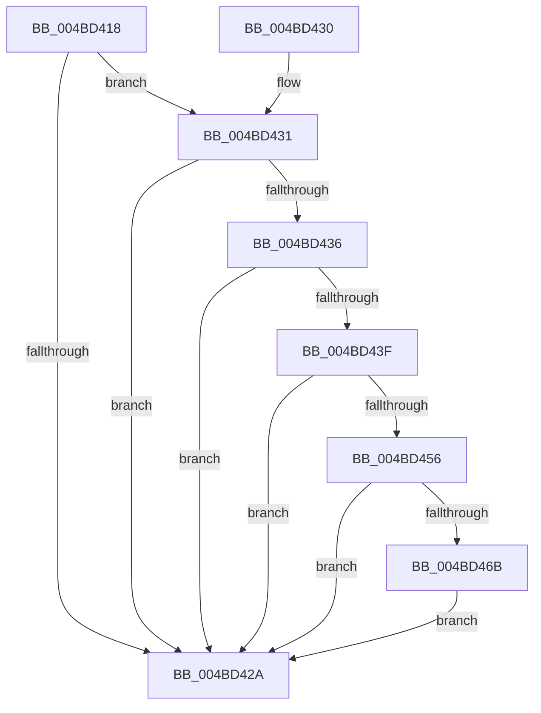

# VfDriverLoadSucceeded

- RVA: `0x004BD418`–`0x004BD481` (길이 `105` bytes)
- VA: `0x00000001404BD418`
- 실행 섹션: `.text`
- PDB 이름 있음: `예`; PDB Function 태그: `아니요`
- unwind 정보 RVA: `0x0006CB1C`
- 디코드: `30`개 명령, `105/105` bytes 표시
- 미해석 바이트: `0` (있으면 어셈블리에 `.byte`로 보존)

> 이 문서는 커널 이미지의 기계어와 PDB 기호를 분석해 생성했습니다. 4번과 5번은 함수 원형과 자료형을 바이너리 사용 방식에서 추정한 C 해석이며 원본 소스 복구 결과는 아닙니다.

## 1. Dependencies

- 직접 호출 지점: **2**; 고유 호출 대상: **2**
- 직접 호출자로 확인된 함수: **2**
- RIP 상대 이미지 참조: **6**

### Outgoing calls
- `0x004BD44D` → [RtlEqualUnicodeString](../../page/93/RtlEqualUnicodeString_function_00932A20.md) (function, `0x00932A20`)
- `0x004BD459` → [ViXdvDriverLoadImage](../../pagevrfy/B9/ViXdvDriverLoadImage_function_00B9A9A0.md) (function, `0x00B9A9A0`)

### Direct callers
- [MiDriverLoadSucceeded](../../page/70/MiDriverLoadSucceeded_function_00702F08.md) at `0x00702F6F`
- [MmLoadSystemImageEx](../../page/99/MmLoadSystemImageEx_function_00999B8C.md) at `0x0099A166`

### Static image references
- `0x004BD41E` → RVA `0x00F048B8` (`.data`; read)
- `0x004BD436` → RVA `0x00FFDA18` (`PAGEVRFD`; read)
- `0x004BD443` → RVA `0x00FF4150` (`PAGEVRFD`; read)
- `0x004BD461` → RVA `0x00FFDA18` (`PAGEVRFD`; write)
- `0x004BD46F` → RVA `0x00F04370` (`.data`; write)
- `0x004BD479` → RVA `0x00F04378` (`.data`; write)

## 2. Other-region calls and transfers

- 다른 실행 섹션으로 향하는 call: **2**
  - `0x004BD44D` → [RtlEqualUnicodeString](../../page/93/RtlEqualUnicodeString_function_00932A20.md) (`.text` → `PAGE`)
  - `0x004BD459` → [ViXdvDriverLoadImage](../../pagevrfy/B9/ViXdvDriverLoadImage_function_00B9A9A0.md) (`.text` → `PAGEVRFY`)
- 별도 외부 분기/꼬리 이동을 확인하지 못했습니다.

## 3. Assembly (complete function range)

```asm
004BD418  40 53                           push rbx
004BD41A  48 83 EC 20                     sub rsp, 0x20
004BD41E  80 3D 93 74 A4 00 00            cmp byte ptr [rip + 0xa47493], 0
004BD425  48 8B D9                        mov rbx, rcx
004BD428  75 07                           jne 0x1404bd431
004BD42A  48 83 C4 20                     add rsp, 0x20
004BD42E  5B                              pop rbx
004BD42F  C3                              ret
004BD430  CC                              int3
004BD431  48 85 DB                        test rbx, rbx
004BD434  74 F4                           je 0x1404bd42a
004BD436  83 3D DB 05 B4 00 00            cmp dword ptr [rip + 0xb405db], 0
004BD43D  75 EB                           jne 0x1404bd42a
004BD43F  48 83 C1 58                     add rcx, 0x58
004BD443  48 8D 15 06 6D B3 00            lea rdx, [rip + 0xb36d06]
004BD44A  41 B0 01                        mov r8b, 1
004BD44D  E8 CE 55 47 00                  call 0x140932a20
004BD452  84 C0                           test al, al
004BD454  74 D4                           je 0x1404bd42a
004BD456  48 8B CB                        mov rcx, rbx
004BD459  E8 42 D5 6D 00                  call 0x140b9a9a0
004BD45E  0F B6 C0                        movzx eax, al
004BD461  89 05 B1 05 B4 00               mov dword ptr [rip + 0xb405b1], eax
004BD467  85 C0                           test eax, eax
004BD469  74 BF                           je 0x1404bd42a
004BD46B  48 8B 43 30                     mov rax, qword ptr [rbx + 0x30]
004BD46F  48 89 05 FA 6E A4 00            mov qword ptr [rip + 0xa46efa], rax
004BD476  8B 43 40                        mov eax, dword ptr [rbx + 0x40]
004BD479  89 05 F9 6E A4 00               mov dword ptr [rip + 0xa46ef9], eax
004BD47F  EB A9                           jmp 0x1404bd42a
```

## 4. C-style interpretation (structured pseudocode)

```c
__int64 __fastcall VfDriverLoadSucceeded(__int64 a1)
{
    __int64 result;
    __int64 v_rsp;

    v_rsp = (v_rsp) - (32);
    if ((*(unsigned __int8 *)(v_rip + 10777747)) != 0) goto loc_004BD431;
loc_004BD42A:
    v_rsp = (v_rsp) + (32);
    return result;
loc_004BD431:
    if (a1 == 0) goto loc_004BD42A;
    if ((*(unsigned int *)(v_rip + 11797979)) != 0) goto loc_004BD42A;
    a1 = (a1) + (88);
    result = RtlEqualUnicodeString(a1, v_rip + 11758854, 1, a4);
    if ((unsigned __int8)(result) == 0) goto loc_004BD42A;
    result = ViXdvDriverLoadImage(a1, v_rip + 11758854, 1, a4);
    *(unsigned int *)(v_rip + 11797937) = (unsigned int)((unsigned __int8)(result));
    if ((unsigned int)((unsigned __int8)(result)) == 0) goto loc_004BD42A;
    *(unsigned __int64 *)(v_rip + 10776314) = *(unsigned __int64 *)(a1 + 48);
    *(unsigned int *)(v_rip + 10776313) = (unsigned int)((unsigned int)(*(unsigned int *)(a1 + 64)));
    goto loc_004BD42A;
}
```

## 5. (Beta) C Style

```c
int64_t VfDriverLoadSucceeded(int64_t Arg1)
{
    int64_t result;
    int64_t local_rsp;

    local_rsp = (local_rsp) - (32);
    if ((*(uint8_t *)(v_rip + 0xA47493)) != 0) goto loc_004BD431;
loc_004BD42A:
    local_rsp = (local_rsp) + (32);
    return result;
loc_004BD431:
    if (Arg1 == 0) goto loc_004BD42A;
    if ((*(uint32_t *)(v_rip + 0xB405DB)) != 0) goto loc_004BD42A;
    Arg1 = (Arg1) + (88);
    result = RtlEqualUnicodeString(Arg1, v_rip + 11758854, 1, a4);
    if ((uint8_t)(result) == 0) goto loc_004BD42A;
    result = ViXdvDriverLoadImage(Arg1, v_rip + 11758854, 1, a4);
    *(uint32_t *)(v_rip + 0xB405B1) = (uint32_t)((uint8_t)(result));
    if ((uint32_t)((uint8_t)(result)) == 0) goto loc_004BD42A;
    *(uint64_t *)(v_rip + 0xA46EFA) = *(uint64_t *)(Arg1 + 0x30);
    *(uint32_t *)(v_rip + 0xA46EF9) = (uint32_t)((uint32_t)(*(uint32_t *)(Arg1 + 0x40)));
    goto loc_004BD42A;
}
```

## 6. Execution-region graph

[열기: 2D/3D 그래프와 함수 탐색 컨트롤 패널](../../../control-panel.html?section=text&rva=0x004BD418&view=graph)

- 2D 그래프는 위에서 아래로 흐르고, 3D 그래프는 빈 공간을 드래그해 회전합니다. Shift+드래그는 이동, 휠은 확대·축소, 함수 노드 선택은 대상 보고서 이동입니다.

### Static fallback


