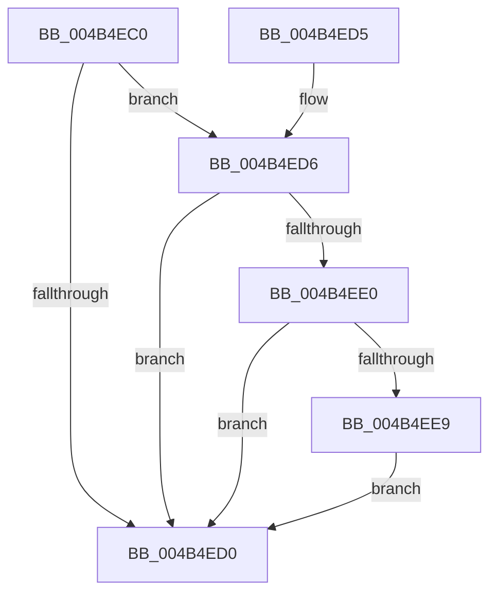

# VfFailDeviceNode

- RVA: `0x004B4EC0`–`0x004B4F17` (길이 `87` bytes)
- VA: `0x00000001404B4EC0`
- 실행 섹션: `.text`
- PDB 이름 있음: `예`; PDB Function 태그: `아니요`
- unwind 정보 RVA: `0x000BA0C0`
- 디코드: `24`개 명령, `87/87` bytes 표시
- 미해석 바이트: `0` (있으면 어셈블리에 `.byte`로 보존)

> 이 문서는 커널 이미지의 기계어와 PDB 기호를 분석해 생성했습니다. 4번과 5번은 함수 원형과 자료형을 바이너리 사용 방식에서 추정한 C 해석이며 원본 소스 복구 결과는 아닙니다.

## 1. Dependencies

- 직접 호출 지점: **2**; 고유 호출 대상: **2**
- 직접 호출자로 확인된 함수: **0**
- RIP 상대 이미지 참조: **2**

### Outgoing calls
- `0x004B4EE0` → [PpvUtilIsHardwareBeingVerified](../../pagevrfy/B9/PpvUtilIsHardwareBeingVerified_function_00B92C48.md) (function, `0x00B92C48`)
- `0x004B4F10` → [CarReportRuleViolationFromNt](../../pagevrfy/B9/CarReportRuleViolationFromNt_function_00B9D904.md) (function, `0x00B9D904`)

### Direct callers
- 이 함수 시작 RVA로 연결되는 직접 call은 확인되지 않았습니다. 간접 호출은 완전히 역산할 수 없습니다.

### Static image references
- `0x004B4EC4` → RVA `0x00F048D0` (`.data`; read)
- `0x004B4ED6` → RVA `0x00F04A20` (`.data`; read)

## 2. Other-region calls and transfers

- 다른 실행 섹션으로 향하는 call: **2**
  - `0x004B4EE0` → [PpvUtilIsHardwareBeingVerified](../../pagevrfy/B9/PpvUtilIsHardwareBeingVerified_function_00B92C48.md) (`.text` → `PAGEVRFY`)
  - `0x004B4F10` → [CarReportRuleViolationFromNt](../../pagevrfy/B9/CarReportRuleViolationFromNt_function_00B9D904.md) (`.text` → `PAGEVRFY`)
- 별도 외부 분기/꼬리 이동을 확인하지 못했습니다.

## 3. Assembly (complete function range)

```asm
004B4EC0  48 83 EC 48                     sub rsp, 0x48
004B4EC4  83 3D 05 FA A4 00 00            cmp dword ptr [rip + 0xa4fa05], 0
004B4ECB  44 8B D2                        mov r10d, edx
004B4ECE  75 06                           jne 0x1404b4ed6
004B4ED0  48 83 C4 48                     add rsp, 0x48
004B4ED4  C3                              ret
004B4ED5  CC                              int3
004B4ED6  8B 05 44 FB A4 00               mov eax, dword ptr [rip + 0xa4fb44]
004B4EDC  85 C0                           test eax, eax
004B4EDE  78 F0                           js 0x1404b4ed0
004B4EE0  E8 63 DD 6D 00                  call 0x140b92c48
004B4EE5  84 C0                           test al, al
004B4EE7  74 E7                           je 0x1404b4ed0
004B4EE9  48 8B 41 08                     mov rax, qword ptr [rcx + 8]
004B4EED  45 33 C9                        xor r9d, r9d
004B4EF0  41 8B D0                        mov edx, r8d
004B4EF3  4C 8B C1                        mov r8, rcx
004B4EF6  41 8B CA                        mov ecx, r10d
004B4EF9  48 8B 40 18                     mov rax, qword ptr [rax + 0x18]
004B4EFD  48 89 44 24 30                  mov qword ptr [rsp + 0x30], rax
004B4F02  C7 44 24 28 1E 00 00 00         mov dword ptr [rsp + 0x28], 0x1e
004B4F0A  48 83 64 24 20 00               and qword ptr [rsp + 0x20], 0
004B4F10  E8 EF 89 6E 00                  call 0x140b9d904
004B4F15  EB B9                           jmp 0x1404b4ed0
```

## 4. C-style interpretation (structured pseudocode)

```c
__int64 __fastcall VfFailDeviceNode(__int64 a1, int a2, int a3, int a4)
{
    __int64 result;
    __int64 v_rsp;
    unsigned __int64 v_stack_p20;
    unsigned int v_stack_p28;
    unsigned __int64 v_stack_p30;

    v_rsp = (v_rsp) - (72);
    if ((*(unsigned int *)(v_rip + 10811909)) != 0) goto loc_004B4ED6;
loc_004B4ED0:
    v_rsp = (v_rsp) + (72);
    return result;
loc_004B4ED6:
    if (sign_flag) goto loc_004B4ED0;
    result = PpvUtilIsHardwareBeingVerified(a1, a2, a3, a4);
    if ((unsigned __int8)(result) == 0) goto loc_004B4ED0;
    a4 = 0;
    v_stack_p30 = *(unsigned __int64 *)(*(unsigned __int64 *)(a1 + 8) + 24);
    v_stack_p28 = 30;
    result = CarReportRuleViolationFromNt((unsigned int)((unsigned int)((unsigned int)(a2))), (unsigned int)(a3), a1, a4);
    goto loc_004B4ED0;
}
```

## 5. (Beta) C Style

```c
int64_t VfFailDeviceNode(int64_t Arg1, int32_t Arg2, int32_t Arg3, int32_t Arg4)
{
    int64_t result;
    int64_t local_rsp;
    uint64_t v_stack_p20;
    uint32_t v_stack_p28;
    uint64_t v_stack_p30;

    local_rsp = (local_rsp) - (72);
    if ((*(uint32_t *)(v_rip + 0xA4FA05)) != 0) goto loc_004B4ED6;
loc_004B4ED0:
    local_rsp = (local_rsp) + (72);
    return result;
loc_004B4ED6:
    if (sign_flag) goto loc_004B4ED0;
    result = PpvUtilIsHardwareBeingVerified(Arg1, Arg2, Arg3, Arg4);
    if ((uint8_t)(result) == 0) goto loc_004B4ED0;
    Arg4 = 0;
    v_stack_p30 = *(uint64_t *)(*(uint64_t *)(Arg1 + 0x8) + 0x18);
    v_stack_p28 = 30;
    result = CarReportRuleViolationFromNt((uint32_t)((uint32_t)((uint32_t)(Arg2))), (uint32_t)(Arg3), Arg1, Arg4);
    goto loc_004B4ED0;
}
```

## 6. Execution-region graph

[열기: 2D/3D 그래프와 함수 탐색 컨트롤 패널](../../../control-panel.html?section=text&rva=0x004B4EC0&view=graph)

- 2D 그래프는 위에서 아래로 흐르고, 3D 그래프는 빈 공간을 드래그해 회전합니다. Shift+드래그는 이동, 휠은 확대·축소, 함수 노드 선택은 대상 보고서 이동입니다.

### Static fallback


