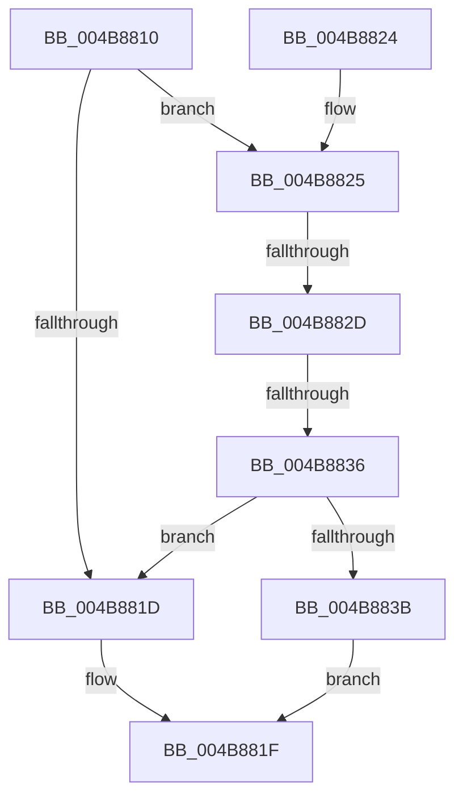

# VfIsVerificationEnabled

- RVA: `0x004B8810`–`0x004B8848` (길이 `56` bytes)
- VA: `0x00000001404B8810`
- 실행 섹션: `.text`
- PDB 이름 있음: `예`; PDB Function 태그: `예`
- unwind 정보 RVA: `0x000841D0`
- 디코드: `17`개 명령, `56/56` bytes 표시
- 미해석 바이트: `0` (있으면 어셈블리에 `.byte`로 보존)

> 이 문서는 커널 이미지의 기계어와 PDB 기호를 분석해 생성했습니다. 4번과 5번은 함수 원형과 자료형을 바이너리 사용 방식에서 추정한 C 해석이며 원본 소스 복구 결과는 아닙니다.

## 1. Dependencies

- 직접 호출 지점: **0**; 고유 호출 대상: **0**
- 직접 호출자로 확인된 함수: **1**
- RIP 상대 이미지 참조: **2**

### Outgoing calls
- 직접 디코드된 call 명령이 없습니다.

### Direct callers
- [VfFailSystemBIOS](../61/VfFailSystemBIOS_function_00612770.md) at `0x006127A6`

### Static image references
- `0x004B8814` → RVA `0x00F048D0` (`.data`; read)
- `0x004B883B` → RVA `0x00F04A20` (`.data`; read)

## 2. Other-region calls and transfers

- 다른 실행 섹션으로 향하는 call: **0**
- call이 아닌 외부 분기/꼬리 이동: **2**
  - `0x004B8827` → [sub_006FC1AC](../6F/Unknown_function_006FC1AC.md) (`tail-transfer`)
  - `0x004B8830` → [sub_006FC1AC + 0x1A](../6F/Unknown_function_006FC1AC.md) (`tail-transfer`)

## 3. Assembly (complete function range)

```asm
004B8810  48 83 EC 28                     sub rsp, 0x28
004B8814  83 3D B5 C0 A4 00 00            cmp dword ptr [rip + 0xa4c0b5], 0
004B881B  75 08                           jne 0x1404b8825
004B881D  33 C0                           xor eax, eax
004B881F  48 83 C4 28                     add rsp, 0x28
004B8823  C3                              ret
004B8824  CC                              int3
004B8825  85 C9                           test ecx, ecx
004B8827  0F 84 7F 39 24 00               je 0x1406fc1ac
004B882D  83 E9 01                        sub ecx, 1
004B8830  0F 84 90 39 24 00               je 0x1406fc1c6
004B8836  83 F9 01                        cmp ecx, 1
004B8839  75 E2                           jne 0x1404b881d
004B883B  8B 05 DF C1 A4 00               mov eax, dword ptr [rip + 0xa4c1df]
004B8841  C1 E8 1E                        shr eax, 0x1e
004B8844  23 C1                           and eax, ecx
004B8846  EB D7                           jmp 0x1404b881f
```

## 4. C-style interpretation (structured pseudocode)

```c
__int64 __fastcall VfIsVerificationEnabled(int a1)
{
    __int64 result;
    __int64 v_rsp;

    v_rsp = (v_rsp) - (40);
    if ((*(unsigned int *)(v_rip + 10797237)) != 0) goto loc_004B8825;
loc_004B881D:
    result = 0;
loc_004B881F:
    v_rsp = (v_rsp) + (40);
    return result;
loc_004B8825:
    a1 = (unsigned int)((a1) - (1));
    if (a1 != 1) goto loc_004B881D;
    result = (unsigned int)(((unsigned int)(*(unsigned int *)(v_rip + 10797535))) >> (30));
    result = (unsigned int)((result) & (a1));
    goto loc_004B881F;
}
```

## 5. (Beta) C Style

```c
int64_t VfIsVerificationEnabled(int32_t Arg1)
{
    int64_t result;
    int64_t local_rsp;

    local_rsp = (local_rsp) - (40);
    if ((*(uint32_t *)(v_rip + 0xA4C0B5)) != 0) goto loc_004B8825;
loc_004B881D:
    result = 0;
loc_004B881F:
    local_rsp = (local_rsp) + (40);
    return result;
loc_004B8825:
    Arg1 = (uint32_t)((Arg1) - (1));
    if (Arg1 != 1) goto loc_004B881D;
    result = (uint32_t)(((uint32_t)(*(uint32_t *)(v_rip + 0xA4C1DF))) >> (30));
    result = (uint32_t)((result) & (Arg1));
    goto loc_004B881F;
}
```

## 6. Execution-region graph

[열기: 2D/3D 그래프와 함수 탐색 컨트롤 패널](../../../control-panel.html?section=text&rva=0x004B8810&view=graph)

- 2D 그래프는 위에서 아래로 흐르고, 3D 그래프는 빈 공간을 드래그해 회전합니다. Shift+드래그는 이동, 휠은 확대·축소, 함수 노드 선택은 대상 보고서 이동입니다.

### Static fallback


