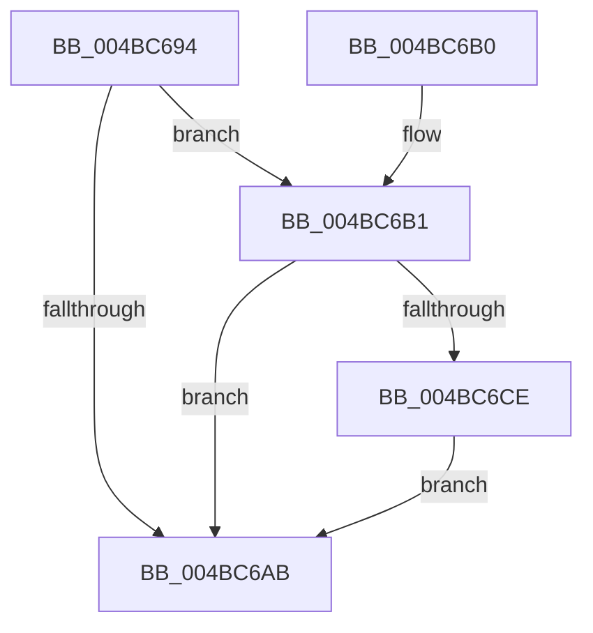

# VfMiscCheckKernelAddress

- RVA: `0x004BC694`–`0x004BC6F6` (길이 `98` bytes)
- VA: `0x00000001404BC694`
- 실행 섹션: `.text`
- PDB 이름 있음: `예`; PDB Function 태그: `아니요`
- unwind 정보 RVA: `0x000BB950`
- 디코드: `26`개 명령, `98/98` bytes 표시
- 미해석 바이트: `0` (있으면 어셈블리에 `.byte`로 보존)

> 이 문서는 커널 이미지의 기계어와 PDB 기호를 분석해 생성했습니다. 4번과 5번은 함수 원형과 자료형을 바이너리 사용 방식에서 추정한 C 해석이며 원본 소스 복구 결과는 아닙니다.

## 1. Dependencies

- 직접 호출 지점: **1**; 고유 호출 대상: **1**
- 직접 호출자로 확인된 함수: **20**
- RIP 상대 이미지 참조: **0**

### Outgoing calls
- `0x004BC6EF` → [CarReportRuleViolationFromNt](../../pagevrfy/B9/CarReportRuleViolationFromNt_function_00B9D904.md) (function, `0x00B9D904`)

### Direct callers
- [VfMiscKeAcquireSpinLockAtDpcLevel_Entry](../61/VfMiscKeAcquireSpinLockAtDpcLevel_Entry_function_00617020.md) at `0x00617030`
- [VerifierPortKeAcquireSpinLockNoXdv](../../pagevrfy/BA/VerifierPortKeAcquireSpinLockNoXdv_function_00BA5E80.md) at `0x00BA5EAF`
- [ViKeAcquireSpinLockCommon](../../pagevrfy/BA/ViKeAcquireSpinLockCommon_function_00BA60B0.md) at `0x00BA60E2`
- [VfMiscIoFreeMdl_Entry](../../pagevrfy/BA/VfMiscIoFreeMdl_Entry_function_00BADB00.md) at `0x00BADB14`
- [VfMiscIoInitializeWorkItem_Entry](../../pagevrfy/BA/VfMiscIoInitializeWorkItem_Entry_function_00BADB60.md) at `0x00BADB7B`
- [VfMiscKeAcquireInStackQueuedSpinLockAtDpcLevel_Entry](../../pagevrfy/BA/VfMiscKeAcquireInStackQueuedSpinLockAtDpcLevel_Entry_function_00BADBD0.md) at `0x00BADBE9`
- [VfMiscKeAcquireInStackQueuedSpinLockAtDpcLevel_Entry](../../pagevrfy/BA/VfMiscKeAcquireInStackQueuedSpinLockAtDpcLevel_Entry_function_00BADBD0.md) at `0x00BADBFA`
- [VfMiscKeAcquireInStackQueuedSpinLockForDpc_Entry](../../pagevrfy/BA/VfMiscKeAcquireInStackQueuedSpinLockForDpc_Entry_function_00BADC60.md) at `0x00BADC75`
- [VfMiscKeAcquireInStackQueuedSpinLockForDpc_Entry](../../pagevrfy/BA/VfMiscKeAcquireInStackQueuedSpinLockForDpc_Entry_function_00BADC60.md) at `0x00BADC86`
- [VfMiscKeAcquireSpinLockRaiseToDpc_Entry](../../pagevrfy/BA/VfMiscKeAcquireSpinLockRaiseToDpc_Entry_function_00BADCA0.md) at `0x00BADCB5`
- [VfMiscKeInsertQueueDpc_Entry](../../pagevrfy/BA/VfMiscKeInsertQueueDpc_Entry_function_00BADDA0.md) at `0x00BADDB0`
- [VfMiscKeReleaseMutant_Entry](../../pagevrfy/BA/VfMiscKeReleaseMutant_Entry_function_00BADEB0.md) at `0x00BADEC0`
- [VfMiscKeReleaseSpinLockFromDpcLevel_Entry](../../pagevrfy/BA/VfMiscKeReleaseSpinLockFromDpcLevel_Entry_function_00BADF10.md) at `0x00BADF20`
- [VfMiscKeRemoveQueueDpc_Entry](../../pagevrfy/BA/VfMiscKeRemoveQueueDpc_Entry_function_00BADF40.md) at `0x00BADF50`
- [VfMiscKeSetEvent_Entry](../../pagevrfy/BA/VfMiscKeSetEvent_Entry_function_00BADF70.md) at `0x00BADF80`
- [VfMiscKeTryToAcquireSpinLockAtDpcLevel_Entry](../../pagevrfy/BA/VfMiscKeTryToAcquireSpinLockAtDpcLevel_Entry_function_00BADFC0.md) at `0x00BADFD9`
- [VfMiscObGetObjectSecurity_Entry](../../pagevrfy/BA/VfMiscObGetObjectSecurity_Entry_function_00BAE470.md) at `0x00BAE480`
- [VfMiscObReferenceObjectByPointerWithTag_Entry](../../pagevrfy/BA/VfMiscObReferenceObjectByPointerWithTag_Entry_function_00BAE550.md) at `0x00BAE560`
- [VfMiscObReferenceObjectByPointer_Entry](../../pagevrfy/BA/VfMiscObReferenceObjectByPointer_Entry_function_00BAE580.md) at `0x00BAE595`
- [VfMiscObfDereferenceObjectWithTag_Entry](../../pagevrfy/BA/VfMiscObfDereferenceObjectWithTag_Entry_function_00BAE5E0.md) at `0x00BAE5F0`
- [ViMiscValidateSynchronizationObject](../../pagevrfy/BA/ViMiscValidateSynchronizationObject_function_00BAF698.md) at `0x00BAF6A8`
- [ViMiscCheckReleaseSpinlock](../../pagevrfy/BB/ViMiscCheckReleaseSpinlock_function_00BB8140.md) at `0x00BB8162`

### Static image references
- 디코드된 RIP-relative 메모리 참조가 없습니다.

## 2. Other-region calls and transfers

- 다른 실행 섹션으로 향하는 call: **1**
  - `0x004BC6EF` → [CarReportRuleViolationFromNt](../../pagevrfy/B9/CarReportRuleViolationFromNt_function_00B9D904.md) (`.text` → `PAGEVRFY`)
- 별도 외부 분기/꼬리 이동을 확인하지 못했습니다.

## 3. Assembly (complete function range)

```asm
004BC694  48 83 EC 48                     sub rsp, 0x48
004BC698  48 8D 42 FF                     lea rax, [rdx - 1]
004BC69C  48 03 C1                        add rax, rcx
004BC69F  48 85 D2                        test rdx, rdx
004BC6A2  48 0F 44 C1                     cmove rax, rcx
004BC6A6  48 3B C1                        cmp rax, rcx
004BC6A9  73 06                           jae 0x1404bc6b1
004BC6AB  48 83 C4 48                     add rsp, 0x48
004BC6AF  C3                              ret
004BC6B0  CC                              int3
004BC6B1  48 8D 41 FF                     lea rax, [rcx - 1]
004BC6B5  49 B9 FF FF FE FF FF 7F 00 00   movabs r9, 0x7ffffffeffff
004BC6BF  48 03 C2                        add rax, rdx
004BC6C2  48 85 D2                        test rdx, rdx
004BC6C5  48 0F 44 C1                     cmove rax, rcx
004BC6C9  49 3B C1                        cmp rax, r9
004BC6CC  77 DD                           ja 0x1404bc6ab
004BC6CE  4C 89 44 24 30                  mov qword ptr [rsp + 0x30], r8
004BC6D3  4C 8B CA                        mov r9, rdx
004BC6D6  BA E0 00 00 00                  mov edx, 0xe0
004BC6DB  C7 44 24 28 0B 00 00 00         mov dword ptr [rsp + 0x28], 0xb
004BC6E3  48 83 64 24 20 00               and qword ptr [rsp + 0x20], 0
004BC6E9  4C 8B C1                        mov r8, rcx
004BC6EC  8D 4A E4                        lea ecx, [rdx - 0x1c]
004BC6EF  E8 10 12 6E 00                  call 0x140b9d904
004BC6F4  EB B5                           jmp 0x1404bc6ab
```

## 4. C-style interpretation (structured pseudocode)

```c
__int64 __fastcall VfMiscCheckKernelAddress(__int64 a1, __int64 a2, __int64 a3)
{
    __int64 result;
    __int64 v_rsp;
    unsigned __int64 v_stack_p20;
    unsigned int v_stack_p28;
    unsigned __int64 v_stack_p30;

    v_rsp = (v_rsp) - (72);
    result = (a2 - 1) + (a1);
    if (a2 == 0) { result = a1; }
    if (result >= a1) goto loc_004BC6B1;
loc_004BC6AB:
    v_rsp = (v_rsp) + (72);
    return result;
loc_004BC6B1:
    result = (a1 - 1) + (a2);
    if (a2 == 0) { result = a1; }
    if (result > a4) goto loc_004BC6AB;
    v_stack_p30 = a3;
    v_stack_p28 = 11;
    result = CarReportRuleViolationFromNt(224 - 28, 224, a1, a2);
    goto loc_004BC6AB;
}
```

## 5. (Beta) C Style

```c
int64_t VfMiscCheckKernelAddress(void *Arg1, void *Arg2, int64_t Arg3)
{
    uint8_t *arg1 = (uint8_t *)Arg1;
    uint8_t *arg2 = (uint8_t *)Arg2;

    int64_t result;
    int64_t local_rsp;
    uint64_t v_stack_p20;
    uint32_t v_stack_p28;
    uint64_t v_stack_p30;

    local_rsp = (local_rsp) - (72);
    result = (Arg2 - 1) + (Arg1);
    if (Arg2 == NULL) { result = Arg1; }
    if (result >= Arg1) goto loc_004BC6B1;
loc_004BC6AB:
    local_rsp = (local_rsp) + (72);
    return result;
loc_004BC6B1:
    result = (Arg1 - 1) + (Arg2);
    if (Arg2 == NULL) { result = Arg1; }
    if (result > a4) goto loc_004BC6AB;
    v_stack_p30 = Arg3;
    v_stack_p28 = 11;
    result = CarReportRuleViolationFromNt(224 - 28, 224, Arg1, Arg2);
    goto loc_004BC6AB;
}
```

### 관측된 메모리 오프셋

구조체 형식이 확인되지 않은 접근은 인자 기준의 오프셋으로만 기록했습니다.

| 기준 인자 | 오프셋 표현 | 폭 (bit) | 접근 |
|---|---:|---:|---|
| `Arg1` | `- 0x1` | `64` | `R` |
| `Arg2` | `- 0x1` | `64` | `R` |

## 6. Execution-region graph

[열기: 2D/3D 그래프와 함수 탐색 컨트롤 패널](../../../control-panel.html?section=text&rva=0x004BC694&view=graph)

- 2D 그래프는 위에서 아래로 흐르고, 3D 그래프는 빈 공간을 드래그해 회전합니다. Shift+드래그는 이동, 휠은 확대·축소, 함수 노드 선택은 대상 보고서 이동입니다.

### Static fallback


