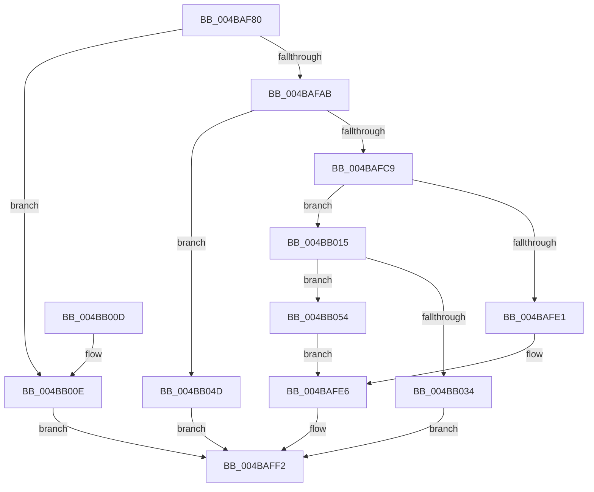

# VslAllocatePool

- RVA: `0x004BAF80`–`0x004BB060` (길이 `224` bytes)
- VA: `0x00000001404BAF80`
- 실행 섹션: `.text`
- PDB 이름 있음: `예`; PDB Function 태그: `아니요`
- unwind 정보 RVA: `0x000BB638`
- 디코드: `65`개 명령, `224/224` bytes 표시
- 미해석 바이트: `0` (있으면 어셈블리에 `.byte`로 보존)

> 이 문서는 커널 이미지의 기계어와 PDB 기호를 분석해 생성했습니다. 4번과 5번은 함수 원형과 자료형을 바이너리 사용 방식에서 추정한 C 해석이며 원본 소스 복구 결과는 아닙니다.

## 1. Dependencies

- 직접 호출 지점: **5**; 고유 호출 대상: **3**
- 직접 호출자로 확인된 함수: **1**
- RIP 상대 이미지 참조: **0**

### Outgoing calls
- `0x004BAFB8` → [ExAllocatePool2](../../poolcode/B8/ExAllocatePool2_function_00B820F0.md) (function, `0x00B820F0`)
- `0x004BAFD4` → [ExAllocatePool2](../../poolcode/B8/ExAllocatePool2_function_00B820F0.md) (function, `0x00B820F0`)
- `0x004BAFEB` → [ExFreePoolWithTag](../../poolcode/B8/ExFreePoolWithTag_function_00B82870.md) (function, `0x00B82870`)
- `0x004BB029` → [VslpLockPagesForTransfer](../29/VslpLockPagesForTransfer_function_0029E0FC.md) (function, `0x0029E0FC`)
- `0x004BB059` → [ExFreePoolWithTag](../../poolcode/B8/ExFreePoolWithTag_function_00B82870.md) (function, `0x00B82870`)

### Direct callers
- [sub_006F88AE](../6F/Unknown_function_006F88AE.md) at `0x006F8B7D`

### Static image references
- 디코드된 RIP-relative 메모리 참조가 없습니다.

## 2. Other-region calls and transfers

- 다른 실행 섹션으로 향하는 call: **4**
  - `0x004BAFB8` → [ExAllocatePool2](../../poolcode/B8/ExAllocatePool2_function_00B820F0.md) (`.text` → `POOLCODE`)
  - `0x004BAFD4` → [ExAllocatePool2](../../poolcode/B8/ExAllocatePool2_function_00B820F0.md) (`.text` → `POOLCODE`)
  - `0x004BAFEB` → [ExFreePoolWithTag](../../poolcode/B8/ExFreePoolWithTag_function_00B82870.md) (`.text` → `POOLCODE`)
  - `0x004BB059` → [ExFreePoolWithTag](../../poolcode/B8/ExFreePoolWithTag_function_00B82870.md) (`.text` → `POOLCODE`)
- 별도 외부 분기/꼬리 이동을 확인하지 못했습니다.

## 3. Assembly (complete function range)

```asm
004BAF80  48 8B C4                        mov rax, rsp
004BAF83  48 89 58 08                     mov qword ptr [rax + 8], rbx
004BAF87  48 89 70 10                     mov qword ptr [rax + 0x10], rsi
004BAF8B  48 89 78 18                     mov qword ptr [rax + 0x18], rdi
004BAF8F  4C 89 70 20                     mov qword ptr [rax + 0x20], r14
004BAF93  41 57                           push r15
004BAF95  48 83 EC 30                     sub rsp, 0x30
004BAF99  4D 8B F1                        mov r14, r9
004BAF9C  4D 8B F8                        mov r15, r8
004BAF9F  48 8B D9                        mov rbx, rcx
004BAFA2  48 81 F9 00 A0 1F 00            cmp rcx, 0x1fa000
004BAFA9  77 63                           ja 0x1404bb00e
004BAFAB  44 8B C2                        mov r8d, edx
004BAFAE  BF 40 00 00 00                  mov edi, 0x40
004BAFB3  48 8B D1                        mov rdx, rcx
004BAFB6  8B CF                           mov ecx, edi
004BAFB8  E8 33 71 6C 00                  call 0x140b820f0
004BAFBD  48 8B F0                        mov rsi, rax
004BAFC0  48 85 C0                        test rax, rax
004BAFC3  0F 84 84 00 00 00               je 0x1404bb04d
004BAFC9  8D 57 08                        lea edx, [rdi + 8]
004BAFCC  41 B8 56 6D 73 54               mov r8d, 0x54736d56
004BAFD2  8B CF                           mov ecx, edi
004BAFD4  E8 17 71 6C 00                  call 0x140b820f0
004BAFD9  48 8B F8                        mov rdi, rax
004BAFDC  48 85 C0                        test rax, rax
004BAFDF  75 34                           jne 0x1404bb015
004BAFE1  BB 9A 00 00 C0                  mov ebx, 0xc000009a
004BAFE6  33 D2                           xor edx, edx
004BAFE8  48 8B CE                        mov rcx, rsi
004BAFEB  E8 80 78 6C 00                  call 0x140b82870
004BAFF0  8B C3                           mov eax, ebx
004BAFF2  48 8B 5C 24 40                  mov rbx, qword ptr [rsp + 0x40]
004BAFF7  48 8B 74 24 48                  mov rsi, qword ptr [rsp + 0x48]
004BAFFC  48 8B 7C 24 50                  mov rdi, qword ptr [rsp + 0x50]
004BB001  4C 8B 74 24 58                  mov r14, qword ptr [rsp + 0x58]
004BB006  48 83 C4 30                     add rsp, 0x30
004BB00A  41 5F                           pop r15
004BB00C  C3                              ret
004BB00D  CC                              int3
004BB00E  B8 BB 00 00 C0                  mov eax, 0xc00000bb
004BB013  EB DD                           jmp 0x1404baff2
004BB015  83 64 24 20 00                  and dword ptr [rsp + 0x20], 0
004BB01A  41 B9 01 00 00 00               mov r9d, 1
004BB020  44 8B C3                        mov r8d, ebx
004BB023  48 8B D6                        mov rdx, rsi
004BB026  48 8B CF                        mov rcx, rdi
004BB029  E8 CE 30 DE FF                  call 0x14029e0fc
004BB02E  8B D8                           mov ebx, eax
004BB030  85 C0                           test eax, eax
004BB032  78 20                           js 0x1404bb054
004BB034  48 8B 47 38                     mov rax, qword ptr [rdi + 0x38]
004BB038  49 89 07                        mov qword ptr [r15], rax
004BB03B  48 8B 07                        mov rax, qword ptr [rdi]
004BB03E  49 89 06                        mov qword ptr [r14], rax
004BB041  48 8B 44 24 60                  mov rax, qword ptr [rsp + 0x60]
004BB046  48 89 38                        mov qword ptr [rax], rdi
004BB049  33 C0                           xor eax, eax
004BB04B  EB A5                           jmp 0x1404baff2
004BB04D  B8 9A 00 00 C0                  mov eax, 0xc000009a
004BB052  EB 9E                           jmp 0x1404baff2
004BB054  33 D2                           xor edx, edx
004BB056  48 8B CF                        mov rcx, rdi
004BB059  E8 12 78 6C 00                  call 0x140b82870
004BB05E  EB 86                           jmp 0x1404bafe6
```

## 4. C-style interpretation (structured pseudocode)

```c
__int64 __fastcall VslAllocatePool(__int64 a1, int a2, __int64 a3, __int64 a4, __int64 a5)
{
    __int64 result;
    __int64 v_rsp;
    unsigned __int64 v_stack_p10;
    unsigned __int64 v_stack_p18;
    unsigned __int64 v_stack_p20;
    unsigned __int64 v_stack_p8;

    *(unsigned __int64 *)(v_rsp + 8) = v_rbx;
    *(unsigned __int64 *)(v_rsp + 16) = v_rsi;
    *(unsigned __int64 *)(v_rsp + 24) = v_rdi;
    *(unsigned __int64 *)(v_rsp + 32) = v_r14;
    v_rsp = (v_rsp) - (48);
    if (a1 > 0x1FA000ULL) goto loc_004BB00E;
    result = ExAllocatePool2(64, a1, (unsigned int)(a2), a4);
    if (result == 0) goto loc_004BB04D;
    result = ExAllocatePool2(64, 64 + 8, (unsigned int)(0x54736D56ULL), a4);
    if (result != 0) goto loc_004BB015;
loc_004BAFE6:
    a2 = 0;
    result = ExFreePoolWithTag(result, a2, (unsigned int)(0x54736D56ULL), a4);
loc_004BAFF2:
    v_rsp = (v_rsp) + (48);
    return (unsigned int)((unsigned int)((unsigned int)(0xC000009AULL)));
loc_004BB00E:
    goto loc_004BAFF2;
loc_004BB015:
    result = VslpLockPagesForTransfer(v_stack_p18, v_stack_p10, (unsigned int)((unsigned int)(v_stack_p8)), 1);
    if (sign_flag) goto loc_004BB054;
    *(unsigned __int64 *)(a3) = *(unsigned __int64 *)(v_stack_p18 + 56);
    *(unsigned __int64 *)(v_stack_p20) = *(unsigned __int64 *)(v_stack_p18);
    *(unsigned __int64 *)(a5) = v_stack_p18;
    result = 0;
    goto loc_004BAFF2;
loc_004BB04D:
    goto loc_004BAFF2;
loc_004BB054:
    a2 = 0;
    result = ExFreePoolWithTag(v_stack_p18, a2, (unsigned int)((unsigned int)(v_stack_p8)), 1);
    goto loc_004BAFE6;
}
```

## 5. (Beta) C Style

```c
int64_t VslAllocatePool(int64_t Arg1, int32_t Arg2, void *Arg3, void *Arg4, void *Arg5)
{
    uint8_t *arg3 = (uint8_t *)Arg3;
    uint8_t *arg4 = (uint8_t *)Arg4;
    uint8_t *arg5 = (uint8_t *)Arg5;

    int64_t result;
    int64_t local_rsp;
    uint64_t v_stack_p10;
    uint64_t v_stack_p18;
    uint64_t v_stack_p20;
    uint64_t v_stack_p8;

    *(uint64_t *)(local_rsp + 0x8) = local_rbx;
    *(uint64_t *)(local_rsp + 0x10) = local_rsi;
    *(uint64_t *)(local_rsp + 0x18) = local_rdi;
    *(uint64_t *)(local_rsp + 0x20) = local_r14;
    local_rsp = (local_rsp) - (48);
    if (Arg1 > 0x1FA000ULL) goto loc_004BB00E;
    result = ExAllocatePool2(64, Arg1, (uint32_t)(Arg2), Arg4);
    if (result == 0) goto loc_004BB04D;
    result = ExAllocatePool2(64, 64 + 8, (uint32_t)(0x54736D56ULL), Arg4);
    if (result != 0) goto loc_004BB015;
loc_004BAFE6:
    Arg2 = 0;
    result = ExFreePoolWithTag(result, Arg2, (uint32_t)(0x54736D56ULL), Arg4);
loc_004BAFF2:
    local_rsp = (local_rsp) + (48);
    return (uint32_t)((uint32_t)((uint32_t)(0xC000009AULL)));
loc_004BB00E:
    goto loc_004BAFF2;
loc_004BB015:
    result = VslpLockPagesForTransfer(v_stack_p18, v_stack_p10, (uint32_t)((uint32_t)(v_stack_p8)), 1);
    if (sign_flag) goto loc_004BB054;
    *(uint64_t *)(arg3) = *(uint64_t *)(v_stack_p18 + 0x38);
    *(uint64_t *)(v_stack_p20) = *(uint64_t *)(v_stack_p18);
    *(uint64_t *)(arg5) = v_stack_p18;
    result = 0;
    goto loc_004BAFF2;
loc_004BB04D:
    goto loc_004BAFF2;
loc_004BB054:
    Arg2 = 0;
    result = ExFreePoolWithTag(v_stack_p18, Arg2, (uint32_t)((uint32_t)(v_stack_p8)), 1);
    goto loc_004BAFE6;
}
```

### 관측된 메모리 오프셋

구조체 형식이 확인되지 않은 접근은 인자 기준의 오프셋으로만 기록했습니다.

| 기준 인자 | 오프셋 표현 | 폭 (bit) | 접근 |
|---|---:|---:|---|
| `Arg3` | `+ 0x0` | `64` | `W` |
| `Arg4` | `+ 0x0` | `64` | `W` |
| `Arg5` | `+ 0x0` | `64` | `W` |

## 6. Execution-region graph

[열기: 2D/3D 그래프와 함수 탐색 컨트롤 패널](../../../control-panel.html?section=text&rva=0x004BAF80&view=graph)

- 2D 그래프는 위에서 아래로 흐르고, 3D 그래프는 빈 공간을 드래그해 회전합니다. Shift+드래그는 이동, 휠은 확대·축소, 함수 노드 선택은 대상 보고서 이동입니다.

### Static fallback


